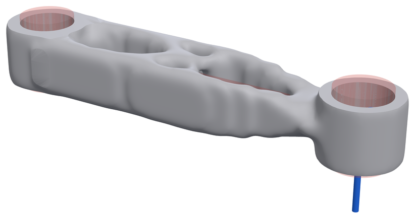
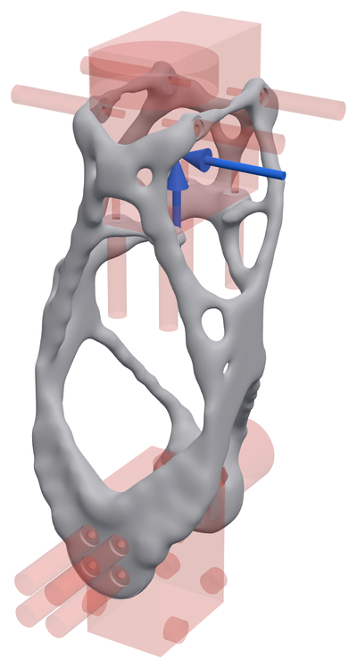
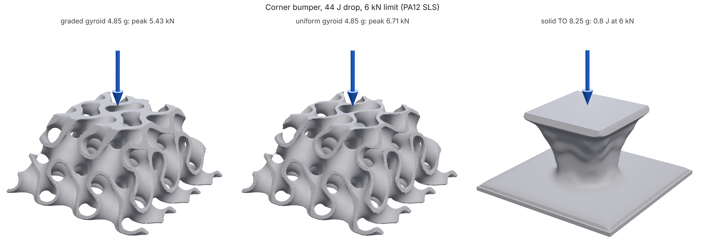

# loadpath

Engineering checks and generative design for parts you are going to print,
built for people and coding agents that make CAD.

CAD generators (build123d, CadQuery, text-to-CAD tools) make geometry. They
don't tell you whether a part is strong enough, thick enough or will fit. loadpath does:

- **Optimize.** Describe what a part must keep, what it must avoid, where it is held
  and how hard it is pushed. loadpath returns the lightest printable shape that
  carries the loads, verified by a fresh FEA of the delivered mesh.
- **Check.** `loadpath.checks` has printability (wall thickness, overhangs, trapped
  voids), component fit, fluid-network isolation, a quick FEA probe and an SDF toolkit.
- **Model with fields.** A part can be a graph of implicit fields, nTop style: the
  skin thickens where the stress is, the lattice cell grows away from the bolts, the
  fillet is larger where the load comes in, and the mesh comes out smooth
  ([docs/fields.md](docs/fields.md)). `loadpath edit` opens the graph in a browser
  editor with sliders and a live GPU preview. Bores, bolt faces and keep-outs cut with a
  plain shape keep exact, sharp edges.
- **CAD in.** `loadpath import part.step` reads a STEP (or STL) part, heals open
  shells, finds its bores, counterbores, bolt patterns and flat mounting faces, and
  drafts a study: the part as design space, every interface preserved, every bore a
  keep-out, and a suggested support and load to replace with the real ones
  ([docs/IMPORT.md](docs/IMPORT.md)).
- **STEP out.** `--step` writes the part as a B-rep for CAD: keep-outs, preserved
  shapes and the design space as true planes and cylinders, the organic body faceted
  (`loadpath[step]`, OpenCascade).
- **For the process you print with.** FDM (bridges, islands, bed, layer bond), powder
  nylon (SLS, MJF: trapped powder, escape holes, warp-prone panels), resin (SLA, DLP:
  supports, peel area, suction cups, trapped resin) and powder-bed metal (internal
  ceilings, powder clean-outs), each with material cards.
- **Sliced, not guessed (FDM).** With PrusaSlicer installed, every outcome is sliced
  headless for print time, filament and support; `"goal": {"minimize": "printTime"}`
  delivers the fastest passing part, and `"slicer": {"grade": true}` sizes infill
  region by region from the stress and writes it as slicer modifiers in a graded 3MF
  ([docs/slicer.md](docs/slicer.md)).

### Why agents like it

- **One JSON study in, one JSON report out.** Keep-outs, preserved faces, loads and
  goals are plain shapes and numbers an agent can write from a CAD script; the report
  says pass or fail and why, in units (`safetyFactor`, `p5Member`, `bodies`, ...).
- **MCP or CLI.** `loadpath mcp` is a stdio MCP server; `loadpath run study.json`
  does the same from a shell. No GUI, no GPU, no license server.
- **Renders it can look at.** Every outcome comes with clay renders, and stress maps
  are one call away, so a vision model can sanity-check the shape before the user does.
- **Every mistake at once.** `loadpath check` validates against a published JSON
  Schema and returns every problem by path, with "did you mean" for a misspelt key,
  so an agent fixes a study in one round trip.
- **A skill that knows the pitfalls.** [`loadpath/SKILL.md`](loadpath/SKILL.md) tells
  the agent how to write a study and what to check in the report before trusting it.

Units are millimetres, newtons, megapascals. See [`loadpath/README.md`](loadpath/README.md)
for the method, the study format, goals and limits.

**Tutorials.** Six workflows end to end, each with its files, commands, the numbers
you should get and renders, and each run by CI so it can't go stale
([docs/tutorials/](docs/tutorials/)): an FDM bracket to a 3MF, a graded SLS lattice
with powder drains, a simulated metal heat exchanger, an impact bumper, a part drawn in
the field editor and tuned, and an arm link loaded by its robot's URDF. Every command
takes `--quick` for a first look in a minute or two.

<!-- gallery:start -->

## Examples

The eval cases (14/14 passing): GRIP robot-arm style parts, each optimized and then checked by a fresh FEA of the delivered mesh. Blue arrows are loads, red is keep-out. Every view, stress map and number is in [docs/GALLERY.md](docs/GALLERY.md).

<table>
<tr>
<td align="center" valign="top"><br><b>arm-link</b><br><sub>59.6 g · 52% lighter · SF 14.06 · pass</sub></td>
<td align="center" valign="top"><br><b>arm-link-cast</b><br><sub>71.3 g · 43% lighter · SF 19.39 · pass</sub></td>
<td align="center" valign="top"><br><b>arm-link-driven</b><br><sub>47.3 g · 62% lighter · SF 11.25 · pass</sub></td>
</tr>
<tr>
<td align="center" valign="top"><br><b>bell-crank</b><br><sub>24.3 g · 84% lighter · SF 3.34 · pass</sub></td>
<td align="center" valign="top"><br><b>grip-turret</b><br><sub>149.1 g · 91% lighter · SF 2.32 · pass</sub></td>
<td align="center" valign="top"><br><b>grip-upper-arm</b><br><sub>209.5 g · 88% lighter · SF 5.14 · pass</sub></td>
</tr>
<tr>
<td align="center" valign="top"><br><b>grip-wrist-link-mjf</b><br><sub>37.1 g · 95% lighter · SF 3.08 · pass</sub></td>
<td align="center" valign="top"><br><b>grip-wrist-yoke</b><br><sub>23.7 g · 90% lighter · SF 2.39 · pass</sub></td>
<td align="center" valign="top"><br><b>mbb-beam</b><br><sub>22.5 g · 66% lighter · SF 1.52 · pass</sub></td>
</tr>
<tr>
<td align="center" valign="top"><br><b>motor-mount</b><br><sub>27.5 g · 69% lighter · SF 3.87 · pass</sub></td>
<td align="center" valign="top"><br><b>printed-hook</b><br><sub>31.0 g · 80% lighter · SF 2.95 · pass</sub></td>
<td align="center" valign="top"><br><b>wall-bracket</b><br><sub>64.6 g · 85% lighter · SF 2.57 · pass</sub></td>
</tr>
<tr>
<td align="center" valign="top"><br><b>wall-bracket-fasteners</b><br><sub>45.7 g · 89% lighter · SF 2.51 · pass</sub></td>
</tr>
</table>

Where the load goes: von Mises stress, blue (none) to red (the part's 98th percentile), on the part bent by its worst load case:

<table>
<tr>
<td align="center" valign="top"><br><sub>bell-crank</sub></td>
<td align="center" valign="top"><br><sub>grip-upper-arm</sub></td>
<td align="center" valign="top"><br><sub>printed-hook</sub></td>
</tr>
</table>

Two-fluid heat exchangers: two isolated channel networks through one sheet gyroid, with headers that print without support.


Printed in metal, nothing inside can be supported: the channels end in peaked roofs instead of flat ceilings (red).


Made another way: the same arm link printed, cast (no undercuts along z), 3-axis milled from both sides with a 6 mm cutter, and with members capped at 6 mm. Each meets SF 3 and 0.5 mm.


<sub>Rendered 2026-10-31 from `25376bc` by `python docs/gallery.py`.</sub>

<!-- gallery:end -->

### Field-driven parts

A part can also be a graph of fields ([docs/fields.md](docs/fields.md)). Here the
arm link's skin and gyroid wall follow its own stress (colour) and the cells grow
away from the bearings. At the same 52 g as a uniform lattice it has SF 14.8 and
0.65 mm deflection, against SF 11.8 and 0.74 mm (`python examples/fields/arm_link.py`).


`loadpath edit` opens a graph in the browser: nodes and wires below, an inspector
with a slider for every number, and the part above, raymarched on the GPU from the
graph itself, so it redraws as a slider moves. Here the arm link is cut open and
painted with its stress, showing the graded gyroid inside the skin. Run meshes it
for real and shows the report.


`loadpath tune` (or Tune in the editor) turns the numbers you pick until the part
is as light as it can be while it still meets a study's safety factor and
deflection, each candidate meshed and analyzed by FE: the arm link's web and blend
went from 61.8 g to 54.9 g at its 0.5 mm stiffness limit in 25 analyses.


A graded cell bends the lattice's coordinates, so walls run continuously from 4 mm
to 12 mm cells:


A skin over a lattice traps powder or resin. Give the graph a `"process"` and it
drills its own drain holes, sized well over the process minimum (6 mm for SLS) and
added until no powder is more than 60 mm from one, on bosses, at the calmest flat
faces clear of the bearing seats. Then it checks that nothing is still sealed and
the escape ball reaches every chamber. The arm link takes 14 holes; SF 13.5
against 13.4 undrilled, 10% softer.


### Impact: where lattices beat solid TO

A stiff part is the wrong way to stop a falling mass: it stores energy as a spring
and pushes back hard. A graph's `impact` block crushes a TPMS core layer by layer,
using plateau strengths from unit-cell plastic collapse, and grades its density so
every layer crushes at the same force ([docs/IMPACT.md](docs/IMPACT.md)). Test case:
a corner bumper stopping a 5 kg robot falling 0.9 m (44 J) under a 6 kN limit. The
graded gyroid (4.85 g) peaks at 5.4 kN. Grading per cell in 3D (4.39 g) brings
that to 5.2 kN. A uniform core of the same mass peaks at 6.7 kN. Solid TO of the
same envelope (8.25 g) holds only 0.8 J within the limit
(`python examples/impact/end_stop.py`). TPU uses an elastic buckling law for
small knocks: a forearm pad takes 0.75 J at 114 N against a 140 N limit, impact-rate stiffening included
(`examples/impact/knock_pad.py`). Graded TPU lattice feet tune a vibration isolator
under an off-centre robot. They are tuned at TPU's dynamic stiffness, which is
1.5x its static stiffness at 35 Hz and modelled with creep from sourced data
(`viscoelastic.py`). The payload sits level and stays level as the feet creep
over 10 years, a vertical shake no longer rocks it, and it takes 23% more shock
before a foot buckles (`examples/isolator/mount.py`).

### Compliant mechanisms

Grippers and flexures that are meant to bend (`mechanism.py`). On the
textbook force inverter and gripper, loadpath matches a port of Sigmund's
99-line mechanism code within 1-2% at equal volume, with crisp designs. A
robust option rules out one-node hinges. Designs are then driven through a
servo's stroke with large deflections (`stroke_mechanism`). A TPU gripper
grips with 5.4 N at a 3 mm stroke with no corner hinges, and its grip
relaxes to 3.8 N over a day as the TPU creeps. The textbook design with the
same springs relies on 7 corner hinges and its large-deflection solve stops
at a fifth of the stroke. For long strokes, `mechanism_nl.py` optimizes on
the large-deflection response itself: on the inverter driven through 30%
of its length it moves the output 18% further than the linear design, with
no corner hinge ([docs/MECHANISMS.md](docs/MECHANISMS.md)).



## Install

```
pip install "loadpath[mcp] @ git+https://github.com/connorwhite-online/loadpath"
loadpath examples shelf-bracket > bracket.json
loadpath check bracket.json            # every problem at once, with suggestions
loadpath run bracket.json --out out/   # optimize, mesh, verify, render
loadpath run bracket.json --recall     # re-run: start from what earlier runs found
loadpath mcp                           # stdio MCP server for agents
```

Also: `loadpath lattice` (fill a part with a stress-graded TPMS lattice),
`loadpath heatx` (two-fluid TPMS heat exchangers), `loadpath field` (a part as a
graph of fields, [docs/fields.md](docs/fields.md)), `loadpath edit` (edit a field
graph in the browser with a live preview), `loadpath import` (a STEP or STL part as a
draft study, [docs/IMPORT.md](docs/IMPORT.md)), `loadpath tune` (tune a graph's numbers
against a study's limits), `loadpath schema` (JSON Schemas, also
in [`schema/`](schema/)).

Large studies (100k+ cells) solve with matrix-free multigrid; install the `gpu`
extra (`loadpath[mcp,gpu]`, PyTorch) to run it on an NVIDIA GPU, an Apple
Silicon GPU, or torch's threaded CPU kernels. The same extra evaluates field
graphs on the GPU when meshing (`LOADPATH_FIELD_DEVICE=torch` uses torch on the
CPU, 1.7x faster than numpy on the arm link). Without it everything runs on
numpy as before.

- [Quickstart](docs/quickstart.md): install to a verified part in ten minutes.
- [Agents](docs/agents.md): the MCP server, its tools and the loop to follow.
  [`loadpath/SKILL.md`](loadpath/SKILL.md) is the skill.
- [Reference](loadpath/README.md): the method, every study field, the report, limits.
- [Benchmarks](docs/BENCHMARKS.md): loadpath against top88 and top3d on the textbook
  problems (MBB beam, L-bracket, 3D cantilever, 3D bridge) and the GE bracket challenge.
- [Materials](docs/materials.md): the material library, every value cited to its
  datasheet (`loadpath materials`), across-layer values, overrides.
- [Calibration](docs/CALIBRATION.md): coupons to print and test at home, and a fit
  that turns the measurements into a material card for your printer.
- [Examples](loadpath/examples/): a fastened bracket, a robot arm link, a
  lattice-filled pedal, two heat exchangers.

## Tests

```
python3 tests/test_loadpath.py
python3 tests/run_tests.py
python3 tests/test_interface.py
python3 tests/test_pressure.py
python3 tests/test_process.py
python3 tests/test_fields.py
python3 tests/test_sharp.py
python3 tests/test_editor.py      # the GPU part needs node and Playwright
python3 tests/test_impact.py
python3 tests/test_recall.py
python3 tests/test_assembly.py
python3 tests/test_cadimport.py
python3 tests/test_evals.py
python3 -m loadpath.evals.run --tier coarse --corpus 6 --out evals-coarse/   # minutes: every push
python3 -m loadpath.evals.run --out evals-out/                               # full suite
python3 tests/test_benchmarks.py
python3 -m loadpath.benchmarks.run --out bench-out/
python3 docs/gallery.py --evals evals-out/    # refresh the gallery renders from that run
```

## License

MIT
