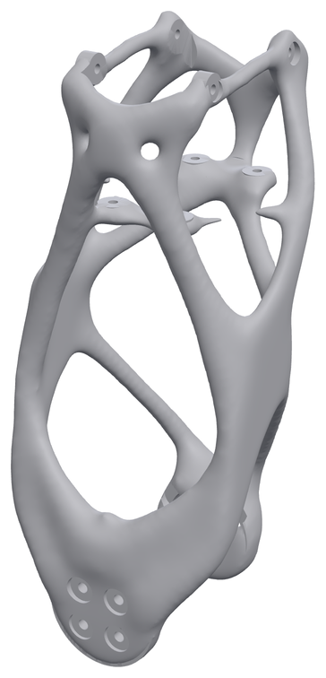
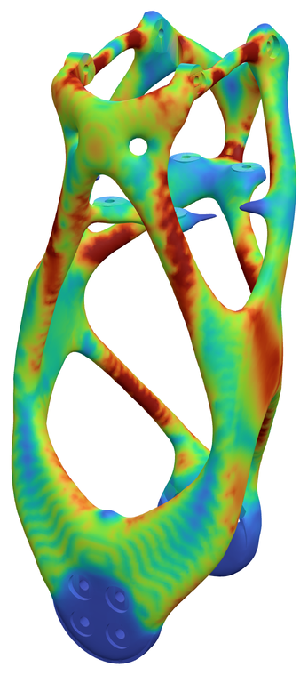
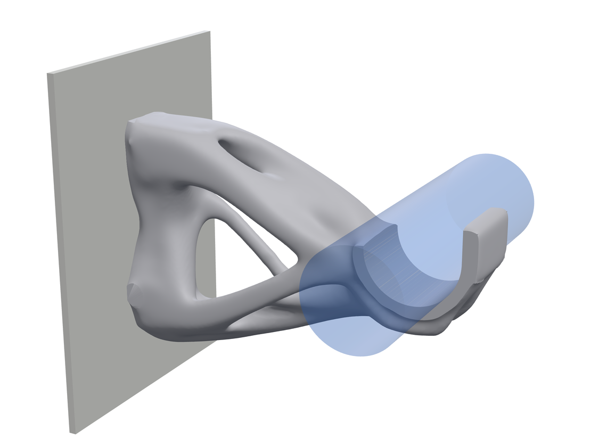
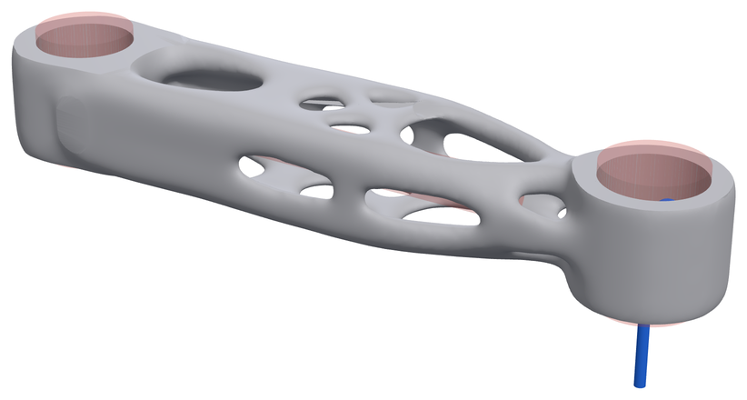
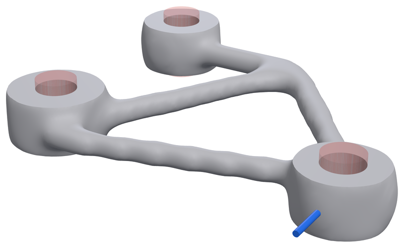
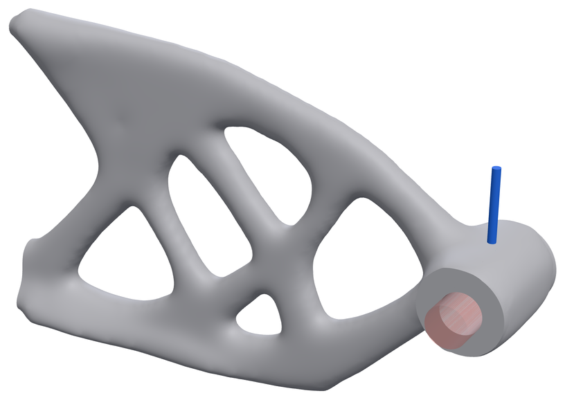
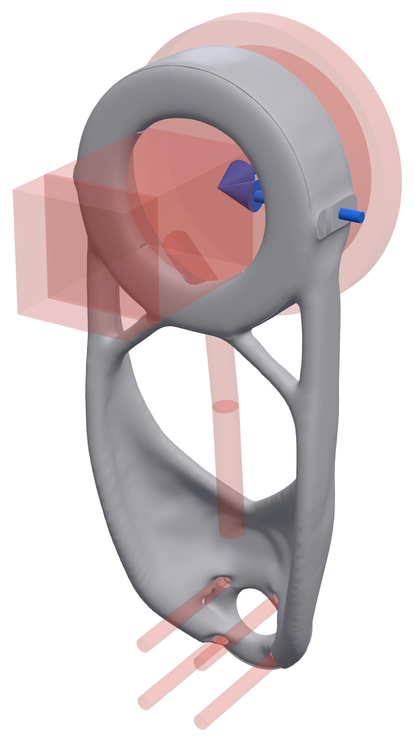
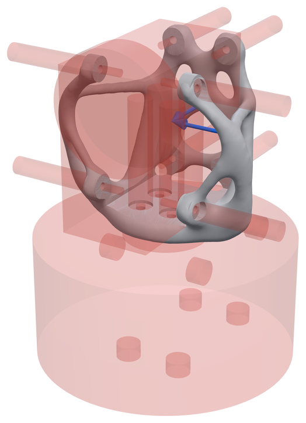
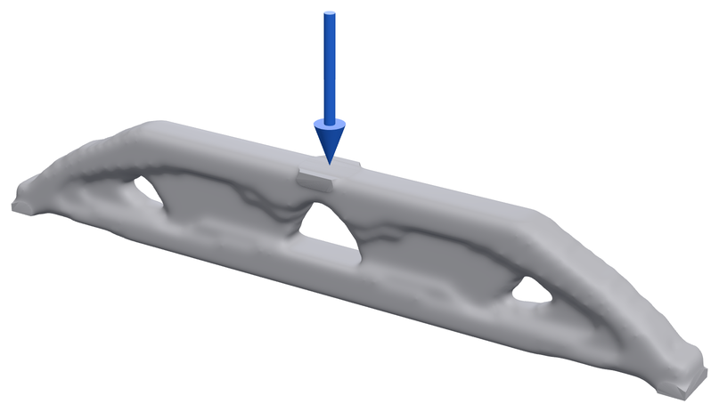

# loadpath

**Generative design for 3D printed parts, driven by your coding agent.**
Describe the part. loadpath grows it from the loads, cuts its mounts and holes
exactly, checks it with a fresh analysis, and hands back a printable file with
a pass/fail report.

<table>
<tr>
<td align="center" width="50%"></td>
<td align="center" width="50%"></td>
</tr>
<tr>
<td align="center" colspan="2"><sub>A robot-arm wrist link as delivered (left) and its stress from a fresh analysis
(right, blue low to red high). MJF nylon, 40.2 g, safety factor 5.8.</sub></td>
</tr>
</table>

## Quick start

```bash
pip install "loadpath[mcp]"
claude mcp add loadpath -- loadpath mcp   # or any MCP client: {"command": "loadpath", "args": ["mcp"]}
```

Then ask your agent:

> I need a hook to hang my bike on the garage wall.

You don't give it numbers. The agent works out the loads and constraints, writes
them into a study, runs loadpath, and reads the report. For this ask it decided:

- **Load**: a bike up to 15 kg, hanging for ten years. Lifting it on or off is 1.5x that, about once a day. A sideways knock is half of it.
- **Fit**: a top tube up to 50 mm wide, held 165 mm out so the handlebars and pedals clear the wall.
- **Mount**: two #10 wood screws into one stud.
- **Material**: PA 12 (MJF). It tried PETG first, but daily lifting fatigued the printed layers near the screws.

<table>
<tr>
<td align="center"></td>
</tr>
<tr>
<td align="center"><sub>The hook it delivered, with the top tube shown in blue. 293 g, safety factor 2.8 under the lift-on load.
<a href="examples/readme/bike-hook/">Study and script</a>.</sub></td>
</tr>
</table>

Everything runs on your machine.

## What you get

- **A part file**: STL, 3MF or STEP, watertight, with bores and bolt holes cut to fit.
- **A report**: mass, safety factor, deflection, thinnest wall, and whether every hole, mount and clearance came through.
- **A check you can trust**: the delivered mesh is analysed again, independently of the optimizer.
- **Process rules**: FDM, SLS, MJF, resin, metal printing, casting and milling.

## What it can do

- **Lightweight structural parts**: brackets, links, mounts, hooks, cranks.
- **Products inside a designer's exterior**: place the board, battery and ports, then design the interior for drops, feel and heat ([docs/ENCLOSURE.md](docs/ENCLOSURE.md)).
- **Start from what you have**: a STEP file, a 3D scan, a KiCad board, a robot's URDF, or a generated mesh.
- **Lattices and heat exchangers**: graded gyroids and strut lattices, with flow and heat solved.
- **More physics**: buckling, fatigue, impact, flexures, print warp, casting, antennas.

## Where it fits

Topology optimization codes stop at a density field. Script CAD and AI CAD
tools draw shapes but don't know the loads. loadpath is the layer between:
load-aware shapes, checked and ready to make.

<!-- gallery:start -->

## Examples

Parts from the eval suite (15/15 pass on a fresh analysis of the delivered mesh). Blue arrows are loads, red is space to keep clear. Simulated results: every view, stress map and number is in [docs/GALLERY.md](docs/GALLERY.md).

<table>
<tr>
<td align="center" valign="top"><br><b>arm link</b><br><sub>55.3 g · safety factor 8.9</sub></td>
<td align="center" valign="top"><br><b>bell crank</b><br><sub>23.4 g · safety factor 3.2</sub></td>
<td align="center" valign="top"><br><b>printed hook</b><br><sub>24.2 g · safety factor 2.7</sub></td>
</tr>
<tr>
<td align="center" valign="top"><br><b>robot upper arm</b><br><sub>207.7 g · safety factor 7.3</sub></td>
<td align="center" valign="top"><br><b>robot wrist yoke</b><br><sub>17.3 g · safety factor 3.9</sub></td>
<td align="center" valign="top"><br><b>mbb beam</b><br><sub>13.8 g · safety factor 1.5</sub></td>
</tr>
</table>

<sub>Rendered 2026-11-03 from `6c97b57` by `python docs/gallery.py`.</sub>

<!-- gallery:end -->

## Learn more

- [Everything in detail](docs/CAPABILITIES.md): every feature, speed, case studies, limits, CLI and Python.
- [Quickstart](docs/quickstart.md) and [tutorials](docs/tutorials/): from install to a checked part.
- [For agents](docs/agents.md): the MCP tools and workflow. The agent's own guide is [loadpath/SKILL.md](loadpath/SKILL.md).
- [How much to trust it](docs/VALIDATION.md): what each model has been checked against. Results are simulated.
- [Study reference](loadpath/README.md): every study field and the report.

## License

MIT
