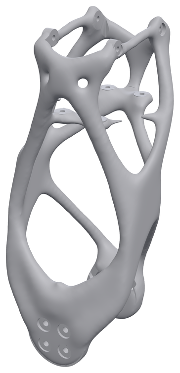
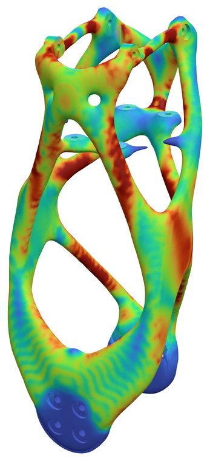
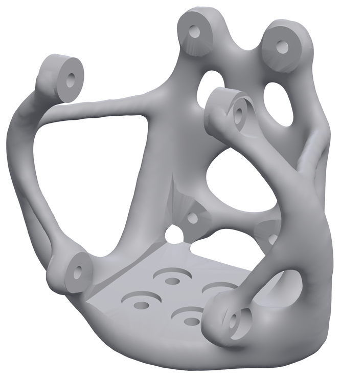
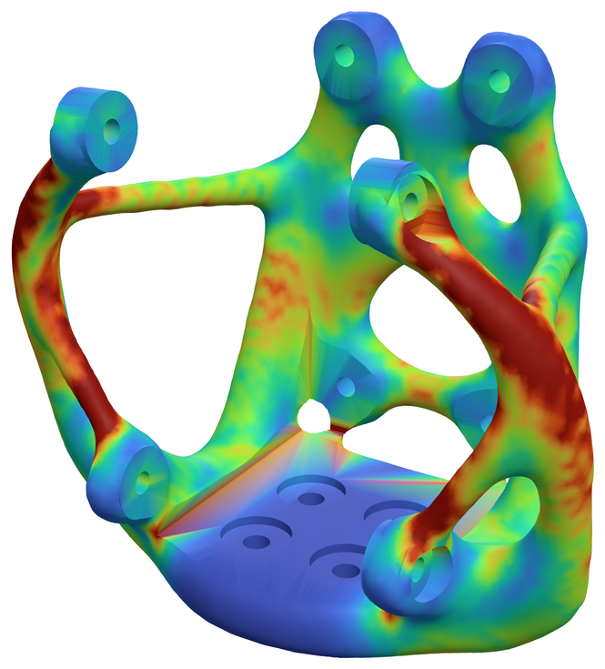
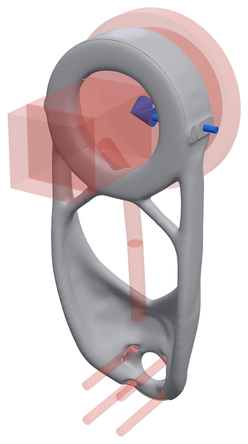
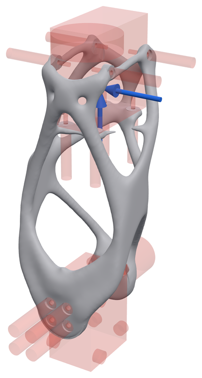
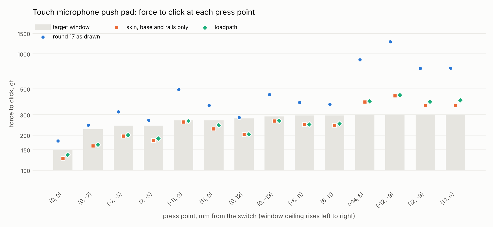
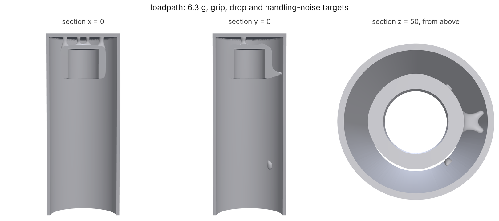
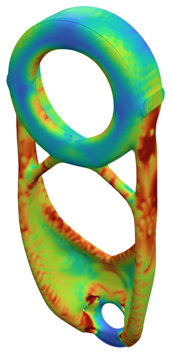

# loadpath

Generative design for 3D printed parts (and cast or milled ones), built to be
driven by coding agents. Tell your agent what you want to build. It works out
the engineering from there: where the part mounts, what it has to carry, which
bores, bolt patterns and clearances must survive, and how it will be made.
loadpath grows the part with topology optimization, meshes it as a watertight
solid with the interfaces cut exactly, and checks that mesh with a fresh finite
element analysis. You get an STL, 3MF or STEP and a report: mass, safety
factor, deflection, thinnest member, whether every interface and clearance
came through, what each bearing seat, pin hole and bolt hole will measure as
built and whether its fit holds, printability, pass or fail.

<table>
<tr>
<td align="center" width="50%"></td>
<td align="center" width="50%"></td>
</tr>
<tr>
<td align="center" width="50%"></td>
<td align="center" width="50%"></td>
</tr>
<tr>
<td align="center" colspan="2"><sub>Two robot-arm parts as loadpath delivered them (left) and their stress from a fresh
analysis of that mesh (right), blue (none) to red (the part's 98th percentile), on the shape bent by the worst
load case. Top: a wrist link between two servos, MJF nylon, 40.2 g, safety factor 5.8. Bottom: a servo cradle
held only at its eight screw bosses, glass-filled SLS nylon, 17.3 g, safety factor 3.9. More in
<a href="#examples">Examples</a>.</sub></td>
</tr>
</table>

## Point your agent at it

```bash
pip install "loadpath[mcp]"
claude mcp add loadpath -- loadpath mcp   # any MCP client: {"command": "loadpath", "args": ["mcp"]}
```

Then ask in plain words:

> I need a PETG bracket to hold a 10 kg shelf off the wall.

or hand it what you already have: a STEP of the part to lighten, a URDF of
the arm the link goes in, a photo or sketch. The agent turns that into a
study. It reads bores, bolt patterns and mounting faces out of CAD
(`loadpath_import_cad`), derives joint loads from a URDF's masses and motor
torques (`loadpath assembly`), sizes bolt clearance and driver paths from the
fastener, picks the fit each hole needs (a bearing presses in, a locating pin
slips, a shaft turns, a bolt passes) and draws the hole for the process so it
prints to that fit, and fills the gaps you didn't mention (screw size,
spacing, a safety factor for the use) with stated assumptions you can correct. `loadpath_check`
lints the setup before anything runs: missing or misspelled fields, a
keep-out cutting into a mounting boss, a bore with no open end, a part glued
down where it should be bolted. Then the agent runs it in the background and
reads the report back, including whether every interface survived, every
keep-out stayed clear, and every hole will fit what goes in it (or needs a
reamer). Its guide is [loadpath/SKILL.md](loadpath/SKILL.md) (the
`loadpath_guide` tool returns it); the tools and the loop are in
[docs/agents.md](docs/agents.md). The server runs locally and nothing
leaves the machine. Units are millimetres, newtons and megapascals. MIT
licensed.

## Where it fits

A designed part needs a shape, the loads it carries, and a way to make it.
The open tools each cover one of those:

- **Topology optimization codes** (top88, top3d, ToPy, FEniCS scripts) are
  research solvers. They stop at a density field on a grid: no printable
  part, and nothing checks the result.
- **Script CAD** (CadQuery, build123d, OpenSCAD), SDF libraries, AI CAD
  tools and 3D generators draw the shape but don't know the loads.
- **Commercial generative design** (Fusion, nTop) does the whole job, but
  it's built around a GUI, not an agent.

loadpath is the layer in between. The agent pulls the interfaces from CAD
(or from your description), works out the loads, material and process, and
loadpath returns a watertight
part checked by an analysis independent of the optimizer, with a JSON report
an agent can act on. Its STEP output goes back into CAD.

Where it is strongest:

- **The analysis behind the shape**: buckling, fatigue and creep,
  large-deflection compliant mechanisms, loads of unknown direction, thermal
  loads and print warp, all checked on the delivered mesh.
- **Inside an industrial design**: the designer's exterior kept as a thin
  cosmetic skin, every component's assembly path kept clear, and everything
  invisible designed for how the product should feel: a push pad that fires
  its switch at a chosen force anywhere on the touch area, a grip that gives
  just so much under a squeeze, a capsule or board cushioned for a fall,
  and handling vibration kept off a microphone capsule, with the least
  material ([docs/FEEL.md](docs/FEEL.md)). Where the exterior itself rules a target out, the report says
  where and by how much, and what skin or target change would fix it, for
  the designer to decide; loadpath never edits the exterior
  ([docs/SWITCH.md](docs/SWITCH.md)). `loadpath handoff` starts from what
  a designer hands over, the exterior and the component CAD in assembly
  order, and reads the study off the geometry: each part's way in (a board
  that has to slide back before it drops out included), the plunger over
  the switch, what the switch stands on, and a clearance per component.
- **Any exterior in**: you or your agent draw the shape, loadpath makes
  everything inside it work. A designer's STEP, a mesh, an SDF function
  (numpy, the `sdf` package, libfive style), a build123d part, or a mesh
  from a 3D generator such as Tripo or Meshy (holes, double walls, flipped
  patches, debris, unit scale) all go through one intake,
  `loadpath exterior`, which wraps a broken mesh into one closed skin on the
  generator's own triangles and says how much room is inside
  ([docs/EXTERIOR.md](docs/EXTERIOR.md)). In the
  [tutorial](docs/tutorials/generated-exterior/), an agent reads a
  paragraph about a camera shutter remote, finds the button in a generated
  pebble, lays out the board and battery, and gets the click it asked for
  without touching the exterior. Interiors go back out as SDF grids
  (`loadpath sdf`).
- **Implicit modelling**: field graphs, graded and conformal lattices (TPMS,
  strut, Voronoi), blends, and exact STEP of lattice parts.
- **Process awareness**: FDM, SLS, MJF, resin and powder-bed metal rules,
  plus casting and milling constraints, and hole fits: each bearing seat,
  pin hole and bolt hole drawn for how that process prints holes, with its
  as-built size checked on the delivered mesh.
- **Heat exchangers**: lattice-Boltzmann flow and conjugate heat transfer
  for gyroid cores and cold plates.

There is no GUI on purpose; it's a library.

## What it does

- **Topology optimization** on a voxel grid (SIMP with a density filter,
  Heaviside projection and a robust minimum-member formulation), searching
  for the lightest part that meets a safety factor and a deflection limit
  across several load cases. A stress-constrained mode (MMA) is available.
- **Verification of the delivered mesh**, not the optimizer's density
  field: the STL is analysed again, on a tetrahedral mesh when the
  `crosscheck` extra is installed and on a fine voxel grid otherwise. Keep-out
  intrusion and lost interface geometry are measured with exact booleans.
- **Process rules** for FDM (overhangs, bridges, layer bond), SLS and MJF
  (trapped powder, escape holes, warp-prone panels), resin (supports, peel,
  suction cups) and powder-bed metal (internal ceilings, powder
  clean-outs), plus milling and casting constraints.
- **Outcome exploration** (`loadpath explore`): one study solved once per
  manufacturing method and material (FDM, SLS, MJF, resin, LPBF metal,
  cast, 2.5/3/5-axis milled), each a full verified run, ranked by mass,
  estimated cost and lead time with Pareto fronts and the cheapest method
  at each order quantity.
- **Field modelling**: a part as a graph of implicit fields, so skins,
  lattices (TPMS and strut) and fillets can be graded by stress or by
  distance ([docs/fields.md](docs/fields.md)).
- **Other analyses**: large deflection and buckling, compliant mechanisms,
  thermal loads, fatigue and creep estimates, lattice crush and impact,
  vibration, lattice-Boltzmann flow and conjugate heat for heat exchangers
  and cold plates, and layer-by-layer warp and residual stress
  ([docs/BUILDSIM.md](docs/BUILDSIM.md)).
- **CAD in and out**: a STEP or STL part becomes a draft study with its
  bores and bolt patterns found ([docs/IMPORT.md](docs/IMPORT.md)); results
  export as STL, 3MF, and STEP with exact planes and cylinders at the
  interfaces; a lattice part (strut cells, TPMS, graded, skinned or open)
  goes to STEP lattice and all, as smooth patches on its true surface ([docs/fields.md](docs/fields.md#the-lattice-itself-in-the-step-lattice-exact)),
  and any closed STL, gyroid-cored and drained ones included, becomes one
  valid STEP solid with every tunnel kept (`loadpath step part.stl`, a
  minute for a 500k-triangle link).
- **Mesh checks without a study** (`loadpath.checks`): wall thickness,
  overhangs, trapped voids, fluid-network isolation, component fit.

## How much to trust it

Read [docs/VALIDATION.md](docs/VALIDATION.md) before relying on a number.
In short:

- **The solvers match analytic answers** in the test suite: beam
  deflection within 3-5%, stress at a hole within about 13%, Lamé pressure
  vessels within 5-11%, Poiseuille flow exactly.
- **The structural check is cross-checked**: CalculiX and loadpath's own
  tetrahedral solver agree within 0.1% on the same mesh. The voxel check
  reads 24-49% higher stress than the tet check, so it errs safe.
- **The optimizer is benchmarked**: 1-5% less stiff than top88 and top3d at
  equal material on three of their textbook problems, stiffer on the fourth.
- **Printed lattices match published tests**: against 33 published
  compression tests of printed lattices, the stiffness check has a median
  error of 1.23x (held out) and the strength check stays under the measured
  value on all 33.
- **Warp prediction is fitted to measured data** (NIST AM-Bench 2018 for
  LPBF IN625, a published ABS study for FDM) and misses other alloys and
  materials by 30-60%.
- **Everything else is simulation only**, including every part mass and
  safety factor in the case studies. The analysis is linear elastic with
  datasheet material values; printed parts vary with the printer.

## Case studies

Each states the problem, the setup, the numbers against a named baseline,
and the limitations ([docs/case-studies/](docs/case-studies/)).

| Case study | Result | Baseline |
| --- | --- | --- |
| [Eval suite](docs/case-studies/evals.md) | 15 of 15 parts meet their requirements on a fresh analysis of the delivered mesh | Each part's own requirements |
| [Robot arm](docs/case-studies/robot-arm.md) | A load sweep over the arm's URDF found 3 of 5 links below SF 1; the regrown set meets SF 2 and is 18% smaller | The robot arm's committed parts, made by an earlier loadpath with hand-written loads |
| [Arm link cores](docs/case-studies/arm-link-cores.md) | 42.2 g box section for FDM, 36.8 g hollow link for SLS, both at 0.5 mm and SF 3 | 54.9 g solid web; 54.2 g free-form topology optimization |
| [Liquid cold plate](docs/case-studies/cold-plate.md) | A die-graded gyroid ties streamline channels; channels filled with a graded gyroid run 7% cooler | Streamline channels and pin fins, equal metal and pressure drop |
| [TPU finger](docs/case-studies/tpu-finger.md) | up to 8 mm of tip curl for a 5 mm pull; a tendon finger grips 8x harder | A linear-model design (2.5 mm, then the solve fails); a plain bar of equal volume |
| [Benchmarks](docs/case-studies/benchmarks.md) | 1-5% less stiff than top88/top3d at equal material, in 57-60 iterations instead of 130-410 | Ports of top88 and top3d |

## Command line and Python

```bash
loadpath examples shelf-bracket > bracket.json
loadpath check bracket.json            # every problem at once, with suggestions
loadpath run bracket.json --out out/   # optimize, mesh, verify, render
```

`out/` gets an STL and a render per outcome and `report.json`. Every command
takes `--quick` for a first look in a minute or two.

Optional extras: `crosscheck` (tetrahedral verification; recommended),
`render`, `step` (STEP in and out, OpenCascade), `flow` (lattice-Boltzmann,
numba), `gpu` (PyTorch for large grids on CUDA, Apple Silicon or CPU
threads).

Studies are validated against a published JSON Schema
([`schema/`](schema/)), and `loadpath check` returns every problem at once
with its JSON path, so an agent can fix a study in one round trip. Long
solves run as background jobs the agent polls. Each finished outcome has an
`attention` list of numbers to look at before trusting it, and renders a
vision model can inspect.

From Python:

```python
from loadpath.spec import study_from_dict
from loadpath.study import run_study

result = run_study(study_from_dict(study))
best = result.outcomes[result.best]
best.mesh.export("part.stl")
print(best.report["mass"], best.report["safetyFactor"])
```

## Documentation

- [Quickstart](docs/quickstart.md): install to a checked part.
- [Tutorials](docs/tutorials/): twelve end-to-end workflows, each run by CI
  (an FDM bracket to 3MF, an SLS lattice with drain holes, a metal heat
  exchanger, an impact bumper, a STEP part round trip, LPBF distortion
  compensation, a working part inside a generated mesh, and more).
- [Reference](loadpath/README.md): the method, every study field, the
  report, the limits.
- [Validation](docs/VALIDATION.md): what each model has been checked
  against.
- [Case studies](docs/case-studies/) and [benchmarks](docs/BENCHMARKS.md).
- Topics: [fields](docs/fields.md), [materials](docs/materials.md),
  [build simulation](docs/BUILDSIM.md), [calibration](docs/CALIBRATION.md),
  [CAD import](docs/IMPORT.md), [slicer](docs/slicer.md),
  [multi-material](docs/MULTIMATERIAL.md), [impact](docs/IMPACT.md),
  [mechanisms](docs/MECHANISMS.md), [push pads](docs/SWITCH.md), [feel targets](docs/FEEL.md),
  [any exterior in](docs/EXTERIOR.md).

<!-- gallery:start -->

## Examples

The eval suite (15/15 passing): robot-arm links, brackets, a bell crank and a hook, each optimized and then checked by a fresh analysis of the delivered mesh. "Under envelope" compares with the design space filled solid, not with a conventionally designed part. These are simulated results; see [docs/VALIDATION.md](docs/VALIDATION.md). Blue arrows are loads, red is keep-out. Every view, stress map and number is in [docs/GALLERY.md](docs/GALLERY.md).

<table>
<tr>
<td align="center" valign="top"><br><b>arm-link</b><br><sub>55.3 g · 56% under envelope · SF 8.92 · pass</sub></td>
<td align="center" valign="top"><br><b>arm-link-cast</b><br><sub>67.8 g · 46% under envelope · SF 20.11 · pass</sub></td>
<td align="center" valign="top"><br><b>arm-link-driven</b><br><sub>48.4 g · 61% under envelope · SF 11.17 · pass</sub></td>
</tr>
<tr>
<td align="center" valign="top"><br><b>bell-crank</b><br><sub>23.4 g · 84% under envelope · SF 3.22 · pass</sub></td>
<td align="center" valign="top"><br><b>robot-turret</b><br><sub>140.4 g · 91% under envelope · SF 2.85 · pass</sub></td>
<td align="center" valign="top"><br><b>robot-upper-arm</b><br><sub>207.7 g · 88% under envelope · SF 7.33 · pass</sub></td>
</tr>
<tr>
<td align="center" valign="top"><br><b>robot-wrist-link-mjf</b><br><sub>40.2 g · 95% under envelope · SF 5.83 · pass</sub></td>
<td align="center" valign="top"><br><b>robot-wrist-yoke</b><br><sub>17.3 g · 93% under envelope · SF 3.88 · pass</sub></td>
<td align="center" valign="top"><br><b>mbb-beam</b><br><sub>13.8 g · 79% under envelope · SF 1.51 · pass</sub></td>
</tr>
<tr>
<td align="center" valign="top"><br><b>motor-mount</b><br><sub>27.6 g · 69% under envelope · SF 3.65 · pass</sub></td>
<td align="center" valign="top"><br><b>printed-hook</b><br><sub>24.2 g · 84% under envelope · SF 2.73 · pass</sub></td>
<td align="center" valign="top"><br><b>wall-bracket</b><br><sub>26.9 g · 94% under envelope · SF 2.85 · pass</sub></td>
</tr>
<tr>
<td align="center" valign="top"><br><b>wall-bracket-fasteners</b><br><sub>26.5 g · 94% under envelope · SF 2.57 · pass</sub></td>
</tr>
</table>

**Inside a product's exterior.** A touch microphone's push pad: the
designer's surfacing kept as a 1.0 mm SLS TPU skin, the board, switch and
USB-C plug paths kept clear, and the interior designed so a press anywhere
on the touch area clicks at 150 gf at the centre rising to 300 gf at the
rim. Read back on the printable mesh itself (cut cells, 0.33-0.5 mm), the
drawn interior hits none of 14 press windows (up to 1272 gf at a corner),
and neither did loadpath's first 1 mm ribs, which had read 13 of 14 on
their own grid, so
loadpath now closes that loop: it reads each round's mesh back and
corrects the targets by the error. With the skin read as cut cells inside the
optimizer too, a 1.0 → 0.7 mm run's ribs hit 9 of 14 delivered in 7.8
cm^3 on the first round, as many as the bare skin allows. Corrected over
rounds, ribs and a graded BCC strut lattice both hit 8 of 14, the lattice in 7.0 cm^3 against the drawn 9.7
with nothing in the assembly paths, and the four misses are the rim
presses the 1.0 mm skin alone puts over 300 gf: a call for the designer,
which the report makes with numbers. Written by `loadpath handoff` from
the product's CAD alone, the study does as well from a quick 1 mm run:
10 of 14 delivered (0.5 mm cut cells) in 7.4 cm^3, with the skin kept clear
of every part on the board.
It runs in the eval suite as `touch-mic-pad`. ([docs/SWITCH.md](docs/SWITCH.md))



**Designed for feel.** Beyond the click: how much a grip gives, how hard a
fall hits what is inside, and how much handling noise reaches a microphone
capsule are each a stiffness window between where the product is held and
where the load comes in, and `loadpath feel` designs the interior for them
together. A generic stick microphone in SLS TPU, designed on 1 mm then
0.7 mm cells: short posts and one strut hang the 4 g capsule from the head
so a 1 m fall on the head hits it at 1360 g (target 1500), handling noise
from 500 Hz up reaches it at under a third, and a 20 N grip gives 0.37 mm,
all read on the delivered mesh's own cut cells, modes included.
([docs/FEEL.md](docs/FEEL.md))



Where the load goes: von Mises stress, blue (none) to red (the part's 98th percentile), on the part bent by its worst load case:

<table>
<tr>
<td align="center" valign="top"><br><sub>bell-crank</sub></td>
<td align="center" valign="top"><br><sub>robot-upper-arm</sub></td>
<td align="center" valign="top"><br><sub>printed-hook</sub></td>
</tr>
</table>

Two-fluid heat exchangers: two isolated channel networks through one sheet gyroid, with headers that print without support.


Printed in metal, nothing inside can be supported: the channels end in peaked roofs instead of flat ceilings (red).


Made another way: the same arm link printed, cast (no undercuts along z), 3-axis milled from both sides with a 6 mm cutter, and with members capped at 6 mm. Each meets SF 3 and 0.5 mm.


<sub>Rendered 2026-11-03 from `6c97b57` by `python docs/gallery.py`.</sub>

<!-- gallery:end -->
## Limits

- Linear elastic, small deflection in the main check; large deflection and
  buckling are separate analyses (`nonlinear.py`), with contact (rigid
  obstacles and self contact, optionally with Coulomb friction) and
  tendons there only.
- Printed layers are modelled as transversely isotropic stiffness plus a
  tension-across-layers strength check. Interlayer shear is not checked
  separately.
- Material cards are datasheet values until you calibrate your printer
  (`loadpath calibrate`).
- Results depend on the grid: mass at a target safety factor moves about
  5% with small changes of grid size or starting point.
- Pure Python with NumPy, SciPy and numba kernels. A 40,000-cell study takes
  a few minutes; a safety-factor search runs several of those and confirms
  its pick on a tetrahedral mesh, so the larger eval parts take 15-60
  minutes on four cores. The search uses idle cores for the next step's
  checks ([wall time](docs/BENCHMARKS.md#wall-time-where-a-runs-minutes-go-2026-11-06)).

## Tests

```bash
python tests/run_tests.py && python tests/test_loadpath.py        # core
python tests/test_tutorials.py                                    # every tutorial, quick mode
python -m loadpath.evals.run --tier coarse --corpus 6 \
    --baseline loadpath/evals/baselines/coarse.json --gate regressions   # under 30 min
python -m loadpath.evals.run --out evals-out/                     # full eval suite, hours
python -m loadpath.benchmarks.run --out bench-out/                # top88 / top3d benchmarks
python docs/gallery.py --evals evals-out/                         # refresh the Examples renders
```

`.github/workflows/tests.yml` lists the full set CI runs.

## License

MIT
