# loadpath

Generative design and engineering checks for 3D printed parts, built to be
driven by coding agents.

You describe a part as JSON: the geometry it must keep (bores, mounting
faces), the space it must leave empty, where it is held, the loads on it,
the material and the process. loadpath runs topology optimization, meshes
the result as a watertight part with the interfaces cut exactly, and checks
that mesh with a fresh finite element analysis. It returns an STL and a JSON
report: mass, safety factor and deflection per load case, thinnest member,
printability, and pass or fail against your goal.

Units are millimetres, newtons and megapascals. MIT licensed. Not yet on
PyPI.

## What it does

- **Topology optimization** on a voxel grid (SIMP with a density filter,
  Heaviside projection and a robust minimum-member formulation), searching
  for the lightest part that meets a safety factor and a deflection limit
  across several load cases. A stress-constrained mode (MMA) is available.
- **Verification of the delivered mesh**, not the optimizer's density
  field: the STL is analysed again, on a tetrahedral mesh when the
  `crosscheck` extra is installed and on a fine voxel grid otherwise. Keep-out
  intrusion and lost interface geometry are measured with exact booleans.
- **Process rules** for FDM (overhangs, bridges, layer bond), SLS and MJF
  (trapped powder, escape holes, warp-prone panels), resin (supports, peel,
  suction cups) and powder-bed metal (internal ceilings, powder
  clean-outs), plus milling and casting constraints.
- **Field modelling**: a part as a graph of implicit fields, so skins,
  lattices (TPMS and strut) and fillets can be graded by stress or by
  distance ([docs/fields.md](docs/fields.md)).
- **Other analyses**: large deflection and buckling, compliant mechanisms,
  thermal loads, fatigue and creep estimates, lattice crush and impact,
  vibration, lattice-Boltzmann flow and conjugate heat for heat exchangers
  and cold plates, and layer-by-layer warp and residual stress
  ([docs/BUILDSIM.md](docs/BUILDSIM.md)).
- **CAD in and out**: a STEP or STL part becomes a draft study with its
  bores and bolt patterns found ([docs/IMPORT.md](docs/IMPORT.md)); results
  export as STL, 3MF, and STEP with exact planes and cylinders at the
  interfaces; a lattice part (strut cells, TPMS, graded, skinned or open)
  goes to STEP lattice and all, as smooth patches on its true surface ([docs/fields.md](docs/fields.md#the-lattice-itself-in-the-step-lattice-exact)).
- **Mesh checks without a study** (`loadpath.checks`): wall thickness,
  overhangs, trapped voids, fluid-network isolation, component fit.

## How much to trust it

Read [docs/VALIDATION.md](docs/VALIDATION.md) before relying on a number.
In short:

- **Nothing has been physically tested yet.** A calibration kit of coupons
  and a bench test are designed and waiting to be printed
  ([docs/CALIBRATION.md](docs/CALIBRATION.md)).
- **The solvers match analytic answers** in the test suite: beam
  deflection within 3-5%, stress at a hole within about 13%, Lamé pressure
  vessels within 5-11%, Poiseuille flow exactly.
- **The structural check is cross-checked**: CalculiX and loadpath's own
  tetrahedral solver agree within 0.1% on the same mesh. The voxel check
  reads 24-49% higher stress than the tet check, so it errs safe.
- **The optimizer is benchmarked**: 1-5% less stiff than top88 and top3d at
  equal material on three of their textbook problems, stiffer on the fourth.
- **Warp prediction is fitted to measured data** (NIST AM-Bench 2018 for
  LPBF IN625, a published ABS study for FDM) and misses other alloys and
  materials by 30-60%.
- **Everything else is simulation only**, including every part mass and
  safety factor in the case studies. The analysis is linear elastic with
  datasheet material values; printed parts vary with the printer.

## Case studies

Each states the problem, the setup, the numbers against a named baseline,
and the limitations ([docs/case-studies/](docs/case-studies/)).

| Case study | Result | Baseline |
| --- | --- | --- |
| [Eval suite](docs/case-studies/evals.md) | 15 of 15 parts meet their requirements on a fresh analysis of the delivered mesh | Each part's own requirements |
| [GRIP robot arm](docs/case-studies/grip.md) | A load sweep over the arm's URDF found 3 of 5 links below SF 1; the regrown set meets SF 2 and is 18% smaller | GRIP's committed parts, made by an earlier loadpath with hand-written loads |
| [Arm link cores](docs/case-studies/arm-link-cores.md) | 42.2 g box section for FDM, 36.8 g hollow link for SLS, both at 0.5 mm and SF 3 | 54.9 g solid web; 54.2 g free-form topology optimization |
| [Liquid cold plate](docs/case-studies/cold-plate.md) | A die-graded gyroid ties streamline channels; channels filled with a graded gyroid run 7% cooler | Streamline channels and pin fins, equal metal and pressure drop |
| [TPU finger](docs/case-studies/tpu-finger.md) | up to 8 mm of tip curl for a 5 mm pull; a tendon finger grips 8x harder | A linear-model design (2.5 mm, then the solve fails); a plain bar of equal volume |
| [Benchmarks](docs/case-studies/benchmarks.md) | 1-5% less stiff than top88/top3d at equal material, in 57-60 iterations instead of 130-410 | Ports of top88 and top3d |

## Install

```bash
pip install "loadpath[mcp] @ git+https://github.com/connorwhite-online/loadpath"
loadpath examples shelf-bracket > bracket.json
loadpath check bracket.json            # every problem at once, with suggestions
loadpath run bracket.json --out out/   # optimize, mesh, verify, render
```

`out/` gets an STL and a render per outcome and `report.json`. Every command
takes `--quick` for a first look in a minute or two.

Optional extras: `crosscheck` (tetrahedral verification; recommended),
`render`, `step` (STEP in and out, OpenCascade), `flow` (lattice-Boltzmann,
numba), `gpu` (PyTorch for large grids on CUDA, Apple Silicon or CPU
threads).

## For agents

```bash
claude mcp add loadpath -- loadpath mcp          # or any MCP client: {"command": "loadpath", "args": ["mcp"]}
```

`loadpath mcp` is a local stdio MCP server; nothing leaves the machine.
Studies are validated against a published JSON Schema
([`schema/`](schema/)), and `loadpath check` returns every problem at once
with its JSON path, so an agent can fix a study in one round trip. Long
solves run as background jobs the agent polls. Each finished outcome has an
`attention` list of numbers to look at before trusting it, and renders a
vision model can inspect.

- [docs/agents.md](docs/agents.md): the MCP tools and the loop to follow.
- [loadpath/SKILL.md](loadpath/SKILL.md): how to turn a part description
  into a study, and what to check in the report. `loadpath_guide` returns
  the same text.

From Python:

```python
from loadpath.spec import study_from_dict
from loadpath.study import run_study

result = run_study(study_from_dict(study))
best = result.outcomes[result.best]
best.mesh.export("part.stl")
print(best.report["mass"], best.report["safetyFactor"])
```

## Documentation

- [Quickstart](docs/quickstart.md): install to a checked part.
- [Tutorials](docs/tutorials/): eleven end-to-end workflows, each run by CI
  (an FDM bracket to 3MF, an SLS lattice with drain holes, a metal heat
  exchanger, an impact bumper, a STEP part round trip, LPBF distortion
  compensation, and more).
- [Reference](loadpath/README.md): the method, every study field, the
  report, the limits.
- [Validation](docs/VALIDATION.md): what each model has been checked
  against.
- [Case studies](docs/case-studies/) and [benchmarks](docs/BENCHMARKS.md).
- Topics: [fields](docs/fields.md), [materials](docs/materials.md),
  [build simulation](docs/BUILDSIM.md), [calibration](docs/CALIBRATION.md),
  [CAD import](docs/IMPORT.md), [slicer](docs/slicer.md),
  [multi-material](docs/MULTIMATERIAL.md), [impact](docs/IMPACT.md),
  [mechanisms](docs/MECHANISMS.md).

<!-- gallery:start -->

## Examples

The eval suite: robot-arm links, brackets, a bell crank and a hook, each optimized and then checked by a fresh analysis of the delivered mesh. "Under envelope" compares with the design space filled solid, not with a conventionally designed part. These are simulated results; see [docs/VALIDATION.md](docs/VALIDATION.md). Blue arrows are loads, red is keep-out. Every view, stress map and number is in [docs/GALLERY.md](docs/GALLERY.md).

<table>
<tr>
<td align="center" valign="top">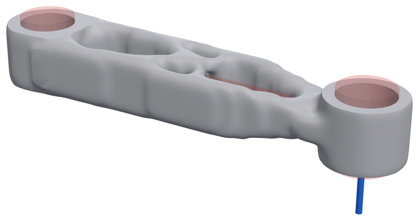<br><b>arm-link-cast</b><br><sub>67.8 g · 46% under envelope · SF 20.85 · pass</sub></td>
<td align="center" valign="top">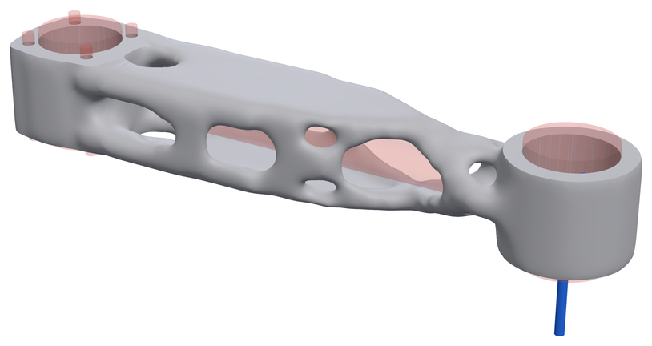<br><b>arm-link-driven</b><br><sub>51.3 g · 59% under envelope · SF 12.50 · pass</sub></td>
<td align="center" valign="top">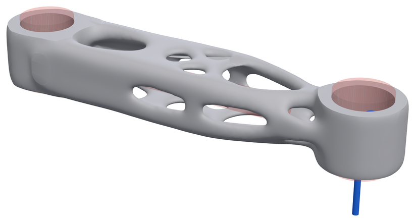<br><b>arm-link</b><br><sub>54.2 g · 57% under envelope · SF 10.97 · pass</sub></td>
</tr>
<tr>
<td align="center" valign="top">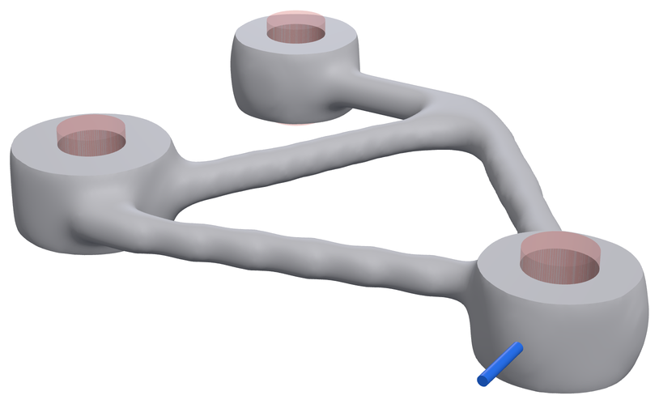<br><b>bell-crank</b><br><sub>23.8 g · 84% under envelope · SF 4.90 · pass</sub></td>
<td align="center" valign="top">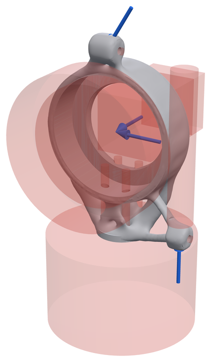<br><b>grip-turret</b><br><sub>142.1 g · 91% under envelope · SF 2.45 · pass</sub></td>
<td align="center" valign="top"><br><b>grip-upper-arm</b><br><sub>208.1 g · 88% under envelope · SF 5.83 · pass</sub></td>
</tr>
<tr>
<td align="center" valign="top">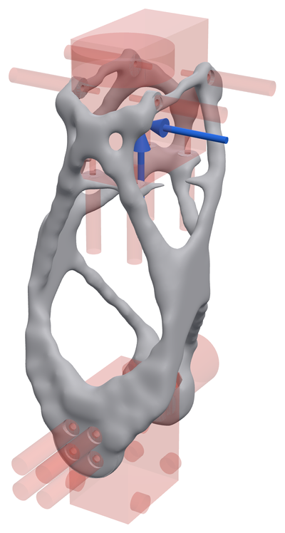<br><b>grip-wrist-link-mjf</b><br><sub>41.0 g · 95% under envelope · SF 3.71 · pass</sub></td>
<td align="center" valign="top">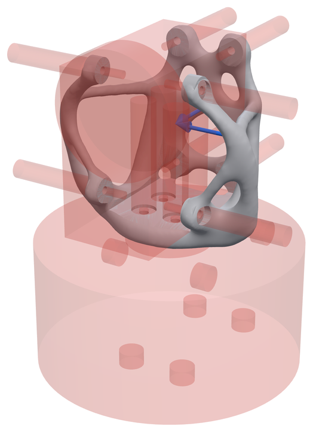<br><b>grip-wrist-yoke</b><br><sub>22.0 g · 91% under envelope · SF 4.24 · pass</sub></td>
<td align="center" valign="top">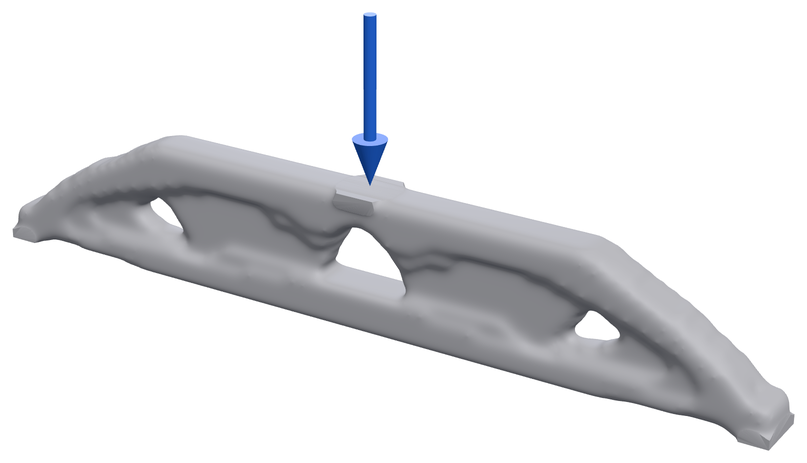<br><b>mbb-beam</b><br><sub>14.2 g · 78% under envelope · SF 1.51 · pass</sub></td>
</tr>
<tr>
<td align="center" valign="top">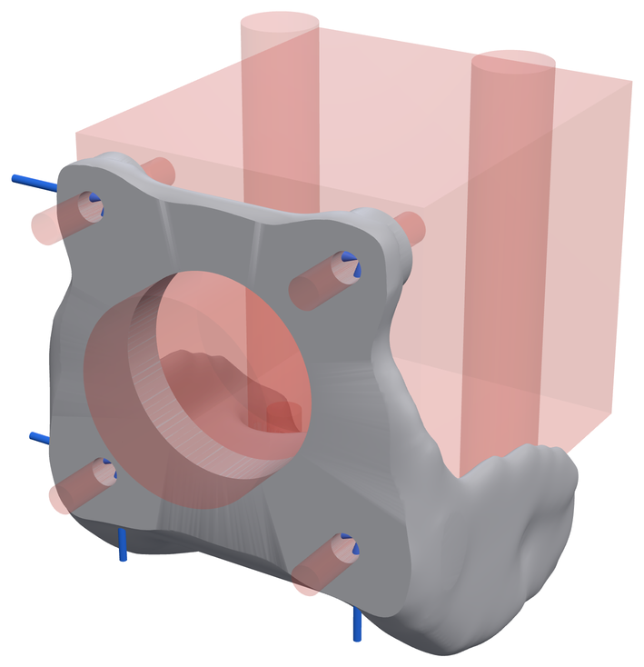<br><b>motor-mount</b><br><sub>27.6 g · 69% under envelope · SF 4.07 · pass</sub></td>
<td align="center" valign="top">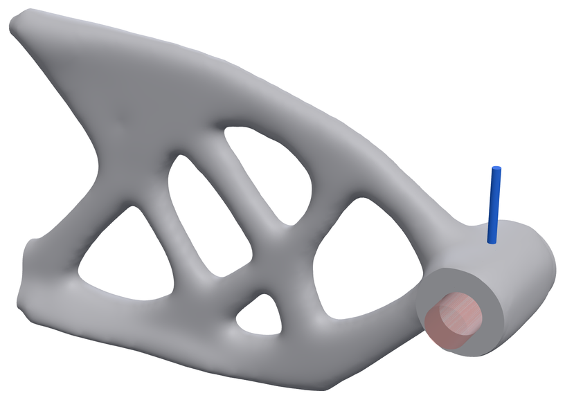<br><b>printed-hook</b><br><sub>27.4 g · 82% under envelope · SF 2.73 · pass</sub></td>
<td align="center" valign="top">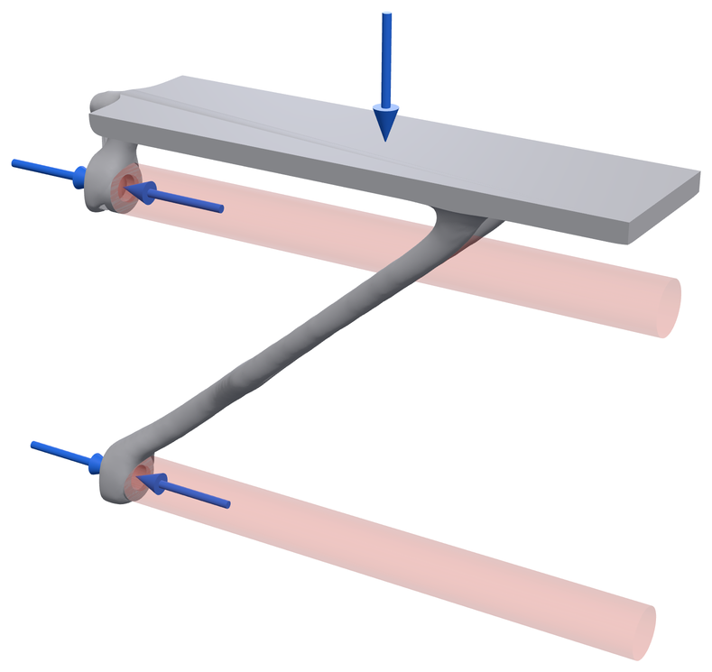<br><b>wall-bracket-fasteners</b><br><sub>41.0 g · 90% under envelope · SF 2.89 · pass</sub></td>
</tr>
<tr>
<td align="center" valign="top">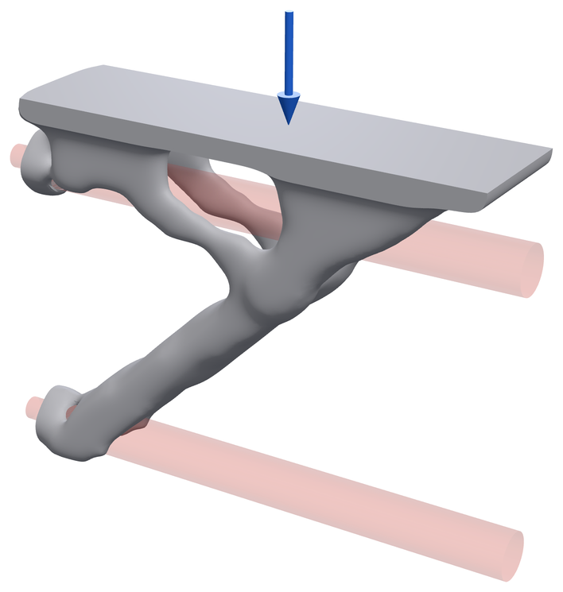<br><b>wall-bracket</b><br><sub>64.4 g · 85% under envelope · SF 2.75 · pass</sub></td>
</tr>
</table>

Where the load goes: von Mises stress, blue (none) to red (the part's 98th percentile), on the part bent by its worst load case:

<table>
<tr>
<td align="center" valign="top">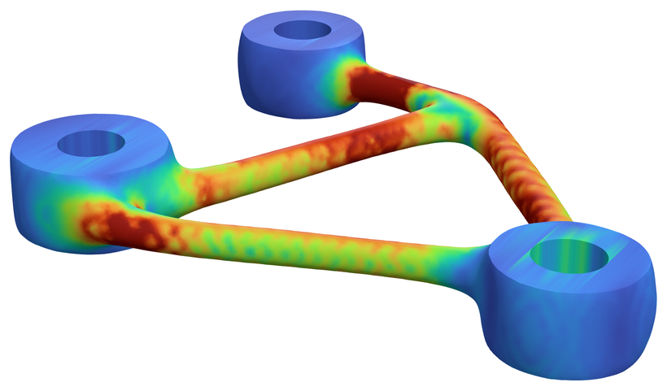<br><sub>bell-crank</sub></td>
<td align="center" valign="top"><br><sub>grip-upper-arm</sub></td>
<td align="center" valign="top">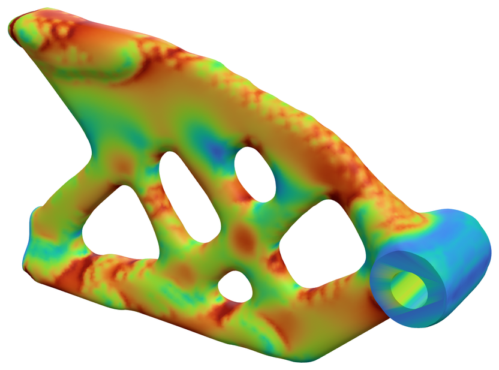<br><sub>printed-hook</sub></td>
</tr>
</table>

Two-fluid heat exchangers: two isolated channel networks through one sheet gyroid, with headers that print without support.

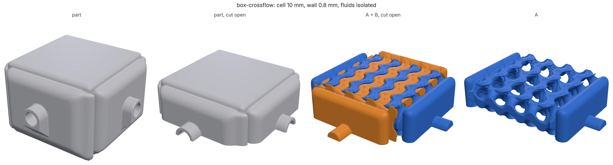

Printed in metal, nothing inside can be supported: the channels end in peaked roofs instead of flat ceilings (red).

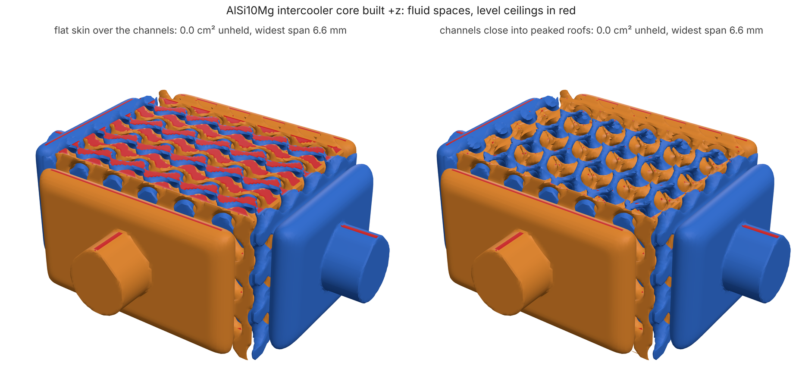

Made another way: the same arm link printed, cast (no undercuts along z), 3-axis milled from both sides with a 6 mm cutter, and with members capped at 6 mm. Each meets SF 3 and 0.5 mm.

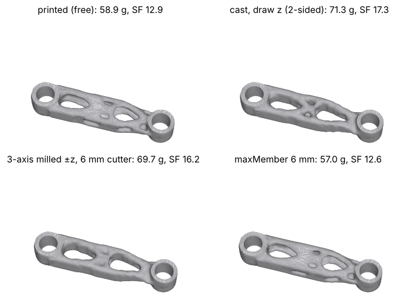

<sub>Rendered 2026-11-01 from the tet-confirmed full baseline run (`063c233`) by `python docs/gallery.py`.</sub>

<!-- gallery:end -->
## Limits

- Linear elastic, small deflection in the main check; large deflection and
  buckling are separate analyses (`nonlinear.py`), with contact (rigid
  obstacles and self contact, optionally with Coulomb friction) and
  tendons there only.
- Printed layers are modelled as transversely isotropic stiffness plus a
  tension-across-layers strength check. Interlayer shear is not checked
  separately.
- Material cards are datasheet values until you calibrate your printer
  (`loadpath calibrate`).
- Results depend on the grid: mass at a target safety factor moves about
  5% with small changes of grid size or starting point.
- Pure Python with NumPy and SciPy. A 40,000-cell study takes a few minutes
  on one laptop core; a safety-factor search runs several of those, and the
  larger eval parts take 15-60 minutes on four cores.

## Tests

```bash
python tests/run_tests.py && python tests/test_loadpath.py        # core
python tests/test_tutorials.py                                    # every tutorial, quick mode
python -m loadpath.evals.run --tier coarse --corpus 6 \
    --baseline loadpath/evals/baselines/coarse.json --gate regressions   # under 30 min
python -m loadpath.evals.run --out evals-out/                     # full eval suite, hours
python -m loadpath.benchmarks.run --out bench-out/                # top88 / top3d benchmarks
python docs/gallery.py --evals evals-out/                         # refresh the Examples renders
```

`.github/workflows/tests.yml` lists the full set CI runs.

## License

MIT
