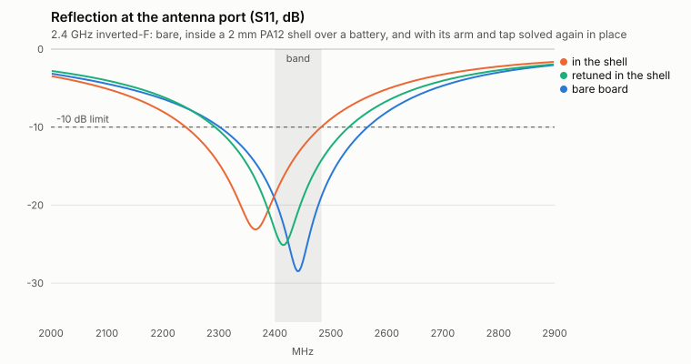

# Antennas inside the product

A board antenna is tuned on a bare reference board in free space. Then it
goes into a product: a printed wall a couple of millimetres away, a
battery under the board, a motor, a cable. Each of them moves the
antenna's resonance and takes some of its power, and the usual way to
find out is to build the thing and put it on a network analyser. RF tools
that could predict it do not know the printed part: its shape after
optimization, its material, how solid it is. A topology optimizer and a
CAD script do not know there is a radio. `loadpath` already holds
everything the fields see (the board's copper, the shell's mesh and
material, every placed component), so it solves Maxwell's equations on
it and lets the antenna have a say in the layout.

```
python -m loadpath antenna brief.json --out out/       # MCP: loadpath_antenna
```

and, inside a product, the same block on a component of an enclosure
brief (`components[].antenna`): then every candidate layout is priced by
what it does to the antenna's port, and the chosen one is solved in full
([below](#inside-an-enclosure-the-antenna-has-a-say-in-the-layout)).

Nothing here is tuned by rule. There is no "keep 5 mm clear" constant, no
detuning factor per millimetre of plastic. The plastic's permittivity and
loss, the copper as drawn and the metal near it are the model; the
resonance, the match, the efficiency and the keep-out are what the fields
do.

## What comes out

For the bare board and for the board as installed (`out/antenna.json`,
sweep in `out/s11.csv`):

| | |
|---|---|
| `resonance` | where the reflection is lowest, and whether that is inside the band |
| `inBand.worstS11`, `worstMismatchLoss` | the worst reflection across the band (dB) and the power it costs |
| `bandwidth` | the -10 dB and -6 dB bands |
| `impedance` | R + jX at the band's edges and centre: what a matching network has to work with |
| `efficiency.radiation`, `.total` | radiated / accepted and radiated / available power |
| `efficiency.heat` | the share of accepted power each material turns to heat (the laminate, the shell, a pad) |
| `efficiency.unaccounted` | accepted minus radiated minus heat: the solve's own energy balance, under 1% |
| `change` | installed against bare: resonance shift in MHz and as a share of the bandwidth, efficiency change |
| `sensitivity` | how far from the copper the port's sensitivity to metal reaches; the field itself is `out/sensitivity.npz` |

The bare board is solved on the same grid as the installed one (every
surrounding body in place, as air), so the difference between the two is
the product and not the grid.

## The brief

```json
{
  "band": [2400, 2483.5],
  "board": {"size": [32, 56.6], "thickness": 1.0, "material": "fr4",
            "ground": [[[0, 0], [32, 0], [32, 50], [0, 50]]],
            "top": [[[1, 50], [2, 50], [2, 56], [1, 56]],
                    [[1, 55], [23.467, 55], [23.467, 56], [1, 56]],
                    [[4.516, 50.5], [5.516, 50.5], [5.516, 55], [4.516, 55]]]},
  "feed": {"from": [5.016, 50, 1.0], "to": [5.016, 50.5, 1.0], "width": 1.0, "across": "x"},
  "surroundings": [
    {"name": "shell", "material": "pa12", "mesh": "shell.stl"},
    {"name": "battery", "metal": true, "box": [[2, 5, -5.5], [30, 40, -1.5]]},
    {"name": "pad", "material": {"base": "tpu", "fill": 0.4}, "box": [[0, 0, 1.5], [10, 10, 4]]},
    {"name": "lead", "wire": [[10, 10, -2], [10, 30, -2]]}
  ]
}
```

The board's corner is the origin, its bottom face z = 0, its top copper
at z = thickness. `top` and `bottom` are copper outlines as drawn, `ground`
a pour on both faces (stitched: solved as solid metal through the board),
`feed` the gap the radio drives. `surroundings` are in the board's frame:
a mesh, a box or an extruded outline of a material, metal, or a thin
wire. `loadpath schema antenna` has every field.

`antenna.ifa(arm, height, tap, trace, gap)` draws an inverted-F and
`antenna.board_brief(design, width, ground, ...)` puts it on a board;
`antenna.ifa_ti_dn007()` is the dimensioned 2.4 GHz inverted-F of Texas
Instruments' design note DN007.

## The solver

`loadpath/rf.py` is a finite-difference time-domain solver (Yee's
leapfrog scheme): the electric and magnetic fields on a staggered grid,
stepped through time from a short pulse at the port until the fields have
rung down, then read at every frequency of the sweep at once. It was
written for this job rather than wrapped, so the grid, the materials and
the outputs are loadpath's own:

- **A graded grid.** Every copper edge, board face and body face is a
  grid line; cells are 0.5 mm at the copper (0.25 mm between close
  lines) and grow by at most 1.4 from cell to cell out to a twentieth of
  a wavelength in air. A bare inverted-F is a third of a million cells
  and 10 to 20 s on four cores; in its shell, a million and 30 to 60 s
  (numba, single precision).
- **Open space.** A convolutional perfectly matched layer (Roden &
  Gedney 2000), eight cells, a quarter wavelength from the model.
- **The port.** A resistive voltage source across the feed gap
  (Piket-May, Taflove & Baron 1994): S11 = 2V/Vs - 1 against the radio's
  impedance, and the current through it gives the input impedance.
- **Cut cells.** A cell part-filled by a surface takes the mean
  permittivity for the field along the surface and the mean of its
  inverse for the field across it (Farjadpour et al. 2006), so a wall
  whose face falls between grid planes is the wall and not a staircase
  of it. A mesh is sampled 3 x 3 x 3 per cell.
- **Loss and energy.** Each material's loss tangent becomes a
  conductivity at the band's centre. The power through a box round the
  model is integrated at the band's edges and centre, and so is the heat
  in every cell, by material: radiated + heat = accepted is checked on
  every run.

## What it was checked against

`tests/test_rf.py`, a minute:

| case | reference | solved |
|---|---|---|
| modes of a 30 x 20 x 10 mm metal box | exact | within 0.2% |
| 40 x 30 x 20 mm box, 6.3 mm of permittivity 2.7 on its floor (the face 0.3 of the way through a cell), TE10 and TM11 | exact (transcendental) | 0.16% and 0.01% |
| thin 60 mm dipole: first resonance | NEC-2: 2.347 GHz, 72 ohm | 2.321 GHz (-1.1%), 73.2 ohm |
| the same dipole: radiated / accepted power, no loss in the model | 1 | 0.998 to 1.000 |
| line-fed patch on 0.794 mm Duroid, measured by Sheen et al. 1990 | 7.5 GHz measured | 7.40 GHz at 0.4 mm cells, 7.48 at 0.25 mm |

The part-filled box is the one that matters most here: it is the test of
how a plastic surface inside a cell is treated, which is every printed
wall.

One comparison did not come out, and is reported as such. The
dimensioned inverted-F of TI's DN007 measures a -24 dB dip at 2.42 GHz on
TI's board; the same copper on a 50 mm ground resonates near 2.78 GHz
here, converged with the grid, and between 2.63 and 2.82 GHz as the
ground's length and the board's width change. The note gives the
antenna's dimensions but not the board's, and an inverted-F's ground is
half the antenna, so this is a statement about what the note leaves out
and not a validation either way. `ifa_ti_dn007()` is in the library as
geometry, not as a reference result.

## Material data

Radio-frequency permittivity and loss tangent are on the material cards
(`loadpath/material_library.py`), each with its source:

| material | permittivity | loss tangent | source |
|---|---|---|---|
| PLA | 2.89 | 0.011 | Castro et al. 2026, printed, 100% fill, cavity perturbation at 3.5 GHz |
| PETG | 2.69 | 0.0070 | Castro et al. 2026 |
| ABS | 2.55 | 0.0067 | Castro et al. 2026 |
| TPU (NinjaFlex 85A) | 3.0 | 0.06 | Moscato et al. 2016, ring resonator at 2.4 GHz |
| PA12, PA11 | 2.6 | 0.02 | **estimate**, 2.4 to 2.9: no microwave measurement on the powder-bed datasheets; printed nylon filament is 2.82 / 0.020 (Castro) |
| FR-4 | 4.04 | 0.021 | Isola 370HR datasheet at 2 GHz |

A material with no value on file is asked for (`{"base": "...",
"permittivity": ..., "lossTangent": ...}`), never assumed. The PA12 row
is the weak one, and the [bench test](#a-bench-test) below measures it.

**Part-solid plastic** (`fill`: a lattice's relative density, an
infilled wall) takes an effective permittivity between the
Hashin-Shtrikman bounds, the tightest limits on any isotropic mix of two
materials at a given share. For plastics against air the two bounds are
within 0.1 of each other, so the value is their mean and the bounds are
its stated uncertainty. `fill` is the solid share of the volume, not the
slicer's infill setting: Castro's PETG printed at 25, 50 and 75% infill
measures 1.71, 1.94 and 2.28, each above the mix at that share (1.32,
1.70, 2.15) because a printed sample's walls and skins are solid. Weigh
the part: mass over solid mass is the number.

## An inverted-F, bare and in a shell

The inverted-F above (arm 22.47 mm, tap 3.52 mm, 6 mm tall, on a 32 mm
board with a 50 mm ground; its arm and tap were [solved](#the-antennas-own-dimensions),
not drawn):

| | resonance | worst S11 in band | -10 dB band | total efficiency at 2400 / 2442 / 2483.5 MHz | heat |
|---|---|---|---|---|---|
| bare board | 2442 MHz | -19.1 dB | 2302 to 2566 MHz | 92 / 93 / 92% | FR-4 6.0% |
| in a 2 mm PA12 shell, a battery under the ground | 2366 MHz (-76) | -10.0 dB | 2241 to 2483 MHz | 91 / 88 / 83% | FR-4 6.2%, shell 1.4% |
| the battery under the antenna instead | | -0.5 dB | none | nearly all reflected | |
| the first again, [retuned in place](#the-antennas-own-dimensions) | 2415 MHz | -14.3 dB | 2293 to 2532 MHz | 92 / 91 / 89% | FR-4 6.1%, shell 1.4% |

Two solves, a minute (`loadpath antenna`; the shell and battery as boxes
in `surroundings`).



A 2 mm PA12 shell 2 mm off the board's edges pulls the resonance down by
about 3% and with it the top of the band out of match. A battery under
the ground costs little more. The same battery slid 17 mm further, under
the antenna, shorts the port: almost nothing is radiated. The wall's
loss (the watts it takes) is small next to the mismatch: for a printed
shell at 2.4 GHz the permittivity moves the antenna and the loss tangent
hardly matters, except in TPU.

## The keep-out, as the fields give it

How close can a part sit? The answer is a field, not a distance. By
reciprocity (Harrington, *Time-Harmonic Electromagnetic Fields*, 7-4) a
small volume V of material put where the unperturbed electric field is
**E** changes the impedance at a port carrying current I by

    dZ = -j w eps0 (eps_r - 1) V  E.E / I^2          (a dielectric)
    dZ = -j w V (3 eps0 E.E + 1.5 mu0 H.H) / I^2     (a small conductor)

with E.E the plain product (phase matters). The bare board's fields are
kept at the band's centre, so one solve gives the cost of putting
anything anywhere near the antenna: `out/sensitivity.npz` (ohm per mm3 of
plastic, and of metal, on the solver's grid). A compact dielectric body
is charged 3 / (eps_r + 2) of that, its depolarization.

Against solving the board again with the body in place
(`tests/test_antenna.py`):

| body | solved change in Z | first order |
|---|---|---|
| 1.5 mm PA12 wall, 0.6 mm off the board's long edge | -3.22 + 1.21j ohm | -3.15 + 0.88j |
| a whole PA12 shell with a floor 1.4 mm under the board (reflection changes by 0.216, resonance -91 MHz) | -16.3 + 14.3j | -19.0 + 10.8j (0.223) |
| 3 mm metal cube 3 mm above the arm's end | -1.76 + 1.71j | -1.20 + 1.11j |

Plastic is predicted within 10 to 20%, near enough to rank layouts and to
say which wall is doing the damage (in that shell: the floor, nine tenths
of it). A small metal body comes out a third low; a battery under the antenna
is not a small perturbation at all, which is why the chosen layout is
always solved in full. Half of the port's sensitivity to metal lies
within 3 mm of the antenna's own copper; the rest runs down the edges of
the ground, which is the antenna's other half. A rule that draws a box
round the antenna trace misses that.

## Inside an enclosure: the antenna has a say in the layout

In an enclosure brief ([ENCLOSURE.md](ENCLOSURE.md)) a board with an
antenna carries the same block:

```json
{"components": [
   {"id": "board", "antenna": {"band": [2400, 2483.5], "board": {...}, "feed": {...}},
    "mass": 0.004, "rotate": "z"},
   {"id": "battery", "size": [28, 34, 4], "mass": 0.012},
   {"id": "pad", "size": [10, 10, 2], "rf": "tpu"},
   {"id": "label", "size": [10, 10, 0.2], "rf": "ignore"}],
 "placement": {"antenna": {"weight": 200}}}
```

- The bare board is solved once, with its sensitivity field (about 20 s).
- **Placement** then prices every candidate position of every part by
  the first-order change in the antenna's reflection: the shell's wall as
  it really is (its skin, its openings left open, its material's
  permittivity) and each part already placed. All positions of a part at
  one rotation are one correlation (an FFT), so it costs the search
  milliseconds. The cost is in the search's own unit, millimetres:
  `placement.antenna.weight` mm per unit change of reflection (default
  200: a change of 0.1, which takes a -20 dB match to about -14 dB, costs
  what 20 mm of centre-of-mass offset costs). In the test's box a battery
  under the ground costs 6.5 mm and the same battery under the antenna 84.
- Each part is what `rf` says it is to a radio wave: `"metal"` (the
  default for anything inside: batteries, motors, displays, other
  boards), a plastic, or `"ignore"`. A closure of the shell (`external`:
  a lid, a door) is the shell's material. Anything taken as metal by
  default is named in a warning.
- **The chosen layout is solved in full**: the skin as a mesh with its
  material, every part where it was put. `report.antenna.<id>` has
  `bare`, `installed`, `change`, `firstOrder` (which part or wall was
  predicted to cost what) and `ok` against `limit` (default -10 dB across
  the band); `antenna-<id>.csv` is the sweep. An antenna the product
  detunes past its limit is a warning that says by how much and what to
  do: retune it in place, or move the part named.

A test product: a 40 x 100 x 14 mm PA12 box with a lid, the inverted-F's
board and a 28 x 34 x 4 mm battery, in a cavity 11 mm tall (the battery
has to sit over the board).

| | battery's edge to the antenna end of the ground | first order: battery, lid, wall | resonance shift | worst S11 in band |
|---|---|---|---|---|
| antenna left out of the search (`weight: 0`) | 7.6 mm | 0.088, 0.079, 0.045 | -72 MHz | -10.8 dB |
| antenna in the search | 15.6 mm | 0.005, 0.081, 0.032 | -59 MHz | -11.8 dB |

The search slid the board 11 mm along the box and turned the battery,
which took the battery out of the antenna's fields. What is left is the
lid 2.7 mm under the board and the walls, which no position in this box
avoids: `firstOrder` says so, and the fix for that is in the copper. The
installed model is written as a brief of its own
(`antenna-<id>/brief.json`, bodies as STL in the board's frame) for
exactly that. Three solves, two and a half minutes on top of the
enclosure run.

## The antenna's own dimensions

`antenna.tune(make, start)` solves an antenna's dimensions in the
surroundings it will work in. `make(**dims)` returns a brief; the
reflection at the band's centre is a complex number, so two dimensions
(an inverted-F's arm length and tap position) can bring it to zero. No
tuning rule is used: each dimension is moved a millimetre and the board
solved again to measure how the reflection responds, then Broyden's
method (a secant method in two unknowns) walks to the root, each step a
new field solution.

From arm 24, tap 5 mm the inverted-F above came out at arm 22.47, tap
3.52 mm in six solves and 104 s: 2442 MHz, -28.5 dB, -10 dB from 2302 to
2566 MHz, radiation efficiency 93.5% (the FR-4 takes the rest).

Run with `installed=True` on a brief with its surroundings, the same
call retunes the antenna inside the product. In the PA12 shell with the
battery (the table above) it took five solves and 144 s to move the arm
from 22.47 to 21.69 mm and the tap from 3.52 to 3.30 mm: the worst
reflection in the band went from -10.0 to -14.3 dB and the -10 dB band
covers 2400 to 2483.5 MHz again. That antenna is wrong on a bare board
(2494 MHz) and right in the product, and it is found before a board is
ordered.

This is the first step of loadpath generating antennas rather than
checking them, and the rest of that path uses what is already here:

1. **Shape, not two numbers.** The sensitivity field is the gradient a
   shape optimizer needs: one more solve (the adjoint, which for a
   one-port antenna is the same solve) gives the change in reflection for
   moving every copper edge at once. That is topology optimization of the
   conductor with the same machinery loadpath uses on structure, with the
   printed part's geometry in the loop.
2. **Copper loss.** Conductors are perfect here. A surface-impedance
   boundary gives copper, and then printed and plated conductors
   (conductive filament, silver ink, plating on a printed carrier) whose
   conductivity is one to three orders below copper and decides their
   efficiency.
3. **Conformal antennas.** Traces on the inside of the shell itself
   (laser direct structuring, plated or inked onto a printed surface)
   need the conductor off the grid's planes: a conformal sheet model on
   the same cut-cell treatment.
4. **Far field.** The radiated power is already integrated over a closed
   box; transforming that box's fields gives gain and pattern, so "which
   way does it radiate with the hand on it" has an answer.
5. **KiCad in.** `loadpath kicad` already reads a board's outline and
   parts ([KICAD.md](KICAD.md)); reading its copper layers makes any
   board's antenna the brief, with no redrawing.

## The product's own metal as the antenna

Phones, watches and trackers mostly carry no separate antenna. A stretch
of the metal frame, a plate between two layers of plastic, a foil on the
inside of the shell: the radio drives a piece of the product itself
against the chassis. The brief takes that metal as `radiator`, with or
without a board:

```json
{
  "band": [2400, 2483.5],
  "radiator": [
    {"name": "frame", "metal": true, "prism": {"outline": [
        [[0, 0], [40, 0], [40, 100], [0, 100]],
        [[1.5, 1.5], [38.5, 1.5], [38.5, 98.5], [1.5, 98.5]]], "from": 0, "to": 8}},
    {"name": "chassis", "metal": true, "box": [[1.5, 1.5, 3], [38.5, 92, 4]]},
    {"name": "tie", "metal": true, "box": [[21.3, 92, 3], [23.3, 98.5, 4]]},
    {"name": "split", "material": "pa12", "box": [[24.3, 98.5, 0], [25.8, 100, 8]]},
    {"name": "feed", "wire": [[28, 98.5, 4], [28, 93, 4]]}
  ],
  "feed": {"from": [28, 92, 4], "to": [28, 93, 4]}
}
```

Boxes, extruded outlines (a ring inside a ring is a hole) and wires;
later entries overwrite earlier ones, so a split is a box of plastic
through the metal. Unlike `surroundings`, the radiator is the antenna: it
is there in the bare solve, and what is laid over it (an overmould, a
back cover, a case) goes in `surroundings` and is what the comparison
reports.

`antenna.frame_brief(size, wall, clearance, split, tap, ...)` writes this
for a metal band round a body with a chassis plate inside it and one
split in its end. The stretch of band between the split and where the
chassis meets it is the radiator: its length sets the frequency, and
where the feed lands on it sets the resistance the radio sees. Neither
is given by a rule. `antenna.tune` moves the split and the feed and
solves the fields again until the reflection at the band's centre is
gone, the same way it solves an inverted-F's arm and tap.

A 40 x 100 x 8 mm product, 1.5 mm aluminium band, chassis plate stopping
8 mm short of the end, split 1.5 mm wide filled with PA12:

| | split, feed past it (mm) | resonance | worst S11 in band | total efficiency | heat in plastic |
|---|---|---|---|---|---|
| first guess (arm a quarter wave long) | 10, 18.5 | 1547 MHz | -0.4 dB | 8% | 3% |
| solved bare (11 solves, 10 min) | 24.3, 2.2 | 2448 MHz | -14.9 dB | 94% | 3% |
| the same, sandwiched in 1.5 mm TPU | 24.3, 2.2 | 1999 MHz (-449) | -3.7 dB | 48 to 54% | 15% |
| solved inside the TPU (11 solves) | 30.4, 0.5 | 2360 MHz | -11.5 dB | 75 to 77% | 19% |

Three things the fields said that a rule would not:

- **The whole product is in it.** The first guess resonated at 1.5 GHz
  because a 100 mm body is itself half a wavelength long there, and the
  split's end faces grounded metal 1.5 mm away across plastic, which
  loads the arm as more length would. The arm that works is 13 mm of
  band, not the 31 mm a quarter wave suggests.
- **An overmould is not a detail.** 1.5 mm of TPU (permittivity 3.0,
  loss tangent 0.06) over the frame and in the split moves the resonance
  449 MHz, 18%: far outside any band. The frame has to be solved in the
  plastic it will wear.
- **Retuning brings the match back, not the loss.** Solved inside the
  TPU the band is covered again, but a fifth of the power still heats
  the TPU, most of it in and around the split where the field is
  strongest. A low-loss plastic in the split and over the arm (PETG or
  ABS, loss tangent 0.007) is the physical fix; the heat split by body
  says where it matters. In that last row the feed ran to the nearest
  it may sit to the split (0.5 mm), so the reflection stopped at -13 dB
  at the band's centre and not the -20 dB asked for.

Aluminium is a perfect conductor here; for solid metal at 2.4 GHz the
loss that leaves out is small against the plastic's, but it is not in
the number. A slot in a metal back and a foil or plated trace on the
shell's inner surface are the same brief with other bodies; a trace
that follows a curved shell waits on conformal conductors (below).

## A bench test

None of this has been measured on a print yet, and one cheap test checks
the two things that matter: that the solver predicts what a printed part
does to an antenna, and what the plastic's permittivity really is.

**The fixture.** A rod monopole over a small ground plate, about ten
dollars of parts:

- an SMA panel jack (four-hole flange) through the centre of a 60 mm
  square of copper-clad board or sheet metal, flange soldered or screwed
  to the plate;
- a 1.3 mm brass rod or stiff wire soldered to the jack's pin, cut so it
  stands 28 mm above the plate;
- two printed caps, 100% infill, set over the rod flat on the plate:
  cap A (20 mm square inside, 32 mm tall inside, 2 mm walls) and cap B
  (6 mm square inside, 30 mm tall inside, 4 mm walls). One pair per
  material to be measured.
- a network analyser that reaches 3 GHz: a LiteVNA 64 (50 kHz to
  6.3 GHz, 130 to 200 dollars) or a NanoVNA V2 Plus4. The original
  NanoVNA-H stops at 1.5 GHz and cannot do this one.

**The measurement.** Calibrate at the end of the cable (open, short,
load) from 1.5 to 3.4 GHz. On the Smith chart, note the frequency where
the trace crosses the horizontal axis near 2.4 GHz (the reactance is
zero: the rod's resonance). Then the same with cap A on, then cap B,
each centred on the rod.

**The prediction** (`antenna.bench_monopole(cap={...})`, all on one
grid):

| | reactance zero | shift |
|---|---|---|
| no cap | 2434 MHz | |
| cap A, PETG (2.69) | 2402 MHz | -1.28% |
| cap A, PA12 (2.6) | 2403 MHz | -1.25% |
| cap B, PETG (2.69) | 2231 MHz | -8.33% |
| cap B, PA12 (2.6) | 2237 MHz | -8.10% |
| cap B at permittivity 2.5 | 2241 MHz | -7.91% |
| cap B at permittivity 2.9 | 2220 MHz | -8.77% |

Compare shifts as percentages: a real jack's pin and dielectric move the
bare rod's resonance by a few percent from the model's 2434 MHz (the
model feeds the rod across a 0.5 mm gap, not through a coax opening),
and the shift is what the plastic does.

- Cap A against cap B is the solver's test. The same plastic at two
  distances from the rod should shift it by 1.3% and 8.3%, a ratio of
  six that comes from the geometry.
- Cap B is the material's test. Its shift moves 0.21% (5 MHz) for every
  0.1 of permittivity, so reading the crossing to 5 MHz gives the
  plastic's permittivity at 2.4 GHz to about 0.1: enough to replace the
  PA12 estimate with a measurement, and that number then goes on the
  material's card.

Seat a cap the same way each time. What follows, once this agrees, is
the real thing: the inverted-F on a board with an SMA footprint, in its
shell.

**Metal sandwiched in plastic.** The same plate and jack check the case
of the section above, metal between two layers of plastic. In place of
the rod, a strip of sheet metal that takes solder (brass or copper,
0.5 mm; 8 mm wide, 26 mm long) soldered edge-on to the jack's pin so its
top stands 28 mm above the plate with 2 mm of pin showing below it. Over
it slides a printed sleeve, 100% infill: 2 mm of plastic on each face of
the strip, 3 mm past its edges and top (14 x 4.5 x 31 mm outside, a
8.4 x 0.8 mm slot). Measure the reactance zero with and without the
sleeve (`antenna.bench_blade(sleeve="petg")`, one grid):

| | reactance zero | shift | resistance there | heat in the sleeve |
|---|---|---|---|---|
| no sleeve | 2265 MHz | | 19.0 ohm | |
| PETG (2.69, 0.007) | 1953 MHz | -13.8% | 14.5 ohm | 1.1% |
| PA12 (2.6, 0.02) | 1962 MHz | -13.4% | 15.0 ohm | 3.2% |
| TPU (3.0, 0.06) | 1932 MHz | -14.7% | 15.4 ohm | 9.5% |

The plastic touches the metal here, so the shift is large (300 MHz) and
easy to read: it is the check that a sandwich detunes as much as the
frame's table says. The step between two plastics (20 MHz from PETG to
TPU) reads their permittivity, and TPU's loss shows as a resonance that
is wider and a resistance about 6% higher than PETG's.

## Limits

- **Conductors are perfect.** Copper loss at 2.4 GHz on a board antenna
  is a few percent of efficiency; it is not in the number yet.
- **A radiator is drawn, not read from the enclosure yet.** `radiator`
  takes boxes, extruded outlines and wires in a standalone brief; an
  enclosure's metal parts are not yet offered to the radio as one, and
  the layout search does not move splits.
- **PA12's radio-frequency values are an estimate** (2.6, range 2.4 to
  2.9). Across that range the shell's shift changes by about a third.
  The bench test measures it.
- **Chip antennas cannot be solved**: what is inside the ceramic is the
  maker's. Their datasheets give a keep-out and a matching network for a
  reference board, and the sensitivity field of the pads and ground
  still says where metal hurts, but the resonance is not predicted.
- **Wires are not yet in the enclosure's installed solve.** A standalone
  brief takes `wire` bodies; the cables an enclosure lays
  ([WIRES.md](WIRES.md)) are not yet handed to the antenna check.
- **Grid.** Changing the grid alone moves a 2.4 GHz resonance by up to
  0.3% (6 MHz); differences are always taken on one grid. Absolute
  resonance against measurement is 1 to 1.5% low at the default cells
  (the dipole and the patch above).
- **One cross-check missing.** openEMS would be the natural second
  solver; it was not available where this was built. NEC-2 covers wires, the measured
  patch covers a board.
- **A body in the hand.** Tissue is a material like any other
  (permittivity about 40 to 50, lossy), but no hand or head model ships.
