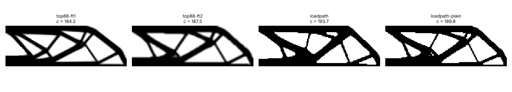
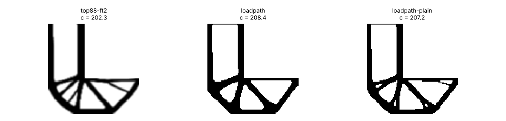
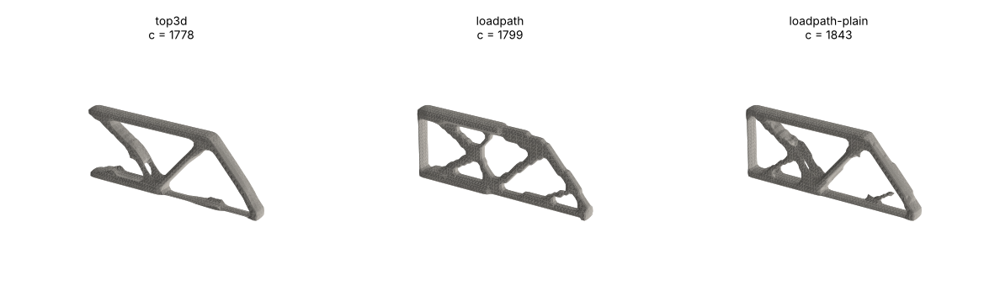
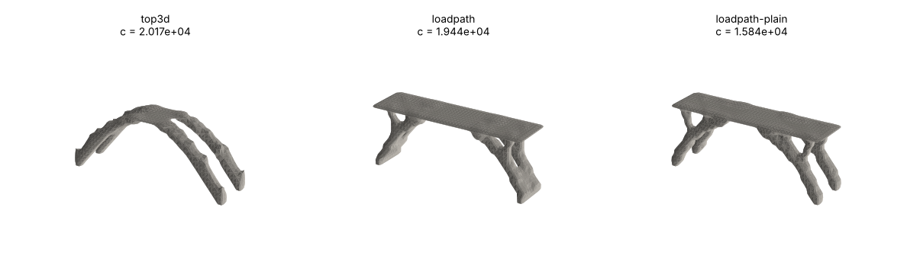
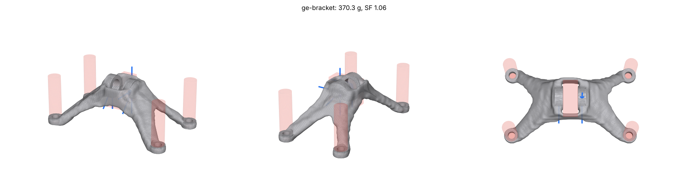

# Benchmarks

How close does loadpath's optimizer get to the optimum? The robot-arm evals ask
whether a part is good enough to print; this suite asks how loadpath compares
with the published topology-optimization codes on the textbook problems, with
the same supports, loads and amount of material, scored by one evaluator.

```
python -m loadpath.benchmarks.run --out bench-out/          # every problem
python -m loadpath.benchmarks.run mbb-2d cantilever-3d      # a subset
python -m loadpath.benchmarks.run --refresh                 # rerun the references too
python3 tests/test_benchmarks.py
```

Code: [`loadpath/benchmarks/`](../loadpath/benchmarks/). Installing
`scikit-sparse` (CHOLMOD; `apt install libsuitesparse-dev` first) makes the
evaluator's direct solves several times faster in 3D; it is optional.

<!-- results:start -->

## Results

Run 2026-10-30 on the 4-core cloud box. Compliance is in the problems' own
units (unit Young's modulus, unit loads); lower is stiffer. Every design has
the same total material.

| problem | design | compliance | vs best reference | as delivered (p=3) | black/white at target volume | volume | iterations |
|---|---|---|---|---|---|---|---|
| MBB beam 2D (150x50, vf 0.5) | top88, sensitivity filter | **184.2** | 1.000 | 193.4 | 184.2 | 0.500 | 206 |
| | top88, density filter | 187.3 | 1.017 | 200.9 | 187.3 | 0.500 | 391 |
| | loadpath | 193.7 | 1.052 | 193.7 | 195.0 | 0.509 | 60 |
| | loadpath, plain | 189.8 | 1.030 | 189.8 | 189.8 | 0.500 | 56 |
| L-bracket 2D (100x100, vf 0.4) | top88, density filter | **202.3** | 1.000 | 237.3 | 202.3 | 0.400 | 409 |
| | loadpath | 208.4 | 1.030 | 208.4 | 209.6 | 0.405 | 57 |
| | loadpath, plain | 207.2 | 1.024 | 207.3 | 207.2 | 0.400 | 56 |
| Cantilever 3D (60x20x4, vf 0.3) | top3d | **1778** | 1.000 | 2418 | 1778 | 0.300 | 133 |
| | loadpath | 1800 | 1.012 | 1828 | 1800 | 0.294 | 57 |
| | loadpath, plain | 1843 | 1.037 | 1844 | 1843 | 0.300 | 57 |
| Bridge 3D (48x12x16, vf 0.15) | top3d | 20170 | 1.000 | 20170 | 8.2e9 (falls apart) | 0.150 | 172 |
| | loadpath | 19440 | 0.964 | 19500 | 19440 | 0.150 | 58 |
| | loadpath, plain | **15840** | 0.785 | 15840 | 15840 | 0.150 | 57 |

**Stress-constrained (minimum mass), L-bracket.** With top88's peak von
Mises (0.949, load cells left out) as the limit, loadpath's `goal.method:
"constrained"` reaches **0.302 volume at a peak of 0.934**: 25% less material
than the compliance designs carry for the same peak. It converges in 97
iterations and under a minute.









**Reading it.** On the 2D problems loadpath is 3-5% less stiff than top88 at
the same material, and 1% on the 3D cantilever; on the bridge it is stiffer
than top3d, whose grey design falls apart once thresholded to a real part.
loadpath gets there in 57-60 iterations against 130-410, and always delivers
a crisp part (greyness 0.01 against 0.13-0.27). The slower schedule below
closes about half of the 2D gap when stiffness is all that counts.

"loadpath, plain" switches off the three things loadpath does for
printability: the robust (eroded) formulation that stops sub-minimum members,
the boundary-padded filter, and dead-material pruning. With them off loadpath
solves the same problem as top88's density filter and lands within 1.3% of
it on the MBB beam. So most of the gap is the price of printable members,
and the rest is projection continuation (below).

<!-- results:end -->

## Method

**References.** [`reference.py`](../loadpath/benchmarks/reference.py) holds
line-for-line NumPy ports of the two codes everyone benchmarks against:
`top88` (Andreassen et al. 2011, 2D; sensitivity filter ft=1 and density
filter ft=2) and `top3d` (Liu & Tovar 2014, 3D, density filter). Ported: the
truncated cone filter normalized by its row sums, the sensitivities, the OC
bisection (move 0.2, 1e-3 tolerance), volume on physical densities and the
stopping rules (0.01 change; top3d at most 200 iterations). The elements are
the same (top88's plane-stress square, top3d's 8-node brick). On top3d's
own default problem, `top3d(60,20,4,0.3,3,1.5)`, the port ends at
c = 2418.2 after 133 iterations. A search turned up a top3d run quoted at
c = 2417.5, but not its parameters, so that agreement is suggestive, not a
check. Running the original `.m` files in Octave was not possible in this
environment (it blocks running downloaded code), so the ports are what was
run; the Octave runs would be the definitive check.

**Problems.** [`problems.py`](../loadpath/benchmarks/problems.py) defines
each problem once on a unit grid, and that definition drives the reference,
loadpath and the evaluator, so all three see the same supports and loads.

- MBB beam: top88's default half beam. loadpath models the whole beam with
  mirror symmetry, as a study would, and the half is scored.
- L-bracket (Le et al. 2010): 100x100 with a 60x60 cut-out, clamped on top,
  loaded down at the free arm's tip. The top88 reference uses passive voids
  as in the paper's section 5.2.
- Cantilever 3D: top3d's default problem.
- Bridge 3D: pinned along the bottom edges at both ends, a uniform load over
  the whole top face.

loadpath's side is built the way a study is (`build_domain`, so load and
support cells are pinned and symmetry is mirrored), then given the exact
nodal supports and loads. Its volume fraction is lowered by the pinned cells
so the total material equals the reference's. Plane problems run as a
one-cell slab extruded along y.

**Scoring.** [`evaluate.py`](../loadpath/benchmarks/evaluate.py) scores
every design two ways, void at 1e-9: penalized (p = 3) as delivered, and
black-and-white at the target volume (the densest cells kept). The headline
is the lower of the two, which is the most generous reading of a grey
reference design.

## GE jet engine bracket

[`cases/ge-bracket.json`](../loadpath/benchmarks/cases/ge-bracket.json) is
the 2013 GE/GrabCAD challenge set up as a loadpath study: the challenge's
four load cases (35.6 kN up, 37.8 kN out, 42.3 kN at 42 degrees, 565 N m
torsion as a couple on the two lugs), Ti-6Al-4V, a 0.75 in pin through a
two-lug clevis, four 0.375 in bolts held rigid, and the challenge's pass
rule: peak von Mises under yield (131 ksi, 903 MPa) in every case (goal
safety factor 1.0). The original bracket weighed 4 lb (1.81 kg) and the
winning entries removed about 80% of it (Carter et al. 2014, "The GE
aircraft engine bracket challenge: an experiment in crowdsourcing for
mechanical design concepts"). The geometry is approximate: the design
envelope is a box about the original's size (178 x 107 x 63 mm), roomier
than the original's L-shaped envelope, so masses compare only roughly.

<!-- ge:start -->
**Result: 370 g, safety factor 1.06** against yield in the worst case
(confirmed on the finer grid), one body, 0.17 mm worst deflection at the
pin. That is 79.6% lighter than the original's 1.81 kg, level with the
winning entries' "about 80%". The safety-factor search took six runs
(1540 g at SF 2.9, 803 g, 435 g, then 318 g and 343 g, both just under
SF 1) and 53 minutes on the cloud box while sharing it with the suite.



Caveats: the envelope is roomier than the original's, the bolts sit at
assumed positions, the mounting face is not modelled as contact, and the
challenge's stress check was a separate FE model where this is loadpath's own
voxel verification. The case's `expect` keeps 362 g (an 80% reduction) as the
mark to beat, so it currently reads as a narrow fail.
<!-- ge:end -->

## Fusion 360

No public Fusion generative-design case study publishes geometry, loads and
results complete enough to reproduce. Autodesk's own GE-bracket tutorial
sets its studies up with mass targets of 1.5 and 1.8 lb under maximum
stiffness and does not publish the outcomes; case studies (GM's seat bracket,
Airbus's partition) give percentages without the problems. Fusion's shape
optimization is SIMP-based, like loadpath; its generative design uses a level
set method. The GE challenge entries are the closest public yardstick.

## Lattice heat sinks against solid topology optimization

Do field-graded lattices win where they should, in heat sinks? An air-cooled
LPBF sink in a duct (`bench/lattice_heatsink.py`): a 40 x 40 x 3 mm AlSi10Mg
base, 30 W into a 20 x 20 mm die under its centre, a 40 x 40 x 15 mm fin
space closed over by the duct, 10 mm of empty duct before and after. Every
design holds 20% of the fin space in metal that touches the base and is rated
at the same 20 Pa across the duct, by `conjugate.py`: lattice Boltzmann flow
(flow.py, Smagorinsky 0.17), then solid and air heat in one finite-volume
solve (energy balance closes to 1e-9). 0.5 mm voxels, 326k cells. Score: the
die's hottest point over the inlet air, per watt (lower is better).

| Design | Metal | Air L/min at 20 Pa | Die max K/W | vs solid TO |
| --- | --- | --- | --- | --- |
| Solid topology optimization (thermal.py, constant h 50 W/m²K) | 20% | 53.4 | 3.19 | baseline |
| Straight plate fins (8 fins) | 20% | 91.1 | 2.56 | -20% |
| Uniform gyroid network, 8 mm cells | 21.4%* | 49.4 | 2.39 | -25% |
| Gyroid graded by the uniform lattice's heat flux (exponent 0.25) | 20% | 51.7 | 2.41 | -25% |
| Gyroid graded by heat flux (exponent 0.5) | 20% | 51.1 | 2.47 | -23% |
| Gyroid graded by height, 2:1 base to top | 20% | 52.9 | 2.37 | -26% |
| Gyroid graded by height, 3:1 base to top | 20% | 53.4 | **2.36** | **-26%** |

\* the uniform gyroid's connected metal jumps from under 20% to 21.4% (its
ligaments break below that at 0.5 mm); the graded ones hold exactly 20%.

What it says, on this grid alone:

- Every gyroid beat the solid topology by a quarter at equal metal and
  pressure drop, and beat plate fins by 6-8%. The solid TO's weakness is its
  model, not its search: a constant h pays for surface anywhere, so it grows
  a dense pin field that chokes the flow (53 L/min against the plates' 91)
  without being charged for it.
- Grading by height (denser at the base, where all the heat enters) is the
  best of the graded rules, 1-2% over uniform. Grading by the heat flux is no
  better than uniform, and an uncapped flux grading (density up to 0.6 at the
  base) rated 2-3x worse on a 1 mm grid: a near-solid layer of lattice over
  the base walls the air off from it, so graded densities are capped at 0.4.

### Grid check, a second geometry, and flow-aware TO

The lattice-over-plates margin did not survive the follow-up checks
(`bench/lattice_heatsink_0375.json`, `bench/lattice_heatsink_geo2.json`):

| Case | Plates | Uniform gyroid 8 mm | Gyroid graded 3:1 by height | Solid TO (constant h) |
| --- | --- | --- | --- | --- |
| 20 mm centred die, 15 mm fins, 20 Pa, 0.5 mm voxels (table above) | 2.56 | 2.39 | **2.36** | 3.19 |
| Same sink, 0.375 mm voxels (820k cells) | **1.95** | 2.17 | 2.18 | 2.79 |
| 10 mm die 10 mm behind the leading edge, 25 mm fins, 10 Pa, 0.5 mm | **2.34** | 2.48 | 2.38 | 3.95 |

(die max K/W; 20% metal in every design; at 0.375 mm the plates are 7 fins
of 1.125 mm, the nearest whole-voxel match to 20%, against 8 of 1.0 mm at
0.5 mm.)

- **Lattices beat constant-h solid TO in every case** (by 22% at 0.375 mm
  and 37-40% on the second geometry). That gap is the constant-h model's.
- **Lattices do not beat well-drawn plate fins.** At 0.375 mm the plates win
  by 10%; on the second geometry by 2%. The 0.5 mm win was inside the grid
  error: the gyroid's sub-millimetre ligaments are the most under-resolved
  thing in the sink, and plates gain most from refinement (2.56 to 1.95).
- **Flow-aware TO** (`loadpath/flowtopo.py`): density TO with the flow in the
  loop, so the solid side is no longer handicapped by constant h. Darcy flow
  with a Borrvall-Petersson inverse permeability (open-duct permeability
  calibrated so plate fins pass what LBM says they do at 20 Pa), then
  advection-conduction, both adjoint-differentiated (checked against finite
  differences), at fixed pressure drop, MMA with permeability continuation.
  On a 1 mm grid it is not yet competitive even in its own model: from a
  grey start it reaches 5.2 K/W (mean die rise, crisp design) at 12% metal,
  against 4.2 for plates and 2.5 for the gyroid in the same model, and
  warm-started from either it does not improve them (the crisp design's
  projection gradients vanish, and a softened start re-greys the fins and
  chokes the flow). An equal-volume run from grey collapsed to a choked
  design. It was not worth a lattice Boltzmann rating. What it needs:
  finer grids (the fins are 1-2 voxels at 1 mm), a body-fitted or
  level-set boundary instead of grey Darcy walls, or a turbulence-aware h.

Honest summary: for an air sink at these sizes, a TPMS lattice is a large
win over what loadpath's solid TO produced before (constant h), and a
draw with plate fins (within -10% to +8% depending on grid and geometry).
The next places a lattice should win are where plates can't follow the
heat: several dies, a non-straight flow path, or liquid cold plates.

## Lattices in a liquid cold plate

The case where a lattice should have its best chance (`bench/cold_plate.py`,
results in `bench/cold_plate.json`): water, three dies at different powers
(25, 25 and 15 W under a 24 x 24 mm AlSi10Mg plate, 1.5 mm base, 2.5 mm
cavity), and a U-turn flow path with the inlet and outlet on the same side.
Every design holds 30% of the cavity in metal touching the base and is rated
at the same 1 kPa, port to port, by lattice Boltzmann water flow then
conjugate heat (energy balance to 1e-6). Score: the hottest die's peak rise
over the inlet water, lower is better. Each family's parameter was swept on
the coarse grid; the best of each was then rated on finer grids.

| Design (best of its family) | 0.25 mm | 0.1875 mm | 0.15 mm |
| --- | --- | --- | --- |
| Gyroid 3 mm, graded over the dies (Gaussian 4 mm, 0.15-0.55 solid) | **35.9 K** | 35.4 K | **32.3 K** |
| Curved channels along the streamlines, 10 channels | 40.4 K | **35.3 K** | 32.6 K |
| Uniform gyroid, 3 mm cells | 42.0 K | 39.4 K | |
| Staggered pin fins, 3 mm pitch | 43.1 K | 42.5 K | |
| **Hybrid: 8 streamline channels (walls 15% of the cavity) with a die-graded 2 mm gyroid inside** | | **32.8 K** | **30.4 K** |
| Streamline channels with walls graded over the dies (wall fraction 0.25-0.6 of the pitch) | | 34.3 K | |

Swept on the coarse grid and dropped: pins at 1.5, 2 and 4 mm pitch (46.7-47.0 K),
6 and 8 channels (51.9 and 43.9 K), gyroid cells of 2 and 4 mm (50.0 and 43.1 K),
and other grading widths and cells (36.3-37.8 K).

What it says:

- **The die-graded gyroid ties the best curved channels.** It is 1% ahead at
  0.15 mm and 0.3% behind at 0.1875 mm. That is inside the grid error: every
  design is still dropping by about 8% per refinement, and channels improve
  fastest (their 0.5 mm walls are the least resolved feature).
- **Grading is what makes the lattice competitive.** Putting the metal over
  the dies beats the uniform gyroid by 10% and the pins by 17% at 0.1875 mm.
  Those gaps are larger than the grid trend.
- **The channels here are not naive.** They follow the empty cavity's
  streamlines, so a straight-channel design would do worse in this U-turn
  plate. A designer who has the streamlines ties the lattice. Pins, the usual
  printable default, lose clearly.
- **A hybrid wins.** Thinner streamline channels that steer the water
  round the U, filled with a gyroid graded over the dies, beat the best
  channels by 7% on both fine grids (32.8 vs 35.3 K, 30.4 vs 32.6 K) and the
  graded lattice alone by 6-7%. Its flow runs converged on both grids,
  while the baseline's higher-flow run at 0.15 mm had not settled. The
  channels set where the water goes and the lattice takes the heat out
  where the dies are. Grading the channel walls alone gained 3%.
  Next: grade the lattice from the conjugate temperature field rather than
  from die position, and give the channels their own share of the metal.
- Method note: the averaged lattice Boltzmann velocity does not conserve
  volume cell by cell. Interpolated to faces and used for upwind advection,
  it lost 99% of the heat on this plate. `conjugate.solve_heat(...,
  project=True)` first projects the face fluxes onto volume-conserving ones
  (least squares, the inlet held), and the balance then closes to 1e-6. The
  air heat sink results above used the conservative form, which balances
  globally by construction.

## Wall time: where a run's minutes go (2026-11-06)

An agent waits on `loadpath run` (or `loadpath_start` and polling), so the
wall time of one study matters as much as the mass it finds. Profiled on the
4-core, 15 GB cloud box (py-spy over full-tier MBB beam and printed hook,
stage timestamps on the arm link, wrist yoke and turret), a safety-factor
search spends its time in the optimizer (about 40%), fTetWild's tet mesh for
the confirm (about 20%), the voxel verify after every outcome (20-25%) and
the quadratic tet solve (about 7%). Two things wasted the rest:

- **Cores fighting each other.** Every worker process ran one compiled-kernel
  thread per core, so three pitch starts on four cores ran twelve threads, and
  a kernel's barriers waited on threads the OS had parked: one arm-link
  stiffness assembly took 0.6 s against 0.05 s on one thread. Worker
  processes now split the cores (`LOADPATH_THREADS` = cores / workers, also
  for `evals --jobs`), and the assembly is one parallel pass over the matrix
  instead of 64 (same bits).
- **Cores sitting idle.** A one-grid search (larger parts; small ones run
  three pitch starts, one process each) keeps about one core of four
  busy. The tet cross-check of each passing outcome now starts in a
  background process while the search optimizes the next fraction (the
  search confirms its picks only after its fraction loop, so the confirm is
  often ready when asked for); the buckling check runs beside the verify's
  stress solve; CSR matrix-vector products run on every core (same bits);
  and goal.method auto starts its constrained run beside the search instead
  of after it, killing it when the search's part says it does not apply.
  The constrained method's buckling factorizations at 150k+ cells were the
  turret's long pole: PARDISO (now part of `loadpath[crosscheck]` on x86-64)
  replaces SuperLU there and in the buckling check, and SuperLU ran the wall
  bracket's constrained run out of the 15 GB box.

Old code (8b79a82) against new, same box, no tet cache, one case at a time
the way an agent runs it (full tier):

| Case | Old s | New s | Mass old / new g |
| --- | --- | --- | --- |
| MBB beam | 2640 | 2014 | 15.6 / 15.7 |
| Printed hook | 1756 | 1790 | 29.4 / 29.4 |
| Robot-arm wrist yoke | 714 | 585 | 17.3 / 17.3 |
| Wall bracket | out of memory at 30 min | 1887 | - / 27.3 |

The coarse eval tier (four cases at once, so no idle cores to borrow) went
from 37,676 to 35,739 case-seconds, with the turret 3301 -> 2307 s, the upper
arm 6247 -> 5417 s and the wall bracket 2919 -> 2389 s; 15 of its 20 cases
came out at the same mass. The ones that moved are cases known to be noisy
from run to run, and the wrist yoke shows why. Its search reads its parts'
stress on fTetWild meshes, and fTetWild is not repeatable, so the search
picks a different fraction from run to run. Given the old run's tet meshes
(its tet cache), the new code found the same 15 search parts, to the last
digit. That pick then decides whether goal.method auto runs the constrained
method. The old code gave 13.3, 13.4, 13.6 and 19.3 g over four runs; the
new code gave 13.3, 13.3, 14.0, 14.1 g and five runs at 17.7-19.4 g. One
real bug showed up along the way. The constrained run's time box is wall
time, a multiple of the search's. A faster search, or a busy box, left it
2 parts (19.3 g old, 19.2 g new, against 13-14 g from 5 parts). It now
always finishes 4 parts, stopping at twice the box at most. What is left: fTetWild itself (100+ s a confirm
on the arm link; a 70% lighter input surface saved 15%), the verify's cut-cell
solve, and the optimizer's Gauss-Seidel, which runs on one core per load case.
`LOADPATH_TET_PREFETCH=0` and `LOADPATH_SPECULATE=0` turn the background work off.

## Coarse eval tier: how far a run moves on its own (2026-11-06)

The coarse tier (`python -m loadpath.evals.run --tier coarse --corpus 6
--baseline loadpath/evals/baselines/coarse.json --gate regressions`) is the
gate a change runs before it lands, so it only helps if a move past its 5%
line means something changed. Its baseline was saved on Nov 3-4, before
cut-cell verification, the min-member reconstruct fixes, the draft check and
the speed work. On today's code it flagged the wrist yoke, MBB beam, wall
bracket and bell crank. Each flagged move was traced to a commit by
re-running the case on the commits between, and the tier was then run twice
on e8c55b5 to measure the spread.

**Where the moves came from** (coarse tier, best part / massAtTarget, g):

| Case | Old baseline | Change | Cause |
| --- | --- | --- | --- |
| Bell crank | 25.0 / 24.1 | 25.3 (fa17ad8), 25.7 (d1b2b2c) | Members held at minMember or removed: thin struts no longer shrink below it, so the part is slightly heavier and its peak no longer sits on a sliver. Intended. |
| Wall bracket | 27.6 / 25.2 | 27.7 up to e04f5e4, 29.4 at fa17ad8, 29.0-29.9 now | The same minMember change. Intended. |
| MBB beam | 13.3 / 13.3 | 14.7 at the old baseline's own commit (f8e9df0) | The row was out of date when it was saved: it was not re-run with that commit. Now 13.7-14.7. |
| Wrist yoke | 14.1 / 14.1 | 20.0 (search) or 13.4-15.1 (constrained) up to e04f5e4; 17.7 at fa17ad8; 18.3 now | See below. Not a defect in the part, but a lost gain. |
| Printed hook | 28.8 / 28.1 | 25.0-26.1 now | Its search part became heavier and less evenly worked (utilization 0.32 -> 0.16), so goal.method auto now runs the constrained method, which wins. Moved between c7f1a59 and e8c55b5 (the speed and fits commits); not bisected further. Buckling 2.6-2.9 for a 2.5 goal. |
| corpus-bracket-4 | 49.2 / 48.1 | 34-40 now | Its constrained run, known noisy. |
| corpus-tri-mount-5 | 77.2 / 77.2 | 61-69 now | The same. |

**The wrist yoke.** goal.method auto runs the constrained method only when
the search's part is unevenly worked, below a stress utilization of 0.19
(`study._AUTO_UTILIZATION_CUT`). The minMember fixes made the yoke's search
part lighter and more even: its utilization went 0.166 -> 0.199 (fa17ad8)
-> 0.226 (d1b2b2c), so the constrained stage is skipped and the 18.3 g search
part is delivered. Run with the cut at 0.25 on the same code, the
constrained method still finds 13.5 g (SF 2.11, buckling 6.5). At 0.21 it is
still skipped. The cut is a single number that every reconstruct change can
push a case across; the yoke, MBB beam (0.20), corpus-link-0 (0.19) and
motor mount (0.20) all sit within 0.04 of it. Moving it would change which
method runs on several cases and how long they take, so it is left at 0.19
here and the baseline records the 18.3 g yoke.

**Spread.** Two runs of e8c55b5, each with an empty tet cache (fTetWild does
not give the same mesh twice, and a warm cache hides that: two runs of
c7f1a59 sharing one cache matched to the gram on every search case), 21/21
pass both times, about 2.9 h wall each on the 4-core box:

| | massAtTarget, run to run | Cases |
| --- | --- | --- |
| Same to 0.1 g | 0% | arm-link, -cast, -driven, upper arm, motor mount, corpus-link-0, -link-3 |
| Search cases, tet confirm varies | 1-2.5% | bell crank 1.2%, yoke 1.7%, MBB 2.2%, turret 2.3%, corpus-tri-mount-2 1.5% |
| Constrained, with a time box | 1-17% | wall bracket 1.1%, hook 1.6%, corpus-bracket-1 7.3%, corpus-tri-mount-5 12.6%, corpus-bracket-4 17% |

The best part moves more than massAtTarget on some search cases (MBB 13.7
vs 14.7 g, bell crank 25.7 vs 26.9 g): a different tet mesh flips one
fraction's pass, and the search stops one step apart. So on the search cases
the 5% gate line is about twice the noise, while on three constrained corpus
cases a single run cannot tell a 10% move from noise. The re-saved baseline
takes each case's row from the heavier of the two runs, so that a run
landing anywhere in the measured range does not flag. A flag on
corpus-bracket-1, -bracket-4 or -tri-mount-5 alone needs a rerun before it
is read as a regression.

## Pitch sensitivity: one grid is a sample

A safety-factor search's answer moves a lot with sub-percent changes of the
cell size. On a grid 1% coarser the optimizer settles in a different layout,
and the verified stress, read near supports and sharp junctions, differs
between layouts. The search then brackets a different fraction. The MBB beam
at 30% read SF 1.43 on a 1.3336 mm grid and 0.88 on a 1.3373 mm one, with
the same 27945 cells. Its peak sat at the beam's end, one cell above the
pin, which is modelled as a clamped pad. The 0.88 search stepped up to 55%.

Measured on the coarse tier (bench/results/pitch_starts.json):

| | Median range | Worst range | Failed runs |
| --- | --- | --- | --- |
| One grid, six pitches 0-5% apart (16 safety-factor cases) | 24% | 138% (corpus-bracket-4, 82-196 g) | 3 of 96 |

`resolution.pitchStarts` runs the search on N grids, each 1% coarser than
the last. Coarser keeps maxElements a hard cap. It keeps the grid whose
lightest part passes, and `result.starts` lists every grid's pick. "auto",
the default, means 3 grids for safety-factor, deflection and durability
searches up to 30k cells with no pitch given, and 1 grid otherwise. The
grids run in parallel where memory allows.

Paired runs of the whole coarse tier at maxElements x1 and x0.91 (the pitch
about 3% coarser), one grid against three:

| | Delivered mass, median / mean pair spread | massAtTarget, median / mean / worst | Sum of delivered mass (17 cases) | Lost passes | Time |
| --- | --- | --- | --- | --- | --- |
| 1 grid | 10% / 18% | 5% / 17% / 80% | 1405 g | 0 | 1x |
| 3 grids | 12% / 15% | 5% / 10% / 46% | 1287 g (-8%) | 0 | 2.7x |

Three grids cut the worst swings (the hook went from 28-48 g to 28-35 g,
corpus-bracket-1 from 168-246 g to 168-201 g, corpus-tri-mount-5 from
133-137 g to 79 g at both scales), and they make parts about 8% lighter.
They don't make the typical case reproducible: the median spread is
unchanged. That needs the layout itself to stop depending on the grid,
through a mesh-independent filter or start, or a peak stress read that
doesn't ride the supports' singular field.

A latent bug turned up along the way. `verify.voxelize` gave a box a whole
number of cells across one cell too many at 107 of 400 pitches tried, and
the access report then crashed on the shape mismatch (the arm link, twice).
It is fixed.

Full tier with pitchStarts on (one worker, tet confirm): all 14 cases
pass, in 186 min against the old baseline's 145. The MBB beam, which main
had at a 32.1 g massAtTarget on a single grid (55% over the old baseline's
20.7 g), comes out at 26.7 g. The sum of massAtTarget is 757 g against the
old baseline's 747 g; that baseline was taken before the hard maxElements
cap and the other commits since. baselines/full.json and coarse.json are
re-saved on this code.

## Gaps found

Fixed in this round:

1. **A load spread over a large face could land on void.** Load and support
   regions touching more than 3% of the cells were never pinned, contrary to
   the intent that a loaded face is. On the bridge (deck load, 6% of the
   cells) loadpath left deck nodes on void cells and its compliance came out
   around 1e9 against top3d's 2e4. A loaded face is now pinned whatever its
   share ([`domain.py`](../loadpath/domain.py)). The eval cases' domains are
   unchanged.
2. **The reduced solve crashed on hinges.** The optimizer solves only the
   live cells connected to a support, by 26-connectivity, so a piece hanging
   on one edge or corner is kept and makes the system singular; CG then
   failed with "the structure may be a mechanism". It now falls back to the
   full system, which holds the hinge at void stiffness
   ([`simp.py`](../loadpath/simp.py), forward and adjoint solves).

3. **The stress-constrained optimizer diverged.** `goal.method:
   "constrained"` (minimum mass with MMA, P-mean stress) emptied the
   L-bracket from the reference's volume and, started solid, ended 34% over
   its limit or in NaN. The cause was the stress relaxation: at q = 0.5
   (sigma = x^q vm) cells with almost no material next to a member, strained
   by the member's motion across them, read 100-1000 times the limit, and
   the aggregate chased cells that hold nothing. Fixed in
   [`constrained.py`](../loadpath/constrained.py) by q = 1; a guarded MMA
   step (when the worst constraint gets worse while infeasible, halve the
   move and pull the asymptotes in, `MMA.tighten`); sharpening the
   projection only once the design is feasible; and delivering the
   blueprint instead of the opening of the eroded design, which reshaped thin
   members after their stress was checked. Over ten runs (limits 0.7-1.2,
   starting volumes 0.4-0.95) every one converges, in 40-115 s; nine land at
   0.25-0.32 volume with the evaluator's peak within -12..+11% of the limit,
   and the tightest limit (0.7) lands in a heavier layout (0.57).
4. **Projection continuation is fast (measured, default kept).** loadpath doubled the projection
   sharpness at most every 10 iterations. Every 20 gave stiffer designs on
   every problem for twice the iterations. A sweep found where the gain comes
   from: the soft levels, where the layout forms. 20 iterations at beta 1 and
   2 and 10 after (`SimpOptions.beta_schedule = (20, 20)`) keeps about 90%
   of it for 1.4x the iterations; 20 at the sharp levels alone gains
   nothing.

   | schedule (iterations per doubling) | MBB | L-bracket | cantilever | bridge | iterations |
   |---|---|---|---|---|---|
   | 10 at every level (old default) | 0 | 0 | 0 | 0 | 1.00x |
   | 20 at every level | -2.6% | -0.9% | -0.2% | -12.2% | 1.96x |
   | 15 at every level | -2.2% | -0.7% | -0.1% | -11.1% | 1.46x |
   | **20, 20, then 10** | -2.5% | -0.6% | -0.3% | -11.4% | 1.40x |
   | 15, 15, then 10 | -1.8% | -0.7% | 0.0% | -12.2% | 1.21x |
   | 10, 10, 10, then 20 | -0.3% | 0.0% | 0.0% | +0.1% | 1.38x |

   Compliance change against the old default, loadpath as a study runs it.
   In a study on more than 12,000 cells the soft levels run on the coarse
   start (an eighth of the cells), so most of the extra cost lands there.
   **It is not the default.** On the evals (latest main against main with
   the schedule, cloud box) every case still passes, but stiffer is not
   lighter at a safety factor: mass at the target safety factor rose on all
   five small parts (MBB +3.6%, motor mount +4.2%, printed hook +13.6%, wall
   bracket +3.4%, fastened wall bracket +1.8%), and the robot-arm parts moved by
   search noise (turret -7%, upper arm, wrist link and yoke within 1%). The
   schedule trades a little stress for stiffness, and the safety-factor
   search pays for stress. It stays available as `beta_schedule` for
   stiffness-driven studies.

Open, as next work:

1. **Constrained studies need a finer grid than the search, and pay for it.**
   The first constrained run of the wall bracket read 17 MPa in the
   optimizer and 377 MPa verified: its 4 mm members sat on a 2.6 mm grid, 1.5
   cells across, and the meshed part deflected 13.7 mm where the voxels
   deflected 0.23 mm. Two near-identical 58 g designs verified at SF 1.58 and
   2.72, the peak sitting on a junction a cell or two wide. Constrained
   studies now pick the grid so the minimum member is 2.5 cells across, up to
   4x `maxElements` cells (`domain.choose_pitch`). Across target safety
   factors 2.45, 2.5, 2.55 and 2.6 the wall bracket lands at 29.2, 29.9, 30.1
   and 29.3 g, where it was 55.5-74.6 g on the coarser grid and 68-79 g with
   the default search, in about 2-4x the time. Two cells across is not
   enough (35 g, first runs at SF 0.3). The arm link is the cost: 59.6 g
   against 55.6 g on its old grid, and its constrained runs at an in-between
   grid wandered up to 85 g. On its own grid, deflection limits of 0.48, 0.5
   and 0.52 mm land at 62.2, 59.6 and 63.3 g, the same with the tet
   cross-check steering (b65a548). The optimizer holds its deflection limit
   exactly, but the verified part reads 0.73 to 1.03 of it depending on the
   layout, so the result jumps between layouts. Stopping the limit search on
   an 8% bracket instead of 15% did not help (58.7, 59.6, 65.0 g): one near
   miss read SF 1.61 next to 4.96 at about the same mass, and the next limit
   built a solid part. For a deflection-bound part like this one the default
   search is lighter (55.4 g). The finer grid does not help the default
   search either: the wall bracket drops to 35.7 g (from 68.7 g) at 4.5x the
   time, but the arm link gets heavier (60.5 g), the robot-arm wrist yoke's solve
   fails at 1.2 mm, and the wrist link did not finish in 90 minutes. So the
   default search and the evals keep their grids.

   Where the deflection gap comes from (arm link, 0.5 mm, 1.2 mm grid): the
   optimizer reads deflection on its eroded design, which is about 25%
   floppier than the blueprint it delivers (0.48 mm eroded, 0.38 mm
   blueprint). Holding the limit on the blueprint instead (blueprint solved
   every 5 iterations and at each beta, eroded reading scaled by
   blueprint/eroded) made the first run 52 g at 0.51 mm on the blueprint, but
   the meshed part verified at 0.79 mm. The thresholded voxels also read 0.50
   mm, so the stiffness is lost in reconstruction or in how verification
   applies the loads, not in grey cells, and the loss depends on the layout
   (verified/blueprint 0.97, 1.44, 1.57 in three runs, with mass matching the
   voxels). The robust erosion had been absorbing it. With the outer limit
   search the study ended at 57.7 g in 80 minutes (59.6 g in 19 minutes
   without the correction), still heavier than the default search's 55.4 g,
   so it was not adopted. The next target is that voxel-to-mesh stiffness
   loss on light layouts.
2. **Spread loads on regions that are not faces.** A load over a region too
   small or too chunky to count as a face is still not pinned, and on a
   coarse grid its nodes can end on void (a 24x6x8 bridge does this). The
   delivered part's verification catches it, but the optimizer should not
   produce it.
3. **Compliance designs keep sharp re-entrant corners.** On the L-bracket
   loadpath's peak stress is above top88's at the same volume. The
   safety-factor search pays for that peak with material.

## Compliant mechanisms

`python -m loadpath.benchmarks.mechanisms` runs the force inverter (Bendsøe &
Sigmund 2003, sec. 2.6) and a gripper (after Sigmund 1997) through a port of
the 99-line code's mechanism version and through loadpath's `mechanism.py`.
Every design is scored by one plane-stress evaluator with the same springs.
At equal volume loadpath's output is within 1-2% of the reference's: +2.0% on
the inverter and +0.9% on the gripper, black and white. The robust
(eroded/dilated) option gives up 3-4% for designs with no one-node hinges.
Full table and the TPU gripper in [MECHANISMS.md](MECHANISMS.md).

## Thin members against CalculiX

```
python -m loadpath.benchmarks.beams [--quick] [--out beams.json]
```

[`loadpath/benchmarks/beams.py`](../loadpath/benchmarks/beams.py): strips 1, 2,
3 and 5 cells thick, at 0, 30 and 45 degrees to the voxel grid, clamped at
one end, under a tip shear (bending) or a tip pull (tension). The voxel model
is the production one (cells whose centre is inside the strip, `fem.Stiffness`,
`verify.nodal_stress`); the reference is CalculiX on the exact strip (C3D20,
four elements through the thickness), which reads beam theory to within 0.1%.
"peak" is the largest von Mises over 30-70% of the length, each divided
pointwise by beam theory, voxel over CalculiX: under 1 is the unsafe
direction. "stiffness" is CalculiX's load-point displacement over the voxel
one (over 1: the voxel model is stiffer). `im` is the default element
(Wilson's incompatible modes), `plain` the trilinear hex8 it replaced
(LOADPATH_HEX8=plain), `cut` the cut-cell model (`loadpath/cutcell.py`,
verify's `resolution.cutCells`). Run 2026-11-03, about 30 s.

| load | cells thick | angle | cut peak / CalculiX | cut stiffness / CalculiX | im peak / CalculiX | im stiffness / CalculiX | plain peak / CalculiX | plain stiffness / CalculiX |
|---|---|---|---|---|---|---|---|---|
| bending | 1 | 0 | 1.02 | 0.95 | 1.00 | 0.97 | 0.62 | 1.55 |
| bending | 1 | 30 | 0.86 | 1.47 | 0.08 | 0.00 | 0.14 | 0.00 |
| bending | 1 | 45 | 0.61 | 2.17 | 0.19 | 0.00 | 0.06 | 0.00 |
| bending | 2 | 0 | 1.02 | 0.95 | 1.01 | 0.97 | 0.84 | 1.12 |
| bending | 2 | 30 | 1.06 | 1.10 | 1.28 | 0.50 | 0.83 | 0.59 |
| bending | 2 | 45 | 0.86 | 1.34 | 0.75 | 0.99 | 0.65 | 1.02 |
| bending | 3 | 0 | 1.01 | 0.97 | 1.00 | 0.98 | 0.91 | 1.05 |
| bending | 3 | 30 | 1.07 | 1.03 | 1.25 | 0.73 | 0.97 | 0.78 |
| bending | 3 | 45 | 1.02 | 1.07 | 0.98 | 0.76 | 0.88 | 0.77 |
| bending | 5 | 0 | 1.01 | 0.98 | 1.00 | 0.99 | 0.96 | 1.01 |
| bending | 5 | 30 | 1.09 | 1.00 | 1.01 | 0.82 | 1.04 | 0.85 |
| bending | 5 | 45 | 1.06 | 0.98 | 0.93 | 0.93 | 0.89 | 0.93 |
| tension | 1 | 0 | 1.00 | 0.98 | 1.00 | 0.99 | 1.00 | 0.99 |
| tension | 1 | 30 | 1.25 | 0.93 | 2.46 | 0.00 | 7.48 | 0.00 |
| tension | 1 | 45 | 0.98 | 1.02 | 1.41 | 0.69 | 1.41 | 0.69 |
| tension | 2 | 0 | 1.00 | 0.98 | 1.00 | 0.99 | 1.00 | 0.99 |
| tension | 2 | 30 | 1.05 | 0.96 | 1.71 | 0.72 | 1.73 | 0.75 |
| tension | 2 | 45 | 0.95 | 1.02 | 0.94 | 1.02 | 0.94 | 1.02 |
| tension | 3 | 0 | 1.00 | 0.99 | 1.00 | 0.99 | 1.00 | 0.99 |
| tension | 3 | 30 | 1.17 | 0.97 | 1.95 | 0.75 | 2.06 | 0.77 |
| tension | 3 | 45 | 1.05 | 0.98 | 1.06 | 0.92 | 1.06 | 0.92 |
| tension | 5 | 0 | 1.00 | 0.99 | 1.00 | 0.99 | 1.00 | 1.00 |
| tension | 5 | 30 | 1.15 | 0.99 | 1.33 | 0.93 | 1.48 | 0.94 |
| tension | 5 | 45 | 1.02 | 0.98 | 1.01 | 0.98 | 1.01 | 0.98 |

- Grid-aligned members are exact with the incompatible modes at every
  thickness (the plain hex8 read bending stress 38/16/9/4% low at 1/2/3/5
  cells). Large deflection and buckling (nonlinear.py) use the same element
  since 2026-11-02: a column one cell thick buckles at 1.00x Euler's load
  (plain: 1.54x, unsafe).
- Angled members are a geometry problem, not an element one: the staircase
  of whole cells is not the strip, so a member's thickness rounds to whole
  cells. Two cells at 30 degrees read 1.28x (stiffness 0.50), at 45
  degrees 0.75x; tension at 30 degrees up to 1.95x. A 1-cell strip at 30/45
  degrees is cells touching only along edges (no load path, the rows read
  ~0).
- Cut cells (each cell's stiffness integrated over its solid share on a 4x
  finer sub-grid, stress fitted on the true surface) read 0.95-1.09 in
  bending and 0.95-1.17 in tension from 2 cells up, except two cells at 45
  degrees (0.86): two cells across a diagonal strip are too few for a
  trilinear cell to bend in. On a 2.5x finer grid, which verify's
  thin-member submodels use, that case reads 0.97-1.01, and every 1.5-2
  cell case 0.97-1.06 (the staircase there: 0.67-1.47).
- On the eval parts (150k cells, the tet confirm's grid), against the P2
  tet peak: whole cells read 1.22-1.49x on the arm link, bell crank, wall
  bracket and the robot-arm wrist yoke, cut cells 0.93-1.12x; on the hook and MBB
  beam both read ~1.65x (the tet peak's contact band leaves out what both
  voxel models see). Verification takes 2-4x as long. The plate with a
  hole (Peterson 81 MPa) reads 79-86 cut, 78-93 whole, over 0.7-1.4 mm cells.
- Cut cells were opt-in until 2026-11-05 (coarse tier 2026-11-03: all pass
  either way, massAtTarget within noise but for the wrist yoke and hook).
  They are the default now, after the robot arm's MJF wrist link showed what whole
  cells do to struts under three cells thick (below). `resolution.cutCells:
  false` or LOADPATH_CUT_CELLS=0 goes back to whole cells; studies with a
  pressure load stay on whole cells (their wetted nodes come from the
  whole-cell staircase, and on the cut grid the thick sphere read 105 MPa
  for Lame's 21).

### Sub-cell struts: the robot arm's wrist link (2026-11-05)

Four stored densities from the full-tier `robot-wrist-link-mjf` search
(volume fraction 0.045-0.06), each meshed three ways (stem smoothing off,
the default one-pass, `axial_debias`): twelve near-identical meshes, verified
as the search verifies (1.22 mm cells), on P2 tets at the confirm's 1.5 mm,
and on 0.9 mm tets as the reference. Safety factor, worst of the three cases:

| fraction | mesh | whole cells | cut cells | tets 1.5 mm | tets 0.9 mm |
|---|---|---|---|---|---|
| 0.045 | off | 1.02 | 1.78 | 1.55 | 1.57 |
| 0.045 | one-pass | 0.75 | 2.19 | 2.20 | 2.17 |
| 0.045 | debiased | 2.28 | 0.67 | 0.99 | 0.66 |
| 0.0525 | off | 1.54 | 3.70 | 4.40 | 4.14 |
| 0.0525 | one-pass | 2.80 | 3.68 | - | - |
| 0.0525 | debiased | 3.18 | 5.05 | 5.19 | - |
| 0.0562 | off | 3.71 | 5.41 | 5.70 | - |
| 0.0562 | one-pass | 3.59 | 4.76 | 6.46 | - |
| 0.0562 | debiased | 3.04 | 6.02 | 7.93 | - |
| 0.06 | off | 4.34 | 6.73 | 6.50 | - |
| 0.06 | one-pass | 5.48 | 5.86 | 7.26 | - |
| 0.06 | debiased | 4.71 | 6.72 | 6.14 | - |

(The 0.0525 one-pass mesh's tet solves did not converge, SF ~1e-5.)

- Against the best tet reading of each mesh, whole cells read 0.35-3.5x and
  cut cells 0.74-1.13x. Whole cells put the three 0.045 meshes in the wrong
  order: the debiased mesh grows a 0.95 mm sliver strut (the study's
  minMember is 3 mm) that 0.9 mm tets and cut cells both read at SF 0.66,
  and whole cells, which see a cell or none there, at 2.28, a false pass.
  The 1.5 mm tets (the confirm's) read it 0.99.
- So the 2-3x spread between re-meshes is partly real: smoothing variants
  of one density make different struts. Cut cells follow the reference's
  spread (3.3x on the 0.045 design, 1.2-1.4x on the others) instead of
  adding their own. That reconstruct can leave struts a third of minMember
  is its own problem.
- Also tried: whole-cell solve with cut-cell submodels where the peak sits
  on a member under 3 cells thick. It read 1.29 where the reference is
  2.17: the whole-cell displacements that drive the submodel's faces are
  wrong near such a member already.
- Cut cells read stressUtilization 7-16% higher than whole cells (the
  staircase's spurious corner peaks are gone), so goal.method auto's
  threshold for trying the constrained method is 0.19 on cut cells (0.15
  on whole); at 0.15 the coarse wrist yoke skipped it and came out 18.6 g
  against 14.1 (13.9 at 0.19).

### Re-meshing one density: members held at minMember (2026-11-05)

Why the table above swings 2-3x between near-identical meshes: the opening
in `reconstruct._isosurface` leaves members about 2.4 mm across or more
(minMember 3 mm on 0.81 mm fine cells), and the shrinking surface smoothing
after marching cubes then took 1.2-1.7 mm off a thin strut's diameter. A
straight rod on 2.44 mm cells drawn 4.4 mm across came out 3.7 mm unsmoothed
and 2.0 mm smoothed; one drawn 3.6 mm came out 0.85. Now `_smooth_surface`
pushes a vertex back out wherever the smoothing's net inward shift (averaged
over a few rings, so the staircase still comes off) is more than the
member's half-thickness over half the minimum allows: the 4.4 mm rod comes
out 3.5 mm, and thick members smooth exactly as before.

Four densities from a fresh full-tier `robot-wrist-link-mjf` search, each
meshed three ways (stem smoothing off, the default one-pass, debiased),
verified as the search verifies (cut cells, 60k cells). Safety factor, worst
case, and p1 member thickness (shape diameter) of the worst of the three:

| fraction | mass (old -> new) | SF off / one-pass / debiased, old | new | spread old -> new | p1 old -> new |
|---|---|---|---|---|---|
| 0.06 | 37.3-38.7 -> 38.9-40.1 g | 0.25 / 0.97 / 2.10 | 3.35 / 3.89 / 6.31 | 8.4x -> 1.9x | 1.83 -> 2.24 mm |
| 0.045 | 30.9-32.4 -> 31.6-33.1 g | 1.79 / 2.17 / 0.67 | 2.55 / 2.38 / 2.73 | 3.2x -> 1.15x | 1.86 -> 2.41 mm |
| 0.041 | 26.6-28.0 -> 27.6-28.9 g | 0.81 / 1.98 / 1.61 | 1.39 / 2.17 / 1.62 | 2.4x -> 1.6x | 2.08 -> 2.25 mm |
| 0.041 (2nd) | 26.3-27.9 -> 27.2-28.8 g | 0.51 / 0.39 / 0.61 | 0.97 / 1.04 / 1.90 | 1.6x -> 2.0x | 1.85 -> 2.23 mm |

- Every mesh reads stronger (worst SF of each density 1.7-13x higher) for
  2.5-4% more mass; the 0.045 design's debiased mesh, the one whose 0.95 mm
  sliver read SF 0.66 on 0.9 mm tets, now reads 2.73.
- Letting the push go further, to bring the 2.4 mm members the opening
  passes up to the full 3 mm, changed these readings by under 2%: dropped.
- What is left: p1 is still ~2.2-2.7 mm, from the opening's discrete ball
  being smaller than minMember on coarse fine grids; and the second 0.041
  density still moves 2x, its peak moving between different struts.

### Loaded pieces stay joined (2026-11-05)

The Ti64 (LPBF) arm link at volume fraction 0.2-0.25 hung its wrist bearing
on members the optimizer left grey (0.3-0.5) or about one 2.9 mm cell across
(minMember 3). Three steps of reconstruct each cut them: the 0.5 level of the
density, the minMember opening, and the rounding at the design-space
boundary (it thins a member lying along the wall by about half a cell). The
bearing came out a separate body, verification found its load on nothing,
and the search climbed to 140-240 g at SF 60-180. Now:

- `_bridge_pieces`: a loaded piece the 0.5 level leaves apart from the
  supported material is joined to it along the optimizer's own grey route
  (least missing density, cells at 0.15 or more), mirrored for symmetry.
- `_keep_joints`, after the opening and after the boundary rounding: a thin
  member that is all that joins two bodies (each at least 1% of the part)
  stays, built out to minMember round its own ridge; one that joins nothing
  (a fin) still goes. A 1.6 mm rod between two blocks comes out 2.9 mm
  across.
- The buckling check keeps only face-connected material, as the stress
  check does: a piece meeting the rest at a cell's edge or corner turns on
  a hinge at almost no load (buckling factors of 0.003-0.01).

Ti64 arm link, coarse tier, same densities: vf 0.2 and 0.25 were two bodies
(verification failed); now one body each, 118 g SF 1.46 and 148 g SF 1.34,
buckling factor 19 and 14, deflection 2.2-5.5 mm against the 0.5 mm goal:
honestly too weak, so the search goes up from a real reading.

Left: the opening's discrete ball is smaller than minMember on coarse fine
grids (it passes a 2.2 mm rod at minMember 3, which then keeps that size).
Fixed below (members at minMember or gone).

Coarse gate with corpus (6) on these changes against `baselines/coarse.json`:
18 of 19 pass. arm-link-cast fails its draft check (373 mm^2, limit 300) at
65.0 g on today's main without them too. Wall bracket 27.3 g at target
(main today 25.8, +5.8%: thin members kept at minMember weigh more on this
buckling-governed bracket, within its 7.2% search spread); wrist yoke 17.4
(main today 18.1; the 14.1 baseline no longer reproduces); corpus-bracket-4
-17.7%, corpus-tri-mount-5 -13.5%; every other case within 5%.

### Members at minMember or gone (2026-11-05)

The opening in `reconstruct._isosurface` was a grey opening with a voxel
ball, and a voxel ball is only as wide as its whole cells reach: at
minMember 3 on 0.81 mm fine cells it reached 1.15 mm across a rod and
0.81 mm across a plate, so it passed 2.3 mm rods and 1.6 mm plates. A strut
nearer the minimum came out necked (a 3.2 mm strut drawn on 2.44 mm cells:
median 2.2 mm, thinnest 1.3) instead of whole or gone.

`_hold_members` replaces it, in distance space: a sub-cell signed distance
(the field's gradient next to the surface, a closest-point sweep further
in), each point's member half-thickness as the deepest point within reach,
then

- members under 2/3 of minMember go, by an opening by that radius (what is
  left keeps its own surface exactly);
- members between 2/3 and 1 are built out to minMember.

Building out first matters: an exact opening by minMember alone kept a
tilted strut whose section wanders round the minimum (the analysis grid's
staircase) as a string of beads, necked between them. A thin member that is
the only joint between two bodies is still kept (`_keep_joints`).

Synthetic struts beside a thick one, minMember 3, 2.44 mm cells, shape
diameter (p1 of rays along the inward normal) of the delivered part:

| strut drawn | before, axis-aligned / tilted | now, axis-aligned / tilted |
|---|---|---|
| 2.4 mm | gone / gone | gone / gone |
| 2.8 mm | gone / gone | 3.23 / gone |
| 3.2 mm | 2.11 / gone | 3.40 / a 3.0 mm stub |
| 3.6 mm | 3.65 / gone | 3.68 / 3.04 |
| 4.4 mm | 3.21 / 2.98 | 3.87 / 3.07 |

Coarse tier (no corpus) against `baselines/coarse.json`: 12 of 13 pass;
robot-wrist-yoke 18.2 g (main before this 18.1; the 14.1 baseline no longer
reproduces), wall bracket 27.4 (27.3), bell crank 25.4 (+5.3%, at the noise
line), every other case within 5%.

**arm-link-cast draft on the coarse tier.** It failed its draft check
(373 mm^2, limit 300) already at ab522de, the commit that added the check
(the coarse baseline predates it), so it was never a regression. Two
causes: coarse cells read walls shallower, so the draft reconstruct builds
in over the request (`manufacture.DRAFT_MARGIN`, 1 deg) now grows with the
fine cell past 0.55 mm (1.8 deg at the coarse tier's 0.97 mm; the full
tier's 0.52 mm cells keep 1 deg); and material that ran on past the wrist
boss to the design space's end wall (the fillet treats preserved shapes as
flush faces) was cut off there with no draft at all, about half the area.
The draft lean-in from the design space's walls now spares only the faces
the part is held and loaded at. Same coarse densities: 233-253 -> 36-81
mm^2 under draft, mass +0.1 g. The coarse case now passes: 209 mm^2, 50.6 g
at target (53.2 before). Its crease length went 23 -> 95 mm (the drafted
end wall now meets the wrist boss in an edge; the case has no crease limit).
