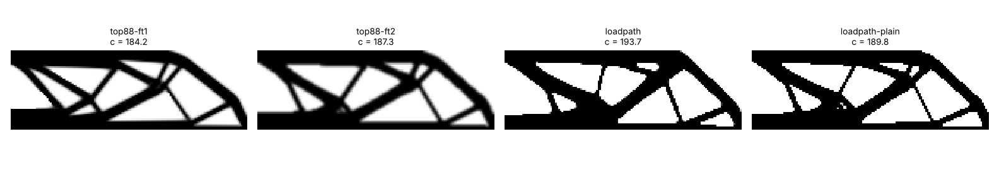
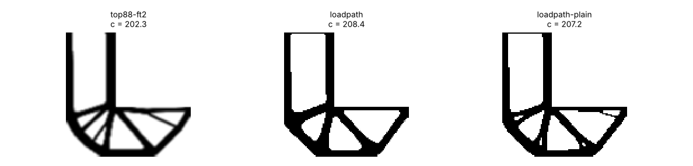
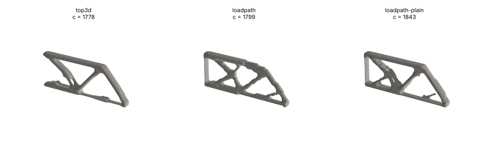
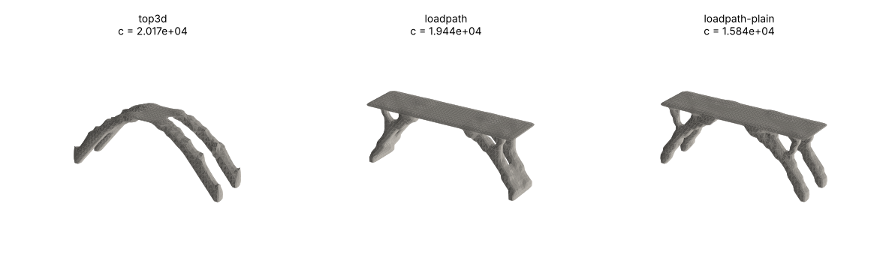
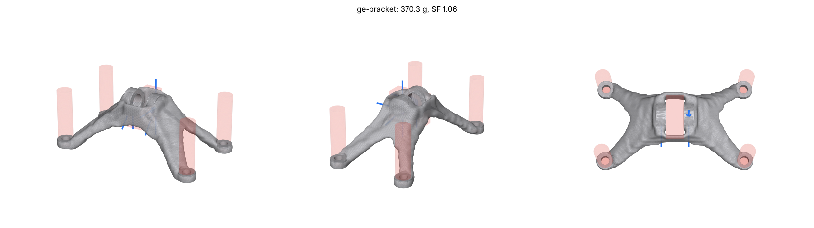

# Benchmarks

How close does loadpath's optimizer get to the optimum? The GRIP evals ask
whether a part is good enough to print; this suite asks how loadpath compares
with the published topology-optimization codes on the textbook problems, with
the same supports, loads and amount of material, scored by one evaluator.

```
python -m loadpath.benchmarks.run --out bench-out/          # every problem
python -m loadpath.benchmarks.run mbb-2d cantilever-3d      # a subset
python -m loadpath.benchmarks.run --refresh                 # rerun the references too
python3 tests/test_benchmarks.py
```

Code: [`loadpath/benchmarks/`](../loadpath/benchmarks/). Installing
`scikit-sparse` (CHOLMOD; `apt install libsuitesparse-dev` first) makes the
evaluator's direct solves several times faster in 3D; it is optional.

<!-- results:start -->

## Results

Run 2026-10-30 on the 4-core cloud box. Compliance is in the problems' own
units (unit Young's modulus, unit loads); lower is stiffer. Every design has
the same total material.

| problem | design | compliance | vs best reference | as delivered (p=3) | black/white at target volume | volume | iterations |
|---|---|---|---|---|---|---|---|
| MBB beam 2D (150x50, vf 0.5) | top88, sensitivity filter | **184.2** | 1.000 | 193.4 | 184.2 | 0.500 | 206 |
| | top88, density filter | 187.3 | 1.017 | 200.9 | 187.3 | 0.500 | 391 |
| | loadpath | 193.7 | 1.052 | 193.7 | 195.0 | 0.509 | 60 |
| | loadpath, plain | 189.8 | 1.030 | 189.8 | 189.8 | 0.500 | 56 |
| L-bracket 2D (100x100, vf 0.4) | top88, density filter | **202.3** | 1.000 | 237.3 | 202.3 | 0.400 | 409 |
| | loadpath | 208.4 | 1.030 | 208.4 | 209.6 | 0.405 | 57 |
| | loadpath, plain | 207.2 | 1.024 | 207.3 | 207.2 | 0.400 | 56 |
| Cantilever 3D (60x20x4, vf 0.3) | top3d | **1778** | 1.000 | 2418 | 1778 | 0.300 | 133 |
| | loadpath | 1800 | 1.012 | 1828 | 1800 | 0.294 | 57 |
| | loadpath, plain | 1843 | 1.037 | 1844 | 1843 | 0.300 | 57 |
| Bridge 3D (48x12x16, vf 0.15) | top3d | 20170 | 1.000 | 20170 | 8.2e9 (falls apart) | 0.150 | 172 |
| | loadpath | 19440 | 0.964 | 19500 | 19440 | 0.150 | 58 |
| | loadpath, plain | **15840** | 0.785 | 15840 | 15840 | 0.150 | 57 |

**Stress-constrained (minimum mass), L-bracket.** With top88's peak von
Mises (0.949, load cells left out) as the limit, loadpath's `goal.method:
"constrained"` reaches **0.302 volume at a peak of 0.934**: 25% less material
than the compliance designs carry for the same peak. It converges in 97
iterations and under a minute.









**Reading it.** On the 2D problems loadpath is 3-5% less stiff than top88 at
the same material, and 1% on the 3D cantilever; on the bridge it is stiffer
than top3d, whose grey design falls apart once thresholded to a real part.
loadpath gets there in 57-60 iterations against 130-410, and always delivers
a crisp part (greyness 0.01 against 0.13-0.27). The slower schedule below
closes about half of the 2D gap when stiffness is all that counts.

"loadpath, plain" switches off the three things loadpath does for
printability: the robust (eroded) formulation that stops sub-minimum members,
the boundary-padded filter, and dead-material pruning. With them off loadpath
solves the same problem as top88's density filter and lands within 1.3% of
it on the MBB beam. So most of the gap is the price of printable members,
and the rest is projection continuation (below).

<!-- results:end -->

## Method

**References.** [`reference.py`](../loadpath/benchmarks/reference.py) holds
line-for-line NumPy ports of the two codes everyone benchmarks against:
`top88` (Andreassen et al. 2011, 2D; sensitivity filter ft=1 and density
filter ft=2) and `top3d` (Liu & Tovar 2014, 3D, density filter). Ported: the
truncated cone filter normalized by its row sums, the sensitivities, the OC
bisection (move 0.2, 1e-3 tolerance), volume on physical densities and the
stopping rules (0.01 change; top3d at most 200 iterations). The elements are
the same (top88's plane-stress square, top3d's 8-node brick). On top3d's
own default problem, `top3d(60,20,4,0.3,3,1.5)`, the port ends at
c = 2418.2 after 133 iterations. A search turned up a top3d run quoted at
c = 2417.5, but not its parameters, so that agreement is suggestive, not a
check. Running the original `.m` files in Octave was not possible in this
environment (it blocks running downloaded code), so the ports are what was
run; the Octave runs would be the definitive check.

**Problems.** [`problems.py`](../loadpath/benchmarks/problems.py) defines
each problem once on a unit grid, and that definition drives the reference,
loadpath and the evaluator, so all three see the same supports and loads.

- MBB beam: top88's default half beam. loadpath models the whole beam with
  mirror symmetry, as a study would, and the half is scored.
- L-bracket (Le et al. 2010): 100x100 with a 60x60 cut-out, clamped on top,
  loaded down at the free arm's tip. The top88 reference uses passive voids
  as in the paper's section 5.2.
- Cantilever 3D: top3d's default problem.
- Bridge 3D: pinned along the bottom edges at both ends, a uniform load over
  the whole top face.

loadpath's side is built the way a study is (`build_domain`, so load and
support cells are pinned and symmetry is mirrored), then given the exact
nodal supports and loads. Its volume fraction is lowered by the pinned cells
so the total material equals the reference's. Plane problems run as a
one-cell slab extruded along y.

**Scoring.** [`evaluate.py`](../loadpath/benchmarks/evaluate.py) scores
every design two ways, void at 1e-9: penalized (p = 3) as delivered, and
black-and-white at the target volume (the densest cells kept). The headline
is the lower of the two, which is the most generous reading of a grey
reference design.

## GE jet engine bracket

[`cases/ge-bracket.json`](../loadpath/benchmarks/cases/ge-bracket.json) is
the 2013 GE/GrabCAD challenge set up as a loadpath study: the challenge's
four load cases (35.6 kN up, 37.8 kN out, 42.3 kN at 42 degrees, 565 N m
torsion as a couple on the two lugs), Ti-6Al-4V, a 0.75 in pin through a
two-lug clevis, four 0.375 in bolts held rigid, and the challenge's pass
rule: peak von Mises under yield (131 ksi, 903 MPa) in every case (goal
safety factor 1.0). The original bracket weighed 4 lb (1.81 kg) and the
winning entries removed about 80% of it (Carter et al. 2014, "The GE
aircraft engine bracket challenge: an experiment in crowdsourcing for
mechanical design concepts"). The geometry is approximate: the design
envelope is a box about the original's size (178 x 107 x 63 mm), roomier
than the original's L-shaped envelope, so masses compare only roughly.

<!-- ge:start -->
**Result: 370 g, safety factor 1.06** against yield in the worst case
(confirmed on the finer grid), one body, 0.17 mm worst deflection at the
pin. That is 79.6% lighter than the original's 1.81 kg, level with the
winning entries' "about 80%". The safety-factor search took six runs
(1540 g at SF 2.9, 803 g, 435 g, then 318 g and 343 g, both just under
SF 1) and 53 minutes on the cloud box while sharing it with the suite.



Caveats: the envelope is roomier than the original's, the bolts sit at
assumed positions, the mounting face is not modelled as contact, and the
challenge's stress check was a separate FE model where this is loadpath's own
voxel verification. The case's `expect` keeps 362 g (an 80% reduction) as the
mark to beat, so it currently reads as a narrow fail.
<!-- ge:end -->

## Fusion 360

No public Fusion generative-design case study publishes geometry, loads and
results complete enough to reproduce. Autodesk's own GE-bracket tutorial
sets its studies up with mass targets of 1.5 and 1.8 lb under maximum
stiffness and does not publish the outcomes; case studies (GM's seat bracket,
Airbus's partition) give percentages without the problems. Fusion's shape
optimization is SIMP-based, like loadpath; its generative design uses a level
set method. The GE challenge entries are the closest public yardstick.

## Gaps found

Fixed in this round:

1. **A load spread over a large face could land on void.** Load and support
   regions touching more than 3% of the cells were never pinned, contrary to
   the intent that a loaded face is. On the bridge (deck load, 6% of the
   cells) loadpath left deck nodes on void cells and its compliance came out
   around 1e9 against top3d's 2e4. A loaded face is now pinned whatever its
   share ([`domain.py`](../loadpath/domain.py)). The eval cases' domains are
   unchanged.
2. **The reduced solve crashed on hinges.** The optimizer solves only the
   live cells connected to a support, by 26-connectivity, so a piece hanging
   on one edge or corner is kept and makes the system singular; CG then
   failed with "the structure may be a mechanism". It now falls back to the
   full system, which holds the hinge at void stiffness
   ([`simp.py`](../loadpath/simp.py), forward and adjoint solves).

3. **The stress-constrained optimizer diverged.** `goal.method:
   "constrained"` (minimum mass with MMA, P-mean stress) emptied the
   L-bracket from the reference's volume and, started solid, ended 34% over
   its limit or in NaN. The cause was the stress relaxation: at q = 0.5
   (sigma = x^q vm) cells with almost no material next to a member, strained
   by the member's motion across them, read 100-1000 times the limit, and
   the aggregate chased cells that hold nothing. Fixed in
   [`constrained.py`](../loadpath/constrained.py) by q = 1; a guarded MMA
   step (when the worst constraint gets worse while infeasible, halve the
   move and pull the asymptotes in, `MMA.tighten`); sharpening the
   projection only once the design is feasible; and delivering the
   blueprint instead of the opening of the eroded design, which reshaped thin
   members after their stress was checked. Over ten runs (limits 0.7-1.2,
   starting volumes 0.4-0.95) every one converges, in 40-115 s; nine land at
   0.25-0.32 volume with the evaluator's peak within -12..+11% of the limit,
   and the tightest limit (0.7) lands in a heavier layout (0.57).
4. **Projection continuation is fast (measured, default kept).** loadpath doubled the projection
   sharpness at most every 10 iterations. Every 20 gave stiffer designs on
   every problem for twice the iterations. A sweep found where the gain comes
   from: the soft levels, where the layout forms. 20 iterations at beta 1 and
   2 and 10 after (`SimpOptions.beta_schedule = (20, 20)`) keeps about 90%
   of it for 1.4x the iterations; 20 at the sharp levels alone gains
   nothing.

   | schedule (iterations per doubling) | MBB | L-bracket | cantilever | bridge | iterations |
   |---|---|---|---|---|---|
   | 10 at every level (old default) | 0 | 0 | 0 | 0 | 1.00x |
   | 20 at every level | -2.6% | -0.9% | -0.2% | -12.2% | 1.96x |
   | 15 at every level | -2.2% | -0.7% | -0.1% | -11.1% | 1.46x |
   | **20, 20, then 10** | -2.5% | -0.6% | -0.3% | -11.4% | 1.40x |
   | 15, 15, then 10 | -1.8% | -0.7% | 0.0% | -12.2% | 1.21x |
   | 10, 10, 10, then 20 | -0.3% | 0.0% | 0.0% | +0.1% | 1.38x |

   Compliance change against the old default, loadpath as a study runs it.
   In a study on more than 12,000 cells the soft levels run on the coarse
   start (an eighth of the cells), so most of the extra cost lands there.
   **It is not the default.** On the evals (latest main against main with
   the schedule, cloud box) every case still passes, but stiffer is not
   lighter at a safety factor: mass at the target safety factor rose on all
   five small parts (MBB +3.6%, motor mount +4.2%, printed hook +13.6%, wall
   bracket +3.4%, fastened wall bracket +1.8%), and the GRIP parts moved by
   search noise (turret -7%, upper arm, wrist link and yoke within 1%). The
   schedule trades a little stress for stiffness, and the safety-factor
   search pays for stress. It stays available as `beta_schedule` for
   stiffness-driven studies.

Open, as next work:

1. **Constrained studies in 3D wander less, but still by about 15%.** The
   first constrained run of the wall bracket reads 17 MPa in the optimizer
   and 377 MPa verified. Its stress measure is not the cause: the optimized
   voxels deflect 0.23 mm, but the meshed part deflects 13.7 mm and comes
   apart in two pieces. About half of the design's cells are members one cell
   thick, and meshing loses them. Checking stress at cell corners instead of
   centres changed nothing. The study now searches the limit by bisection
   between a passing and a failing run, takes at most 4x a step, and
   warm-starts only from a passing design (`study.py`). Across target safety
   factors 2.45, 2.5, 2.55 and 2.6 the wall bracket lands at 56.5, 74.6, 58.6
   and 61.1 g, where it was 72-95 g before and 43-174 g before that. The
   default search lands at 68-79 g on the same four, so it has similar noise:
   the verified safety factor of one design depends on its junction details
   (58.6 g passed at SF 2.74 in one run and failed at 1.55 in another). What
   remains is meshing fidelity for one-cell members, shared with the
   tet-confirm work (1d500e0).
2. **Spread loads on regions that are not faces.** A load over a region too
   small or too chunky to count as a face is still not pinned, and on a
   coarse grid its nodes can end on void (a 24x6x8 bridge does this). The
   delivered part's verification catches it, but the optimizer should not
   produce it.
3. **Compliance designs keep sharp re-entrant corners.** On the L-bracket
   loadpath's peak stress is above top88's at the same volume. The
   safety-factor search pays for that peak with material.

## Compliant mechanisms

`python -m loadpath.benchmarks.mechanisms` runs the force inverter (Bendsøe &
Sigmund 2003, sec. 2.6) and a gripper (after Sigmund 1997) through a port of
the 99-line code's mechanism version and through loadpath's `mechanism.py`.
Every design is scored by one plane-stress evaluator with the same springs.
At equal volume loadpath's output is within 1-2% of the reference's: +2.0% on
the inverter and +0.9% on the gripper, black and white. The robust
(eroded/dilated) option gives up 3-4% for designs with no one-node hinges.
Full table and the TPU gripper in [MECHANISMS.md](MECHANISMS.md).
