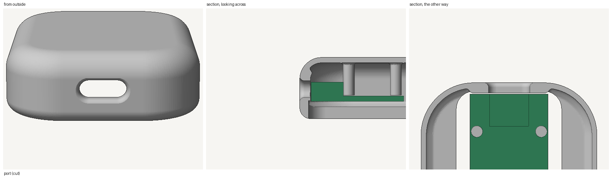

# A part in one run: spec in, checked part out

An agent given a sketch and a parts list can get most of a part right and
still spend a dozen rounds on the last tenth: a port mouth that lost its
round, a cradle patched on with a row of balls, a part a few grams off
that nobody noticed, a form that drifted from the concept a little each
edit. Each of those is a thing that was never written down as a
requirement, so nothing checked it.

`loadpath build` takes those requirements as a spec and makes the part
from them in one run, then measures every one of them on the delivered
mesh.

```
loadpath build spec.json --out dir          # MCP loadpath_build; exit 0 only when every check passes
loadpath check-build spec.json part.stl     # the same checks on a part made any other way
```

The spec is a study (`loadpath schema study`) with five more blocks. It
needs no loads or supports. With them it is also an ordinary study.

| Block | What it is |
|---|---|
| `designSpace` | the exterior, kept exactly: a CAD solid, STEP, mesh or SDF |
| `skin` | the wall kept of it, and `zones` where the wall is another thickness |
| `interfaces` | features that must be exact, as CAD solids: `add` (a boss, a plunger, a cradle) or `cut` (a port, a bore, an opening) |
| `components` | the bought parts as solids where they sit, with `clearance`, `mass`, `keepIn`, `insertFrom` |
| `targetMass` | grams, and which walls may move to reach it |
| `assert` | features measured every build; one that fails fails the build |
| `references` | concept images with their cameras, or a reference solid |

## Why interfaces are CAD solids

A sampled field cannot hold a 1.2 mm round on a port mouth or a crisp
bore: it is rebuilt from samples, and the samples are coarser than the
feature. So the features that must be exact are never sampled. They are
drawn once in [build123d](https://github.com/gumyr/build123d) (or come
in as STEP) and stay solids to the end:

```
part = exterior - (cavity - adds) - cuts - (components grown by their clearance)
```

Every operation in that line is an exact boolean on the tessellated CAD
solids (manifold3d). The exterior's own triangles are the part's outside.
A cut's edges and rounds arrive as drawn, and a pocket is its component
grown by its clearance and nothing else.

Only the cavity comes from a field: the exterior moved in by the skin,
with each add joined to the wall by a circular fillet of its `blend`
radius. The add's own solid is then united exactly, so the fillet is
where the organic wall meets the drawn feature and the feature itself is
untouched. That replaces patching a seam with a row of spheres.

A shape of type `brep` names the solid:

```json
{"type": "brep", "path": "cad.py:port"}
```

`cad.py` is a Python file beside the spec, and `port` a build123d (or
CadQuery) solid in it, or a function with no arguments that returns one.
The file is run, so it is the agent's own file. A `.step` path works the
same way. Any other shape works as an interface too, but brings no CAD
faces for the checks to read.

## The checks

Every build writes `checks.json`. Each row has the number measured, the
limit, and where it failed.

| Check | What is measured |
|---|---|
| `closed`, `one-piece` | the mesh is watertight and one body |
| `sound` | no edge on other than two faces as an STL stores the part, and no section of it crosses itself (watertight and one body is not sound: a folded surface closes too) |
| `exterior` | the part's outside against the exterior given, mm (0.0 when nothing changed it) |
| `open:<cut>` | no material left inside a cut |
| `drawn:<cut>` | the share of the cut's drawn surface, where the part has material behind it, that is the part's surface (at least 98 %) |
| `present:<add>` | the add's solid is all there |
| `clear:<component>` | the least gap from the part to the component |
| `way-in:<component>` | the path it sweeps going in along `insertFrom` is empty |
| `inside:<component>` | exterior left between it and the outside (`keepIn`) |
| `process` | walls, trapped powder and escape holes for the process |
| `dfm` | the print service's published limits for the material (below) |
| `mass` | the mass against the target and its tolerance |
| each `assert` | below |
| each `references` entry | below |

### Asserted features

```json
"assert": [
  {"id": "port-mouth", "type": "surface", "interface": "port", "near": {"type": "box", "...": "..."}},
  {"id": "port-mouth-round", "type": "fillet", "interface": "port", "min": 1.0, "near": {"type": "box", "...": "..."}},
  {"type": "wall", "min": 0.8},
  {"type": "distance", "from": "plunger", "to": "switch", "min": 0.3, "max": 0.5}
]
```

**`surface` is the one to reach for first.** It holds a window of the
part to the drawing, both ways: the interface's drawn surface inside
`near` is the part's surface, and the part's surface inside `near` lies
on something drawn (the exterior, an interface, a component's pocket),
within `tolerance` (0.03 mm). A feature that was filled, patched over
with a row of balls, squared off or rounded away fails outright, and the
row says where. Keep the window on the feature: the cavity's own surface
is not drawn, so a window that reaches into it fails.

`fillet` adds a number to that: the smallest radius of curvature on the
interface's curved faces by the CAD kernel (the radius as drawn), the
share of that surface still on the part, the radius read back from the
mesh, and the sharpest edge on the feature against `maxEdge` degrees. A
radius read off a mesh alone drifts with the tessellation, which is why
the kernel's value is the one reported and the region check is the gate.

`wall`, `clearance`, `keepIn`, `mass`, `open`, `present` and `distance`
are the other types (`loadpath schema study`, `$.assert`).

### A round against an exterior that is a mesh

A designer's exterior often arrives as a mesh, which has no face to
fillet a port's mouth against. `loadpath.brepio.outside_of` reads the
exterior's surface in a window, lays one B-spline face through it and
returns the space outside it as a solid. Unite that with the cut and
fillet the edge where they meet:

```python
outside, off = outside_of("parts/outer.stl", "+y", center=(0, 0, 6.6), size=(18, 8))
tool = tunnel + outside
port = fillet([e for e in tool.edges() if on_the_mouth(e)], 1.0)
```

The round is tangent to the tunnel and to the real exterior, and it is a
kernel face with a radius to read. `off` is how far the smooth face sits
from the mesh (0.006 mm on the Touch-Mic's flank, which runs 6 degrees
oblique to its port).

### DFM

The `process` row is loadpath's own check of the mesh. The `dfm` row
holds the same mesh to Materialize's published limits for the material
(minimum wall, build volume, the notes on its material page), with the
page and the date it was read in the row. Both run on every build.

## Target mass

```json
"targetMass": {"grams": 9.0, "tolerance": 0.15,
               "adjust": [{"zone": "floor", "min": 1.2, "max": 5.0}]}
```

The solve moves only the walls named in `adjust`, between their limits,
and only their inner surfaces: the exterior and every interface stay as
drawn. It works in both directions, so a part that should feel heavier
gets a thicker floor instead of a weight glued in. `of` is `assembly`
(the print with its components' masses, the default) or `part`.

It brackets on a sampled volume, then corrects on meshed masses until
the delivered mesh is inside the tolerance. A target no wall setting
reaches fails the `mass` check and says how far the walls go.

## References

```json
"references": [
  {"id": "hero", "image": "concept/hero.png",
   "camera": {"position": [197, -326, 173], "lookAt": [0, 0, 5], "lens": 85, "width": 1344, "height": 768}}
]
```

A reference is scored from a fixed camera, the one its image was made
with. The lens is a focal length on a 36 mm sensor, as Blender's, so a
render's camera can be copied over. The part is drawn from that camera,
and the score is the share of its outline that lies within `tolerance`
mm of an edge in the image. A silhouette `mask`, when there is one, adds
an overlap score.

A sketch has no camera, and is not to scale: scored as a silhouette,
its style and perspective read as drift while a sunken detail goes
unseen. `"camera": "fit"` still finds a camera from the exterior's
outline and draws the side-by-side, for a reviewer's eye, but a fitted
reference never fails the build (`"gate": false` does the same for any
reference). What holds the form is the exterior itself: freeze it as a
mesh or STEP at sign-off, and the `exterior` check holds every build to
it. Renders with known cameras gate as usual.

A pencil sketch on dot-grid or squared paper needs `"kind": "sketch"`.
The default edge finder reads the dots and the paper's shading as edges,
so a part's outline "matches" a blank page. A sketch is read as ink
(`sketch_strokes`: dark against the paper's own local brightness, specks
the size of a grid dot dropped). The drawn outline is closed into a
silhouette (`sketch_silhouette`, which bridges the gaps a quick stroke
leaves), so the sheet gets an overlap score and the two shapes' width
over height (`proportions`). A sketch's front, side and top views are
orthographic, so they are fitted with `"turn": false` (the default for a
sketch): the camera keeps the named direction and only zooms and pans.
A free fit can tilt the part until a wrong rake or taper lines up.

```json
{"id": "side", "image": "sketch/side.png", "kind": "sketch",
 "camera": "fit", "start": {"direction": "right", "width": 230, "height": 290}}
```

Crop each view from the sheet before scoring it, and paint out any part
of a neighbouring view that runs into the crop. The silhouette takes the
largest closed region, or the one holding `seed` (a pixel) when given.

A reference can also be a solid (`"mesh": "concept.stl"`): the two are
compared in six orthographic views and in three sections.

Each build writes `references/<id>.png`: the reference, the part from
the same camera, and the two outlines over each other. Red is part
outline with no reference edge under it.

## What a build writes

```
part.stl          the part
checks.json       every check
report.json       the checks, the mass solve's steps, the walls it settled on
exterior.png      the outside against the exterior given
views.png         six views
closeups/<id>.png every interface and component: from outside, and two sections through it
references/<id>.png
```

Look at the close-ups before handing a part over. The checks say a
feature is there and how big it is. Only the picture says it looks
right.

## Example

[examples/one-run/pod](../examples/one-run/pod): a desk pod's exterior,
a board and a switch that go in from below, a rounded USB-C mouth, a
plunger 0.4 mm over the switch, four posts, 9 g assembled. One run,
about 40 seconds, 23 checks.



*The port from outside and in two sections, the board green. The mouth's
round is the CAD's (1.2 mm by the kernel, 1.2 mm on the mesh).*

| Check | Reading | Limit |
|---|---|---|
| exterior | 0.0 mm | 0.05 |
| port mouth round | 1.2 mm | at least 1.0 |
| clearance, board | 0.2 mm | 0.2 |
| plunger to switch | 0.4 mm | 0.3 to 0.5 |
| thinnest wall | 0.8 mm | 0.8 |
| mass, assembled | 8.99 g | 8.85 to 9.15 |

The first drafts of this example failed their own checks five times, and
each failure was a mistake in the drawing, not the build: a mouth round
drawn inside the wall instead of at it, an opening that stopped short of
a floor the mass solve had thickened, a collar that left a film of
plastic against the board. Each was fixed in `cad.py` in one edit.

## What this reuses

The exterior check is `surfacecheck.compare_exterior`, the process check
`processcheck.check_process`, the DFM row `dfm_reference.review`. The
final booleans are manifold3d throughout: the CAD kernel draws and
tessellates the features and never cuts against the organic surface.
build123d is the authoring layer, and a `brep` shape works in any study
(a preserve, a keep-out), not only here.

An ordinary study's verify now reads what was drawn the same way
(`drawncheck.py`): every preserved region by name and, for a skin on a
mesh exterior, the exterior itself. A region that lost more than 2 % of
itself (and 1 mm^3), or an exterior that changed, sets `passes` false.
Until now only push-pad and feel parts were read like that.

## Limits

- The checks are geometry and mass. A build does not run loads. For a
  part that carries load, give the spec load cases and run it as a study
  with the interfaces preserved.
- The cavity's surface is marching cubes with a projection step, smooth
  and without creases of its own, on purpose: sharp edges come from the
  exact booleans with the drawn solids, so there is no dual contouring
  and none of its failure modes.
- A cut leaves whatever the wall behind it is. Where that is a fin under
  the minimum wall, the `process` and `wall` checks fail and say where;
  the build does not thicken or trim it. That is a drawing decision.
- Two drawn faces that coincide (two cuts ending on one plane) kiss along
  an edge; `sound` fails and names the place. Move one off the other.
- A hinge printed in place, or a second body, is another spec.
- Nothing here has been printed. The DFM row is a published limit read
  off a mesh, not a print.
