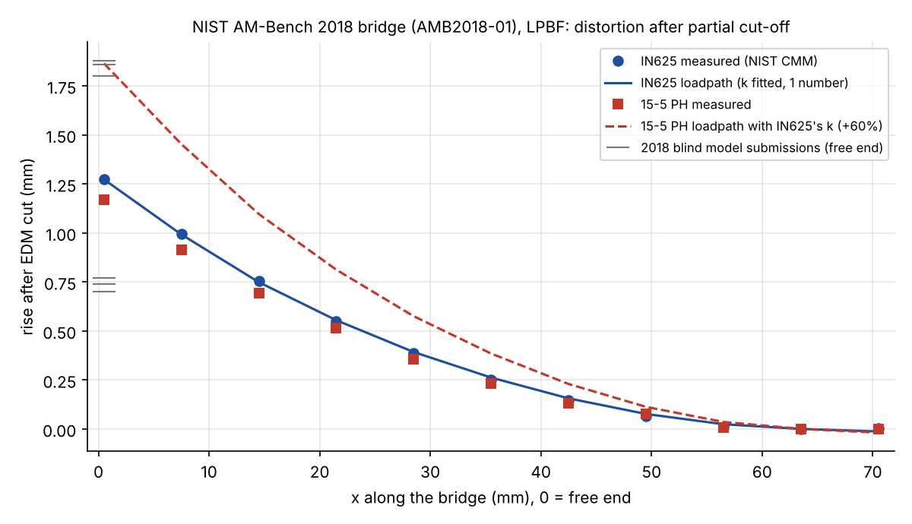
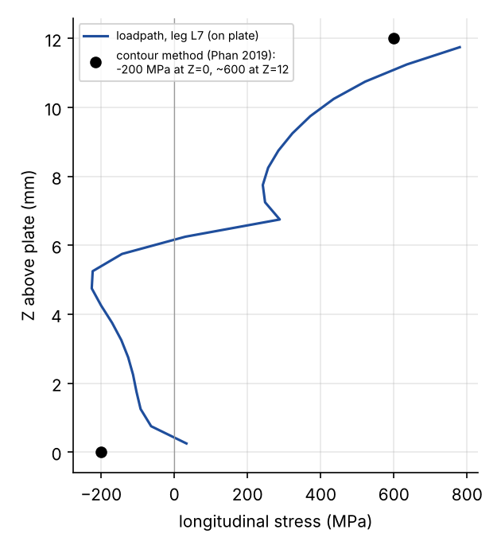
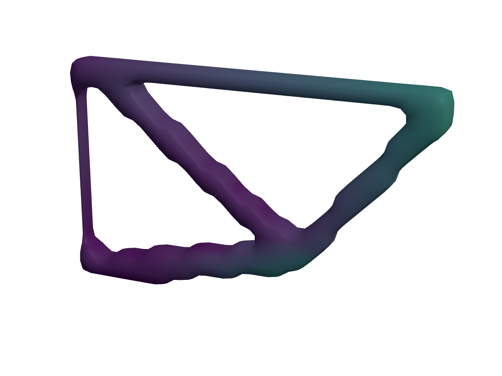
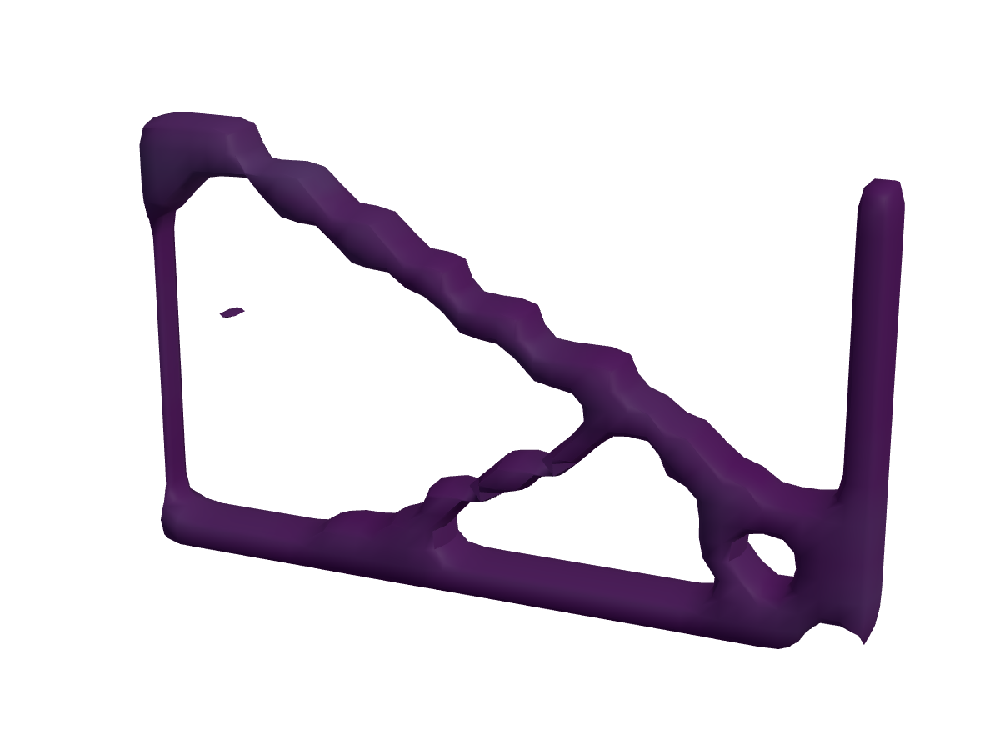

# Build-process simulation: warp, residual stress, compensation

`loadpath.buildsim` predicts what printing does to a part: the residual stress
it is left with, how far it moves when it comes off the plate or bed, whether
the build plane lifts into the recoater, and how hard an FDM part pulls on the
bed. It then feeds that back into design two ways: a pre-distorted mesh that
prints to the nominal shape, and a topology optimizer that weighs build
distortion against stiffness.

```json
"process": {"type": "lpbf"},
"buildSim": {"compensate": true}
```

adds `report.buildSim` to the delivered outcome (distortion, residual stress,
recoater lift, warnings) and writes `<name>-compensated.stl` next to the part.
From Python:

```python
from loadpath.buildsim import BuildSetup, simulate_part, compensate_mesh
r = simulate_part(mesh, BuildSetup(process="lpbf", material="in625"), build="+z")
r.report["distortion"], r.report["residualStress"], r.report["recoater"]
fixed, rep = compensate_mesh(mesh, BuildSetup(process="lpbf", material="ti64"), iterations=2)
```

## How it works

Every process here leaves stress the same way: a layer goes down hot and
stress-free, bonds to the part below, then shrinks as it cools, and what it is
bonded to stops part of the shrink. The solver adds the part one analysis
layer at a time on the same voxel hex mesh as the rest of loadpath. Each new
layer is stress-free in the shape it is laid into (bottom on the distorted
part below, top on the nominal plane the recoater or nozzle levels) and gets
an *inherent strain*: the shrink it would take if free. Each layer is one
linear solve over the cells printed so far, and every cell's stress is
carried forward. Then the part is released, cut off the plate or peeled off
the bed, and springs back. A full release frees each separate piece with a
statically determinate (3-2-1) hold and removes its best-fit rigid motion, as
a CMM would.

| process | inherent strain | held by |
|---|---|---|
| lpbf | `-k * yield / E`, isotropic in the layer plane for rotating scans; `k` fitted on AM-Bench | the build plate, modelled as plate cells bolted at the underside (`plate` mm, default 10) |
| fdm | `-relax * alpha * (Tg - T(z))`, where `T(z)` runs from the bed temperature down to the chamber's; after printing, the whole part cools on the bed to room temperature | the bed, as an elastic foundation (`bed_stiffness`, N/mm³) or rigid |
| sls / mjf | `-ds * min(depth / depth_sat, 1)`: thick sections crystallize more and shrink more than thin walls; the bulk 3-4% shrink is assumed taken out by the printer's scale factor | nothing: the part cools free in the cake |

Layers are lumped: one analysis layer is `layer` mm, one voxel by default.
Lumping changes the answer, because a thick slab laid in one go bends a
compliant part less than thin layers do. The test beam below shows how much.
For that reason the LPBF factor is fitted at the voxel size the benchmark
runs at, and the pitch study further down gives the sensitivity.

## Verification: the progressive-deposition beam

Take a strip laid layer by layer on a free substrate, each layer shrinking
along its length once laid. Beam theory gives its curvature exactly for any
layer schedule (Tsui & Clyne 1997, progressive deposition;
`buildsim.progressive_beam` integrates it). The 3D solver matches it:

| lumping | FE curvature | beam theory | ratio |
|---|---|---|---|
| 0.5 mm layers | 2.840e-3 /mm | 2.884e-3 /mm | 0.985 |
| 1.0 mm layers | 2.089e-3 /mm | 2.113e-3 /mm | 0.988 |

For the same strip, beam theory gives 4.0e-3 /mm with 0.01 mm layers, so
0.5 mm lumps capture 72% of the thin-layer curvature on this compliant strip.
On a part held by a thick plate the gap is smaller (see the pitch study).

`tests/test_buildsim.py` covers this case, plus four more:
- a uniform shrink of a free part leaves it stress-free;
- a part cut off a plate springs up;
- a hot chamber warps less than a cold one;
- the warp optimizer's adjoint gradient matches finite differences to 1e-8.

## Validation: NIST AM-Bench 2018 bridge (LPBF)

AMB2018-01 is a 75 × 5 × 12 mm bridge on twelve legs. It was printed in IN625
and in 15-5 PH on an EOS M270 at 20 µm layers, on a 12.7 mm plate of the same
alloy. NIST then cut the legs off the plate by wire EDM, leaving the base
block attached, and measured the rise of 11 ridges on top by CMM (Phan et al.
2019, IMMI 8:318; NIST AMB2018-01 pages). In the 2018 blind challenge, six
model submissions predicted the free-end rise between -45% and +47% of the
measured value, and none met NIST's criterion (Levine et al. 2020, IMMI 9:1).

`bench/buildsim_validate.py` builds the bridge from NIST's drawing (legs, 45°
window overhangs, ridges) at 0.5 mm voxels on the 12.7 mm plate, modelled
as two voxel layers whose modulus is scaled so they are as compliant through
the thickness as the whole plate (`plateCells`, the default). It lays the
bridge in 0.5 mm analysis layers, cuts the legs off along x = 0-56 mm, and
reads the ridges.



| | free-end rise | all 11 ridges |
|---|---|---|
| IN625 measured | 1.276 mm | |
| IN625 loadpath, k = 0.839 fitted on this data | 1.275 mm | rms error 0.007 mm |
| 15-5 PH measured | 1.168 mm | |
| 15-5 PH loadpath with IN625's k (a prediction) | 1.882 mm (+61%) | rms error 0.33 mm |
| 2018 blind submissions | 0.70-1.88 mm | |

What this shows, and what it does not:

- **The IN625 match is a fit, not a prediction.** One number, `k`, sets the
  magnitude. The shape is not fitted: one scalar cannot bend the curve. The
  model reproduces the whole profile (the near-parabola from the free end,
  the root near x = 56-60 mm, and the flat attached end) to 7 µm rms, 0.6% of
  the tip rise.
- **The transfer to another alloy failed.** The yield-strain law
  `eps = -k * yield / E` carried from IN625 to 15-5 PH over-predicts by 61%.
  15-5 PH turns martensitic as it cools, and the transformation expands,
  undoing part of the shrink, which the law cannot know about. So 15-5 PH has
  its own fitted `k = 0.522` (7 µm rms), which leaves it with no independent
  check.
- **Other alloys are uncalibrated.** Ti64, 316L and AlSi10Mg use IN625's `k`,
  and `report.buildSim.strain.kSource` says so. For Ti64 that gives
  -0.0083 in-plane. Published elastic calibrations on twin cantilevers put
  Ti64 at -0.0047 / -0.0020 (Simufact, Ninpetch et al. 2022, quoted from a
  search summary, not read). For anything that matters, print a cantilever,
  cut it, and set `buildSim.scale`, the same calibration the commercial
  inherent-strain codes ask for.
- **Residual stress on the plate**, along leg L7, compared with the contour
  method: about -200 MPa near the plate in both, and +580 to +720 MPa in the
  top 1 mm against a measured ~600. Through the solid section (z 7-10 mm) the
  model reads +170 to +320 MPa, while the contour cut crosses zero near z = 8
  and reaches only about +100 MPa. That gap is a linear model with no
  yielding: the reported peak (2800 MPa at the sharp leg roots) is a
  singularity, not a stress. The report flags anything above yield.



**Pitch study and speed** (IN625 at the fitted k, the 4-core cloud box):

| voxels | plate | cells | free-end rise | time |
|---|---|---|---|---|
| 0.5 mm | 2 layers, scaled (default) | 35k | 1.275 mm | 65 s |
| 0.5 mm | whole 12.7 mm plate | 85k | 1.178 mm | 181 s |
| 1 mm | 2 layers, scaled | 5k | 1.025 mm (-20%) | 7 s |
| 1 mm | whole plate | 11k | 0.984 mm | 36 s |

The first version took 12 min at 0.5 mm on the whole plate. Two changes
cut that to 65 s: the reduced plate (most of the cells were plate), and
mg.py's matrix-free multigrid for big layer solves (cells not yet printed
get modulus 0), since the AMG setup per layer had been 60% of the time.
The reduced plate is not free: the bridge rises 8% more on it than on the
whole plate (the scaled layers match the plate's give through its
thickness, not how it spreads load sideways), so
`k` was refitted with it, 0.839 against 0.909 on the whole plate; set
`plateCells` high to model the whole plate, then use `scale` 1.08. Only a
plate bolted along its underside is reduced; a free one bends, which the
scaling cannot match. At 1 mm voxels the rise reads 20% low, and
`simulate_part` sizes the grid to about 60k cells by default, so on large
parts the voxels coarsen and the prediction reads low by about that much.

## FDM: warp against Armillotta et al. 2018 (ABS)

Armillotta, Bellotti and Cavallaro measured how flat the top face of ABS
bars came out of a Stratasys Dimension Elite: closed chamber at 75 °C,
0.254 mm layers, a soluble-support raft, flatness taken by 3D scan after
removal (Robotics and CIM 50:140-152, 2018). `bench/buildsim_fdm.py` runs
their nine 20 mm-wide bars as strips at 0.254 mm voxels, one voxel per
printed layer, so nothing is lumped (their tests showed width has no
effect). Two numbers were fitted: the share of the sub-Tg shrink the part
keeps (`relax`, least squares) and the raft's hold (`bed_stiffness`, swept
over 1.5-100 N/mm³ at 0.508 mm and checked at 3 and 4 at 0.254 mm). The bed
is an elastic foundation in all three directions, pinned only against
in-plane drift at its centre: an earlier version also held three corner
nodes down in z, which stopped exactly the corners that lift. The best pair
is 0.895 and 4 N/mm³, which are now the defaults:

| bar (length x height, mm) | measured warp | loadpath |
|---|---|---|
| 60 x 1.5 | 0.38 | 0.62 |
| 60 x 3.5 | 0.45 | 0.40 |
| 60 x 5.5 | 0.42 | 0.28 |
| 100 x 1.5 | 0.58 | 0.85 |
| 100 x 3.5 | 0.67 | 0.71 |
| 100 x 5.5 | 0.68 | 0.58 |
| 140 x 1.5 | 0.93 | 0.91 |
| 140 x 3.5 | 1.05 | 0.89 |
| 140 x 5.5 | 0.97 | 0.78 |

The rms error is 0.16 mm and the mean error 24%. Two things hold up: the
magnitude, and the growth with length (the measured warp grows 2.5x from
60 to 140 mm; the model grows 1.5-2.8x). One thing does not: the measured
warp peaks at 2-4 mm of height, while the model falls steadily with height.
Armillotta's own analytic model misses that peak too; they put it down to
reheating of the layers below above Tg, and to plasticity near Tg, and this
model has neither. With a rigid (glued) bed, the same bars barely warp
(0.02 mm at full shrink), because a part held flat while every layer goes
down holds a nearly uniform stress, and a uniform stress releases without
bending. The bed's give is what lets the warp build up during the print.

**The peak, tried and not fixed.** Two physical mechanisms were tested
against it, and neither reproduces it, so neither is on by default:

- *Bed-bond failure* (`buildSim.bedAdhesion`, MPa). Each bed node whose bond
  tension `kb * u_z` passes the adhesion lets go, and the part re-balances,
  layer by layer and again on cool-down; the report gives `detachedArea` and
  `bedFailed` (the whole footprint let go). Swept over bed 3-100 N/mm³ and
  adhesion 0.03-3 MPa (with relax refitted, which scales the adhesion too),
  the best fit with any letting go was rms 0.18 mm against 0.13 without, at
  0.508 mm voxels. Letting go flattens the tall bars (they curl free while
  printing, and later layers go down level on the curled ones) and leaves
  the thin ones, the opposite of the measured trend. It gives a peak at
  3.5 mm only on the 100 and 140 mm bars at bed 10-30 N/mm³ and 0.3 MPa,
  with the 60 mm bars falling. It stays as an option, because a bond that
  lets go is how prints fail, and `bedFailed` is a useful warning.
- *Reheating of the layers below* (an anneal of the strain already locked in
  when a hot layer goes down on it) moved the trend the wrong way and was
  dropped.
- The corner-pin fix gave a peak on the 140 mm bars at 0.508 mm voxels
  (0.87, 0.96, 0.84 against 0.93, 1.05, 0.97), but it went away at the
  printed 0.254 mm layers, so it was voxel lumping, not physics.

The thin bars are the miss: the model over-predicts the 1.5 mm bars by up
to 65% on the short lengths. The likely cause is something this model does
not have, thin bars cooling through Tg layer by layer in a few seconds
while their layers below are still soft.

The report also gives the bed's pull on the part (`peel`: the mean over the
area in tension, its maximum, and the net lift force). The maximum sits at an
edge, where a bonded joint's peel stress is singular and grows as the voxels
shrink, so the warning goes on the mean. ASA, PETG and PLA use the same two
fitted numbers with their own Tg and CTE, and none of them is validated.

## SLS / MJF

The differential-shrink model (`ds` = 0.3% between a thin wall and a section
4 mm deep or more) is a heuristic sized to the 0.2-0.5% differential shrink
the nylon sintering literature reports. It is not fitted to a measured part,
and the report labels it as a heuristic. Use it to compare designs (a thick
boss on a thin panel bows the panel), not to predict millimetres.

## Pre-distortion compensation

`compensate_mesh` simulates the part, moves every vertex against its
predicted displacement, simulates the moved shape, corrects by whatever error
is left, and repeats. On a Ti64 overhang bracket (a 30 mm arm on a 6 mm post,
0.5 mm voxels, full release):

| round | max deviation from design | rms |
|---|---|---|
| print the design | 1.52 mm | 0.76 mm |
| compensated once | 0.20 mm | 0.12 mm |
| compensated twice | 0.11 mm | 0.05 mm |

What remains is about one voxel's worth of resolution. The study writes
`<name>-compensated.stl` when `buildSim.compensate` is true.

## Warp-aware topology optimization

`optimize_warp(grid, supports, force, WarpOptions(...))` minimizes
`c / c0 + w * D / D0`, where `c` is service compliance and `D` is the mean
squared as-built displacement from the layer-by-layer build on the plate.
The gradient of the layer-by-layer solve comes from the adjoint: two solves
per analysis layer, sharing one factorization. It matches finite differences
to 1e-8.

`bench/buildsim_optimize.py` runs a Ti64 shelf bracket, 40 x 4 x 24 mm
(2.5D, 1 mm voxels), built standing on the plate. It is bolted along x = 0,
and its top corner is loaded. Two designs at the same volume target, both
re-simulated afterwards with the full build model (5 mm plate, then cut off):

| | compliance only (w = 0) | compliance + distortion (w = 1) |
|---|---|---|
| volume fraction | 0.315 | 0.298 |
| service compliance | 1.76 N mm | 3.61 N mm (2.0x) |
| max distortion on the plate | 0.51 mm | 0.088 mm (-83%) |
| max distortion after cut-off | 0.39 mm | 0.18 mm (-54%) |
| lift at the build plane (recoater) | 0.31 mm | 0.056 mm |
| residual von Mises p95 on the plate | 523 MPa | 927 MPa |

| compliance only | warp-aware |
|---|---|
|  |  |

(Colour is the as-built displacement, from 0 in dark purple to 0.8 mm.)

The compliance-only design is a classic truss whose top chord runs
straight out from the flange at the very top, so it is printed last as a
30 mm horizontal span, which curls up as it goes down: 0.31 mm of lift at
the build plane, six times a typical 0.05 mm recoater clearance. The
warp-aware design builds nothing flat and high. A post stands on the plate
under the load pad, a strut runs along the plate back to the flange, and a
tie climbs from that post to the top of the flange at about 30°. The price is
real: twice the service compliance at w = 1, and more stress locked in on
the plate (most of which the cut releases). The weight `w` sets that trade.
Both the trade and the recoater gain come from the optimizer's view of the
build, which no compliance-only optimizer has.

### In a study

The same term is in the study optimizer. Set a weight under `buildSim`:

```json
"process": {"type": "lpbf", "buildDirection": "+z"},
"buildSim": {"warpWeight": 1}
```

The optimizer then minimizes `compliance * (1 + w * D / D0)`, with `D` the
mean squared as-built displacement of the part on its plate and `c0`, `D0`
from the first iteration, and the stress and volume goals still apply as
they do without it. `warpWeight` 0 (the default) leaves the optimizer alone,
and `buildSim` then only verifies and compensates the delivered part. Around
1 is a big trade, as in the table above. The term needs a build direction
along a grid axis (`+z`, `-y`, ...), so a tilted or `auto` build is refused,
and it needs `lpbf` or `fdm`. Layers are lumped to `warpLayer` mm, by default
4 cells. Each iteration costs two sparse solves per lumped layer on top of
the service solve, so a 30-layer part runs several times slower than
compliance alone (7x in the demo below).

**Demo through a study** (`bench/buildsim_study_warp.py`): the Ti64 shelf
bracket of the table above, 40 x 6 x 24 mm, at a fixed 35% volume, run
through `run_study` with `warpWeight` 0 and 1. The study's own `buildSim`
pass checks each delivered part (about 8000 cells, 5 mm plate, as built on
the plate):

| | warpWeight 0 | warpWeight 1 |
|---|---|---|
| mass | 10.0 g | 9.9 g |
| safety factor | 2.07 | 0.96 |
| max as-built distortion | 0.51 mm | 0.17 mm (-66%) |
| rms as-built distortion | 0.13 mm | 0.038 mm (-72%) |
| recoater lift | 0.20 mm | 0.054 mm (-73%) |
| residual von Mises p95 | 933 MPa | 992 MPa |
| study time (cloud box) | 2.5 min | 17 min |

The trade is the same as with the Python API: the build gets much flatter
and the part loses half its strength at the same mass, so at w = 1 a
safety-factor goal that the plain design meets fails. Use a smaller weight
(untested here), or a volume that leaves room, when strength must hold; the
study reports both numbers. The run is about 7x slower.

## Limits

- Speed. Each analysis layer is one solve over the part plus two layers
  of plate. AM-Bench at 0.5 mm (35k cells, 25 layers) takes 65 s on the
  4-core cloud box, and `compensate` runs the simulation iterations + 2
  times. The warp term in the optimizer is the slow part (see above).

- Linear elastic throughout. There is no plasticity, so peaks at sharp roots
  exceed yield (flagged in the report), and there is no creep or stress
  relief. Stress-relief heat treatment before cut-off would remove most of
  the LPBF distortion this predicts.
- One inherent strain per alloy and process, isotropic in plane, which suits
  rotating scans. Stripe or island patterns that do not rotate are
  anisotropic: give `strain` explicitly.
- No thermal history and no preheat. For AlSi10Mg on a plate preheated to
  150-250 °C, the measured distortion falls toward zero (Buchbinder 2014);
  scale it down.
- Voxel and lumping dependence, as quantified above. The LPBF calibration
  holds at 0.5 mm voxels and 0.5 mm analysis layers.
- FDM is fitted to one machine family (an enclosed Stratasys printer, ABS
  on a support raft) and misses the measured warp peak at 2-4 mm of
  height (bed-bond failure and reheating were tried and do not explain it). ASA, PETG and PLA are unvalidated, and an open-frame printer on
  a PEI sheet holds the part differently (`bedStiffness`).
