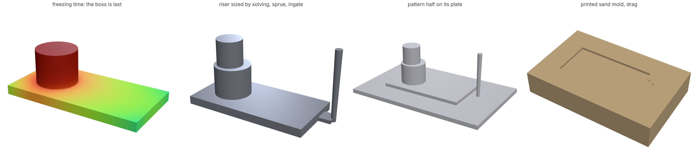
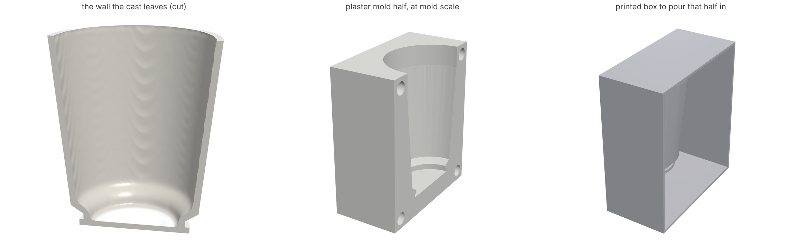

# Casting: metal in a mold, slip in plaster

A printed part is done when the printer stops. A cast part is only a
cavity until the metal has run into it, frozen, shrunk and been fed, or
until a clay slip has stood in plaster long enough to leave a wall. Most
of what makes a casting good or bad is decided by the shape, and the
usual tools for it are rules: a draft angle per process, a minimum wall
per alloy, a riser "1.2 times the section", a shrink rule on the pattern.
A topology optimizer knows the loads and nothing about the foundry; a
casting simulator knows the foundry and waits for somebody to draw the
part. `loadpath` holds the part, so it pours it.

```
python -m loadpath cast part.stl --process sand --alloy a356 --out out/         # MCP: loadpath_cast
python -m loadpath slipcast cup.stl --body porcelain --wall 3 --out out/        # MCP: loadpath_slipcast
```

and, in a study, `"casting": {"draw": "+z", "draft": 2, "process": "sand",
"alloy": "a356"}`: the optimizer keeps the part free of undercuts along
the draw, the delivered mesh carries the draft, and the delivered part is
then poured the same way (`castability` in its report, with its
warnings).

Nothing here is a rule of thumb. There is no modulus ratio for risers, no
table of minimum walls, no shrink allowance per process. The mold's
conductivity, the alloy's freezing curve and latent heat, gravity,
surface tension and conservation of mass are the model; the hot spots,
the riser, the porosity and the wall that fills are what they do.

## Metal



*A 120 x 60 x 8 mm plate with a 36 mm boss, A356 in sand. Alone, the boss
freezes last and holds all of the shrinkage as a cavity. The riser was
sized by solving until the part came out sound; the pattern is larger
than the part by the alloy's contraction.*

**Solidification.** The heat equation with latent heat (the enthalpy
method) on a voxel grid of the metal and its mold: sand, an investment
shell with air beyond it, plaster, or a steel die, each with conductivity
and specific heat as functions of temperature and a contact conductance
at the metal. The mold cells away from the metal take one step for many
of the metal's, against the time-averaged temperatures in between, so
energy is conserved to rounding and a part of 60 000 cells solves in
about fifteen seconds.

**Shrinkage and what feeds it.** Liquid alloy is lighter than solid, so
freezing draws liquid in. At each step the still-liquid metal is split
into connected pools; the volume each pool loses is taken from its
highest cells that can still drain (solid fraction under the alloy's
feeding limit). A pool cut off from any riser empties from its own top:
that is a shrinkage cavity, with a position and a volume. A pool joined
to a riser drains the riser instead: that is the pipe. Nothing says
"risers go on thick sections". The solve is run on the part alone, the
cavities it finds are where metal was needed, a riser is stood over each
and grown until the part holds no cavity and the pipe stays in the
riser, then trimmed to the smallest that still does. The report gives
each riser's position, size, pipe depth and the yield.

**Microporosity.** Where the mush is long and the gradient low, liquid
cannot be drawn through the dendrites fast enough and pores open between
them. Carlson and Beckermann's dimensionless Niyama criterion is Darcy
flow through the mush integrated to the point where the pressure runs
out; it gives a pore volume fraction from the thermal gradient, cooling
rate, the alloy's viscosity, freezing range and arm spacing, with no
threshold fitted per foundry.

**Whether it fills.** Metal enters a wall only if its head beats surface
tension across the gap (2γ/t), and it stops when the tip of the stream
has frozen to the coherency fraction, which is a heat balance on fresh
mold. From those two, the thinnest wall the metal will enter, how far it
runs in a wall of a given thickness, and whether any part of this shape
is past that from the gate. The pour time is the tip time of the
thinnest wall; the sprue passes that flow at the speed the head gives;
the ingates pass it under the speed at which a liquid front breaks up
(Campbell's critical velocity, from the same surface tension).

**Pattern scale.** The solid contracts from the solidus to room
temperature by its expansion coefficient: 1.33% for A356, 2.06% for
carbon steel, which are the patternmaker's 1.3% and 2% rules, derived.

**What you print.** `castmold.metal_pattern` writes, at pattern scale,
the casting tree (part, risers, sprue, ingate) for investment casting
from a printed pattern, and for sand a split pattern on plates and the
two mold halves themselves, for a binder-jet sand printer or a printed
box to ram sand in. The parting plane is the one that leaves no
undercut, found on the shape.

| Alloy | Card | Process | Mold |
|---|---|---|---|
| `a356` | Al-7Si-0.3Mg | `sand` | silica sand, also binder-jet printed |
| `a380` | Al-8.5Si-3.5Cu, die casting | `investment` | ceramic shell, preheated |
| `wcb` | cast carbon steel | `plaster` | plaster-bonded investment flask |
| `silicon-bronze` | Cu-4Si (Everdur) | `permanent`, `die` | steel, coated; die under pressure |

An alloy can be given as a card of overrides (`{"base": "a356",
"liquidus": ..., "fraction": [[T, fs], ...]}`).

## Slip



*A 90 mm porcelain cup with a 3 mm fired wall: 21 minutes in the mold.
The flats come out at 3 mm; the inside corner at the foot, fed by two
mold faces, reaches twice that. The mold is 17.4% larger than the fired
cup.*

**The wall.** Plaster pulls water out of the slip by capillary suction;
the clay left behind is the cake, and the water has to cross it. Darcy's
law through the growing cake and the wetted plaster in series gives
L² = A t, with A from the suction, the cake's permeability and how much
water each unit of cake gives up. On a real shape the same equation is
solved in 3-D (it is a Stefan problem, so the solidification solver runs
it with pressure as temperature): corners fed from two faces build
thicker, a neck narrower than two walls closes and traps slip behind it,
and both are reported with their volumes. A body's permeability comes
from one timed cast (`castingRate`, mm²/min) or from its particle size
by Kozeny-Carman. Pressure on the slip adds to the suction.

**Shrinkage.** By conservation of the solids: drying takes the cake's
packing to the dry packing, firing takes the dry density (less the loss
on ignition) to the fired density. The cube roots of those ratios are
the linear shrinkages, and their product is the mold scale.

**Kiln sag.** Near its top temperature the body is a very viscous
liquid, and a viscous body under a steady load deforms like an elastic
one whose modulus is one over the creep compliance. That compliance is
what the pyroplastic index measures (a bar sagging between two supports
through a firing), so the fired shape is solved under its own weight
with it, resting on its foot or on the setter you give it.

**Strength.** The same self-weight stresses, at the leather-hard size
and density, go through Weibull's weakest-link integral with the green
strength: the chance the part breaks coming out of the mold. The fired
part gets the same with its fired strength.

**The mold.** Two plaster halves at mold scale with the pour opening,
parted on the plane that leaves no undercut, with walls at least as
thick as the water of the casts you want between dryings will wet, and
the printable boxes to pour each half in.

Bodies: `porcelain`, `stoneware`, `earthenware`, `alumina`; any property
can be overridden (`{"base": "porcelain", "castingRate": 0.5,
"specificGravity": 1.78}`).

## What it was checked against

| Check | Result | Reference |
|---|---|---|
| Front of a pure metal freezing against a mold | centre of a 20 mm slab solid at 189.8 s against 189.7 s | Schwarz's exact solution |
| Sound length at the free end of a steel plate, 76 mm thick, sand | 4.2 thicknesses | 4.2, radiographed plates (Ou, Carlson, Hardin, Beckermann 2002) |
| Pore fraction against dimensionless Niyama, WCB steel | within 12% over Ny* 1 to 100 | Carlson and Beckermann 2009, Table III |
| Linear contraction | A356 1.33%, carbon steel 2.06% | patternmaker's rules 1.3%, 2% |
| Critical ingate velocity, aluminium | 0.49 m/s | about 0.5 m/s (Campbell) |
| Slip cake on a grid | within 10% of L² = A t | the filtration law |
| Kiln sag of an overhanging bar | within 10% | beam theory with the pyroplastic compliance |
| Porcelain total shrinkage | 14.8% | 12 to 16% for vitreous casting porcelain |

`tests/test_casting.py` and `tests/test_slipcast.py` hold these.

## What is not there yet

Stated so nobody builds on a number that is weaker than it looks.

- **Feeding is by gravity and connectivity, not a pressure solve.** A
  riser feeds any liquid it is connected to while the path is under the
  feeding limit. Long thin paths that a pressure drop would starve show
  up in the Niyama porosity, not as cavities.
- **Fluidity is not yet checked against measured spiral tests.** The
  magnitudes are right for sand-cast A356 (a 4 mm strip runs past half a
  metre) but no published curve has been reproduced.
- **A356's pore fraction uses the paper's fitted curve.** The integral
  over this card's own freezing curve differs from it by 2 to 7 times at
  high Ny*, because the eutectic plateau dominates; the steel's agrees.
- **No mold filling flow.** Cold shuts, air entrapment and oxide films
  from turbulence need a free-surface flow solve.
- **No hot tearing or residual stress** in the casting as it contracts
  against the mold.
- **Slip: the cast rate and the pyroplastic index are typical values per
  body**, taken from published ranges. One timed cast and one sag bar of
  your own slip replace them. Drying warp from uneven wall thickness is
  not solved; the corners that would cause it are reported.
- **Draft is still the angle you give.** What the pattern needs to pull
  from sand without tearing it depends on friction and the sand's green
  strength; that solve is not here.
- **The optimizer does not yet see the pour.** A study pours the part it
  delivered and reports; it does not move material to feed a hot spot.
  Directional solidification as a constraint in the loop is the next
  step.

## Sources

Carlson and Beckermann, "Prediction of shrinkage pore volume fraction
using a dimensionless Niyama criterion", Metall. Mater. Trans. A 40
(2009). Ou, Carlson, Hardin and Beckermann, "Development of new feeding-
distance rules using casting simulation: Part II", Metall. Mater. Trans.
B 33 (2002). Mills, *Recommended Values of Thermophysical Properties for
Selected Commercial Alloys* (2002). ASM Handbook vol. 15, *Casting*.
Poirier and Geiger, *Transport Phenomena in Materials Processing*.
Flemings, *Solidification Processing* (1974). Campbell, *Castings*.
Each alloy, mold and body card names where its numbers come from
(`casting.SOURCES`, `slipcast.SOURCES`).
