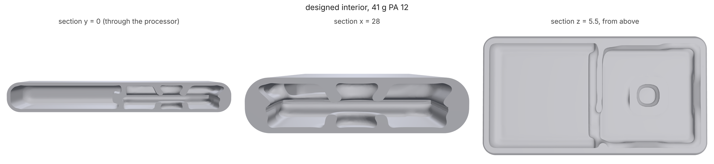

# Cooling: interiors designed around the heat electronics make

An industrial designer hands over the exterior. The parts that go inside
are known, and some of them make heat: a processor, a radio, a charger
chip. Each has a temperature it must stay under, a battery has a lower one
still, and the outside has its own limit: the surface a hand holds must not
get hotter than is comfortable or safe to touch. Everything inside the
exterior is invisible, so it should be designed for exactly that, with the
least material, and together with whatever else the inside has to do (a
grip that does not creak, a push pad's click, a drop).

`loadpath cooling` does this. As with push pads ([SWITCH.md](SWITCH.md))
and feel targets ([FEEL.md](FEEL.md)) the exterior is kept as a thin
`skin`, the components are keep-outs (with their assembly paths), and
everything else is design space. A `cooling` block says what makes heat
and what must stay cool:

```json
"cooling": {
  "ambient": 30,
  "components": [
    {"region": "soc", "watts": 1.5, "maxTemp": 70},
    {"region": "pmic", "watts": 0.3, "maxTemp": 70},
    {"region": "board", "conductivity": 20},
    {"region": "battery", "conductivity": 1.5, "maxTemp": 45}
  ],
  "skin": {"contact": "held"}
}
```

```
python -m loadpath cooling handheld.study.json --out hh-out/
```

A component is a keep-out `region` (the part as drawn: a keep-out with an
`insertFrom` path is swept along it in the study, the part itself is not)
or its own `shape`. `watts` is the heat it gives off, spread over its
volume; `maxTemp` is what its hottest point must stay under; a component
with no watts (a board, a battery) only conducts. `conductivity` defaults
to 20 W/(m K), a package on a copper-filled board in plane; a lithium
pouch is 1-3 across its layers.

The skin limit is `skin.maxTemp` in C, or a contact class for plastic
surfaces after IEC 62368-1's TS1 limits: `continuous` 43 C (held over 8 h),
`held` 48 C (10 min to 8 h, a handheld product in use), `brief` 60 C (1 to
10 min). Metal surfaces have lower limits; check the edition the product is
certified to. `skin.shape` limits it to where the product is touched.

A study with a `cooling` block needs no supports or load cases. `feel` and
`switch` blocks in the same study are designed together with it.

## The model

Per grid cell, inside the exterior:

- **The printed material** (the skin and the designed interior) conducts
  at its card's conductivity (PA 12 0.25 W/(m K), PETG 0.20). A designed
  cell is k_air + x^3 (k - k_air): a void cell is air, not nothing. A
  polymer conducts only six to eight times better than air, so the air in
  the gaps carries a real share of the heat.
- **The air inside** conducts at `air.conductivity` (0.03 W/(m K)). In a
  handheld product the gaps are a few mm. Across a 5 mm gap at a 10 K
  difference the Rayleigh number is about 100, far under the ~1700 where
  natural convection starts in an enclosed layer: the air inside is close
  to still, and conduction is what moves heat through it.
- **The outside** loses heat to the room by natural convection and
  radiation together, `skin.h` (default 10 W/(m^2 K): about 5 of each for
  a matte surface a few tens of K over room temperature). This is the
  number that sets the skin's mean temperature: all the heat leaves through
  it, so the mean rise of the outside is about W / (h A) whatever is
  inside. The interior only decides how evenly.
- **Vents** (`vents`): openings the exterior already has, each a `shape`
  (and an `area`, or the outside faces it covers). Loadpath never cuts the
  exterior. With vents at different heights (`gravity`, default `-z`: the
  way down in use), room air is drawn through by buoyancy: Q = Cd A
  sqrt(2 g H dT / T) with Cd 0.6, the inlets and outlets in series, carrying
  rho c_p Q dT out, with dT the inside air's mean rise. This is a
  well-mixed estimate: good for whether vents help and by how much, not for
  where the draft goes.

The limits are read as a p-norm (p = 12) of the node temperatures, scaled
to the true maximum of the last solve, so the gradient is smooth and the
limit is the hot spot, not an average. They go to the same optimizer as
the push pads and feel targets (minimum volume, MMA, thin skins as cut
cells, coarse to fine). Each costs one solve of a scalar system per
iteration, factored once (PARDISO when installed) and shared by the
forward and adjoint solves. The adjoint gradients match central finite
differences to 1e-7 (tests/test_cooling.py).

**What the two limits trade.** Material run from a hot chip straight to
the nearest wall cools the chip, and makes a hot spot on the wall over it.
Spread under more of the skin, it cools the chip a little less and keeps
every patch of the outside cooler. A battery under the board wants the
board's heat to go anywhere but through it. The optimizer finds the
geometry that meets all of them with the least material.

**Not modelled.** Contact resistance between a component and a printed pad
on it (a thermal pad or paste is assumed: without one, a dry printed
contact adds 1-10 K per W on a small chip), forced air, the hand as a heat
sink, sunlight, and transients (`thermal.cycle` in thermal.py covers
those for a plain part). The plastic's softening with temperature is in
the `thermal` block, not here.

## Checks

After the run the report gives every component's hottest point, the
touched skin's hot spot (and where it is) and mean, and where the heat
leaves (`heatOut`: the skin and the vents), each read three ways:

- `design`: the optimizer's own density field;
- `thresholded`: black and white, as printed;
- `delivered`: the delivered STL, read back on two finer grids (default
  0.7 and 0.5 of the design pitch; `verifyPitches`), each cell solid
  where at least half of it is inside the mesh. `gridChange` is how much
  the two differ, as a share of each temperature rise; quote a delivered
  reading where it is small.

Read the bare skin and a filled interior first (`examples/cooling/handheld.py
--baseline` shows how). If the filled interior still misses a limit, no
interior meets it: the exterior's area, vents, a metal spreader or less
power have to change, and those are the designer's to decide.

## Example: a handheld device

`examples/cooling/handheld.py`: a generic 120 x 64 x 16 mm handheld with
rounded edges, MJF PA 12, a 1.5 mm skin. A board carries a 1.5 W processor
and a 0.3 W power chip (both under 70 C); a battery under the board must
stay under 45 C; the outside under 48 C (held); a 30 C room. A 30 N squeeze
across the width must close it by no more than 0.15 mm.

Read before anything is designed (`--baseline`, 1 mm cells):

| interior | processor | power chip | battery | skin hot spot | skin mean |
|---|---|---|---|---|---|
| bare skin (parts in still air) | 92.3 C (limit 70) | 88.1 C | 29.9 C | 51.0 C (limit 48) | 33.6 C |
| filled solid | 53.7 C | 48.9 C | 33.2 C | 46.2 C | 33.6 C |

Bare, the processor is 22 K over its limit and the skin over it is 3 K
over the touch limit. Filled solid, both are met, at 89.6 cm^3 of PA 12
inside. The skin's mean is the same either way: W / (h A).

Designed on 0.7 mm cells (90 iterations, 31 min on the 4-core cloud box,
`--pitches 0.7 --iterations 90`), the interior is 17% of the design space:
pads off the processor and power chip that spread into a thin liner under
the skin over the board, and almost nothing at the battery end. 41.1 cm^3
in all (skin included), 41.5 g of PA 12.



| reading | processor | power chip | battery | skin hot spot |
|---|---|---|---|---|
| design (0.7 mm) | 70.0 C | 64.2 C | 33.2 C | 48.0 C |
| black and white (0.7 mm) | 69.4 C | 63.6 C | 33.3 C | 48.3 C |
| delivered STL, 0.49 mm | 64.4 C | 59.9 C | 32.0 C | 47.9 C |
| delivered STL, 0.35 mm | 65.9 C | 60.6 C | 33.5 C | 47.9 C |

Every limit is met on the delivered part. The two delivered grids agree
within 3.6% of each temperature rise on the processor and exactly on the
skin hot spot (the battery's rise is small, so its 1.5 K reads as 17%).
The delivered part reads cooler than the design because meshing joins the
pads to the skin and parts the design touched only with grey cells.

**Design on 0.7 mm, not 1 mm.** The same study designed on 1 mm cells met
its limits there and read 3-4 K hot at 0.5 mm (processor 73.7 C, skin
up to 48.5 C): the processor is 1.2 mm thick, the board 1.6 mm and the gaps
around them under a cell, and a 1 mm grid conducts across them more than
they do. 0.5 and 0.35 mm agreed within 1% on the processor.

**Combined with a structural target.** `--press` adds a feel target: the
back panel under a 20 N thumb press in its middle closes by no more than
0.1 mm. The bare skin closes 0.56 mm. Designed together on 0.7 mm cells
(90 iterations, 54 min), the press never bound: the liner the heat needs
under the skin over the board is also what stiffens the panel, to 0.036 mm
(0.035 black and white). The run delivered the same part as cooling alone
(41.4 g; processor 66.0 C, skin 47.9 C at 0.35 mm), and the cooling-only
design reads the same 0.036 mm. A target that is met for free costs
nothing; it is there so a change to the layout that thins the liner cannot
quietly make the panel creak. `tests/test_cooling.py` has a case where the
grip does bind (a squeeze across a small box).

## Two lessons from building it

- A part whose interior lines the whole inside of a closed skin encloses
  that interior as one cavity, and reconstruct used to drop the cavity's
  surface with the small bodies (decompose() gives a cavity a negative
  volume) and deliver the part solid. Fixed on main (32b8293); a closed
  exterior's delivered volume is worth a glance against the design's.
- The touch limit is usually set by the exterior, not the interior: the
  skin's mean rise is W / (h A) whatever is inside, so at 1.8 W this
  21,200 mm^2 exterior averages about 8.5 K over the room, and the interior can
  only decide how far over that mean the hot spot sits.
