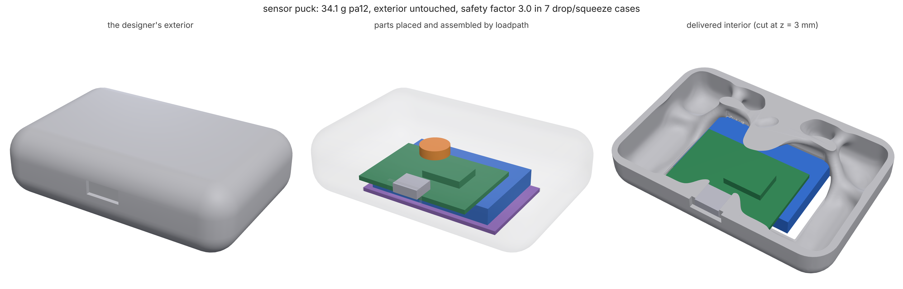

# Products from the outside in

An industrial designer can stop at the outside. They draw the shape and
the surfaces people see and touch, and list what has to go inside: a
battery, a board and its connector, a motor, a switch. Where those parts
sit, how they get in, what holds them, how the product survives a fall and
how it feels in the hand is all invisible, and it is the work between a
rendering and a product that can be built. `loadpath enclosure` does that
work from one brief, and never touches the exterior.

```
python -m loadpath enclosure brief.json --out out/ [--run]
```

The brief (`loadpath schema enclosure`) is the exterior, its openings,
the components and what the product has to survive:

```json
{
  "exterior": "exterior.stl", "skin": 1.2,
  "openings": [{"id": "usb-port", "shape": "port.stl", "inward": "+y"},
               {"id": "battery-door", "shape": "door-opening.stl", "inward": "+z"}],
  "components": [
    {"id": "board", "shape": "board.stl", "mass": 0.008, "rotate": "z"},
    {"id": "usbc", "shape": "usbc.stl", "installedOn": "board",
     "alignTo": {"opening": "usb-port", "face": "-y", "recess": 0.3}},
    {"id": "battery", "size": [45, 30, 6], "mass": 0.032, "against": "-z", "rotate": "z"},
    {"id": "motor", "shape": {"type": "cylinder", "center": [0, 0, 0], "axis": "z", "length": 3.2, "r": 5},
     "mass": 0.002, "near": ["board"], "against": "+z"},
    {"id": "door", "shape": "door.stl", "place": "given", "external": true, "mount": false}],
  "assembly": ["motor", "board", "battery", "door"],
  "loads": {"drop": {"g": 300}, "squeeze": {"axis": "y", "force": 150}},
  "material": "pa12", "process": "sls", "minMember": 1.2, "goal": {"safetyFactor": 1.5}
}
```

## What it does

**1. It places the parts** (`placement.py`), unless the designer drew
them. Each part, or a group (a board with the connector soldered to it,
drawn in the board's frame), is tried in every orientation it may take
(`rotate`: all 24 quarter turns, the four about one axis, or none) at
every position on a grid through the cavity: the exterior less its skin,
plus the openings a part may reach into. For one orientation every
position is tested at once: the cells a part may not enter (the skin, the
designer's fixed geometry, parts already placed, each grown by the
`margin`) are cross-correlated with the part's own cells by FFT, and a
zero is a fit. Among the fits the rules choose:

| rule | what it does |
|---|---|
| `against: "-z"` | pushed to that side of the cavity: a battery on the floor |
| `alignTo: {opening, face, recess}` | that face of the part out through the opening, on its axis, `recess` mm short of the exterior: a connector in its port |
| `under: {at, direction, gap}` | that face on the line through `at`, `gap` under the skin: a switch under the spot a finger presses |
| `near: [ids]` | close to other parts |
| `ports` and `wires` | the cables between parts, laid as elastic rods for each candidate position: one whose cable is too short or bent past its radius is not a position ([WIRES.md](WIRES.md)) |
| `watts`, `maxTemp` | a hot part kept off a part with a temperature limit, and hot parts apart (`placement.heat`) |
| `placement.centerOfMass` | the layout's centre of mass toward a point, or low along an axis |

The parts go in one at a time, the most constrained first, as a beam
search that keeps the best few layouts, so an early choice that boxes a
later part in can be undone. Each position the grid finds is pushed the
rest of the way along its rule and checked on exact distances at dense
samples of the part's surface: the room reported per part
(`roomToSkin`, `roomToParts`) is measured, not the grid's.

**2. It keeps only what can be assembled.** A layout nobody can put
together is no layout. In the `assembly` order, a position is kept only
if the part can still get there past the skin, the fixed geometry and the
parts that went in before it. The way in is found in configuration space:
every translation of the part tested at once (FFT again), then flooded
outward from where it sits one straight leg at a time, so the first path
found has the fewest legs (up to four: a board that lifts off its rest,
slides its connector out of the port, then drops out through the door).
Each path is then walked exactly at the part's surface points, and if the
grid was half a cell too generous it is searched again tighter. The path
becomes the part's keep-out (`insertFrom`), swept the whole way, so no
generated material can block it.

A part with no straight way in is tried turning (next section): tilted in
through an opening shorter than it is, then laid flat; a layout every
part slides into is always taken first. `tilt` in the brief
(or on one component) is how far a part may be turned, 45 degrees unless
said; `false` keeps a part to straight slides.

`enclosure.json` then says the whole assembly as numbered steps a person
can follow (`assembly.steps`), each part's moves in the order they go in.

**3. It mounts what has mass.** Each part with a mass gets a preserved
cradle under one face: the side given (`mount.side`), else the side it is
pushed against, else the side it comes to rest on as it goes in, else its
nearest wall; and never a side that sits in another part's way in. The
cradles are printed, so every path is checked again with them in place.

**4. It writes the loads.** `drop: {g, faces}` adds a case per face the
product can land on: every part's mass at `g` toward that face, carried
through its cradle (with the moment of its offset centre of mass), and the
floor's equal and opposite reaction on that face of the exterior. `g` is
the design deceleration you choose (a few hundred for a hard-floor drop of
a small rigid product; `loadpath feel` designs drop cushioning when the
interior should soften the fall). `squeeze` presses two patches of the
exterior together across an axis; `press` pushes a patch with the far face
held. Load cases, a `switch` block (a push pad; see SWITCH.md, the
plunger and its seat read off the placed parts) and a `feel` block pass
through. Component `watts` go into the study's `thermal` block when the
brief has one.

`rattle: {band, maxAmplification, g, maxTravel}` holds every mounted part
still in the hand: each massed part gets a feel `isolate` target
(FEEL.md) from the skin where the hand is (`hold`, default the whole skin)
to its cradle, with its resonance kept above the handling `band` (default
150 Hz, at most 1.25x the hand's motion over it) and a knock at `g`
(default 5) moving it under `maxTravel` mm (default 0.1) on its mount, so
it neither rings nor knocks against its neighbours. The targets are
designed with everything else and read on the delivered part, modes
included.

`connector: {component, type}` (one, or a list) is what a user does to a
port: a plug pushed home, pulled out, and levered sideways while it still
works, through the mount of the board the socket sits on (`component` is
the socket, `installedOn` its board), with the moment of the lever arm, and
the hand holding the face across from the port. `type` picks the spec
numbers (connectors.py): `usb-c` is 20 N in, 20 N out (the top of the
spec's 5-20 N and 8-20 N ranges, the stiffest new socket), and 8 N across
the plug's thin side and 20 N across its wide side, 15 mm out from the
socket's front edge (the 4-axis continuity test); `usb-a` and
`usb-micro-b` are there too. Any number overrides (`insert`, `withdraw`,
`side {thin, wide}`, `lever`). `abuse: true` adds the wrenching moments at
which the plug itself may break (USB-C 2.0 N·m and 3.5 N·m), held to a
safety factor of 1 of their own (the product only has to outlast the
plug); several times the side load, so off by default. The board's mount may move at most
`maxShift` mm in those cases (default 0.1; a goal clearance), so the
socket's solder joints are not flexed. The cases are named
`<component>-insert`, `-withdraw`, `-side-thin`, `-side-wide`.
`connectors.connector_cases` writes the same cases for any study, with a
load target where the board bears on the part.

**5. It writes an ordinary study**: the exterior as its `skin` (preserved,
never edited, with no skin across the openings), the whole interior as
design space, components as keep-outs with their paths, cradles as
preserves, supports on a small patch of the rest face (the drop and
squeeze cases balance themselves; the patch only holds the part still).
`out/cad/` has every placed part as an STL in product coordinates and
`out/enclosure.json` says how each value was found.

**6. With `--run` it designs and checks it.** `run` designs for strength
and stiffness (`switch` or `feel` when those blocks are there), then
`out/checks.json` reads the delivered part the way the designer and the
engineer would:

- **the exterior untouched**: points sampled on the delivered surface,
  each one's exact distance to the exterior mesh (nothing proud of it),
  and points sampled on the exterior, each one's distance to the delivered
  surface (all of it still there, openings aside);
- **every load case on the delivered part**: `verify` on cut cells (or
  tets where installed), not the optimizer's grid, with the safety factor
  per case and no part's keep-out or path intruded on.

## Parts that only go in at a tilt

Some layouts fit and still cannot be put together by sliding. The
commonest: a board longer than the opening it goes through, with a
connector that has to end up out through a port in the end wall. No
sequence of straight slides gets it there, and a search that only slides
rejects the layout, though anyone assembling it does the obvious thing:
nose into the port at a tilt, then lay the board flat. Rejecting that
layout costs a real product a longer door, a split it did not need, or a
smaller board.

So the way in is a rigid-body motion, turns included (`motion.py`,
`placement.insertion_motion`):

- **Positions and tilts together.** The straight search tests every
  position of the part as it sits. The tilt search makes the same test
  for the part tilted about each axis through its middle, a step at a
  time (a step moves the part's far end about one grid cell), so each
  tilt is a layer of free positions. Within a layer the part slides;
  between neighbouring layers it turns a step where it is. The layers'
  connected regions are searched breadth first from where the part sits,
  the three axes taking turns, so the way out found needs the least tilt.
- **Only as much as it needs.** A layer costs one FFT and is computed
  only when the search reaches it. A part with a straight way in never
  gets here; a part that cannot begin to turn costs three layers per
  axis. The desk hub below takes about 4 s for its final path.
- **With room first.** The first search grows the part by 0.3 mm and half
  a cell, so the route has room to spare and its keep-out cuts nothing
  from the skin. If nothing that comfortable exists it is searched again
  closer, down to the path tolerance.
- **A few moves, each checked exactly.** A route off a grid is a staircase
  of cells and tilt steps. It is reduced to the fewest slides and pivots
  that are each clear when walked at the part's surface points: between
  any two poses with different tilts there is one line that stays put,
  and the move is a turn about it. A part with no way in is still
  reported with what it hits.

The path is written into the keep-out as legs, as the part leaves:

```json
"insertFrom": [{"turn": 10.5, "about": "+y", "at": [-33.2, 0.0, -38.0]},
               {"toward": [0.966, 0.0, -0.258], "length": 10.9},
               "-z"]
```

A turn sweeps the keep-out through the arc, so nothing generated stands
where the part swings. And the same legs, turned round, are the steps in
`enclosure.json`:

```
1. Hold board (with connector on it) tilted 10.5° about +y from how it
   sits (its +x end 5.2 mm toward -z), outside the -z side.
2. Bring it in toward +z.
3. Slide it 10.9 mm toward -x, leaning 14.9° toward +z.
4. Turn it 10.5° about a line along y through x = -33.2, z = -38, its +x
   end 5.2 mm toward +z, until it sits square: it is home.
5. Fit foot from outside.
```

This is the layer between two kinds of tool. A code that optimizes
material stops at a density field and has no idea a board must get in. A
scripted or generated CAD model has the board and the door and no idea
whether one passes the other. Here the layout, the motion that assembles
it, the space that motion needs and the structure round it are one
answer, and the motion is handed back in words.

Limits: one tilt axis per path (no compound turns), 45 degrees unless the
brief says more, and the parts of a split shell still go in by straight
slides with the cover off.

## Split shells, cooling, any exterior

A closed exterior with no openings is assembled with its cover off: give
the brief a `split` block and the study is handed to `shells.py`, which
picks or takes the parting line, finds the paths into the base, and adds
the lips, bosses and snaps (one study per half). A `cooling` block
(components' `watts` and `maxTemp`, skin touch-temperature limits, vent
sizing) passes through to `cooling.py`. The exterior can be any mesh,
STEP, a generated mesh that needs repair, or an SDF: `handoff`'s intake
(`exterior.py`) cleans it first.

## The example

`examples/enclosure/sensor_puck.py` writes a generic handheld sensor puck
(an 84 x 56 x 24 mm pebble with a USB-C port at one end and a battery door
underneath), its parts and the brief above, then runs it.
`examples/enclosure/render.py` draws the result.



Nothing about where the parts go is in the brief beyond the rules. On
0.6 mm cells (the skin two cells thick) loadpath placed all four in three
minutes:

- **The board and its USB-C connector** turned so the connector's face
  points out of the port and sits on the port's axis, 0.31 mm short of the
  outer surface (0.3 asked). The recess is the face's own stand-off; the
  rest of the part keeps its margin from the walls, which the brief sets
  to 0.3 mm for the board (0.5 elsewhere).
- **The battery** went on the floor, straight over the door.
- **The motor** went up against the ceiling, 0.5 mm under the skin and
  directly over the board (4.7 mm above it), so its wires stay short.

Each part has a checked way in, in the assembly order (motor, board,
battery, door):

- The motor and the battery drop straight in through the door.
- The board, with the connector soldered on, comes out the way it went
  in. It slides 11.85 mm along +y to free the connector from the port,
  then drops out through the door. Its turn sits mid-way between the
  lengths that clear both rims.

Every path is swept as a keep-out, and no keep-out overlaps the skin by any
amount (`pathsIntoSkin` 0.0 mm³ for each part). The cradles went under the
board (-y), the battery (+y) and the motor (+z).

`run` then designed the interior for six 300 g drops, one onto each face,
and a 150 N squeeze across the width, out of an 84.9 g design space:
43.8 g at 30% of it, 34.1 g at 15%, and 29.8 g at 8.2%, the lightest that
passed before its 110-minute limit. `checks.json` reads the 29.8 g part
on 130,703 cut cells at 0.42 mm, not on the optimizer's grid, and
`examples/enclosure/tets.py` reads it again on 567k 10-node tets:

| check | result |
|---|---|
| exterior proud of the designer's surface | 0.0 mm (34,034 samples) |
| exterior surface still there | 100% |
| watertight STL | yes |
| material in any keep-out or way in | 0.000005 mm³ |
| safety factor, worst case: cut cells / tets | 1.9 (squeeze-y) / 4.2 (drop -x); goal 1.5 |
| drops -z / +z / -x / +x / -y / +y, cut cells | 2.7 / 4.8 / 3.6 / 3.6 / 3.8 / 3.4 |
| drops -z / +z / -x / +x / -y / +y, tets | 6.3 / 5.3 / 4.2 / 4.3 / 5.6 / 5.8 |
| squeeze-y: cut cells / tets | 1.9 / 5.2 |
| buckling factor | 6.7 |

The two readings agree that every case passes, but not on the margins.
They are furthest apart on the squeeze, whose load goes in through small
patches on the skin. The cut cells read the stress peak under a patch
higher, so they are the reading to design to.

The first runs of this example found five bugs, and all of them are fixed:

- **A rim notch.** The board's way out cleared the door's rim by 0.04 mm
  too little. Because a keep-out is cut from everything, that path cut
  7.9 mm³ out of the skin's rim.
- **Material back in the keep-outs.** The mesh cleanup's pinch filler put
  up to 18 mm³ back inside the ways in.
- **A leaky STL.** 14 sliver edges that only an STL reader's weld exposes
  made the file read as not watertight. The pass that removes them first
  crashed on an unwelded mesh, and now welds before it starts.
- **A recess doubled by the margin.** An aligned connector kept its
  0.5 mm margin from the exterior on top of the 0.3 mm recess asked, so it
  stood 0.82 mm back.

## Six more products

`loadpath/evals/products.py` writes six more generic products, each an
exterior, its parts in plain words and a brief, and the evals run each one
end to end (`python -m loadpath.evals.run enclosure-remote`, and so on):
placement, ways in, the split where there is one, the design (run, feel,
switch or cooling) and the checks on the delivered part. Two of the
exteriors are generated-style meshes (holes, a doubled patch, flipped
faces, debris) that the intake wraps first.

| product | made as | what it asks for |
|---|---|---|
| remote | PA12 SLS, top/bottom split | IR LED aimed out its window, cells over the battery door, 300 g drops, a 120 N squeeze, a 30 N thumb press |
| band pod | TPU 88A, one piece | board on the sensor window, a cell that can move 1.6 mm in a 1.2 m drop, a soft pinch |
| speaker | PETG FDM, generated mesh | driver up into the grille, USB-C in its port, a 1 W amp and an 18650 kept cool, the shell cool to hold |
| tool grip | PA12 MJF, generated mesh, clamshell | motor aimed out the nose, cell in the handle, a trigger where the finger falls, a 250 N grip |
| smart button | TPU over a rigid back | a tactile switch that fires between 150 and 400 gf from 5 points on the dome |
| desk hub | PA12 SLS, one piece | a board 5 mm longer than the service door, its connector out through a port: in only at a tilt; a 200 g drop, an 80 N squeeze |

The coarse tier (1.0 to 1.5 mm cells, short design runs, 2026-11-08):

| product | pass | checks | mass | notes |
|---|---|---|---|---|
| band pod | yes | 7/7 | 3.6 g | drop and pinch windows met on the delivered part |
| smart button | yes | 8/8 | 6.4 g | 5/5 presses in window, worst SF 2.0 |
| speaker | no | 8/9 | 344 g | SF 1.57. The delivered reads now agree (amp 57.1 / 58.8 C, shell 48.8 / 48.9 C at 1.05 / 0.75 mm): the shell is 0.8 C over its 48 C touch limit |
| remote | yes | 12/12 | 72.8 g | worst SF 1.72 (base, a drop onto the underside) |
| tool grip | no | 7/9 | 38.6 g base | base SF 0.74 in the coarse run's 10 minutes (was 0.21); the cover's own run check ran past the box's 15 GB, so it has no part this run (its earlier part read 5.56) |
| desk hub | yes | 9/9 | 19.5 g | the board goes in at 10.5 degrees in three moves; worst SF 1.54 on the delivered part (2026-11-10) |

Every product kept its exterior untouched (0.0 mm proud) and every
component placed with a clear way in. What fails is strength and heat on
the delivered part at coarse settings, which the full tier (finer cells,
longer runs) is for.

Running them found and fixed these:

- A tilted parting line writes its way out as a vector, and the study
  reader took a three-number vector for a path of three legs.
- Generated wraps of 300k faces ran out of memory in trimesh's ray and
  closest-point queries without embree: the wrap report reads inside and
  outside off the wrap's own grid, and the exterior check uses libigl or
  chunks.
- The way-in grid reached 84M cells on a 150 mm remote; it is capped.
- Sweeping a way in by copying the part 201 times took over 10 GB; the
  sweep is now exact per-triangle prisms.
- A half with no passing outcome reported nothing; the closest part is now
  checked, and fails with numbers.
- The support of a product with a hollow middle landed outside the part;
  it now goes at the interior's centre.
- The `cooling` block now takes each part's watts and limit from the
  parts list.

A second pass fixed what the first left open:

- **The check read stress the run leaves out.** The enclosure check left
  no band round loads and supports, so a drop's floor patch and a cradle's
  mass load read their edge stress, which grows without bound as the grid
  refines. The tool grip's cover read 0.09 there and 5.5 in run's own
  check of the same file. It now leaves out a design cell round them, as
  run and `loadpath verify` do; that alone takes the remote to 12/12.
- **A split half's loads from the other half.** A drop onto the cover's
  face pushed the base's components into its single 3 mm support. Loads
  on the other half now come in through the stretch of seam nearest them,
  and loads go to a half only where it has material under them half a
  cell deep (a press near a tilted seam once landed on a sliver of the
  base with no cell under it).
- **Drops spin the part.** A tool landing on its handle's foot with its
  motor out front: the floor's push and the parts' weight balance as
  forces but not as a moment, and the support carried the twist. Each
  drop now adds the spin the landing gives the parts (inertia relief on
  the components), so the case balances and the support carries nothing.
  The tool grip's base went from 0.21 to 0.74.
- **Heat reads that agree across grids.** Two components 0.4 mm apart
  conducted at their own 20 W/(m K) across the air between them on some
  grids; a component was read at nodes in the gap beside another; and a
  gap under a cell wide between a component and its pad read as air on
  some grids and contact on others. All three are fixed (docs/COOLING.md).
- **Each half of a split runs in its own process**, so the cover's run
  does not start with the base's memory still held.

Still open: the tool grip's base needs a longer run than the coarse tier's
10 minutes, and its cover's run check needs more memory than this box has
alongside everything else; the speaker's shell is 0.8 C warm; and the
split search once chose a 15° cut across the remote's top face with no room
for a snap (the remote asks for a flat split).