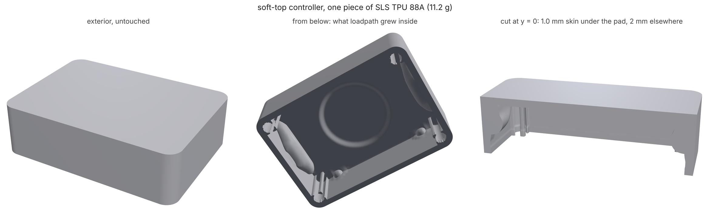
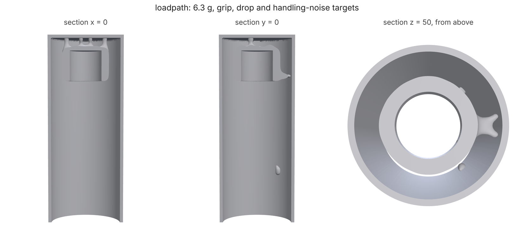

# Feel targets: interiors designed for how a product feels

An industrial designer hands over the surfacing. What goes inside is known
(a board, a battery, a microphone capsule) and so is how the product should
feel in the hand: the grip gives a little but is not mushy, a fall onto the
floor does not break what is inside, and rubbing a thumb along the body
does not come through on the recording. Everything inside the exterior is
invisible, so it should be designed for exactly that, with the least
material.

`loadpath feel` does this. As with push pads ([SWITCH.md](SWITCH.md)) the
exterior is kept as a thin cosmetic `skin`, the components are keep-outs
with their **assembly paths** (`insertFrom`), and everything else is design
space. A `feel` block lists the targets:

```json
"feel": {"targets": [
  {"kind": "squeeze", "name": "grip",
   "hold": {"face": "-x", "shape": GRIP}, "press": {"face": "+x", "shape": GRIP},
   "direction": "-x", "force": 20, "travel": [0.3, 1.0]},
  {"kind": "drop", "name": "head-drop", "lands": {"face": "+z"}, "mass": {"region": "mount"},
   "kg": 0.004, "height": 1.0, "maxG": 1500, "maxTravel": 3.0},
  {"kind": "isolate", "name": "handling-noise", "hold": {"region": "skin", "shape": GRIP},
   "mount": {"region": "mount"}, "kg": 0.004, "band": 500, "maxTransmissibility": 0.5,
   "maxTravel": 0.5, "shockG": 20}
]}
```

```
python -m loadpath feel mic.study.json --out mic-out/
```

A study with a `feel` block needs no supports or load cases: every target
says where the product is held and where its load comes in. A `switch`
block in the same study is designed together with the feel targets, so a
push pad's click force and the grip around it come out of one run.

## The targets

Each target is a stiffness window between where the product is held and
where the load goes in. Where is a `region` (a preserve or keep-out id;
`skin` is the exterior skin), a `shape`, or an exterior `face` (`"-x"`:
the outermost node of every column facing -x); a region or face with a
shape too is only the part of it inside the shape.

**squeeze** — how much a grip gives. Held on one side (`hold`), pressed on
the other (`press`) along `direction` with `force` N, the body should close
by `travel: [min, max]` mm (or give `stiffness: [min, max]` in N/mm).

**drop** — cushioning a part inside (`mass`, `kg`, usually its mount) when
the product falls `height` m and lands on `lands` (a face, or a patch of
one). The structure between the landing patch and the part is a spring k.
With the fall's energy E = m g h, the peak force is sqrt(2 E k) and the
part's travel is sqrt(2 E / k), so

```
2 E / maxTravel^2  <=  k  <=  (maxG m g)^2 / (2 E)
```

`maxG` caps the stiffness and `maxTravel` (the room the part has before it
hits something) bounds it from below. The two together need
maxTravel >= 2 h / maxG whatever is inside: a 1 m fall at under 1500 g
needs at least 1.3 mm. If the numbers ask for less, the study is refused
with that sentence. A linear spring is the worst shape a cushion can have;
a constant-force crush (a lattice, [IMPACT.md](IMPACT.md)) halves the travel.
The shell's own mass is left out: what is asked for is the part's
deceleration.

**isolate** — keeping handling vibration away from a part (`mount`, `kg`)
while the hand (`hold`) shakes the body, along each of `directions`
(default x, y and z). The part on its mount is a suspension of natural
frequency f_n = sqrt(k / m) / 2 pi, and with the material's loss factor eta
(modal.LOSS_FACTOR; TPU 0.12) a shake at f reaches it as

```
T(r) = sqrt((1 + eta^2) / ((1 - r^2)^2 + eta^2)),   r = f / f_n
```

There are two ways to keep a band of handling noise off a part:

- a **soft mount** (`band`): from `band` Hz up, T is at most
  `maxTransmissibility` (default 0.5). That caps f_n, so k.
- a **stiff mount** (`upTo`): the resonance sits over the handling band, so
  nothing up to `upTo` Hz is amplified more than `maxAmplification`
  (default 1.25). That sets a floor on f_n. A part hard-mounted to the
  exterior (a board on rails moulded into the base) can only be this one.

`maxTravel` under a `shockG` knock (default 1 g, its own weight) adds a
floor so a soft mount does not rattle.

## The model

All three are compliance windows. For each target and direction, with the
target's holds fixed and 1 N spread over the loaded nodes (f):

```
c = f . K^-1 f      k = 1 / c      dc/dx_e = -u_e . dK_e u_e
```

so each costs one solve per direction per iteration and its sensitivity is
that solve. Targets that share a hold share a factorization. The
constraints are written on log c, so a factor of two weighs the same at
2 N/mm and at 200 N/mm, and go to the push pad's optimizer (minimum volume,
MMA, thin-skin density floors, coarse to fine).

Three things the first runs got wrong, and what each run does about them
now:

**Grey cells are cheap softness.** A soft window met on the density field
alone was met with cells at 0.3-0.6: under SIMP a grey cell is soft per
gram, which printing does not have. The microphone body's capsule
suspension read 8.7 N/mm on the design and 0.5 N/mm thresholded. Each floor
(k >= min) is now read on the eroded design (projected at 0.7) and each
ceiling (k <= max) on the dilated one (0.3), so the black-and-white part
between them meets both (`"robust": false` turns this off). The
thresholded reading now lands within 5% of the design.

**Members ending on a thin skin stopped short of it.** The delivered mesh
joins the designer's exact skin and is not run on into it (a fillet to a
skin that wraps the whole exterior fills the inside). On a coarse grid the
skin is a row of partly filled cells, and the member's last cell was the
one next to it: the suspension came out as a second, floating body. Every
thin-skin cell beside a solid interior cell is now meshed solid, so members
run into the skin (switch._as_printed, push pads too).

**Smoothing thins one-cell members, and a coarse read-back cannot see
them.** A suspension soft enough for a 4 g capsule is members about one
cell thick. The default smoothing rounded them to a fraction of that, and
the delivered mesh read 2 N/mm against a 50 N/mm design. Feel runs mesh
with reconstruct's thin-member setting (`keepThinMembers`, default true
here) and read the delivered mesh back on a grid of half the design pitch
(`verifyPitch`), where a one-cell member is two cells across.

## Checks on the result

- **Thresholded**: the same readings on the black-and-white design.
- **Delivered**: the STL read back on its own cut cells (`delivered`,
  `deliveredOk`, `cutCells`), as push pads are ([SWITCH.md](SWITCH.md)):
  each cell the surface cuts is integrated over its solid part, so a 1 mm
  skin or member is 1 mm whatever the grid. The grid is half the design
  pitch, no finer than 0.5 mm. Holds and loads go on the part's own cells
  that are at least half full. The older reading, the mesh's fill per cell
  as a density at E x^3 (`deliveredDensity`, `verifyPitch`), stays in the
  report; it does not settle as the grid refines (the 1 mm microphone
  body's head read 89, 78 and 67 N/mm on cut cells at 1, 0.5 and 0.33 mm,
  and 56 as a density), so it no longer decides `deliveredOk`.
  `feel.cutCells: false` goes back to it.
- **Modes** (isolate targets): the delivered part's modes with the part as
  a point mass on its mount and the structure's own mass, the hand's nodes
  the shaken base; the transmissibility at `band`, or the worst
  amplification up to `upTo`, by modal superposition (`modal`). Modes are
  read on a grid no finer than 0.5 mm: at 0.35 mm the shift-invert factor
  took 14 GB.

## Touch zones: pliable here, firm there

A designer rarely wants one feel all over. The touch area of a product
should feel distinctly pliable; the rim and the sides around it should
feel firm, on purpose. A `touch` target is a zone of the exterior and how
it should feel under a fingertip:

```json
"feel": {"targets": [
  {"kind": "touch", "name": "pad", "zone": PAD_DISC, "feel": "pliable", "skinThickness": "auto"},
  {"kind": "touch", "name": "rim", "zone": TOP_OUTSIDE_A_CIRCLE, "feel": "firm"},
  {"kind": "touch", "name": "side+x", "zone": SIDE_WALL, "direction": "-x", "feel": "firm"}],
 "contrast": [{"softer": "pad", "firmer": "rim", "ratio": 4}]}
```

- **Presses.** Fingertip presses (a disc of `fingertip` mm radius,
  default 4) are sampled `spacing` mm apart (default 6) wherever a press
  along `direction` (default `-z`) meets the part inside the zone, at least
  `inset` mm from its edge, or given as `points`. They come from the
  shapes, not the mesh, so every grid and the delivered read-back press
  the same places. Each press is a stiffness window between it and `hold`
  (default: the face the press points at).
- **Windows.** `feel` presets for a fingertip: `pliable` 1-4 N/mm (a light
  2 N touch sinks 0.5-2 mm), `firm` at least 15 N/mm (a 5 N press moves it
  under 0.33 mm), `rigid` at least 50 N/mm. Or `stiffness: [min, max]`, or
  `force` with `travel`; a `travel` max alone is a firmness floor: `"force":
  5, "travel": {"max": 0.25}` means it takes at least 5 N to push it in
  0.25 mm.
- **Contrast.** "Distinctly" is a ratio, not two windows: every press of
  the firmer zone at least `ratio` times as stiff as every press of the
  softer one. One constraint per pair, on log stiffness with a smooth max
  over the softer zone and a smooth min over the firmer one, read robustly
  (softer side on the dilated design, firmer on the eroded one).
- **The skin.** An interior can only stiffen a press, so a zone can never
  be softer than its skin with nothing behind it. `skinThickness: "auto"`
  thins the skin under the zone (only its inner surface moves: skin.zones),
  to the thickest skin whose bare presses sit under 0.75 of the ceiling,
  and **never under the process's minimum wall**. For SLS TPU that is 1.0
  mm: the material card keeps a margin over the 0.8 mm Materialize lists
  (`process.minFeature` in a study overrides it). A zone that would need
  less is flagged in `touchSkin` with the thickness it needs (`needs`) and
  what would help instead (a softer material, a wider zone, a higher
  ceiling); the optimizer then works to what the thinnest printable skin
  gives, and the part is still read against the real window. A number
  instead of "auto" sets the thickness, and is flagged when under the
  minimum wall.

The report's `touchZones` gives each zone's softest and stiffest press and
how many meet the window, and each contrast's ratio, on the design, as
printed and on the delivered mesh.

### A soft-top controller

`examples/feel/soft_top.py`: a generic handheld, 56 x 40 x 16 mm with
rounded corners, one piece of SLS TPU 88A. The exterior is kept as a 2 mm
skin, open underneath where a lid closes it and where the board slides
in. A 24 mm pad in the middle of the top is `pliable`, the rim outside a
30 mm circle and the four walls are `firm`, and every rim and wall press
must be at least 4x as stiff as any pad press. 67 presses in all.

| | pad (1-4 N/mm) | rim (>= 15) | walls (>= 15) | rim / pad (>= 4) |
|---|---|---|---|---|
| bare 2 mm skin (1 mm cells) | 5.7-7.2, 0 of 9 | 12.1-165, 36 of 42 | 40-57, 16 of 16 | 1.7 |
| loadpath, delivered mesh (0.5 mm cut cells) | 2.3-3.8, 9 of 9 | 17.4-163, 42 of 42 | 38-92, 16 of 16 | 4.5 |

The 2 mm skin is too stiff to feel pliable anywhere on the pad, and
the inner rim, next to the pad, is not firm. Auto skin takes the pad's
skin to the 1.0 mm minimum wall (the bare skin there reads 3.5 N/mm,
just over 0.75 of the ceiling, so no thicker skin passes). The optimizer
grows four corner posts and two buttresses on the long walls, and leaves
the pad's span clear, so the pad stays pliable while the rim is held up:
11.2 g, watertight.
Designed on 1 mm cells (80 iterations, 15 min); read on the delivered
mesh's own cut cells at 0.5 mm and again at 0.4 mm, which agree within
1% (pad 2.28-3.84, rim from 17.43, rim/pad 4.53). Part, study and report
in the project files (`feel/soft-top/`).



Designing on 0.5 mm cells after the 1 mm stage did not converge (the
contrast drifted further out each iteration, its gradients checked
against finite differences); design on 1 mm and verify finer.

## A handheld microphone body

`examples/feel/mic_body.py`: a generic stick microphone, 24 mm across and
60 mm long, in SLS TPU 88A. The exterior is kept as a 1.0 mm skin, open at
the bottom where a plug closes it. A 10 mm capsule sits at the head on a
ring mount; its cable path and a board both slide in from the bottom
(`insertFrom: "-z"`). The targets are the three above: a 20 N grip gives
0.3-1.0 mm, a 1 m fall on the head keeps the 4 g capsule under 1500 g and
3 mm of travel, and handling noise from 500 Hz up reaches the capsule at
under half.



| design (1 mm cells; delivered read as a density at 0.5 mm) | grip at 20 N | head drop, 4 g capsule | capsule mount, x / y / z |
|---|---|---|---|
| window | 0.3-1.0 mm (20-67 N/mm) | under 1500 g and 3 mm (8.7-44 N/mm) | 1.6-13 N/mm: under half from 500 Hz up |
| bare skin | 1.19 mm: too soft | the capsule is not held at all | not held |
| filled | 0.009 mm | 12,800 g | 1430 Hz: rings in the band |
| **loadpath, design** | **0.96 mm** | 1620 g, 1.2 mm (8% over) | **190 / 185 / 236 Hz; 0.17 / 0.16 / 0.29 at 500 Hz** |
| **loadpath, delivered mesh** | **0.64 mm** | 1690 g, 1.2 mm (13% over) | **226 / 199 / 259 Hz (lumped); modes 164-226 Hz, 0.44 / 0.49 / 0.29 at 500 Hz** |

The interior is 21% of the design space, 6.3 g of TPU. The capsule hangs
from the head on short posts and one side strut, so the fall onto the head
is cushioned by the head's own skin flexing, and the hand's vibration has
to come up the whole tube and through the posts to reach it. Grip and
isolation are met on the delivered mesh, modes included. The drop is not:
the posts that hold the capsule still enough in three directions make the
head 13% too stiff for 1500 g (1690 g at 1.2 mm of travel). On 1 mm cells
the optimizer could not find a hanger that does both; a finer grid does
(below).

120 iterations, 2085 s on 4 cores shared with another run (about 15 minutes
alone), then 3 minutes of read-back and modes at 0.5 mm.

**1 mm, then 0.7 mm cells** (`--pitches 1.0,0.7 --iterations 120,60`)
closes the drop. Read on cut cells, the delivered part meets all three
targets, and the head drop reads the same on 0.5 and 0.35 mm cells:

| 1.0 then 0.7 mm (cut-cell read at 0.5 mm) | grip at 20 N | head drop, 4 g capsule | capsule mount, x / y / z |
|---|---|---|---|
| the 1 mm design above, read on cut cells | 0.36 mm | 2000 g, 1.0 mm: misses | 11.2 / 7.9 / 10.6 N/mm |
| **design, 0.7 mm** | **0.72 mm** | **970 g** | **4.3 / 2.6 / 5.6 N/mm** |
| **delivered mesh** | **0.37 mm (0.32 at 0.35 mm)** | **1360 g, 1.5 mm (1362 g at 0.35 mm)** | **8.7 / 4.7 / 9.1 N/mm; modes 134-221 Hz, 0.29 / 0.22 / 0.30 at 500 Hz** |

5.6 cm^3 of TPU. The grip sits near its floor of 0.3 mm on the delivered
mesh (stiffer than the design reads), so a designer wanting a softer
handle should open the window downward. About 40 minutes on 4 cores
(PARDISO; see below).

That run used the thin-skin density floor. Since then push pads read thin
skins as cut cells in the optimizer too ([SWITCH.md](SWITCH.md)), and the
same run on that model stalls at 0.7 mm: the drop ceiling stays 2.4x over
on the dilated design through 120 iterations at 0.7 mm (with `moveSharp`
0.05 too), and the delivered head reads 2000-2500 g. Until that is
understood, `LOADPATH_SKIN_MODEL=floor` reproduces the passing design;
the cut-cell read-back is what says whether a design passes either way.
The passing part is in the project files (`feel/mic-body-0.7/`).

Speed: each feel target group factors its own system, twice with robust
reads, so the microphone body solves six systems of ~90k dofs an
iteration. On SuperLU's minimum degree that was 524 s an iteration on a
0.7 mm grid; `switch._Solves` now factors with PARDISO wherever
`pypardiso` is installed (22 s, same numbers to every digit printed).

## On a real product: the touch microphone

The touch microphone's push pad case (`touch-mic-pad`, [SWITCH.md](SWITCH.md))
again, its CAD read from the folder `LOADPATH_TOUCH_MIC_STL` names (it is
not in this repository), with three feel targets added to the same study.
The eval case is `touch-mic-feel`:

- **pinch**: 10 N across the flanks gives 0.15-0.6 mm;
- **face-down drop**: 0.75 m onto the touch face, the 6 g board on its
  rails sees under 2000 g and moves under 1.2 mm;
- **handling noise**: the board sits on rails moulded into the base ring,
  which the study keeps as drawn, so it is hard-mounted. Its bare-skin
  reading is 28-35 N/mm in plane (345-385 Hz) and 7 N/mm (172 Hz) up and
  down. A soft mount is ruled out; the target is the stiff one, the
  board's resonance over a 150 Hz handling band (`upTo`: over 335 Hz).

| design (1 mm cells; delivered read at 0.5 mm) | pinch | face-down drop | board bounce z | presses in window | part |
|---|---|---|---|---|---|
| bare skin, base and rails | 1.26 mm | 1040 g, 1.45 mm | 172 Hz | 9 of 14 | |
| push pad alone (SWITCH.md) | | | | 13 of 14, 11 delivered | 8.2 cm^3 |
| **pad and feel, design** | **0.47 mm** | **1910 g, 0.79 mm** | **338 Hz** | 10 of 14 | |
| **pad and feel, delivered** | **0.40 mm** | 2850 g, 0.53 mm | **351 Hz; modes pass** | 9 of 14 | 10.6 cm^3 |

**Read again on 0.7 mm cells** (the delivered mesh, 2026-11-07, after the
push-pad thread found that 1 mm push-pad designs do not hold at 0.7 mm):
the feel readings hold. Pinch 31.8 N/mm (0.31 mm, in window), board bounce
89 / 89 / 33 N/mm (all over the 26 N/mm floor), and the face-down drop
305 N/mm, out of window as at 0.5 mm. The click map does not hold: 0 of 14
presses in window, 254 gf at the centre and 320-690 gf elsewhere, 1.7-2.3x
the 1 mm reading. Treat the press numbers in the table above as a 1 mm
reading only; the push pad needs designing on a finer grid
([SWITCH.md](SWITCH.md)) before the click and feel trade-off below can be
read as real.

The feel targets cost the click map (on the 1 mm reading). Holding the board's bounce over
335 Hz takes stiff material between the rails and the top skin, and that
stiffens the corners of the touch area (up to 448 gf delivered against a
300 gf ceiling). The drop meets its window on the design and misses on the
delivered mesh: the face-down fall loads the touch face in membrane, which
the 1 mm thin-skin model reads low (it is tuned for bending, membrane
stiffness reads low by phi^2), and the 0.5 mm read-back has the skin
exactly. That is a real limit of the coarse grid for membrane-loaded
skins; the honest reading is the delivered one. Whether to trade some
click-map accuracy for a board that does not ring is the designer's
call; the report gives both. 22 minutes on 4 shared cores.

**1 mm, then 0.7 mm cells** (60 + 60 iterations, cut-cell skin traced
exactly at 1.00 mm, 58 minutes), read on cut cells at 0.5 mm: the drop
gets closer but still misses, and the board bounce now misses by a little.

| touch-mic, cut-cell read at 0.5 mm | pinch | face-down drop | board bounce x / y / z | presses in window |
|---|---|---|---|---|
| bare skin, base and rails (0.7 mm) | 0.43 mm | 1550 g: in window | 63 / 46 / 12 N/mm | |
| 1 mm design above | 0.29 mm | 3020 g: misses | 93 / 86 / 31 N/mm | |
| **1.0 then 0.7 mm, design** | **0.37 mm** | **1980 g: in window** | 90 / 62 / 25 N/mm | 9 of 14 |
| **1.0 then 0.7 mm, delivered** | **0.44 mm** | 2450 g, 0.6 mm: misses | 86 / 65 / 23 N/mm (z under its 26 floor; modes from 269 Hz) | **9 of 14** (155-392 gf) |

(The same run on the skin as it was traced before main 270c16b, 0.65-1.18
mm thick in ridges, read within 5% on every feel number: 2530 g, 24 N/mm,
9 of 14. Its part re-meshed on the exact skin read 2 of 14 presses, so the
click map, unlike the feel targets, has to be designed on the skin it
will be printed with.)

The bare part drops inside its window, so the drop is not the exterior's
limit: the interior the click map and the bounce floor need is what makes
the face-down fall too stiff. The bounce wants material between the rails
and the top skin, and so does the click; the drop wants that path soft.
On this exterior the three pull against each other, and which to give is
the designer's call (a lower drop height or a softer board bounce floor
would each let the others pass). Part and report in the project files
(`feel/touch-mic-0.7/`).

### Holding the touch microphone's board still (2026-11-08)

With the rim corners at 350-450 gf (firm on purpose) the push-pad part
reads 14 of 14 presses and drops face-down at 1860 g, but its board bounces
like the bare shell's: 11.6 N/mm up and down, a 225 Hz mode, against a
floor of 26 N/mm (a mode over 335 Hz, for a 150 Hz handling band).

Restarted from that part (`optimize_switch(x0=..., beta_start=8)`, 80
iterations at 0.7 mm) with the clicks, the drop and the bounce all on, the
design keeps 14 of 14 presses (12 printed) and the drop on the design
(145 N/mm), and gets the bounce to 16 N/mm (203 Hz) and no further; the
printed part drops at 2190 g.

**Correction (2026-11-09): the board was not held at one end.** The
touch microphone holds it in rails along its whole length (crush ribs on
each), and the closed flap's boss presses it up against the stops, with a
fence behind it. The model had lost both. The board's clear zone was the
whole cavity over it, rails included, and a keep-out takes a preserve out
of the analysis where it covers most of a cell: 91% of the rails were
gone. The flap is a separate part and was not in the model at all. Study
setup now warns when a keep-out swallows a preserve
(`preserve 'rails': 91% of it is inside keep-out 'board'`), and the
example subtracts the rails from the clear zone.

Two feel options came out of it:

- a `mount` (or drop `mass`) can be a list of places: rails and a boss on
  the flap are one mount;
- `"rigid": true` ties a stiff part's holds together (a board, a battery,
  a capsule), so its stiffness is the sum of its holds', not the average
  of a load spread over them. The touch microphone's board on its full rails read 1.1 N/mm
  with the load spread over the rails (their free tips dominate) and 13.7 N/mm
  rigid. Enclosure rattle targets
  are rigid.

Where the board touches matters as much. A location can now be the part
where a component touches it, `{"shape": ..., "within": mm}`. The touch
microphone's board pushes on the stops over it in a face-down drop (the
boss and the lips under it only push, so they let go); in a shake it is
held by all of them, rails, stops, boss and the wall slot at its USB end.
Read that way on the same push-pad part (0.7 mm, the flap fused to the base
at its seat, the board rigid):

| | board, up/down | modes |
|---|---|---|
| face-down drop (stops over it) | 88 N/mm, 1500 g (window 61-157 N/mm, 2000 g) | |
| shake, on the desk | 76 N/mm | 565 Hz (x 1040, y 870) |
| shake, held by its sides in the hand | 20.4 N/mm | ~300 Hz (floor 26 N/mm, 333 Hz) |

Everything the pad is used for passes as drawn: clicks 14 of 14, drop, and
the board's modes on the desk. Held by its sides, the board's up-and-down
mode sits at about 300 Hz, and neither the stops nor the boss set it: the
bay's floor does. The board sits in a clear bay whose floor is the flap and
the base ring round it, and that floor bends. Holding the flap rigid reads
372 N/mm; filling the whole interior 312; the 400 best interior cells only
take it from 20.3 to 20.7, and 50 more iterations with the contact model
moved it 0.1 N/mm (the drop rose to 134 N/mm, still inside). A stiffer
flap, or a post from the skin onto the board, would close it; both are the
designer's parts.

## Limits

- Linear and quasi-static: the drop is an elastic spring (no crush, no
  rate), the isolation a single-mode estimate in the optimizer (the modal
  check after it has every mode). TPU stiffens with rate
  (viscoelastic.py: about 1.5x at 35 Hz); feel windows are read at the
  material card's modulus.
- A hold is clamped in all three directions; a hand is softer than that.
- The read-back is a cut-cell model of the mesh, not a tet model. For a
  part that matters, `loadpath verify` on the STL.
- A `face` hold or load takes the outermost node of every column: on a
  round handle that includes the flanks, where pinch and hold come close,
  and the grip reading moves with the grid (54-67 N/mm at 0.7-0.35 mm on
  the microphone body).
