# Gallery

Rendered 2026-11-03 from `6c97b57` by `python docs/gallery.py`.

Regenerate with the commands at the top of [`gallery.py`](gallery.py). Stress maps colour worst-case von Mises stress against the part's own 98th percentile, to show the load paths, on the shape bent by the worst load case, exaggerated; the margin against the material is the SF. "Under envelope" compares each part with its design space filled solid, not with a conventionally designed part. All numbers are simulated ([VALIDATION.md](VALIDATION.md)).

## arm-link

55.3 g · 56% under envelope · SF 8.92 · pass

deflection 0.458 mm · p5Member 1.46 mm · creaseLength 75.8 mm · volumeFraction 36% · 972 s

## arm-link-cast

67.8 g · 46% under envelope · SF 20.11 · pass

deflection 0.478 mm · p5Member 5.35 mm · creaseLength 0.0 mm · volumeFraction 45% · 387 s

## arm-link-driven

48.4 g · 61% under envelope · SF 11.17 · pass

deflection 0.437 mm · p5Member 3.41 mm · creaseLength 0.0 mm · volumeFraction 28% · 793 s

## bell-crank

23.4 g · 84% under envelope · SF 3.22 · pass

deflection 0.073 mm · p5Member 3.23 mm · creaseLength 0.0 mm · volumeFraction 6% · 532 s

## robot-turret

140.4 g · 91% under envelope · SF 2.85 · pass

deflection 0.729 mm · p5Member 5.49 mm · creaseLength 36.8 mm · volumeFraction 2% · 4248 s

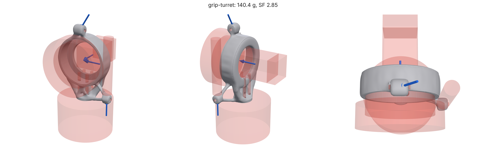

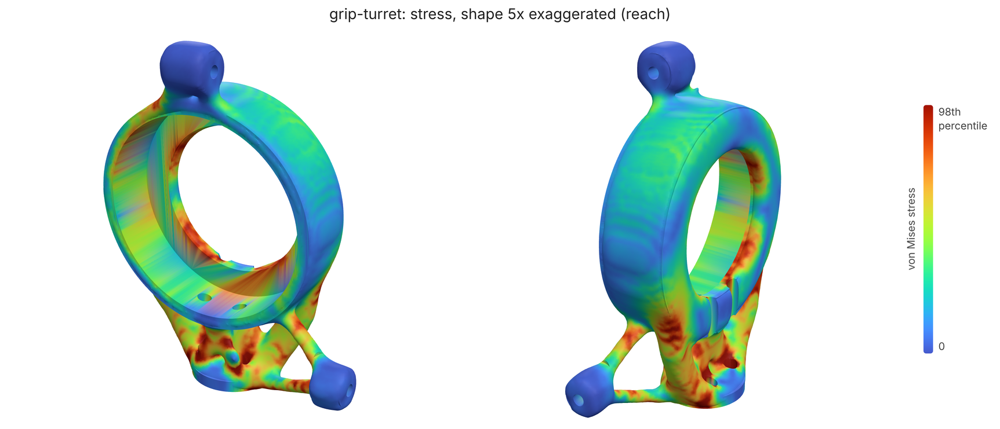

## robot-upper-arm

207.7 g · 88% under envelope · SF 7.33 · pass

deflection 0.519 mm · p5Member 4.96 mm · creaseLength 18.8 mm · volumeFraction 7% · 1416 s

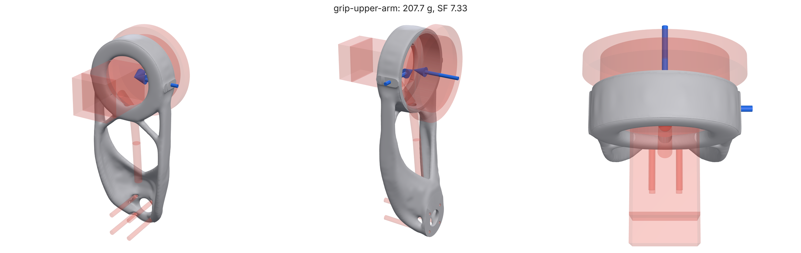

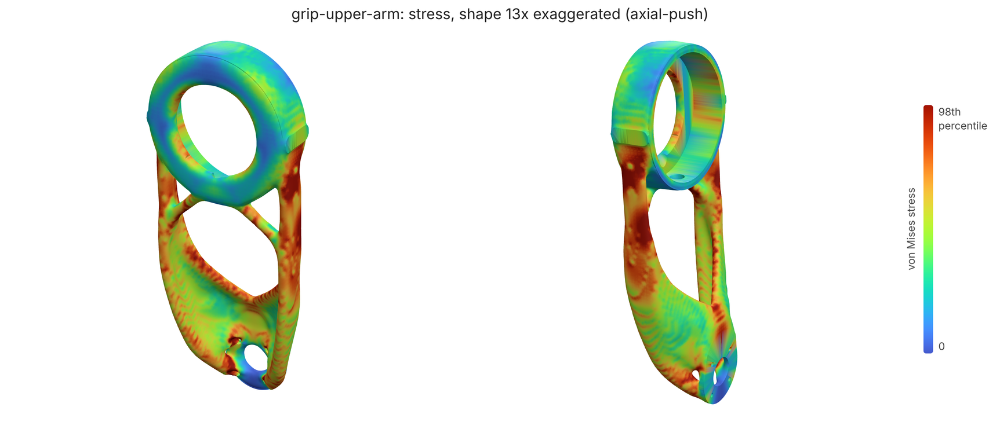

## robot-wrist-link-mjf

40.2 g · 95% under envelope · SF 5.83 · pass

deflection 0.490 mm · p5Member 1.83 mm · creaseLength 1.7 mm · volumeFraction 6% · 1669 s

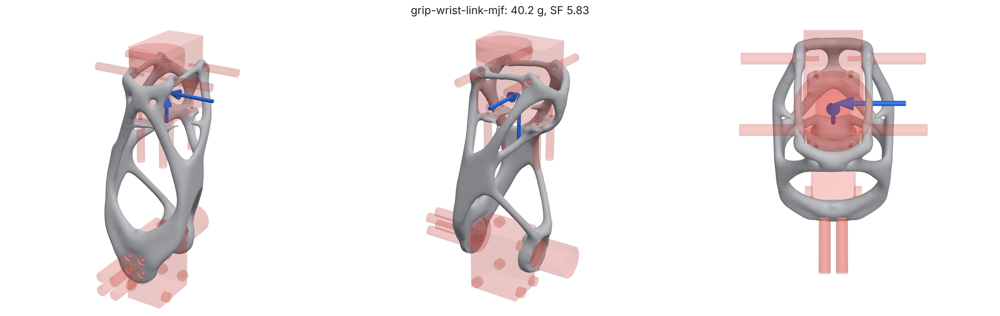

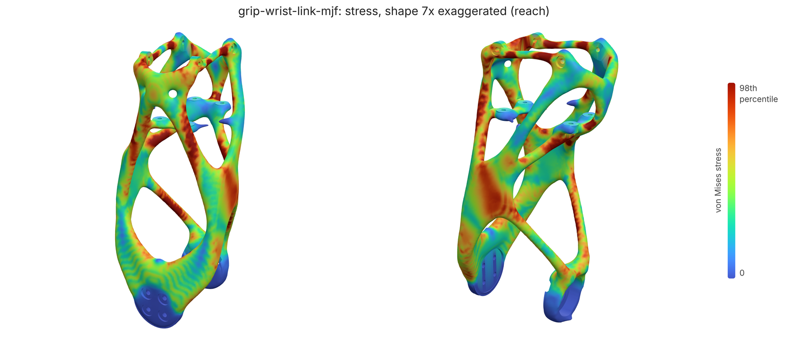

## robot-wrist-yoke

17.3 g · 93% under envelope · SF 3.88 · pass

deflection 0.229 mm · p5Member 2.27 mm · creaseLength 1.1 mm · volumeFraction 6% · 1390 s

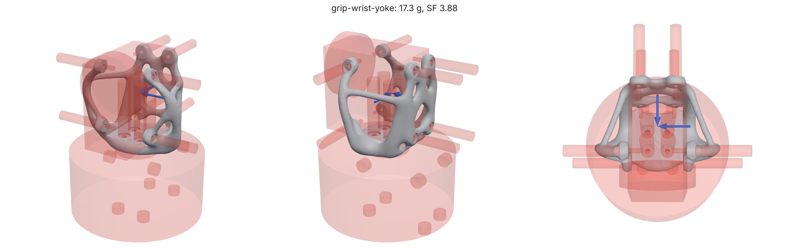

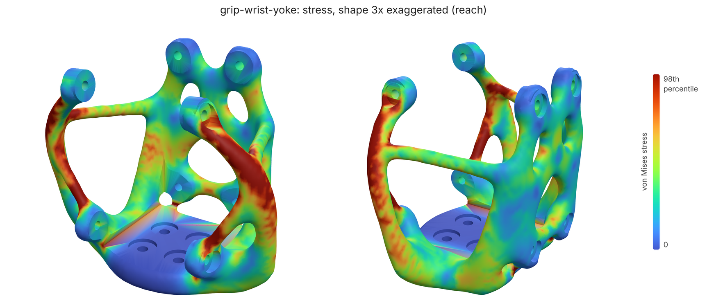

## mbb-beam

13.8 g · 79% under envelope · SF 1.51 · pass

deflection 3.182 mm · p5Member 1.01 mm · creaseLength 0.0 mm · volumeFraction 22% · 1856 s

## motor-mount

27.6 g · 69% under envelope · SF 3.65 · pass

deflection 0.430 mm · p5Member 1.46 mm · creaseLength 0.0 mm · volumeFraction 30% · 148 s

## printed-hook

24.2 g · 84% under envelope · SF 2.73 · pass

deflection 1.240 mm · p5Member 3.41 mm · creaseLength 0.0 mm · volumeFraction 16% · 2856 s

## wall-bracket

26.9 g · 94% under envelope · SF 2.85 · pass

deflection 0.692 mm · p5Member 4.40 mm · creaseLength 4.6 mm · volumeFraction 2% · 1600 s

## wall-bracket-fasteners

26.5 g · 94% under envelope · SF 2.57 · pass

deflection 0.566 mm · p5Member 4.40 mm · creaseLength 47.1 mm · volumeFraction 2% · 2114 s

## Heat exchangers

### box-crossflow

Gyroid crossflow in a box: A left to right, B front to back

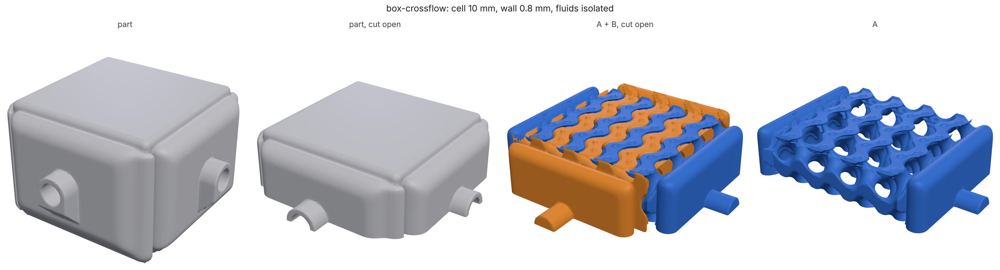

### cylinder-counterflow

Gyroid counterflow in a cylinder: A through the ends, B in and out the side

### Printed in metal

The `lpbf-intercooler-core` eval case built along +z in AlSi10Mg. Nothing inside a metal part can be supported, so a ceiling is a defect wherever it reaches farther from a wall that holds it than half the span an arch closes in powder-bed metal (an 8 mm round hole builds as drawn). The plenums are round vaults and the ports round, rising into a smooth egg only past 8 mm; with `closure` the channels end in peaked roofs under the top skin and flare open over plenums below.

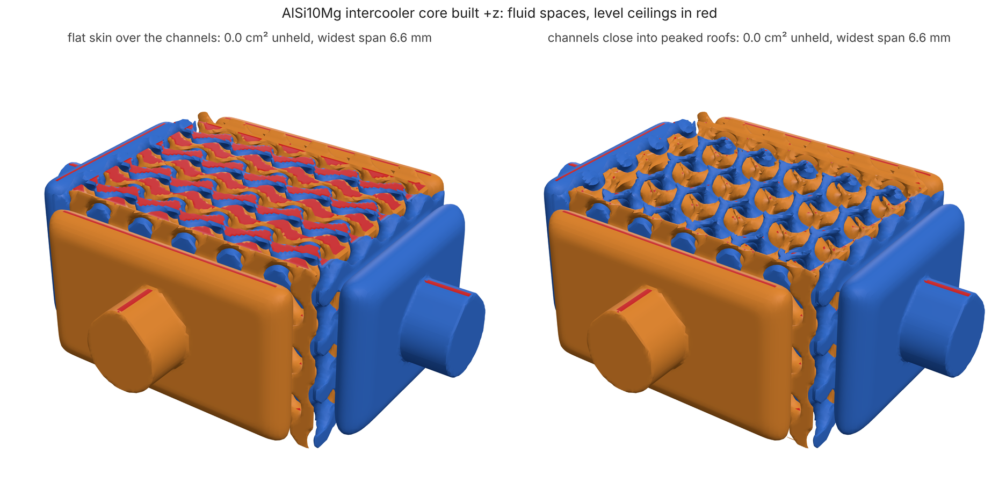

## Manufacturing constraints

The `arm-link` eval case (SF 3, 0.5 mm at the wrist, PA12) with each of loadpath's manufacturing constraints. Cast two-sided along z and milled from +z and -z, every hole runs straight through; the cable channel along x is the one undercut left (it needs a side core), and the report says so (`manufacturing.access.undercutInKeepOuts`). maxMember 6 mm came out 6.8 mm thick at its thickest, under a 2 mm analysis cell over (the free part: 9.8 mm), and 2 g lighter.

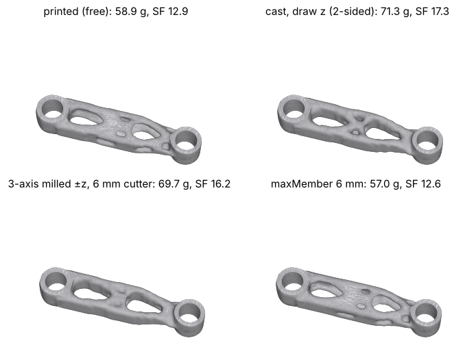

The robot arm's wrist yoke in 6061-T6 aluminium at SF 2: free (38.4 g, SF 4.8) and 5-axis milled with a 4 mm cutter (38.8 g, SF 3.7): every void reachable from one of the six sides, no slot under 4 mm.

