# Gallery

Rendered 2026-10-30 from `a88710c` by `python docs/gallery.py`.

Regenerate with the commands at the top of [`gallery.py`](gallery.py). Stress maps colour worst-case von Mises stress against the part's own 98th percentile, to show the load paths, on the shape bent by the worst load case, exaggerated; the margin against the material is the SF.

## arm-link-driven

46.2 g · 63% lighter · SF 7.98 · pass

deflection 0.494 mm · p5Member 3.41 mm · creaseLength 0.0 mm · volumeFraction 28% · 1782 s

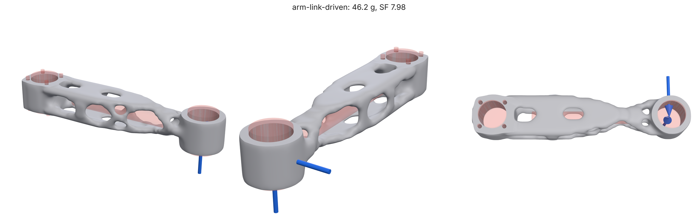

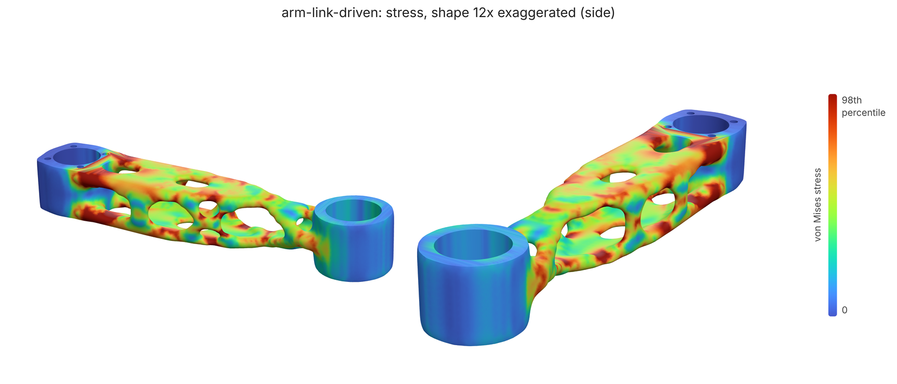

## arm-link

58.9 g · 53% lighter · SF 14.78 · pass

deflection 0.450 mm · p5Member 3.47 mm · creaseLength 0.0 mm · volumeFraction 39% · 1344 s

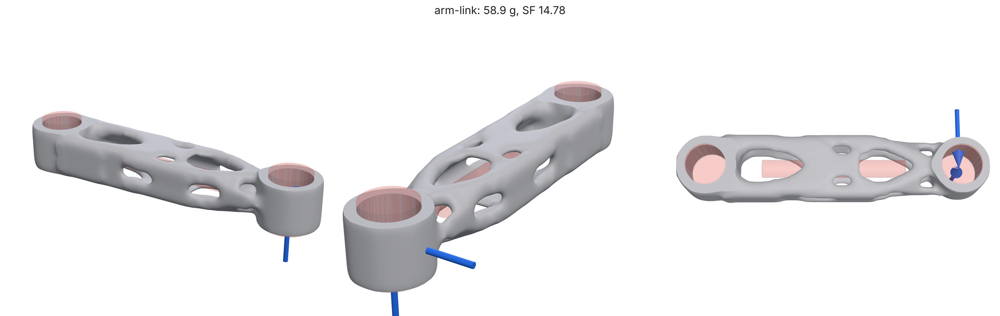

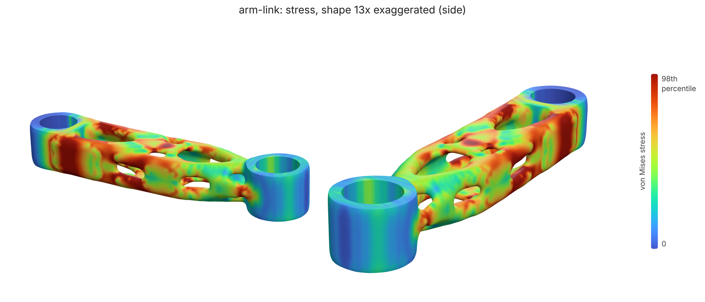

## bell-crank

24.8 g · 84% lighter · SF 3.50 · pass

deflection 0.058 mm · p5Member 4.19 mm · creaseLength 0.0 mm · volumeFraction 7% · 1324 s

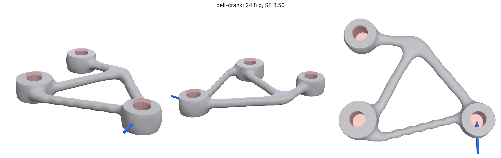

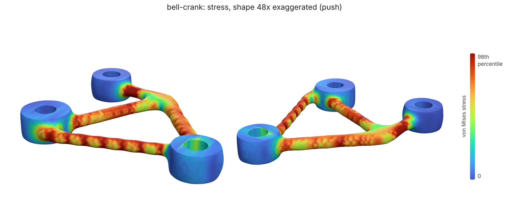

## grip-turret

148.8 g · 91% lighter · SF 2.54 · pass

deflection 0.532 mm · p5Member 5.49 mm · creaseLength 33.1 mm · volumeFraction 2% · 1920 s

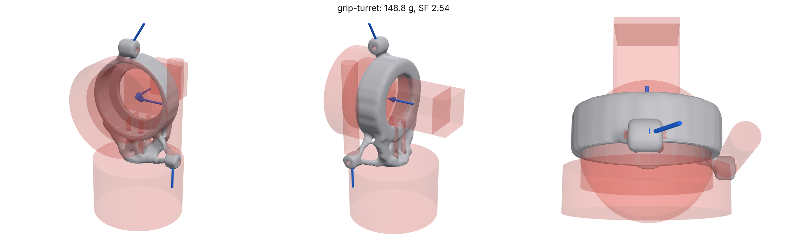

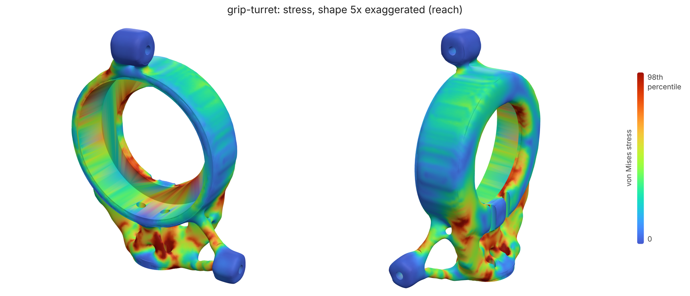

## grip-upper-arm

207.7 g · 88% lighter · SF 7.71 · pass

deflection 0.513 mm · p5Member 4.95 mm · creaseLength 32.8 mm · volumeFraction 7% · 2900 s

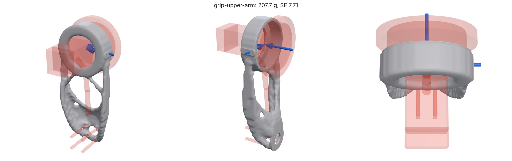

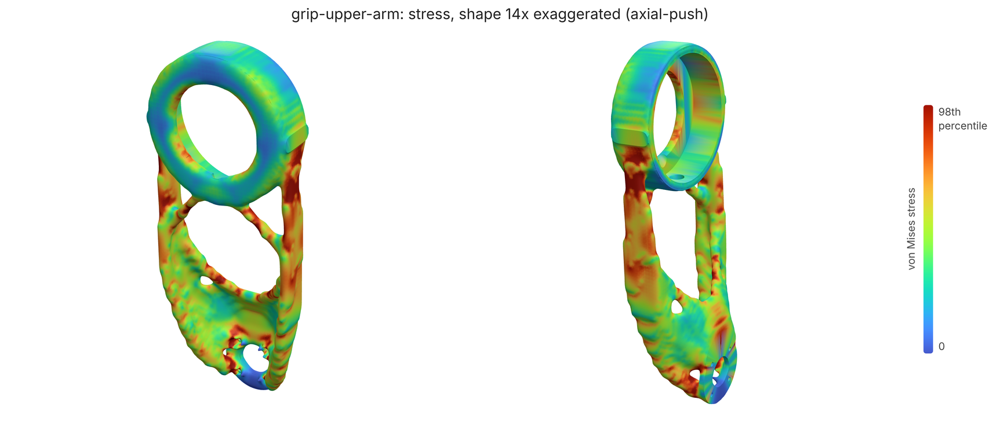

## Heat exchangers

### box-crossflow

Gyroid crossflow in a box: A left to right, B front to back

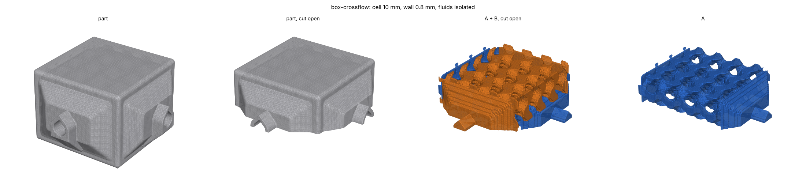

### cylinder-counterflow

Gyroid counterflow in a cylinder: A through the ends, B in and out the side

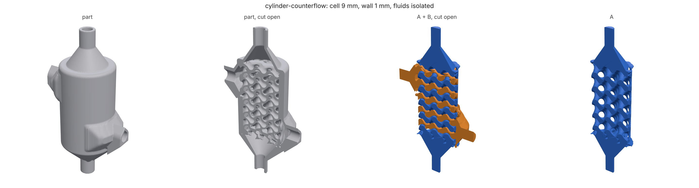

### Printed in metal

The `lpbf-intercooler-core` eval case built along +z in AlSi10Mg. Nothing inside a metal part can be supported, so every flat ceiling over a channel is a defect: with `closure` the channels end in peaked roofs under the top skin and flare open over plenums below.

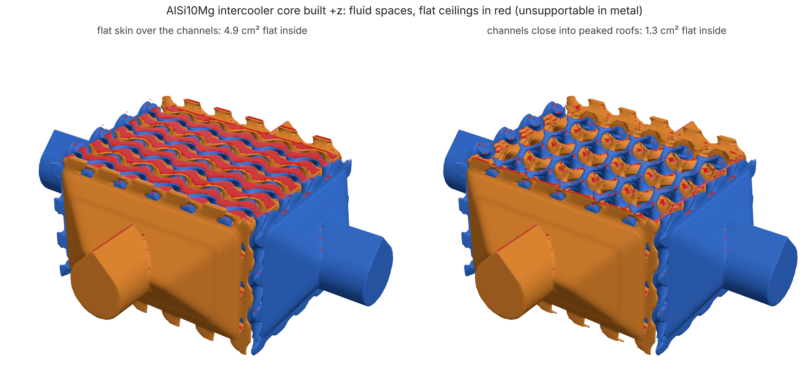
