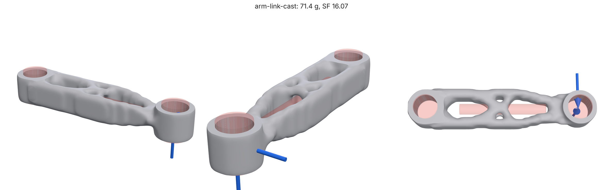
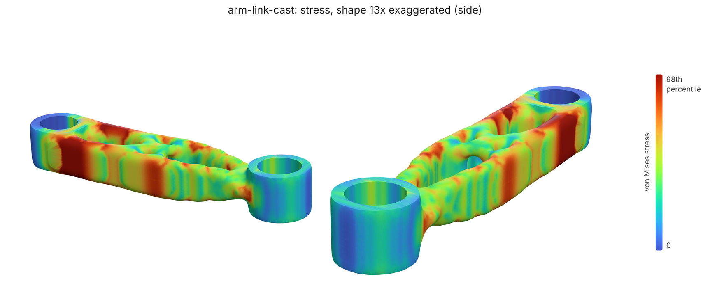
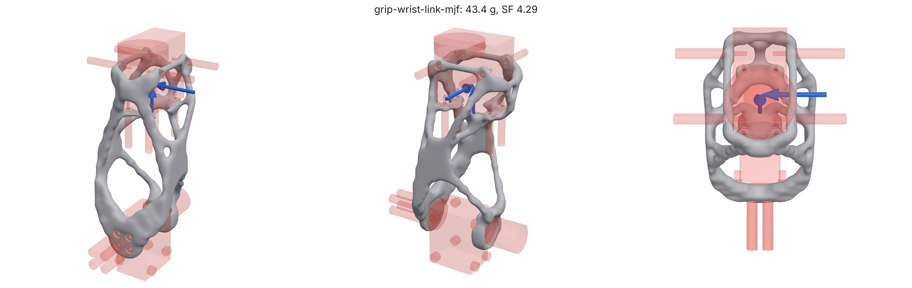
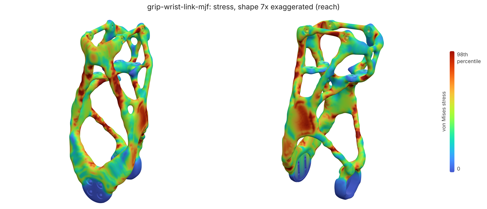

# Gallery

Rendered 2026-10-30 from `b031cbe` by `python docs/gallery.py`.

Regenerate with the commands at the top of [`gallery.py`](gallery.py). Stress maps colour worst-case von Mises stress against the part's own 98th percentile, to show the load paths, on the shape bent by the worst load case, exaggerated; the margin against the material is the SF.

## arm-link-cast

71.4 g · 43% lighter · SF 16.07 · pass

deflection 0.432 mm · p5Member 3.70 mm · creaseLength 0.0 mm · volumeFraction 49% · 1466 s

## arm-link-driven

46.2 g · 63% lighter · SF 7.98 · pass

deflection 0.494 mm · p5Member 3.41 mm · creaseLength 0.0 mm · volumeFraction 28% · 0 s

## arm-link

58.9 g · 53% lighter · SF 14.78 · pass

deflection 0.450 mm · p5Member 3.47 mm · creaseLength 0.0 mm · volumeFraction 39% · 0 s

## bell-crank

24.8 g · 84% lighter · SF 3.50 · pass

deflection 0.058 mm · p5Member 4.19 mm · creaseLength 0.0 mm · volumeFraction 7% · 0 s

## grip-turret

148.8 g · 91% lighter · SF 2.54 · pass

deflection 0.532 mm · p5Member 5.49 mm · creaseLength 33.1 mm · volumeFraction 2% · 0 s

## grip-upper-arm

207.7 g · 88% lighter · SF 7.71 · pass

deflection 0.513 mm · p5Member 4.95 mm · creaseLength 32.8 mm · volumeFraction 7% · 0 s

## grip-wrist-link-mjf

43.4 g · 94% lighter · SF 4.29 · pass

deflection 0.499 mm · p5Member 1.83 mm · creaseLength 0.0 mm · volumeFraction 6% · 2882 s

## grip-wrist-yoke

25.3 g · 90% lighter · SF 3.10 · pass

deflection 0.101 mm · p5Member 3.41 mm · creaseLength 0.0 mm · volumeFraction 9% · 2253 s

## mbb-beam

23.8 g · 64% lighter · SF 1.63 · pass

deflection 1.873 mm · p5Member 2.56 mm · creaseLength 0.0 mm · volumeFraction 37% · 571 s

## motor-mount

27.5 g · 69% lighter · SF 3.35 · pass

deflection 0.321 mm · p5Member 1.46 mm · creaseLength 0.0 mm · volumeFraction 30% · 351 s

## printed-hook

31.3 g · 79% lighter · SF 2.95 · pass

deflection 0.624 mm · p5Member 3.41 mm · creaseLength 0.0 mm · volumeFraction 20% · 585 s

## wall-bracket-fasteners

48.4 g · 89% lighter · SF 3.71 · pass

deflection 0.144 mm · p5Member 4.55 mm · creaseLength 0.0 mm · volumeFraction 8% · 507 s

## wall-bracket

68.1 g · 84% lighter · SF 2.75 · pass

deflection 0.114 mm · p5Member 4.55 mm · creaseLength 0.0 mm · volumeFraction 13% · 382 s

## Heat exchangers

### box-crossflow

Gyroid crossflow in a box: A left to right, B front to back

### cylinder-counterflow

Gyroid counterflow in a cylinder: A through the ends, B in and out the side

### Printed in metal

The `lpbf-intercooler-core` eval case built along +z in AlSi10Mg. Nothing inside a metal part can be supported, so every flat ceiling over a channel is a defect: with `closure` the channels end in peaked roofs under the top skin and flare open over plenums below.

## Manufacturing constraints

The `arm-link` eval case (SF 3, 0.5 mm at the wrist, PA12) with each of loadpath's manufacturing constraints. Cast two-sided along z and milled from +z and -z, every hole runs straight through; the cable channel along x is the one undercut left (it needs a side core), and the report says so (`manufacturing.access.undercutInKeepOuts`). maxMember 6 mm came out 6.8 mm thick at its thickest, under a 2 mm analysis cell over (the free part: 9.8 mm), and 2 g lighter.

GRIP's wrist yoke in 6061-T6 aluminium at SF 2: free (38.4 g, SF 4.8) and 5-axis milled with a 4 mm cutter (38.8 g, SF 3.7): every void reachable from one of the six sides, no slot under 4 mm.

