# Gallery

Rendered 2026-10-29 from `f5b3a9d` by `python docs/gallery.py`.

Regenerate with the commands at the top of [`gallery.py`](gallery.py). Stress maps colour worst-case von Mises stress against the part's own 98th percentile, to show the load paths, on the shape bent by the worst load case, exaggerated; the margin against the material is the SF.

## arm-link

58.9 g · 53% lighter · SF 13.19 · pass

deflection 0.450 mm · p5Member 3.47 mm · creaseLength 0.0 mm · volumeFraction 39% · 0 s

## arm-link-driven

46.2 g · 63% lighter · SF 7.98 · pass

deflection 0.494 mm · p5Member 3.41 mm · creaseLength 0.0 mm · volumeFraction 28% · 0 s

## bell-crank

25.2 g · 83% lighter · SF 3.44 · pass

deflection 0.056 mm · p5Member 4.19 mm · creaseLength 0.0 mm · volumeFraction 8% · 0 s

## grip-turret

172.8 g · 90% lighter · SF 2.33 · pass

deflection 0.382 mm · p5Member 5.49 mm · creaseLength 44.7 mm · volumeFraction 4% · 0 s

## grip-upper-arm

207.9 g · 88% lighter · SF 7.18 · pass

deflection 0.513 mm · p5Member 4.96 mm · creaseLength 38.2 mm · volumeFraction 7% · 1728 s

## grip-wrist-yoke

17.7 g · 92% lighter · SF 3.10 · pass

deflection 0.152 mm · p5Member 1.46 mm · creaseLength 2.9 mm · volumeFraction 8% · 957 s

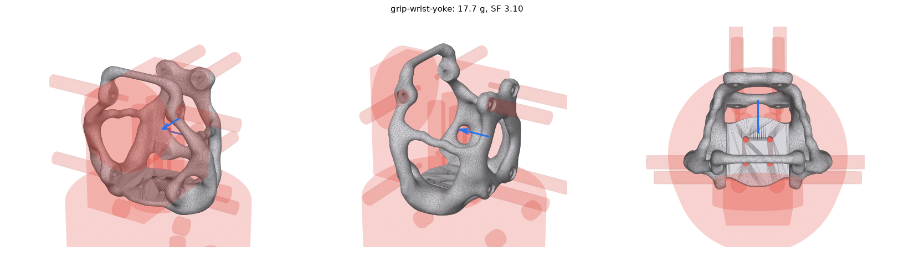

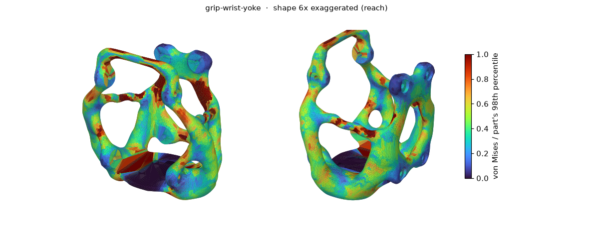

## mbb-beam

26.4 g · 60% lighter · SF 1.56 · pass

deflection 1.669 mm · p5Member 2.65 mm · creaseLength 0.0 mm · volumeFraction 40% · 994 s

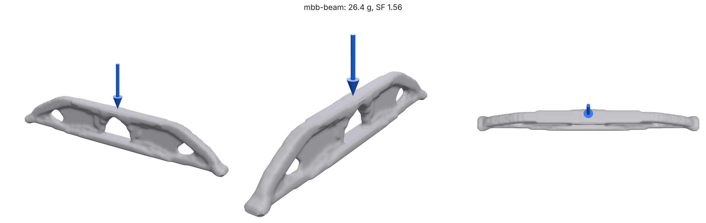

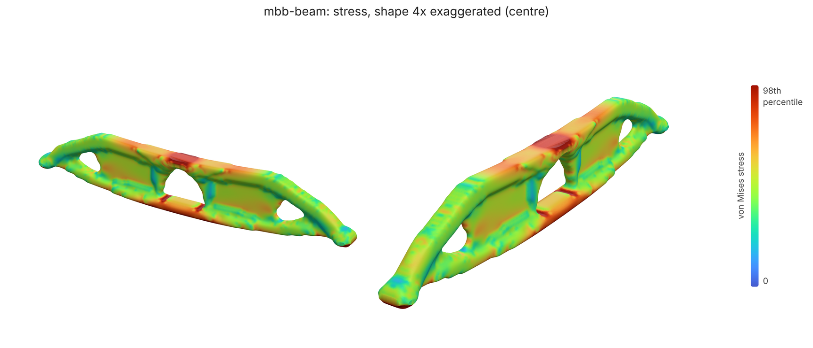

## motor-mount

27.5 g · 69% lighter · SF 2.73 · pass

deflection 0.322 mm · p5Member 1.46 mm · creaseLength 0.8 mm · volumeFraction 30% · 297 s

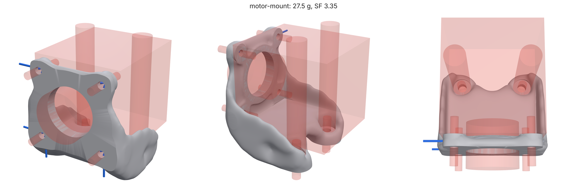

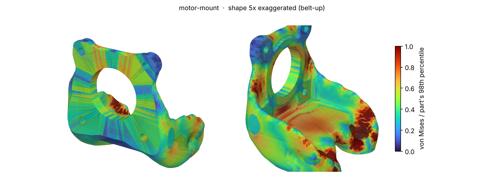

## printed-hook

31.3 g · 79% lighter · SF 2.95 · pass

deflection 0.624 mm · p5Member 3.41 mm · creaseLength 0.0 mm · volumeFraction 20% · 398 s

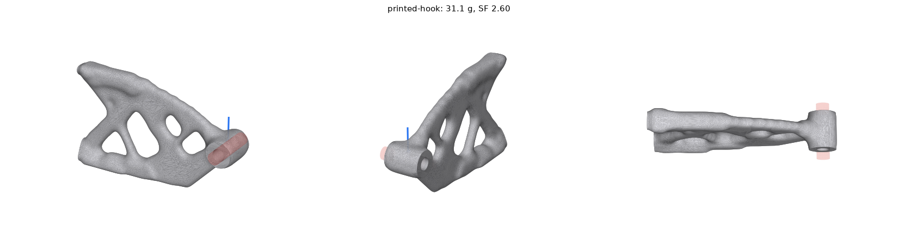

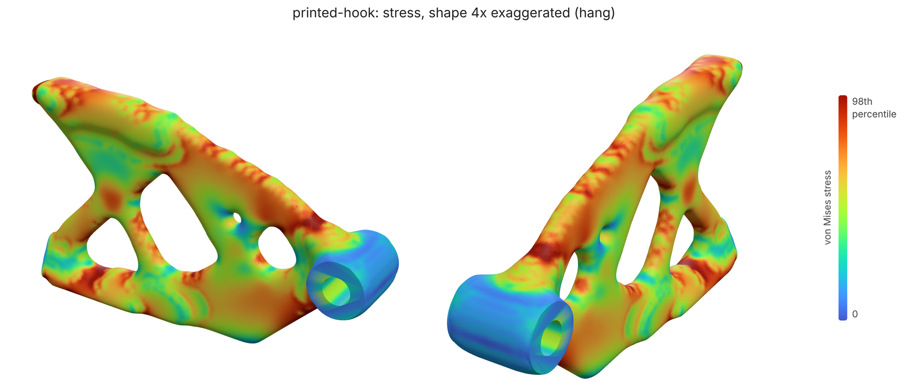

## wall-bracket

61.3 g · 85% lighter · SF 4.37 · pass

deflection 0.096 mm · p5Member 4.55 mm · creaseLength 0.0 mm · volumeFraction 11% · 519 s

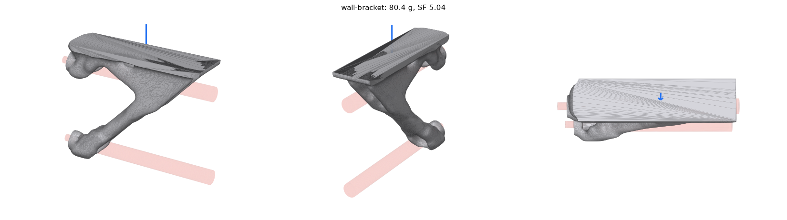

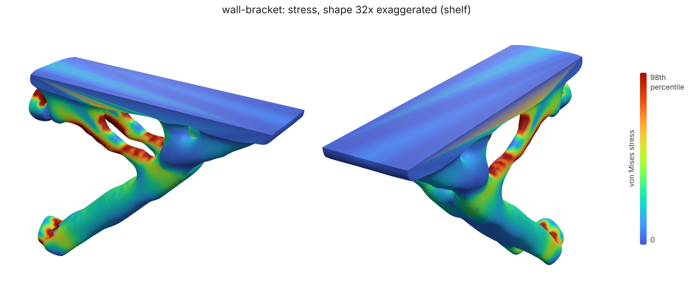

## wall-bracket-fasteners

47.3 g · 89% lighter · SF 3.59 · pass

deflection 0.166 mm · p5Member 4.55 mm · creaseLength 0.0 mm · volumeFraction 8% · 448 s

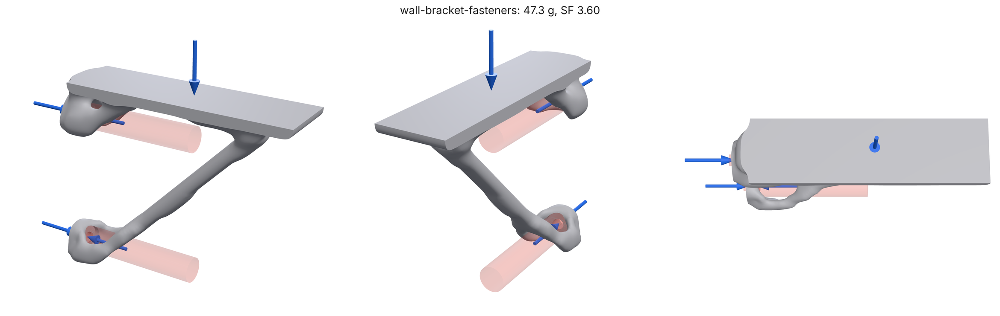

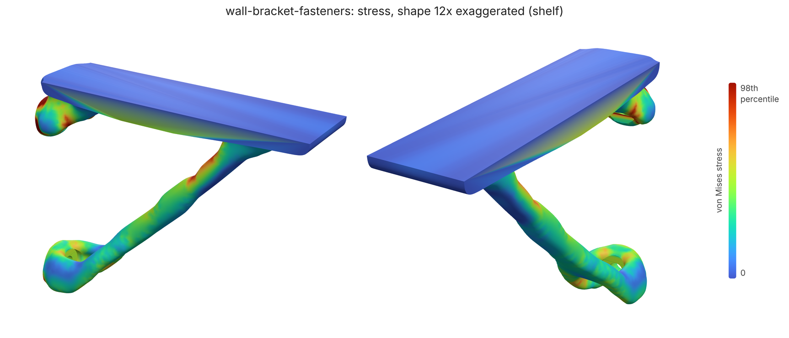

## Heat exchangers

### box-crossflow

Gyroid crossflow in a box: A left to right, B front to back

### cylinder-counterflow

Gyroid counterflow in a cylinder: A through the ends, B in and out the side

### Printed in metal

The `lpbf-intercooler-core` eval case built along +z in AlSi10Mg. Nothing inside a metal part can be supported, so every flat ceiling over a channel is a defect: with `closure` the channels end in peaked roofs under the top skin and flare open over plenums below.

## Manufacturing constraints

The `arm-link` eval case (SF 3, 0.5 mm at the wrist, PA12) with each of loadpath's manufacturing constraints. Cast two-sided along z and milled from +z and -z, every hole runs straight through; the cable channel along x is the one undercut left (it needs a side core), and the report says so (`manufacturing.access.undercutInKeepOuts`). maxMember 6 mm came out 6.8 mm thick at its thickest, under a 2 mm analysis cell over (the free part: 9.8 mm), and 2 g lighter.

GRIP's wrist yoke in 6061-T6 aluminium at SF 2: free (38.4 g, SF 4.8) and 5-axis milled with a 4 mm cutter (38.8 g, SF 3.7): every void reachable from one of the six sides, no slot under 4 mm.

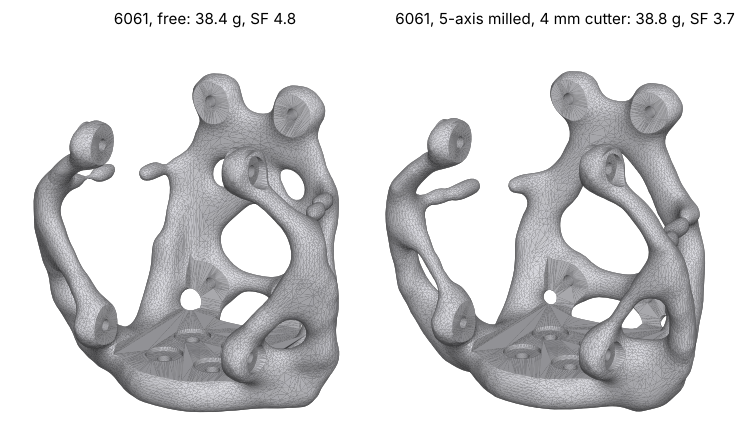
