# Gallery

Rendered 2026-11-01 from the tet-confirmed full baseline run (`063c233`) by `python docs/gallery.py`.

Regenerate with the commands at the top of [`gallery.py`](gallery.py). Stress maps colour worst-case von Mises stress against the part's own 98th percentile, to show the load paths, on the shape bent by the worst load case, exaggerated; the margin against the material is the SF. "Under envelope" compares each part with its design space filled solid, not with a conventionally designed part. All numbers are simulated ([VALIDATION.md](VALIDATION.md)).

## arm-link-cast

67.8 g · 46% under envelope · SF 20.85 · pass

deflection 0.478 mm · p5Member 5.35 mm · creaseLength 0.0 mm · volumeFraction 45% · 494 s

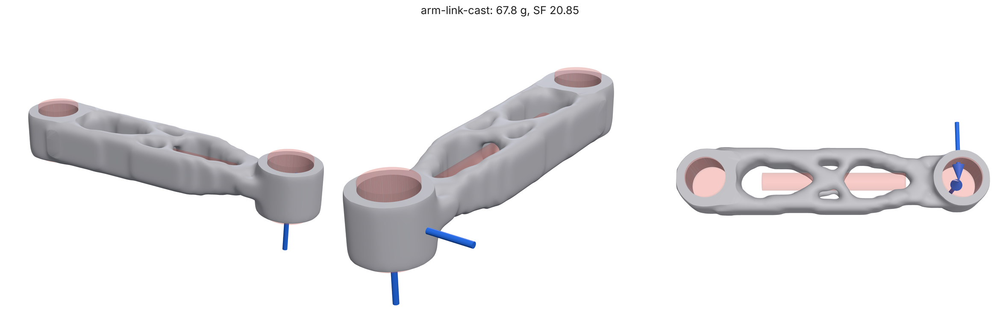

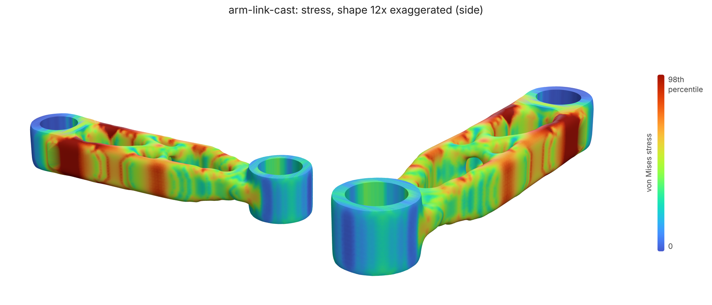

## arm-link-driven

51.3 g · 59% under envelope · SF 12.50 · pass

deflection 0.362 mm · p5Member 3.41 mm · creaseLength 0.0 mm · volumeFraction 32% · 374 s

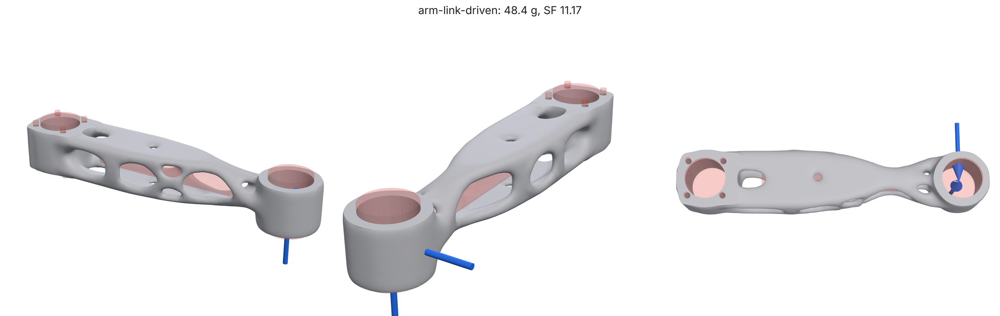

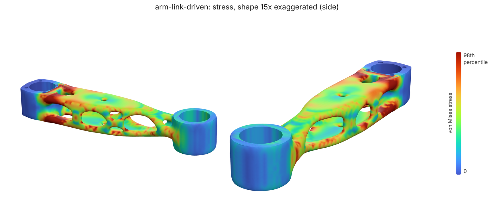

## arm-link

54.2 g · 57% under envelope · SF 10.97 · pass

deflection 0.489 mm · p5Member 1.46 mm · creaseLength 0.0 mm · volumeFraction 36% · 901 s

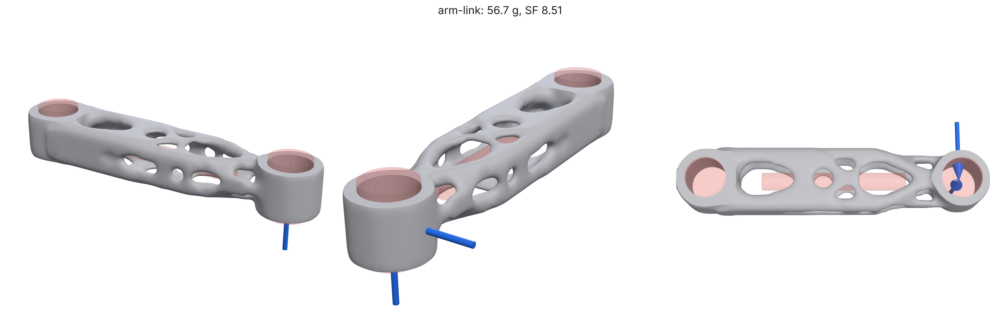

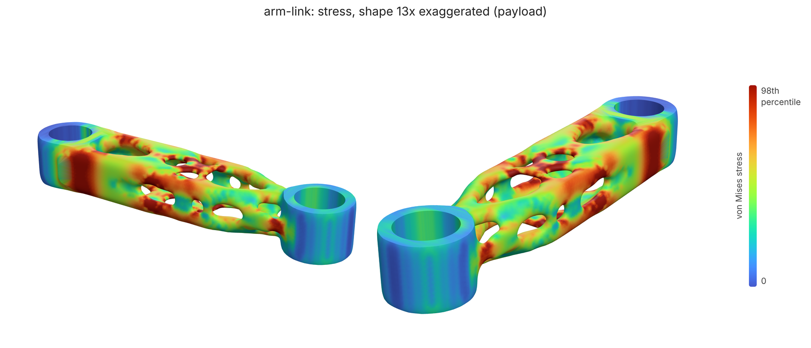

## bell-crank

23.8 g · 84% under envelope · SF 4.90 · pass

deflection 0.066 mm · p5Member 4.19 mm · creaseLength 0.0 mm · volumeFraction 7% · 374 s

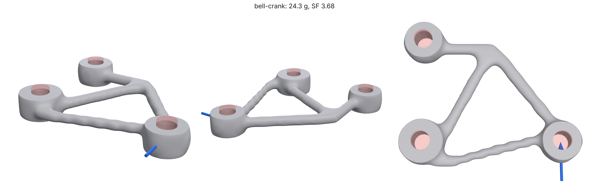

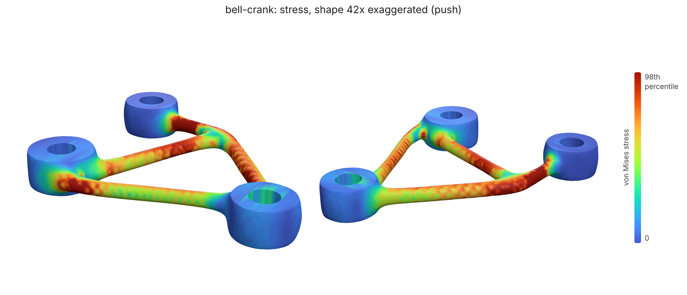

## grip-turret

142.1 g · 91% under envelope · SF 2.45 · pass

deflection 0.767 mm · p5Member 5.49 mm · creaseLength 32.7 mm · volumeFraction 2% · 1025 s

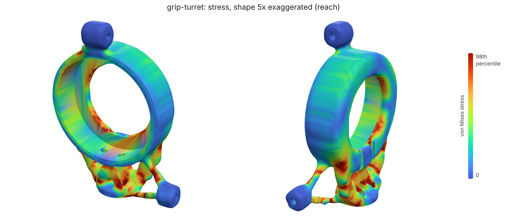

## grip-upper-arm

208.1 g · 88% under envelope · SF 5.83 · pass

deflection 0.515 mm · p5Member 4.96 mm · creaseLength 35.3 mm · volumeFraction 7% · 1383 s

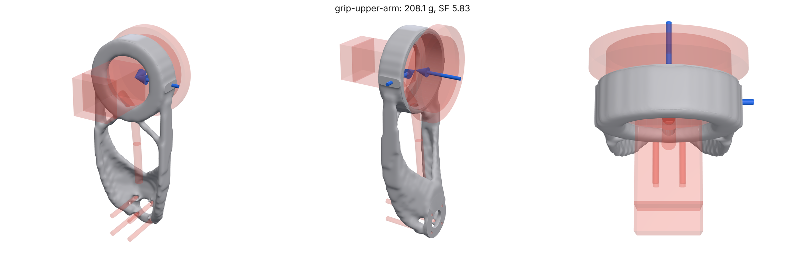

## grip-wrist-link-mjf

41.0 g · 95% under envelope · SF 3.71 · pass

deflection 0.530 mm · p5Member 1.83 mm · creaseLength 0.5 mm · volumeFraction 6% · 2234 s

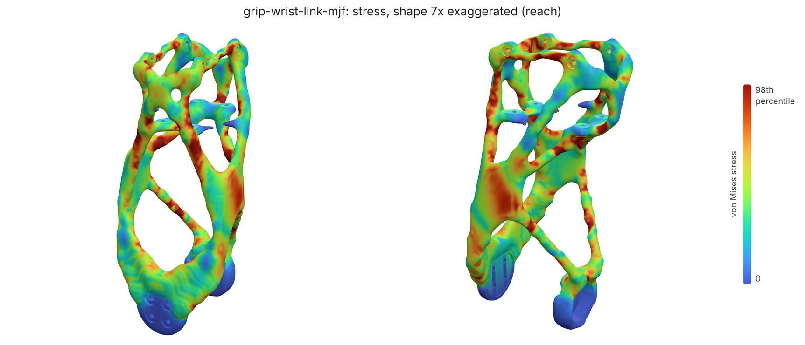

## grip-wrist-yoke

22.0 g · 91% under envelope · SF 4.24 · pass

deflection 0.112 mm · p5Member 3.41 mm · creaseLength 0.0 mm · volumeFraction 8% · 810 s

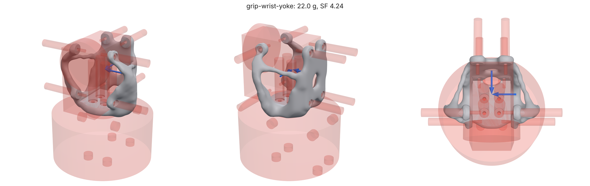

## mbb-beam

14.2 g · 78% under envelope · SF 1.51 · pass

deflection 3.008 mm · p5Member 1.01 mm · creaseLength 0.0 mm · volumeFraction 23% · 1607 s

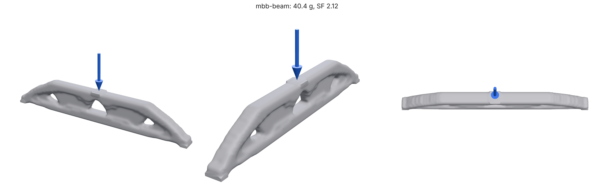

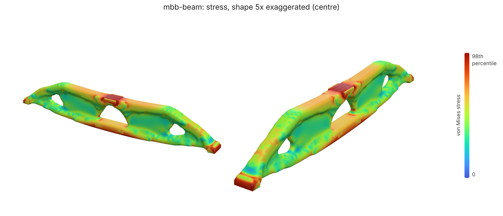

## motor-mount

27.6 g · 69% under envelope · SF 4.07 · pass

deflection 0.431 mm · p5Member 1.46 mm · creaseLength 0.0 mm · volumeFraction 30% · 129 s

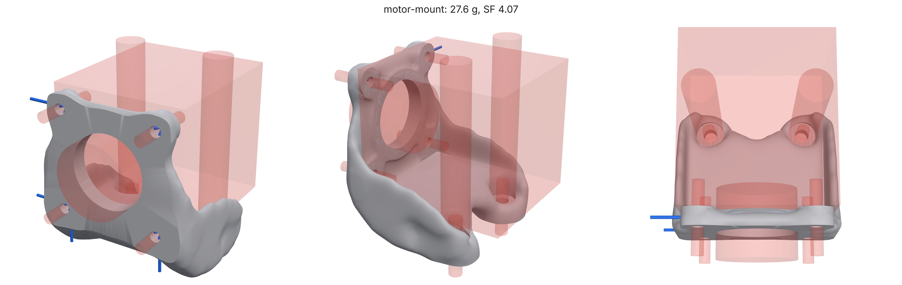

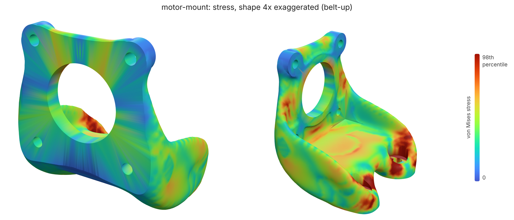

## printed-hook

27.4 g · 82% under envelope · SF 2.73 · pass

deflection 1.041 mm · p5Member 3.41 mm · creaseLength 0.0 mm · volumeFraction 18% · 2438 s

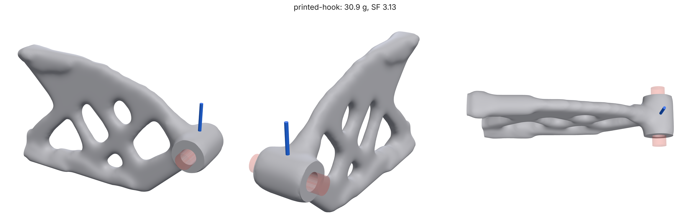

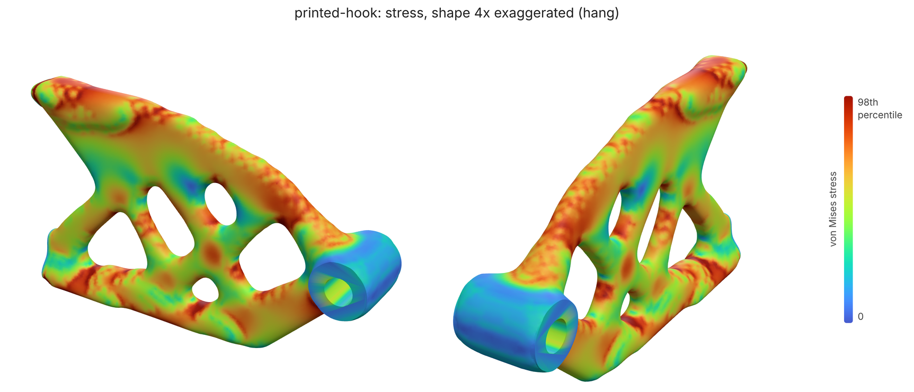

## wall-bracket-fasteners

41.0 g · 90% under envelope · SF 2.89 · pass

deflection 0.552 mm · p5Member 4.55 mm · creaseLength 0.0 mm · volumeFraction 6% · 790 s

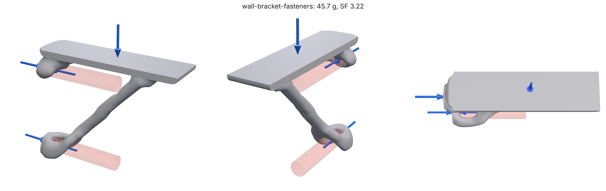

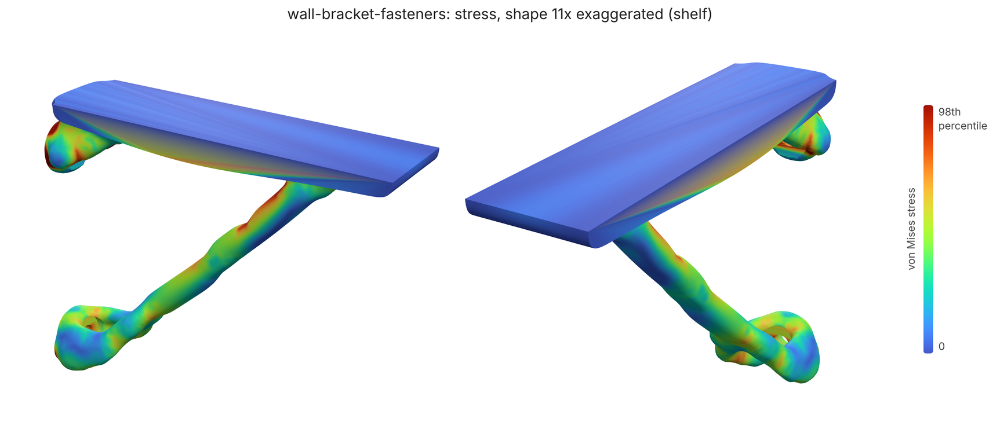

## wall-bracket

64.4 g · 85% under envelope · SF 2.75 · pass

deflection 0.199 mm · p5Member 4.55 mm · creaseLength 0.0 mm · volumeFraction 11% · 381 s

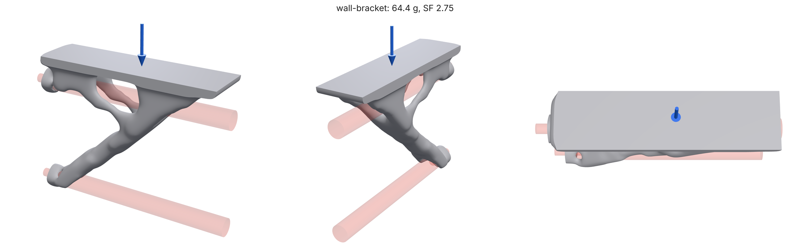

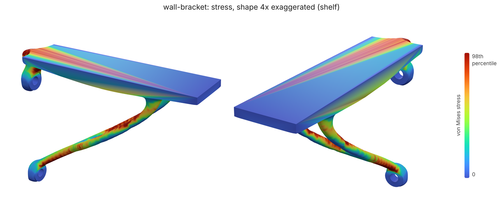

## Heat exchangers

### box-crossflow

Gyroid crossflow in a box: A left to right, B front to back

### cylinder-counterflow

Gyroid counterflow in a cylinder: A through the ends, B in and out the side

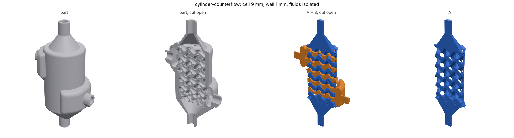

### Printed in metal

The `lpbf-intercooler-core` eval case built along +z in AlSi10Mg. Nothing inside a metal part can be supported, so every flat ceiling over a channel is a defect: with `closure` the channels end in peaked roofs under the top skin and flare open over plenums below.

## Manufacturing constraints

The `arm-link` eval case (SF 3, 0.5 mm at the wrist, PA12) with each of loadpath's manufacturing constraints. Cast two-sided along z and milled from +z and -z, every hole runs straight through; the cable channel along x is the one undercut left (it needs a side core), and the report says so (`manufacturing.access.undercutInKeepOuts`). maxMember 6 mm came out 6.8 mm thick at its thickest, under a 2 mm analysis cell over (the free part: 9.8 mm), and 2 g lighter.

GRIP's wrist yoke in 6061-T6 aluminium at SF 2: free (38.4 g, SF 4.8) and 5-axis milled with a 4 mm cutter (38.8 g, SF 3.7): every void reachable from one of the six sides, no slot under 4 mm.

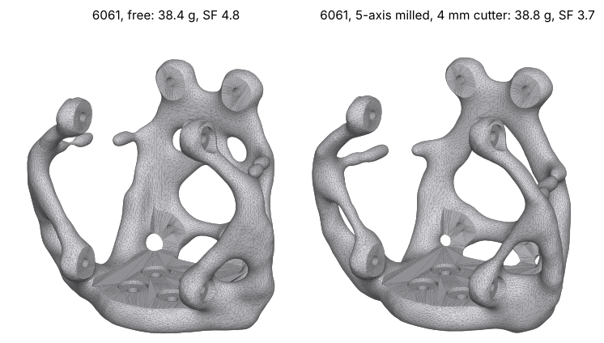
