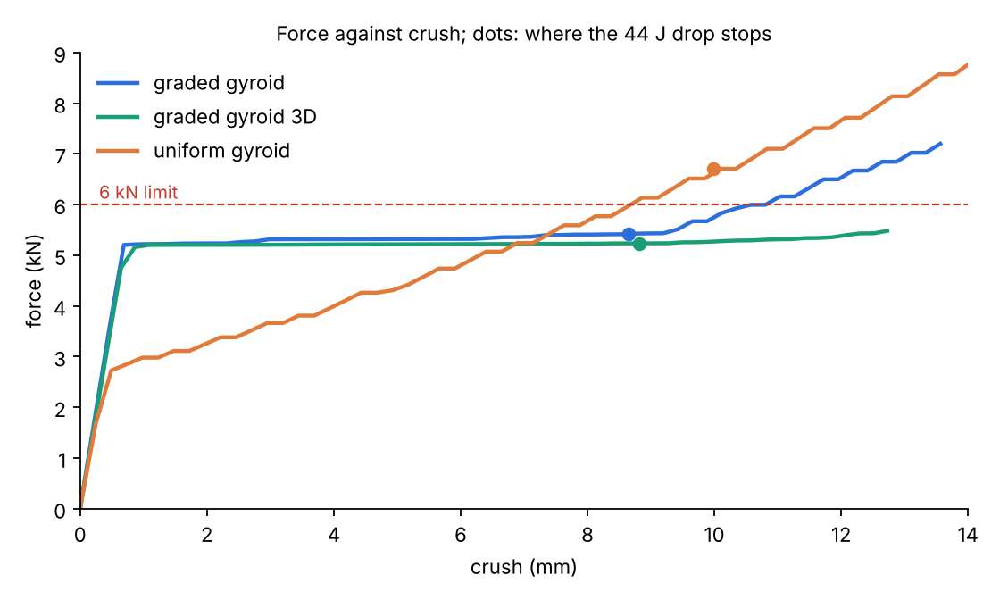
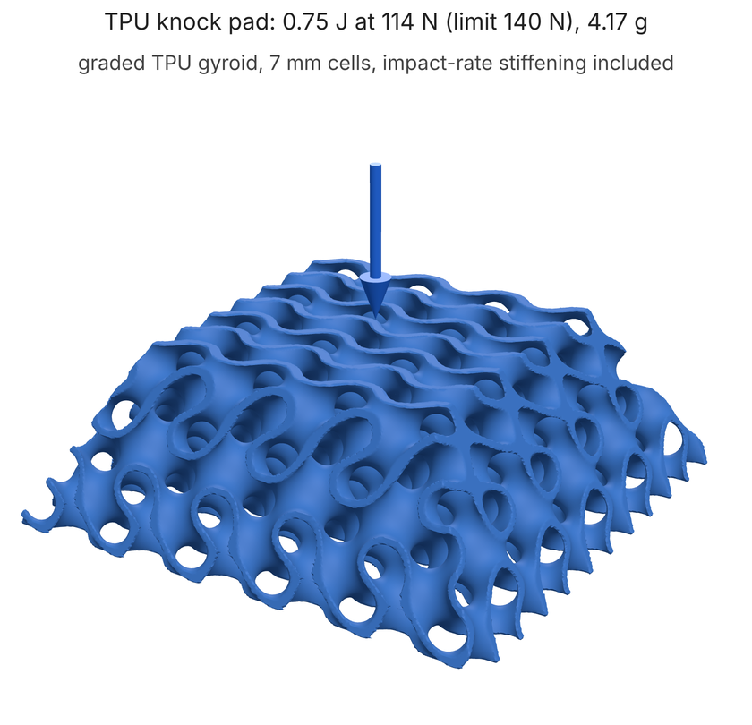
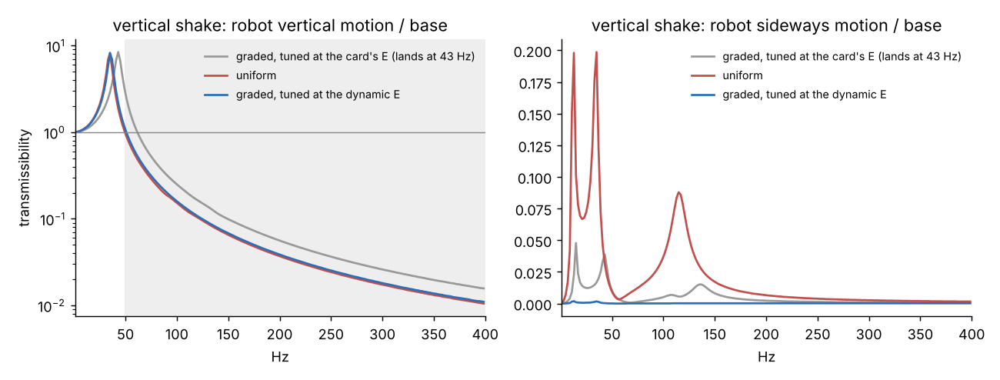
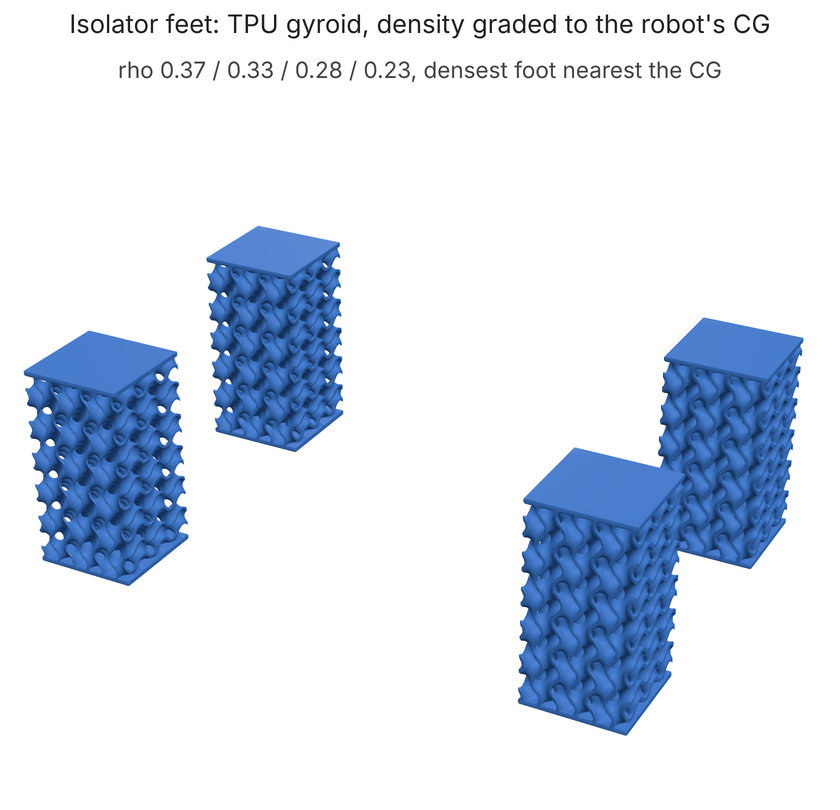

# Impact and vibration

Lattices lose to solid topology optimization on stiffness per gram (a graded
diamond/solid hybrid was 56% more compliant than solid TO at equal material on
the arm link; see the moonshots round 1 write-up). They win where a solid can't
compete: stopping an impact at a force you choose. This page covers
`loadpath/impact.py` (crush and impact), `loadpath/isolator.py` (lattice isolator feet), `loadpath/modal.py` (natural
frequencies and damping) and the `impact` and `vibration` blocks of a field
graph.

## The case: a corner bumper for a falling robot

`examples/impact/end-stop.json`: a tapered corner bumper for a GRIP-like robot
base. The 5 kg robot falls 0.9 m off a bench (4.2 m/s, 44 J) and the PA12 base
behind the bumper must not take more than 6 kN. The envelope narrows from
40 mm to 22 mm square over 20 mm. Cells are 12 mm so the thinnest SLS wall is
0.8 mm, which sets the lowest density at 0.20.

    python examples/impact/end_stop.py --out impact-out/     # ~10 min on 4 cores




| design | mass | peak force | crush | efficiency | 44 J under 6 kN? |
|---|---|---|---|---|---|
| graded gyroid (impact block's grading) | 4.85 g | **5.43 kN** (111 g) | 8.6 mm | **0.94** | **yes** |
| graded gyroid 3D (`grade_3d`, idle rim emptied) | **4.39 g** | **5.24 kN** (107 g) | 8.8 mm | **0.96** | **yes** |
| uniform gyroid, same mass as z-graded (rho 0.243) | 4.85 g | 6.71 kN (137 g) | 10.0 mm | 0.66 | no |
| solid TO, designed for the 6 kN load | 8.25 g | 44 kN if elastic; yields at 4.3 kN | 2.0 mm | n/a | no: holds 0.82 J at 6 kN |

Efficiency is energy / (peak force x crush): 1 is a perfect square pulse.

- **Graded vs uniform, same mass:** 19% lower peak force, and only the graded
  core meets the limit. A uniform core in a taper crushes its narrow top at
  2.7 kN and its wide foot at over 8 kN, so its force climbs all the way; the
  graded one (density 0.20 at the foot to 0.43 at the tip) crushes every layer
  at about 5.3 kN.
- **Graded lattice vs solid TO (1.7x heavier):** the solid is a spring. Within
  the 6 kN limit it can store 0.82 J, 1.8% of the drop; it yields at 4.3 kN
  having stored 0.41 J. The rest of the 44 J has to go into crushing a part
  that was never shaped to crush, and it hands back whatever it stores
  elastically as a rebound. The lattice absorbs the whole drop in 8.6 mm of a
  20 mm pad (64% of its stroke) and keeps it.
- **Grading in 3D** (see below) takes another 9% of mass out and lowers the
  peak further, and its first collapse in a full 3D check (4.7-5.1 kN) now
  agrees with the layer model (5.2 kN).
- **Vibration:** the robot sitting on the pad (5 kg on the top face, base
  clamped) has its first mode at 101 Hz on the graded pad, 91 Hz on the
  3D-graded one and 98 Hz on the uniform one (`vibration` block,
  homogenized lattice).

## How the crush model works

1. **Cell strength.** `collapse_strength` crushes one periodic TPMS cell
   (32^3 voxels) by the elastic compensation method (Mackenzie & Boyle 1993):
   linear solves in which every overloaded wall is softened in proportion, so
   load spreads the way a plastic mechanism spreads it. The macro stress at
   which the most loaded wall yields is a lower bound that rises each pass to
   near the limit load. Fits, sigma_pl / sigma_y = D rho^p (within 6% of the
   data, which is in `impact.CRUSH_DATA`):

   | sheet | D | p | sigma_pl / (rho sigma_y) at rho 0.25 |
   |---|---|---|---|
   | gyroid | 0.633 | 1.19 | 0.49 |
   | diamond | 0.675 | 1.12 | **0.57** |
   | Schwarz P | 0.795 | 1.38 | 0.47 |

   Collapse is 1.4-2x first yield. Exponents of 1.1-1.4 mean the sheets carry
   load mostly by stretching, which is why sheet TPMS beat strut lattices
   (bending, p ~ 1.5-2) per gram. Diamond is the strongest per gram, as it is
   the stiffest.
2. **Densification:** eps_D = 1 - 1.4 rho (Gibson & Ashby's foam constant).
3. **Layers in series** (`crush_curve`): each layer's crush force is the sum
   of its cells' plateau stress times area. The weakest layer crushes through
   its densification strain first, then the next. That is the standard model
   for graded foams.
4. **Grading** (`grade_for_impact`): density per layer from
   sigma_pl(rho) A = F, clipped to the printable range. F is the target that
   gives the lowest peak while still holding 1.25x the energy before the core
   densifies. In a field graph, `"grade": true` returns the result as a
   `remap` table node to paste in as the lattice's density.

## What to trust, and what not yet

- **The plateau is a perfect-cell estimate.** No buckling, no print defects,
  quasi-static. Polymers are 10-30% stronger at impact rates, which raises the
  real force. Treat forces as +-25% until crush coupons calibrate them.
  `calibrate kit --crush` makes two gyroid blocks per material; they can be
  tested at home (TPU under weights, PA12 on a 15:1 lever with a bucket of
  water; see CALIBRATION.md). A saved card's crush factor then scales every
  impact prediction made with that material.
- **Lateral load spreading, and grading in 3D.** A 3D check (`limit_load`:
  elastic compensation on the homogenized pad, Deshpande-Fleck crushable-foam
  yield) shows where a layer-only grading falls short. In a taper the load
  from a narrow layer stays in a column and reaches the middle of the wider
  layers below before their rims, so the middle starts crushing at
  3.5-4.2 kN against the layer model's 5.2 kN while the rims idle.
  `grade_3d` fixes this. Each pass solves the homogenized core and shares
  each layer's crush force among its cells in proportion to where the stress
  actually goes, and cells that would need less than half the printable
  minimum density are left empty. The result is the "graded gyroid 3D" row
  above: 9% lighter, a lower peak force, and the 3D first collapse within
  1-9% of the layer model, against 20-33% for z grading. In a graph it is a
  `grid` node (the saved `.npz`) for the density, plus an
  `expr "0.10 - density"` intersected with the envelope to cut out the empty
  cells.
- **Few cells.** 12 mm cells in a 40 mm pad are about three cells across, so
  homogenization is approximate. That is the price of 0.8 mm SLS walls at
  rho 0.2. MJF or resin at thinner walls allows finer cells.
- **Materials.** The plastic law is right for ductile polymers (PA12, PA11,
  PETG) and metals. PLA fractures and crushes raggedly. TPU uses the elastic
  law below.
- **Top and bottom faces.** The example's core is cut open at both faces. A
  real bumper wants thin face sheets so the impactor meets a surface. Add a
  `shell` of the envelope's top and bottom slabs.

## Small knocks: TPU

PA12 lattices are strong. At SLS's 0.8 mm minimum wall their plateau is
several MPa, so they suit kN, tens-of-joules impacts. Everyday knocks on a
small arm (a fraction of a joule, a contact force a person can take) call
for an elastomer. TPU sheets do not yield: they buckle, the core crushes at
the buckling stress, and it springs back. `crush_law` switches to an elastic
law for materials in `ELASTOMERS`: sigma_el = 0.05 E rho^2, Gibson & Ashby's
elastic collapse for elastomeric foams. Our own check (linear buckling of a
2x2x2 gyroid block between glued plates) gives 0.0043 E at rho 0.3 with 24
voxels per cell, against the law's 0.0045 E. It is not mesh-converged: 16
voxels gives 0.0144 because thin walls lock. So the law stands until a TPU
coupon is crushed. The report adds the energy that comes back as rebound
(`HYSTERESIS`: TPU dissipates roughly 30%; rough).

`examples/impact/knock-pad.json` and `knock_pad.py`: a TPU bumper on a
GRIP-like forearm. 1.5 kg of arm swings into a hand or a fixture at 1 m/s
(0.75 J) under a 140 N limit, which is about the ISO/TS 15066 quasi-static
contact limit for a hand. Taper 40 mm to 24 mm over 14 mm, 7 mm cells, 0.5 mm
thinnest wall (one FDM line).

TPU is stiffer in a knock than in the tensile test its card's E comes from
(see "TPU over time and rate" below). The pad crushes for about 15 ms, which
makes it 1.41x stiffer, and its plateau force rises by the same factor. The
`impact` block includes this for elastomers (`"rate": false` turns it off).
With 6 mm cells the graded pad was 112 N without the factor and exactly the
140 N limit with it, because its softest layers already sat at the printable
minimum density. 7 mm cells let the soft end go to rho 0.22:

| design (rate stiffening included) | mass | peak force | crush | efficiency |
|---|---|---|---|---|
| graded TPU gyroid | 4.17 g | **114 N** (passes, 19% margin) | 7.5 mm | 0.87 |
| uniform TPU gyroid, same mass | 4.16 g | 135 N (passes, 4% margin) | 8.1 mm | 0.69 |
| solid TPU pad, same mass and footprint (2.2 mm thick) | 4.17 g | 5.4 kN (static modulus, so more in fact) | 0.3 mm | n/a |



The graded pad returns about 0.5 J of the 0.75 J as rebound. Rebound is
what a reusable bumper does; a crash element that keeps the energy has to
be sacrificial (the PA12 bumper above).

## TPU over time and rate (`viscoelastic.py`)

A TPU part's stiffness depends on how long the load has been on. The card's
E comes from a test lasting seconds; a foot under a payload for a year is
softer, and a mount vibrating at 35 Hz or a pad hit for 15 ms is stiffer.
`viscoelastic.py` uses a log-time creep law with one rate m:
J(t) / J(10 s) = 1 + m ln(t / 10 s), the form isolator makers give for
polyurethane ("the increase in deformation is proportional to the time
logarithm", Getzner).

- **m = 0.045**, from a generalized Maxwell fit to 100-minute compression
  creep of extrusion-printed TPU (CMC 86(3), 2025): E(10 s) / E(100 min) =
  1.29.
- **Check:** this gives a 35 Hz to static stiffness ratio of 1.53. Isolator
  makers quote 1.3-1.6 for polyurethane (GERB NOVODAMP data sheet).
- **Ten years:** 1.78x the 10 s sag. Getzner quote under 1.5x after 10
  years in their recommended load range, so this is cautious.

| time scale | factor on the card's modulus |
|---|---|
| 10 ms impact | 1.45 |
| 35 Hz vibration | 1.53 |
| 10 s (the card) | 1 |
| 1 day | 0.71 |
| 10 years | 0.56 |

`creep_factor`, `dynamic_factor` and `event_factor` give these. A card
calibrated with the K-25 creep coupon replaces m (CALIBRATION.md).

Not modelled yet:

- **Temperature:** TPU softens fast above about 40 C.
- **Large strains:** the law is linear viscoelastic.
- **Frequency-dependent damping:** the log law implies a loss factor of
  about 0.07, but the 0.12 in `LOSS_FACTOR` is a 10 Hz DMA value, kept as
  is.

## Vibration (`modal.py`)

`modal_analysis(mesh, modulus, density, nu, fixed, n_modes, point_masses)`
solves K phi = w^2 M phi with lumped mass on the voxel mesh. Per-cell modulus
and density mean a homogenized lattice works too (E C rho^n, rho_s rho). It
returns frequencies, mass-normalized modes and the effective mass fraction per
axis. Validated against Euler-Bernoulli: a 100 x 10 x 10 mm cantilever is
within 0.5% for f1, and f2/f1 = 6.27.

Damping: a part made of one linear viscoelastic material has that material's
loss factor in every mode, so **a lattice does not damp better than the solid
it is made of**. `LOSS_FACTOR` holds typical values (PA12 0.04, TPU 0.12, PLA
0.015, metals ~0.002). A lattice changes where the modes are: E/rho falls as
rho^(n-1), so a core lowers frequencies. That suits an isolator and is a
penalty for a stiff bracket, where solid TO wins on first frequency per gram
for the same reason it wins on stiffness. Real lattice damping gains need a
second, lossy material (a TPU core) or unfused powder left in the cells
(particle damping). Neither is modelled yet.

## Isolators: TPU lattice feet (`isolator.py`)

An isolator is the one vibration job where a soft lattice is exactly what you
want: a spring soft enough that the payload's mounted frequency sits well
below the excitation, so base motion above about 1.4x that frequency is cut.
The catch is an off-centre load. Four identical feet under a payload whose
centre of gravity is not over the middle of the footprint let it sit tilted,
couple bounce with rocking (a vertical shake also rocks the payload), and
overload the foot nearest the CG, which then reaches the end of its linear
range first under shock.

The fix is the "elastic centre" rule: give each foot a stiffness so the
stiffness-weighted centre of the feet sits under the CG. With a lattice
the stiffness of a foot is its density (k = E C rho^n A / H), so graded
feet do this with the same footprint and part count. `tune_mount` solves
the per-foot stiffness (sum k = K for the target frequency, sum k x = K x_cg,
closest to equal feet, within the printable density range), and
`density_for_stiffness` turns it into densities.

`examples/isolator/mount.py`: a 3.9 kg GRIP-like robot base (aluminium plate
and a column, CG 11 mm forward, 4 mm to the side, 77 mm up) on four
20 x 20 x 40 mm TPU gyroid feet with 6.7 mm cells, tuned for a 35 Hz bounce
at TPU's dynamic stiffness (1.53x the card's E at 35 Hz; see "TPU over time
and rate" above). Every design is checked by voxel FE of the whole mount
(homogenized feet, plate, column, robot mass; ~5 min on 4 cores). Modes are
at the dynamic modulus, which rises with frequency across the sweep. Sag
and tilt are at the card's modulus, grown by creep.

| | uniform feet (rho 0.31) | graded feet (rho 0.37 / 0.33 / 0.29 / 0.23) | graded, tuned at the card's E |
|---|---|---|---|
| bounce frequency (FE / rigid-body model) | 34.6 / 34.0 Hz | 35.5 / 35.0 Hz | 42.9 / 42.4 Hz |
| vertical isolation starts at | 50 Hz | 51 Hz | 62 Hz |
| worst vertical transmissibility, 50-400 Hz | 0.93 | 1.03 (at 50 Hz) | 2.6 |
| bounce mode's vertical mass fraction | 0.989 | **0.998** | 0.997 |
| tilt under gravity, 1 day / 10 years | 2.4 / 3.1 mrad | **0 / 0** | 0.5 / 0.7 mrad |
| sag spread between feet, 10 years | 0.35 mm | **0** | 0.07 mm |
| vertical shake: peak sideways motion of the robot | 0.29 x base | **0.0 x base** | 0.05 x base |
| 10 ms shock before the first foot buckles, day 1 / 10 years | 3.4 / 2.9 g | **4.2 / 3.6 g** | 9.8 / 9.3 g |
| feet mass | 23.7 g | 23.5 g | 30.6 g |




- **Tuning at the dynamic modulus is what puts the bounce where you asked.**
  Tuned at the card's E, the mount bounces at 43 Hz rather than 35. It only
  starts isolating at 62 Hz, so it amplifies 2.6x at the bottom of a
  50-400 Hz band it was meant to cut. Its feet were also clipped at the top
  density limit.
- **Grading does not move the isolation band**, which the total stiffness
  sets. What it buys is a level payload for life: creep grows every foot's
  sag by the same factor, so a mount that starts level stays level. The
  uniform mount's tilt grows from 1.7 mrad at 10 s to 3.1 mrad at
  10 years, about 0.25 mm across a 80 mm column. A vertical shake also
  stays vertical (no rocking of a tall payload, which is what blurs a
  camera or a printer nozzle). And the shock margin before buckling is 23%
  larger, because each foot carries load in proportion to its stiffness.
- **Creep eats the shock margin.** Thin walls buckle at a strain, and creep
  spends strain: 10 years under the payload costs 0.6 g of the graded
  mount's 4.2 g.
- The rigid-body model that does the tuning agrees with the FE to 1-2% on
  the bounce.

Not yet: the loss factor is one number, temperature is ignored, and the
creep rate is a published value for printed TPU until a K-25 coupon is
measured (CALIBRATION.md). The example writes the graded feet as an STL
with 1 mm end plates.

## Field graph blocks

```json
"impact": {"envelope": "envelope", "density": "density", "lattice": "gyroid", "axis": "z",
           "mass": 5.0, "velocity": 4.2, "forceLimit": 6000, "grade": true, "cell": 12, "minWall": 0.8},
"vibration": {"envelope": "envelope", "density": "density", "lattice": "gyroid", "fixed": "base",
              "pointMasses": [{"region": "top", "mass": 5.0}], "modes": 6, "minFrequency": 80,
              "excitation": 50}
```

Both need a `material`. `loadpath field graph.json` reports `report["impact"]`
(force-crush curve, response, pass or fail against the force limit; with
`grade`, the graded table, its response, and a uniform core of the same mass
for comparison) and `report["vibration"]` (frequencies, mass fractions,
damping ratio, worst transmissibility at the excitation).
