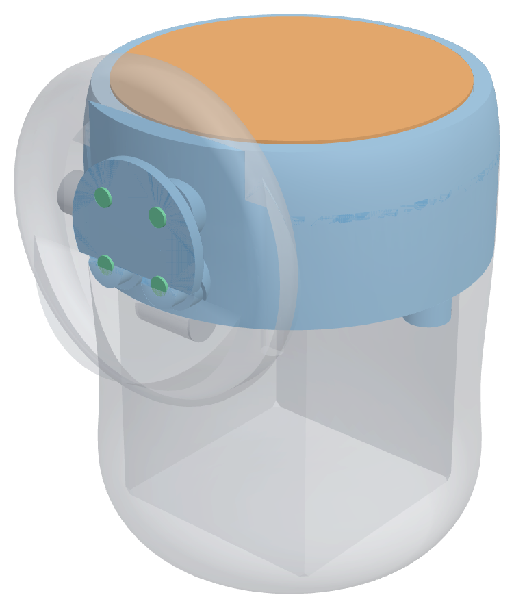
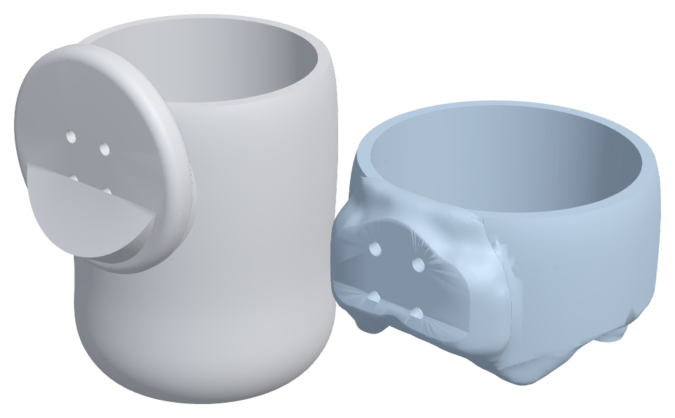

# CAD in: a STEP or STL part as a study

Fusion's generative workspace starts from a body you modelled, and has you
click the faces it bolts on by, the bores its shafts run in and the faces it
must not grow over. Most of that is already in the geometry. `loadpath
import` reads the part, finds it, and writes a study for you to finish:

```bash
pip install "loadpath[step]"                         # OpenCascade, for STEP (STL needs nothing)
loadpath import bracket.step --features-only         # the interfaces, one line each, with ids
loadpath import bracket.step --out draft/ --material pa12 --process sls \
    --support face-1-mount --load bore-0=0,0,-250    # the real setup, no placeholder
loadpath run draft/bracket.study.json --out out/
```

Without `--support` / `--load` the draft carries the suggested setup and a
placeholder force, and the command's `todo` says so; without `--material` it
says the material is the default (PETG, FDM).

MCP: `loadpath_import_cad(path, out_dir, material, process, support, loads)`. Python: `loadpath.cadimport`
(`load_part`, `detect_features`, `suggest_setup`, `draft_study`,
`import_part`).

## What it finds

- **Bores.** Concave cylinders, merged across the faces CAD splits them into,
  with their coaxial steps stacked into one bore (a counterbored M3 is one bore
  with a 1.7 and a 3.0 mm segment). Each has its axis, ends, radius, whether it
  goes through, and a kind: `bolt` up to M6 clearance (3.6 mm radius), else
  `bore` (a bearing seat, a shaft, a socket). Partial arcs (fillets, slot ends)
  and convex cylinders (bosses, listed apart) are not bores.
- **Mounting faces.** Planar faces of at least 1% of the surface that nothing of the
  part covers (rays from the face escape), with the bolt holes that open onto
  each.
- **Interfaces.** A face with two or more bolts (`bolted-face`), bolts that share
  a plane without a face (`bolt-pattern`), or a bore. These are where the part
  meets the rest of the machine.

From a STEP file the surfaces are exact: OpenCascade says which faces are
planes and cylinders, and their radii come out to the micron. From a mesh
they are fitted: smooth patches whose normals lie square to one axis and whose
points sit on a circle (fillets peeled off and trimmed), and coplanar facets
no cylinder claimed. On GRIP's wrist yoke the two agree bore for bore.

## Healing

Real exports are often not solids. Six of GRIP's 31 exported STEPs
(forearm, upper arm, turret, wrist link, wrist yoke, gripper palm) are
open shells: unsewn edges, or a face the exporter dropped. Sewing at 1e-3 mm
runs first; whatever is still open is closed by fanning each boundary loop
from its centroid. Cracks close with no change worth measuring (the yoke:
-76 mm³ of 166,000). A gap wider than 5 mm means a face was missing, and the
report says so (`healed.warning`), because a flat fan is not what the
designer drew.

## The draft study

- **Design space** (`--space`): `part`, the part as drawn (default; the
  optimizer only takes material away), `hull`, its convex hull, or `box`, its
  bounding box, grown by `--grow` mm.
- **Preserved**, cut to the part, one STL per interface: round each bolt, a
  washer-sized seat (ISO head diameter for its clearance hole) `--pad` (2 mm)
  deep under the head (at a counterbore's step when there is one) and where it
  clamps, as `fasteners` would, not a boss or a plate; round each bore, a ring
  (2 mm plus a tenth of the radius, at most 5). Plain bores under 5 mm radius
  that neither hold nor carry a load (cable passes, pilot holes) stay open
  but are not ringed, or the optimizer grows a strut out to them.
- **Kept out**: every bore, through bores 0.5 mm past their ends; when the
  space grows past the part, bolt bores run out of it, each bolt gets a
  `bore: false` head-and-driver path out of its head end, and a slab in front
  of each bolted face keeps material off the mating face.
- **Suggested setup**: the bolted interface with the most bolts holds the
  part (the largest bore when nothing is bolted). The load goes on the
  interface that carries the most farthest away (bore radius x length x
  lever), `--force` N square to the lever, as close to straight down as that
  allows, as a bearing load when it is a plain bore. **This is a placeholder:**
  the force is not the part's; `features.json` lists every interface so the
  real loads go on the right ones.

`<name>.features.json` beside the study has everything found, in mm, in the
file's own frame.

## GRIP's wrist yoke

`examples/grip/import_yoke.py --grip ../grip` imports GRIP's exported
`wrist_yoke.step`, keeps the drafted study, swaps the placeholder load for the
yoke's three load cases from GRIP's hand-written study (rotated from the arm's
frame into the part's) and runs it.

The import, in 2 s: 11 bores (the J5 socket, 61.7 mm; four counterbored M3
horn bolts; two cable passes; two blind pilot holes; two angled screws), 6
mounting faces, 7 interfaces. The suggestion holds the part by the four horn
bolts and loads the J5 socket: the same support and load region the
hand-written study uses.



Run in the cloud (23k cells at the hand-written study's 3 mm minimum member,
PA12-GF card, SF 2 target, 35 min): the lightest passing outcome is
**55.9 g at SF 2.11**, from the original CAD part's 203 g in the same
material. Most of what is left is the socket's preserved 5 mm ring over its
full 29.6 mm depth (about 36 g), which matches the hand-written sleeve's wall;
a shorter ring is the next lever. The first run, which still ringed every
bore, grew a strut out to a 4 mm cable pass and came in at 69 g: that is why
small unloaded bores are no longer preserved.


