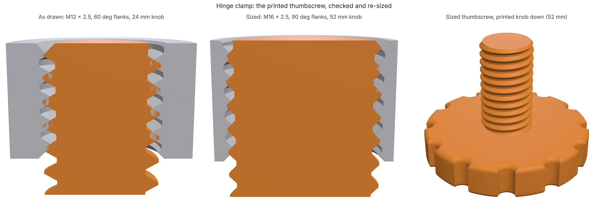
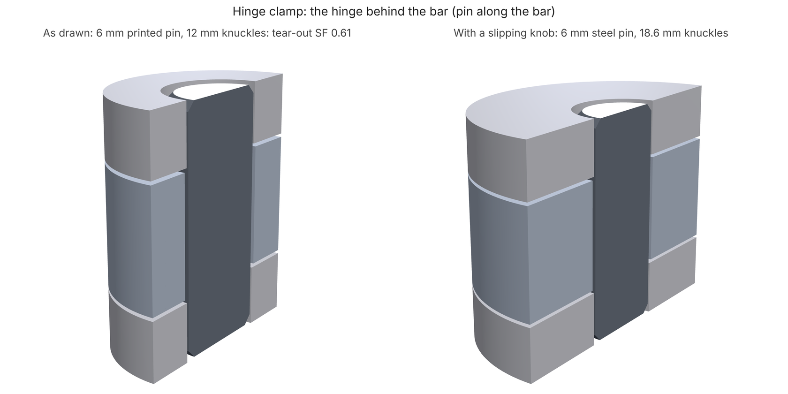
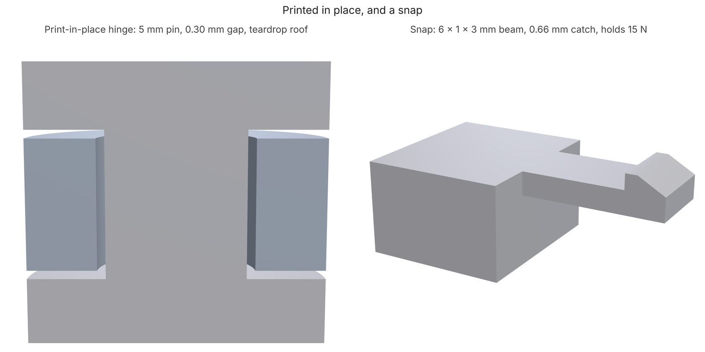

# Printed joints: threads, hinges, snaps

A printed part that opens, closes or clamps needs a joint, and the joint
is usually where it breaks. The usual sizing is a rule of thumb: "M12 is
plenty", "a 6 mm pin", "make the snap 1 mm". Those rules come from steel
fasteners and moulded plastic. A printed joint differs in three ways
that each change the answer:

- **It is layered.** A tooth, a knuckle or a snap beam loaded across the
  layers is held by the bond between them, at a fraction of the in-plane
  strength.
- **It is toleranced by the process.** An FDM hole is drawn a few tenths
  off, so a fine pitch loses most of its tooth to the gap.
- **It creeps.** A clamp held by a printed screw against a TPU liner
  keeps less than half its preload after a year.

`loadpath.joints` sizes each joint from its load and checks it every way
it can fail, reading the layers, the process gap and the creep.
`loadpath.jointcad` draws it as exact B-rep (build123d), and `loadpath
build` cuts it into a part, measures the wall the part actually gives it,
and re-runs the checks at that wall.

```
loadpath joint '{"type": "thread", "clamp": 95, "clampMaterial": "tpu", "knob": "auto"}' --step out/
```

```python
from loadpath import joints as J
t = J.thread(clamp=95, clamp_material="tpu", material="petg", process="fdm", knob="auto",
             axis=(0, 0, 1), screw_build=(0, 0, 1), nut_build=(0, 0, 1))
h = J.hinge(load=470, material="petg", process="fdm", pin="304", width=14, axis=(1, 0, 0),
            load_dir=(0, 0, 1), build=(0, 0, 1))
s = J.snap(hold=15, material="petg", process="fdm")
```

Each returns the sizes, every check row (`id`, `sf`, `pass`, the basis),
`pass`, and the assumptions it made.

## Threads

The profile is trapezoidal with a P/8 crest. The nut is the screw grown
by the process gap, so the two never touch at rest:
gap = ½ |hole bias| + √2 · ½ tolerance + 0.05 mm (fits.HOLES). Three forms
are offered: `iso` (60°), `print` (90°, 45° flanks that print standing
without support) and `buttress` (one 10° flank for a load one way).
`form="auto"` takes `print` for a member printed standing.

What the screw must carry is the clamp **after creep**, then judged at
the most a hand can turn into it:

| Step | What it is |
|---|---|
| clamp after a year | the clamp asked for; the fresh preload is that over the stack's least retention (`clampMaterial` adds a TPU liner or other member) |
| snug | a 60 N pull at the knob's rim; `knob="auto"` sizes the knob so snug reaches the fresh preload |
| most | a 160 N pull on a smooth thread (μ 0.2): checked at target 1.5 (abuse), not 2 |
| `slip` | a torque-limiting knob that slips at that multiple of snug caps the most |

The checks: screw core (tension plus the tightening twist), teeth
(bending and shear at the root, with the first turn's share from
Sopwith's elastic load sharing, calibrated so a steel nut's first turn
carries about a third), stripping on both engagement cylinders, flank
bearing, nut wall (thick cylinder under the flanks' radial push), creep
rupture, engagement left after the gap (at least half the tooth), tooth
width against the process's least feature, flank overhang for a member
printed standing, and the knob's torque. Stresses are read against the
layered strength: in-plane, across the layers, and shear on the layer
plane. A screw printed lying gets a flat 0.3 mm under its root to sit
on, and loses that share of each turn.

The search runs d from 5 to 30 mm, pitch up to d/3 and engagement from
0.8 to 2 d, and takes the smallest that passes. The nut's wall
(`boss`) is then sized to pass the burst row.

## Hinges

A clevis: outer knuckles on one member, inner on the other, sized in
proportion to their load (the middle knuckle carries twice an outer
one). `pin` is `"printed"` (default) or a stock metal (`"304"`), pressed
into the outer knuckles with a bore from the fit window, or `kind:
"print-in-place"` with a running gap from the process and a teardrop
roof on the bore when the pin lies across the build.

Checks: pin shear and bending, knuckle bearing, shear-out and net
tension (across the layers when the load runs up the build), the
ligament against the process's least wall, and for print-in-place the
roof's wall and the pin's bridge.

## Snaps

A cantilever with a barb, sized by `shells.snap_cantilever` to the
allowable strain for the material and process (smaller when the beam
bends across the layers). Checks: strain, beam tension, barb shear, the
hold on the return face, and the push a thumb can give (50 N).

## In a build

A `joints` block in a build spec places one member of each joint:

```json
"joints": [
  {"id": "screw", "type": "thread", "member": "nut", "at": [-8, 0, 0], "axis": [0, 0, 1],
   "length": 12, "clamp": 40, "knob": "auto", "slip": 1.3, "screwBuild": [1, 0, 0]},
  {"id": "hinge", "type": "hinge", "member": "inner", "at": [20, 0, 8], "axis": [0, 1, 0],
   "load": 150, "loadDir": [0, 0, 1], "kind": "print-in-place"}
]
```

Each becomes exact interfaces (the thread cut, knuckles added, rooms and
bores cut) and the mating part (the screw, the pin) is written to
`joints/<id>-<part>.step` and `.stl`. Two check rows join the build:

| Check | What is measured |
|---|---|
| `joint:<id>` | the joint's checks re-run at the wall round the nut, or the ligament round the bore, measured on the part by rays from the axis |
| `joint-fit:<id>` | no part material inside the drawn screw or pin |

## First test: the bike mount's hinge clamp

The phone mount's clamp is a cap hinged on a pin behind the bar and
pulled shut by one printed thumbscrew in front. It must hold the phone's
twist about the bar (4 N·m for both rings, slip safety 2, TPU liner,
μ 0.5) after a year. The cap is a lever (2.07) about its pin, so each
screw must keep 95.5 N, which is 228 N fresh, since the liner keeps 42 %.



| | Thread | Knob | Result |
|---|---|---|---|
| As drawn by hand | M12 × 2.5, 60° | 24 mm | fails: the knob reaches 68 % of the clamp; a strong hand breaks the core (SF 1.02) and teeth (1.14); 60° flanks droop printed standing |
| Sized | M16 × 2.5, 90°, 12.8 mm engaged | 52 mm | passes; fits the Ø19 boss drawn |
| Sized, slipping knob (1.3×) | M12 × 2, 90°, 9.6 mm engaged | 40 mm | passes |

The finding: in a hand-tightened printed clamp, **the hand sizes the
joint, not the load**. A strong hand on a smooth thread puts in about four
times the snug clamp. A knob that slips caps that, and the joint and
everything behind it shrink.



The hinge's pin carries the bar's push less the screw's. Drawn with a
6 mm printed pin in 12 mm knuckles, it fails: the pin bends (SF 0.87)
and the knuckles tear out along the build (0.61), where only the layers'
bond holds them. At the sized screw's most (954 N) the hinge needs a
12 mm pin in 37 mm knuckles. With the slipping knob (474 N) a 6 mm steel
pin in 18.6 mm knuckles passes.



## Limits

- Not yet printed: the gap, the load sharing and the layered strengths
  are from the calibration tables, not from a printed thread pulled to
  failure.
- The slipping knob is a parameter (`slip`), not yet a drawn part.
- Threads are single start; no tapered or pipe threads.
