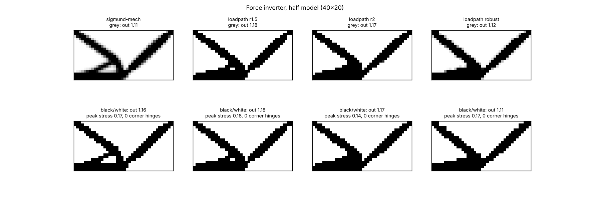
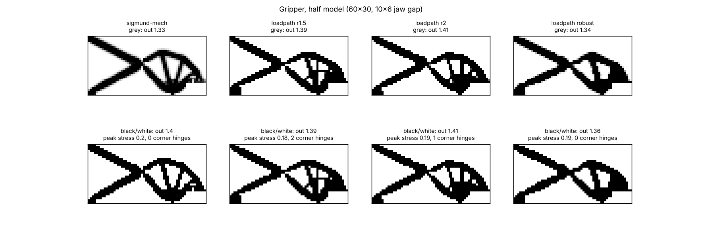
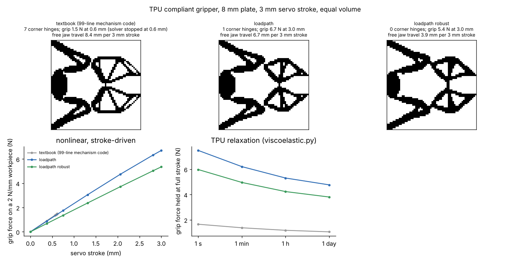
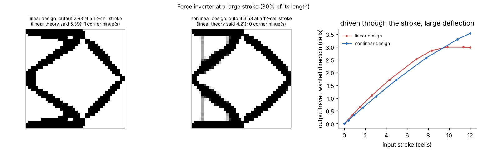
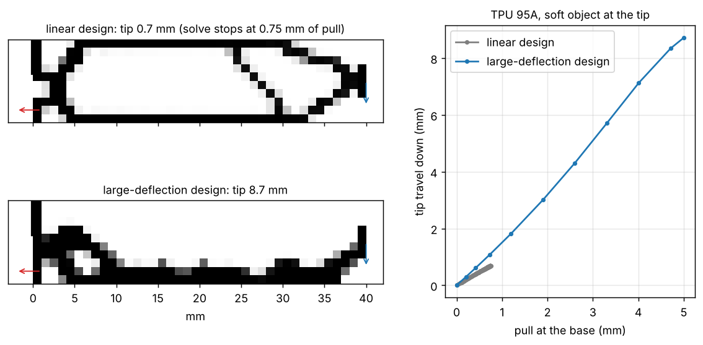
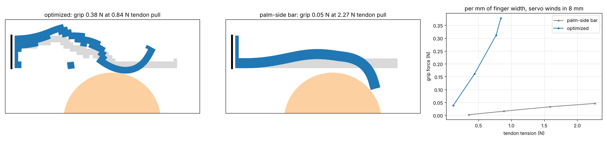

# Compliant mechanisms

Parts that are meant to bend: gripper jaws, flexure hinges, snap fits,
inverters. `loadpath/mechanism.py` designs them by topology optimization
(Sigmund 1997; Bendsøe & Sigmund 2003, sec. 2.6): push at an input, and an
output should move as far as possible in a chosen direction against a
spring (the workpiece), with a spring at the input too (the actuator).
`loadpath/nonlinear.py` then checks the result the way it will be used,
with large deflections.

```python
from loadpath.mechanism import MechanismOptions, optimize_mechanism
from loadpath.nonlinear import stroke_mechanism, verify_mechanism

r = optimize_mechanism(domain, nu, MechanismOptions(
    volume_fraction=0.3, filter_radius=2.0, modulus=26,     # TPU
    k_in=50, k_out=0.25,                                    # N/mm: servo, workpiece
    robust=0.15))                                           # no one-node hinges
rep = stroke_mechanism(domain, r.xphys, 26, 0.45, stroke=3.0, k_out=0.25)
```

`domain.loads[0]` is the input force (its direction is the stroke's),
`domain.loads[1]` the output's wanted direction (any magnitude).

## What it does

- **Objective:** the output's mean travel along its direction, maximized
  with MMA. The adjoint sensitivity takes both signs, which optimality
  criteria can only use by clipping.
- **Springs:** `k_in` and `k_out` are totals in N/mm, shared by the nodes
  of each region. Before 2026-10-31 a push along one axis got 3x the spring
  it asked for.
- **Robust option (`robust`)** (Wang, Lazarov & Sigmund 2011): the filtered
  field is projected three ways, eroded (threshold 0.5 + robust), blueprint
  (0.5) and dilated (0.5 - robust), and the worst output is maximized (a
  smooth minimum). A one-node hinge, two cells meeting only at a corner,
  disconnects in the eroded design, so the optimum keeps its hinges about a
  filter radius wide. That is printable, and it tolerates a line width of
  print error either way. The blueprint is what is delivered.
- **Several input/output pairs** (`pairs`): contact anywhere along a finger.
- **Checks:**
  - `verify_mechanism` re-solves the solid cells under the input force
    with large deflections and checks buckling.
  - `stroke_mechanism` drives the input through a stroke (prescribed, as a
    servo or lead screw does) against a workpiece spring. It reports the
    output's travel, the actuator force, the grip force, the geometric and
    mechanical advantage, and the peak stress and strain, step by step.

## Validation: the textbook benchmarks

`python -m loadpath.benchmarks.mechanisms` runs the force inverter and a
gripper through two optimizers:

- A line-for-line NumPy port of the compliant-mechanism version of
  Sigmund's 99-line code: plane-stress squares, SIMP p = 3, the
  sensitivity filter, and optimality criteria with damping 0.3 and move
  0.1.
- loadpath's 3D optimizer on a one-cell slab.

One independent plane-stress evaluator scores every design. It uses the
reference's own element and springs, at equal volume, and reads each design
black and white (as printed) and grey (as delivered).

| | output, black and white | greyness | one-node hinges |
|---|---|---|---|
| **Inverter** (40 x 20, the book's own example: volume 0.3, rmin 1.2, springs 0.1) | | | |
| 99-line code | 1.157 | 0.108 | 0 |
| loadpath, r = 1.5 | **1.180** (+2.0%) | 0.002 | 0 |
| loadpath, r = 2 | 1.171 (+1.2%) | 0.008 | 0 |
| loadpath robust | 1.108 (-4.2%) | 0.038 | 0 |
| **Gripper** (60 x 30, 10 x 6 jaw gap, after Sigmund 1997) | | | |
| 99-line code | 1.403 | 0.127 | 0 |
| loadpath, r = 1.5 | 1.392 (-0.8%) | 0.005 | 2 |
| loadpath, r = 2 | **1.415** (+0.9%) | 0.014 | 1 |
| loadpath robust | 1.356 (-3.4%) | 0.040 | 0 |




loadpath matches the textbook optimum within about 1-2%, with nearly
black-and-white designs. The reference's designs are 11-13% grey, so they
need a threshold before they can be printed. The robust option gives up
3-4% of output and in exchange removes the corner hinges.

## A TPU gripper, driven by a servo

`examples/mechanism/gripper.py` uses the gripper layout at 1 mm per cell,
printed flat in TPU 95A as an 8 mm plate. The servo is stiff
(400 N/mm through the horn), the workpiece soft (2 N/mm), and the stroke
3 mm. All three designs are optimized for the same springs and volume, and
then driven through the stroke by the nonlinear solver (`stroke_mechanism`,
about 2 min in all):

| | textbook code | loadpath | loadpath robust |
|---|---|---|---|
| one-node hinges | 7 | 1 | **0** |
| free jaw travel per 3 mm stroke | 9.1 mm | 7.9 mm | 4.6 mm |
| grip force on the workpiece at 3 mm | 6.5 N | **6.6 N** | 5.8 N |
| actuator force for that | 28 N | 31 N | 23 N |
| peak strain | 5.4% | 6.2% | 6.1% |
| grip held for 1 min / 1 h / 1 day (relaxation) | 6.1 / 5.2 / 4.7 N | 6.1 / 5.2 / 4.7 N | 5.3 / 4.6 / 4.1 N |
| servo force for a 0.2 s close | 34 N | 38 N | 28 N |



- **The textbook design is a mechanism of corner hinges.** With a stiff
  actuator it puts seven one-node hinges in its jaw linkage. They give it the
  biggest free travel, because a corner hinge costs almost no strain energy,
  but they print as nothing: two cells joined at one node. The
  large-deflection solve used to stop part way through its gripping
  stroke (at 0.6 mm, later 2.2 mm), where a full Newton step turned a cell
  at a hinge inside out. Newton steps are now damped (an update that
  inverts a cell is halved), so it reaches the full stroke and grips
  about as hard as loadpath's design; the hinges are still why not to
  print it.
- **loadpath's designs work through the full stroke.** The plain design
  grips harder (it keeps one corner hinge). The robust one has none, and it
  is the one to print.
- **TPU relaxes.** Held at full stroke, the grip force falls to 64% of its
  first-second value in a day (`viscoelastic.py`, m = 0.045, a sourced
  value until a K-25 coupon is measured). Size the grip for the force left
  after the hold time, or keep the servo under closed-loop force control.
  A quick close takes about 20% more servo force than a slow one, because
  TPU is stiffer at speed.

## Large strokes: optimizing on the large-deflection response

`loadpath/mechanism_nl.py` designs on the response the part will actually
have (Pedersen, Buhl & Sigmund 2001). The input is driven through a
prescribed stroke, the full grid is solved with large deflections (Newton,
total Lagrangian hex8, neo-Hookean), and an adjoint gives the gradient of
the output's travel at the end of the stroke. Void cells use the
Wang, Lazarov & Sigmund (2014) interpolation, so near-empty cells fall back
to a linear response and do not invert. A failed Newton solve backs the
design halfway toward the last good one. The modulus and Poisson's ratio
can be per element, for multi-material parts.

```python
from loadpath.mechanism_nl import optimize_mechanism_nonlinear
r = optimize_mechanism_nonlinear(domain, nu, MechanismOptions(
    volume_fraction=0.3, filter_radius=1.5, k_out=0.02), stroke=12.0)
```

`python examples/mechanism/large_stroke.py` (about 2 min) compares it with
the linear design on the textbook inverter driven 12 cells (30% of its
length), both judged by `stroke_mechanism`:

| | linear design | large-deflection design |
|---|---|---|
| output travel at the full stroke | 2.98 | **3.57** (+20%) |
| what linear theory promised the linear design | 5.39 | |
| one-node hinges | 1 | **0** |
| peak strain | 17.6% | 16.4% |



The linear model over-promises the linear design by 81%. Its output peaks
near 10 cells of stroke and then stalls as its members swing past their
leverage. The design optimized on the large-deflection response keeps
pulling through the whole stroke, with no corner hinge.

## A TPU finger that curls

`examples/mechanism/curling_finger.py` (about 3 min) designs a 40 x 10 mm
TPU 95A finger, printed flat. It is clamped along the top half of its
base. A tendon or servo horn pulls the bottom of the base 5 mm back, and
the tip should curl down against a soft object (0.01 N/mm). Both designs
use the robust option, and both are judged by driving them through the
stroke with the nonlinear solver (incompatible-mode element; numbers
re-measured 2026-11-03):

| | linear design | large-deflection design |
|---|---|---|
| tip travel for a 5 mm pull | 2.5 mm (solve stops at 3.9 mm of pull) | **3.8-8.0 mm** (full stroke; see below) |
| one-node hinges | 1 | **0** |
| pull force at 5 mm | | 5.6-5.7 N |
| peak strain | | 34-35% (TPU 95A breaks past 400%) |



(The figure is the first published run, 8.7 mm of curl with the plain
hex8 check.)

**The large-deflection optimizer is sensitive to rounding.** Five runs
that differ only by rounding-level changes (the compiled element kernel
against the numpy one, which agree to 1e-14, and the filter radius moved
by 1e-9 or 1e-6 of itself) end at 8.0, 7.9, 6.0, 5.9 and 3.8 mm of
curl. All five reach the full stroke with no hinges, and each design reads
the same on both solvers to 1e-10, so the spread is the optimizer's path
(projection steps and sharpening retries are discrete decisions), not the
check. Run it from a few starts and keep the best; making the path itself
stable is open.

Three things made it work, all now in `mechanism_nl.py`:

- **Damped Newton steps.** A full step can invert a solid cell next to
  soft void ones. The step is halved until no cell inverts. Before this,
  a sharper design often failed to reach the stroke and the optimizer
  stayed grey.
- **Sharpening is retried, not abandoned.** If a sharper projection cannot
  reach the stroke, the optimizer keeps the last one for a while and tries
  again; it stops sharpening only after three refusals.
- **The robust option.** Without it the optimizer finds a grey answer: its
  tip travel (11-25 mm) runs through grey cells and one-cell grey hinges.
  Sharpened, that answer drops from 11 mm to 0.01 mm, and thresholded, the
  tip falls off. With robust, the eroded design must work too, so a grey
  hinge is worth nothing.

The check (`stroke_mechanism`) now also reports a tip held only by the
plate's symmetry plane as detached; it used to read 0 mm.

## A tendon-driven finger that grips

`mechanism_nl` also takes a tendon as the input and an object to close on,
and then maximizes the grip force:

```python
from loadpath.mechanism_nl import RigidCylinder, ServoTendon, optimize_mechanism_nonlinear, tendon_grip
ten = ServoTendon(path=[spool_xyz, guide_nodes, ..., knot_nodes], stroke=8.0, stiffness=0.5)
obj = RigidCylinder(center=(30, 0, -16.5), radius=15)
r = optimize_mechanism_nonlinear(domain, nu, opts, tendons=[ten], contact=obj)
check = tendon_grip(domain, r.xphys, E, nu, [ten], obj)     # thresholded, full pull
```

- **Tendons.** A `nonlinear.Tendon` is a cable at constant tension through
  guides on the part; it follows the part as it curls. A `ServoTendon` is
  wound in by a servo: a set length of cable (`stroke`), with the cable
  and servo giving like a spring (`stiffness`), so the pull can never pass
  stiffness x stroke. Use the servo version for optimization. At constant
  tension the soft, grey early designs snap over the object, and no solver
  can follow a snap under a fixed force; a wound-in cable is displacement
  driven and can.
- **Contact.** `RigidCylinder` is a fixed object (a cylinder through the
  plate). Each node is pushed out of it by a smooth penalty, weighted by
  the density around the node (cubed), so empty cells cannot grip. The
  grip force is the sum of the normal forces, and its gradient (contact,
  tendon load stiffness and all) matches finite differences.

`python examples/mechanism/tendon_grip.py` (about 17 min;
`tendon_grip_render.py` draws the figure) designs a 50 x 10
mm TPU 95A finger, its base clamped to the palm. The tendon runs from the
spool behind the palm through guides on the palm side to a knot at the
tip. A 30 mm cylinder (a GRIP-sized handle) sits 1.5 mm below. The servo
winds in 8 mm of cable at 0.5 N/mm. Forces are per mm of finger width
(a 15 mm wide finger grips 15 times as much):

| | plain palm-side bar, same volume | optimized (robust) |
|---|---|---|
| grip force | 0.046 N | **0.38 N** (8x) |
| tendon tension at full wind | 2.27 N | 0.84 N |
| grip per newton of tendon pull | 0.02 | **0.45** |
| nodes touching the cylinder | 2 | 6 |
| one-node hinges | 0 | 0 |



These numbers are from the corrected gradient (see the contact section
below: the tendon's and the contact's stiffness used to leak into the rows
of held dofs, which every 2.5D plate has). The first version of this
design, optimized on the wrong gradient, read 0.42 N at 0.88 N of pull
and pressed with a knee while its tip buckled up out of the way. The
redesign is a different shape: a hooked palm mount carries the tendon's
pull into a finger that curls down and lays a curved belly on the top of
the cylinder (six nodes touching, against one knee), with the tip turning
back up past it. It grips 10% less per finger but spreads the force,
which a printed part and the object both prefer. (One run: like the curling finger's, this optimizer's result moves run to run, so the 10% is within its spread.) The bar curls its tip
past the cylinder and touches it with one edge. It pushes on the object
rather than wrapping it, which is what "most normal force" asks for. Two
things to know before printing it:

- **It cut the middle guide free.** Printed, that guide would be a loose
  bead on the cable. Leave it out: the cable runs straight from the palm
  to the next guide, clear of the cylinder (checked on the deformed shape).
- **The object is fixed.** The grip is what the finger presses on a held
  object; a second finger or the palm on the other side is not modelled.

## Checking contact and tendons with large deflections

`nonlinear.solve_nonlinear` (the large-deflection check, not the optimizer)
takes `contact=[...]` next to its tendons (contact.py):

- `RigidObstacle("plane" | "sphere" | "cylinder" | "box", ...)`: a rigid
  object the part may not enter, fixed (a palm, a table, the object
  gripped) or moving with the load (`move`: an indenter, a jaw, a snap
  fit's catch). `inside=True` keeps the part inside a socket or a tube.
  Exact signed distance, normal and curvature, so the contact tangent is
  the exact derivative of the contact force.
- `SelfContact()`: the part's surface on itself, two-pass node-to-face:
  fingers of one part meeting, a finger curling onto its own palm, a
  flexure gap closing. Clamped surfaces act only as the master side.

Both are penalties (k = 20 E pitch per node, so a node sinks about
F / (20 E h) under a force F), frictionless by default; `friction=mu`
adds Coulomb friction to either (`"friction"` in the field graph's
`contact` block or on one obstacle). A contact sticks, held by a
tangential penalty as stiff as the normal one, until its tangential force
reaches mu times its normal force, then slides with mu p. Friction depends
on the path: where each node sticks (or the friction it carried) is
updated at each converged load step, and a load step in which contacts
carrying much of the load first touch is bisected towards the touch, so
the answer does not depend on how many steps the solve takes (the block
drag below gives the same force with 4 or 128 steps). Each step reports
each contact's force, the nodes touching and the deepest penetration, and
with friction the friction force and the nodes sliding. A `ServoTendon`
(cable wound in by a servo) drives `solve_nonlinear` too.

The optimizer's grip objective takes any `RigidObstacle` shape (wrapped in
a `mechanism_nl.RigidObject`) and several at once: `contact=[gripped,
stop, ...]` (a `mechanism_nl.Contacts`; the first is gripped, the rest are
objects the part may press on that count for nothing: a palm, an end stop,
a neighbouring finger's envelope). `tendon_grip` reports the force on each.
Gradients match finite differences to 1e-7 on a sphere grip, a grip plus a
stop, and a stop under the tendon's knot. That last case found a bug in
the grip gradient since it was written: the tendon's and the contact's
stiffness leaked into the rows of held dofs, which the adjoint then
zeroed, so the gradient was off (by more than 100% at the tip cell) wherever
a tendon knot or a contact sat on a node with a held direction (every 2.5D
plate problem holds y). Designs from the tendon-grip optimizer before
this fix were optimized on a partly wrong gradient.

Agents reach all of it from a field graph's `largeDeflection` block: the
part, the clamp, dead loads, prescribed displacements, tendons (fixed
points and guides, by tension or by servo stroke and stiffness), contact
(obstacles, `"self": true`) and probes. `examples/fields/tendon-finger.json`
curls a 40 mm TPU finger 330 degrees with a servo-wound tendon until its
tip lands on its own palm: without self contact the tip passes 2 mm into
the palm; with it the palm takes 3.4 N and nothing sinks more than
0.006 mm. It takes about 28 s on a 4-core cloud box (76 s before the
compiled element kernel, damped Newton steps and the step-control changes
of 2026-11-03; same tip position to 1e-6 mm, same palm force to 0.02%).

Validation (`tests/test_contact.py`, closed forms; 3D hex8 against beam
theory):

| case | quantity | loadpath / reference |
|---|---|---|
| cantilever lands on a rigid roller at mid-span | roller reaction, tip deflection | within 3% (propped cantilever) |
| two fingers of one part pressed together (self contact) | force across, both tips' deflection | within 4% (R = (P - k g) / 2) |
| ball driven 1 mm into a cantilever (moving obstacle) | force on the ball | within 3% (3 E I d / a^3) |
| cantilever pressed onto a frictionless floor, tip 35% of its length down | floor reaction, how far the tip slid back, tip rotation | within 3%, 1%, 5% (elastica under P - R) |
| block dragged over a rough floor, mu 0.3 (nu 0) | drag / normal force when sliding | 0.300 (mu) |
| block dragged over a second block of the same part (self contact) | drag / normal force when sliding | within 1% of mu; short drag the same with 4 or 16 load steps |
| the floor cantilever with mu 0.1 (slides back) | floor reaction, friction, tip x | within 0.2%, 1%, 0.02% (elastica under P - R and mu R along the beam) |
| the floor cantilever with mu 0.4 | sticks where it landed | sticks; holds it with 0.125 R (a rigid corner would take 0.147 R; the voxel corner gives a little) |

Against CalculiX 2.21 (`bench/contact_ccx.py`, the same voxel meshes as
C3D8I, NLGEOM, surface-to-surface penalty contact with friction; CalculiX's
rigid floor is a slab 1000 times stiffer; results in
bench/results/contact_ccx.json):

| case | quantity | loadpath | CalculiX | difference |
|---|---|---|---|---|
| block on a rough floor (mu 0.3, nu 0.3), drag 0.002 mm | normal force (N) | 0.2111 | 0.2089 | +1.0% |
| | drag force (N) | 0.0025 | 0.0024 | +7.5% |
| block on a rough floor (mu 0.3, nu 0.3), drag 0.01 mm | normal force (N) | 0.2110 | 0.2088 | +1.1% |
| | drag force (N) | 0.0127 | 0.0118 | +7.4% |
| block on a rough floor (mu 0.3, nu 0.3), drag 0.05 mm | normal force (N) | 0.2067 | 0.2035 | +1.6% |
| | drag force (N) | 0.0552 | 0.0531 | +4.0% |
| block on a block of the same part (mu 0.3, nu 0.0), drag 0.05 mm | normal force (N) | 0.1339 | 0.1329 | +0.8% |
| | drag force (N) | 0.0052 | 0.0203 | -74.5% |
| block on a block of the same part (mu 0.3, nu 0.0), drag 0.5 mm | normal force (N) | 0.1337 | 0.1324 | +1.0% |
| | drag force (N) | 0.0398 | 0.0396 | +0.4% |
| block on a block of the same part (mu 0.3, nu 0.3), drag 0.5 mm | normal force (N) | 0.1461 | 0.1433 | +1.9% |
| | drag force (N) | 0.0397 | 0.0402 | -1.2% |
| rough-floor cantilever, mu 0.1 | floor reaction (mN) | 1.5331 | 1.5326 | +0.0% |
| | friction (mN) | 0.1521 | 0.1533 | -0.7% |
| | tip x (mm) | 37.317 | 37.307 | +0.010 mm |
| rough-floor cantilever, mu 0.4 | floor reaction (mN) | 1.5164 | 1.3510 | +12.2% |
| | friction (mN) | 0.1878 | 0.5404 | -65.3% |
| | tip x (mm) | 37.319 | 37.331 | -0.012 mm |

Two rows disagree, and in both cases I think CalculiX is the one that's off:

- **Short self-contact drag (0.05 mm, nu 0):** loadpath gives 0.0052 N and CalculiX gives 0.0203 N. After touch the blocks share only about 0.0045 mm of drag. Their shear compliance is at least 0.67 mm/N, so no more than about 0.0068 N can build up. Rerunning loadpath at 4 to 128 load steps gives the same 0.0052 N. CalculiX's surface-to-surface penalty seems to pick up tangential force during its approach increments. Once the blocks slide fully (0.5 mm), the two agree within 1.2%.
- **Rough-floor cantilever, mu 0.4:** CalculiX slides (friction = 0.4 R). But the sliding closed-form solution would put the contact point at x = 36.852 mm, beyond where the tip lands (36.831 mm). That means the tip would move forward while friction pushes it forward, which is not admissible, so the tip must stick. loadpath sticks with H/R = 0.125, against 0.147 for a rigid corner; the voxel corner is softer. CalculiX 2.21 also fails this case now and then with "too many cutbacks". The bench records that error instead of a number.

## Not yet

- **Friction in the optimizer**: the large-deflection check has Coulomb
  friction; the optimizer's grip objective is still frictionless (a hold
  against pull-out is not an objective yet).
- **The optimizer's contacts are rigid objects**, fixed in space (any
  number, one or more gripped); no self contact inside the optimization
  (the check above has it), and the cable does not touch the object (check
  its path on the deformed shape).
- **Self contact is node-to-face on the voxel surface**: Newton converges
  linearly where faces rotate fast under contact (a tip edge landing on a
  surface), so such solves take a few times longer and can stop short of
  the full load (the report says how far they got). `SelfContact(rotation=
  True)` puts the faces' turning in the tangent (tangent error on tilted
  faces 25% -> 5%), but on the two-finger test it took 13 load steps and
  10x the time instead of 4 steps, so it is off by default; the curling
  finger's time is mostly its tendon-driven steps before any contact.
- **Wrapping grasps:** maximizing the normal force gives a pressing
  finger. A finger that wraps would need the contact spread over the
  object (more nodes in contact, or a pull-out force objective).
- **2.5D plates only** for the gripper above. The optimizer itself is 3D;
  GRIP's tendon-driven TPU finger (examples/grip/finger.py) has the
  nonlinear analysis but not yet a mechanism design.
