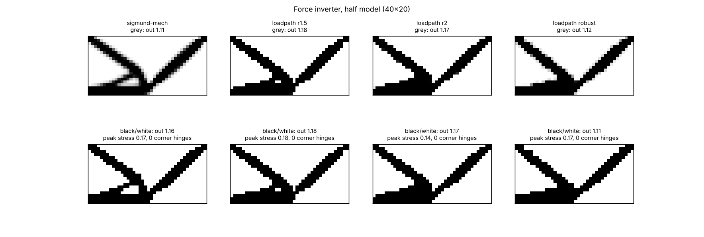
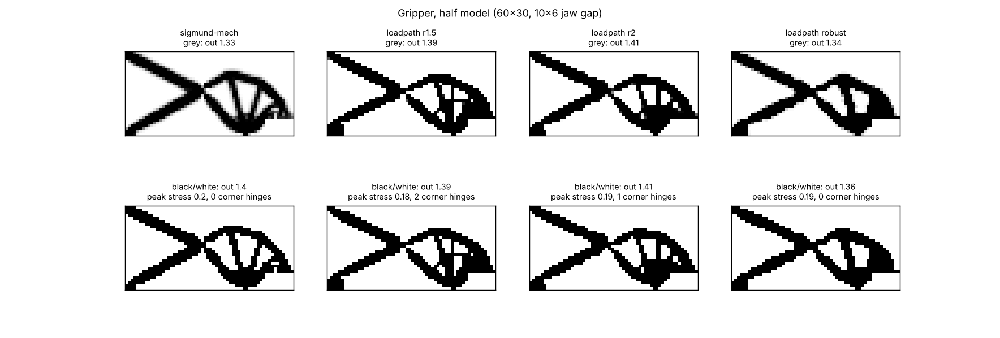
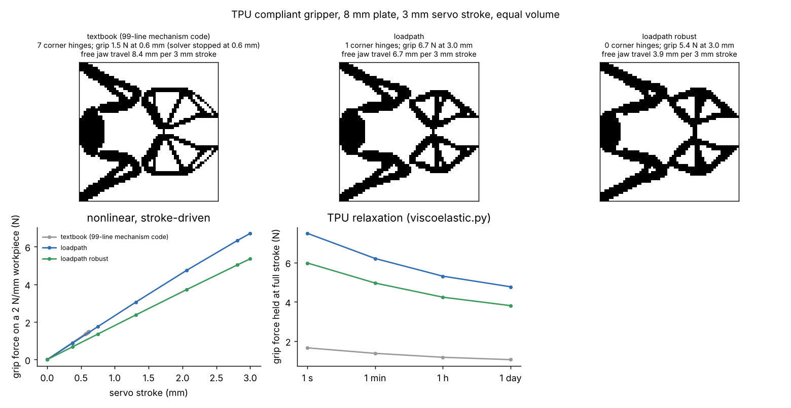
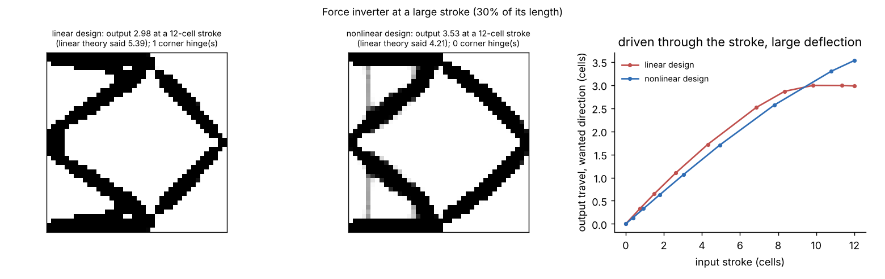

# Compliant mechanisms

Parts that are meant to bend: gripper jaws, flexure hinges, snap fits,
inverters. `loadpath/mechanism.py` designs them by topology optimization
(Sigmund 1997; Bendsøe & Sigmund 2003, sec. 2.6): push at an input, and an
output should move as far as possible in a chosen direction against a
spring (the workpiece), with a spring at the input too (the actuator).
`loadpath/nonlinear.py` then checks the result the way it will be used,
with large deflections.

```python
from loadpath.mechanism import MechanismOptions, optimize_mechanism
from loadpath.nonlinear import stroke_mechanism, verify_mechanism

r = optimize_mechanism(domain, nu, MechanismOptions(
    volume_fraction=0.3, filter_radius=2.0, modulus=26,     # TPU
    k_in=50, k_out=0.25,                                    # N/mm: servo, workpiece
    robust=0.15))                                           # no one-node hinges
rep = stroke_mechanism(domain, r.xphys, 26, 0.45, stroke=3.0, k_out=0.25)
```

`domain.loads[0]` is the input force (its direction is the stroke's),
`domain.loads[1]` the output's wanted direction (any magnitude).

## What it does

- **Objective:** the output's mean travel along its direction, maximized
  with MMA. The adjoint sensitivity takes both signs, which optimality
  criteria can only use by clipping.
- **Springs:** `k_in` and `k_out` are totals in N/mm, shared by the nodes
  of each region. Before 2026-10-31 a push along one axis got 3x the spring
  it asked for.
- **Robust option (`robust`)** (Wang, Lazarov & Sigmund 2011): the filtered
  field is projected three ways, eroded (threshold 0.5 + robust), blueprint
  (0.5) and dilated (0.5 - robust), and the worst output is maximized (a
  smooth minimum). A one-node hinge, two cells meeting only at a corner,
  disconnects in the eroded design, so the optimum keeps its hinges about a
  filter radius wide. That is printable, and it tolerates a line width of
  print error either way. The blueprint is what is delivered.
- **Several input/output pairs** (`pairs`): contact anywhere along a finger.
- **Checks:**
  - `verify_mechanism` re-solves the solid cells under the input force
    with large deflections and checks buckling.
  - `stroke_mechanism` drives the input through a stroke (prescribed, as a
    servo or lead screw does) against a workpiece spring. It reports the
    output's travel, the actuator force, the grip force, the geometric and
    mechanical advantage, and the peak stress and strain, step by step.

## Validation: the textbook benchmarks

`python -m loadpath.benchmarks.mechanisms` runs the force inverter and a
gripper through two optimizers:

- A line-for-line NumPy port of the compliant-mechanism version of
  Sigmund's 99-line code: plane-stress squares, SIMP p = 3, the
  sensitivity filter, and optimality criteria with damping 0.3 and move
  0.1.
- loadpath's 3D optimizer on a one-cell slab.

One independent plane-stress evaluator scores every design. It uses the
reference's own element and springs, at equal volume, and reads each design
black and white (as printed) and grey (as delivered).

| | output, black and white | greyness | one-node hinges |
|---|---|---|---|
| **Inverter** (40 x 20, the book's own example: volume 0.3, rmin 1.2, springs 0.1) | | | |
| 99-line code | 1.157 | 0.108 | 0 |
| loadpath, r = 1.5 | **1.180** (+2.0%) | 0.002 | 0 |
| loadpath, r = 2 | 1.171 (+1.2%) | 0.008 | 0 |
| loadpath robust | 1.108 (-4.2%) | 0.038 | 0 |
| **Gripper** (60 x 30, 10 x 6 jaw gap, after Sigmund 1997) | | | |
| 99-line code | 1.403 | 0.127 | 0 |
| loadpath, r = 1.5 | 1.392 (-0.8%) | 0.005 | 2 |
| loadpath, r = 2 | **1.415** (+0.9%) | 0.014 | 1 |
| loadpath robust | 1.356 (-3.4%) | 0.040 | 0 |




loadpath matches the textbook optimum within about 1-2%, with nearly
black-and-white designs. The reference's designs are 11-13% grey, so they
need a threshold before they can be printed. The robust option gives up
3-4% of output and in exchange removes the corner hinges.

## A TPU gripper, driven by a servo

`examples/mechanism/gripper.py` uses the gripper layout at 1 mm per cell,
printed flat in TPU 95A as an 8 mm plate. The servo is stiff
(400 N/mm through the horn), the workpiece soft (2 N/mm), and the stroke
3 mm. All three designs are optimized for the same springs and volume, and
then driven through the stroke by the nonlinear solver (`stroke_mechanism`,
about 4 min in all):

| | textbook code | loadpath | loadpath robust |
|---|---|---|---|
| one-node hinges | 7 | 1 | **0** |
| free jaw travel per 3 mm stroke | 8.4 mm | 6.7 mm | 3.9 mm |
| grip force on the workpiece at 3 mm | solver stopped at 0.6 mm (1.5 N) | **6.7 N** | 5.4 N |
| actuator force for that | 4.8 N at 0.6 mm | 26 N | 25 N |
| peak strain | 0.9% at 0.6 mm | 4.5% | 7.3% |
| grip held for 1 min / 1 h / 1 day (relaxation) | n/a | 6.2 / 5.3 / 4.8 N | 5.0 / 4.2 / 3.8 N |
| servo force for a 0.2 s close | n/a | 31 N | 30 N |



- **The textbook design is a mechanism of corner hinges.** With a stiff
  actuator it puts seven one-node hinges in its jaw linkage. They give it the
  biggest free travel, because a corner hinge costs almost no strain energy,
  but they print as nothing. The large-deflection solve of the
  gripping case inverts elements at those corners and stops at a fifth of
  the stroke.
- **loadpath's designs work through the full stroke.** The plain design
  grips harder (it keeps one corner hinge). The robust one has none, and it
  is the one to print.
- **TPU relaxes.** Held at full stroke, the grip force falls to 64% of its
  first-second value in a day (`viscoelastic.py`, m = 0.045, a sourced
  value until a K-25 coupon is measured). Size the grip for the force left
  after the hold time, or keep the servo under closed-loop force control.
  A quick close takes about 20% more servo force than a slow one, because
  TPU is stiffer at speed.

## Large strokes: optimizing on the large-deflection response

`loadpath/mechanism_nl.py` designs on the response the part will actually
have (Pedersen, Buhl & Sigmund 2001). The input is driven through a
prescribed stroke, the full grid is solved with large deflections (Newton,
total Lagrangian hex8, neo-Hookean), and an adjoint gives the gradient of
the output's travel at the end of the stroke. Void cells use the
Wang, Lazarov & Sigmund (2014) interpolation, so near-empty cells fall back
to a linear response and do not invert. A failed Newton solve backs the
design halfway toward the last good one. The modulus and Poisson's ratio
can be per element, for multi-material parts.

```python
from loadpath.mechanism_nl import optimize_mechanism_nonlinear
r = optimize_mechanism_nonlinear(domain, nu, MechanismOptions(
    volume_fraction=0.3, filter_radius=1.5, k_out=0.02), stroke=12.0)
```

`python examples/mechanism/large_stroke.py` (about 5 min) compares it with
the linear design on the textbook inverter driven 12 cells (30% of its
length), both judged by `stroke_mechanism`:

| | linear design | large-deflection design |
|---|---|---|
| output travel at the full stroke | 2.98 | **3.53** (+18%) |
| what linear theory promised the linear design | 5.39 | |
| one-node hinges | 1 | **0** |
| peak strain | 17.6% | 16.2% |



The linear model over-promises the linear design by 81%. Its output peaks
near 10 cells of stroke and then stalls as its members swing past their
leverage. The design optimized on the large-deflection response keeps
pulling through the whole stroke, with no corner hinge.

## Not yet

- **Far-curling fingers:** the large-deflection optimizer works on the
  inverter but not yet on a slender TPU finger (40 x 10 cells, 5 mm pull at
  the base, soft workpiece at the tip). It finds a big tip travel (11-25 mm)
  only through grey material: the design stays 55% grey, because every
  sharper projection it tries cannot be driven through the stroke, and
  thresholded at 0.5 its tip falls off. The optimizer now keeps the last
  design that reached the stroke instead of failing, and `stroke_mechanism`
  now reports a tip held only by the plate's symmetry plane as detached
  (it used to read 0 mm of travel). The linear robust design is crisp (9%
  grey) but moves the tip only 0.7 mm before its solve stops. Next: grade
  the void threshold with the projection sharpness, or score the
  thresholded design, so grey cells cannot carry the stroke.
- **Tendon input:** `mechanism_nl` takes a prescribed stroke; a tendon
  (`nonlinear.Tendon`) as the input is not wired in yet.
- **No contact:** the workpiece is a spring on the jaw, not a body the jaw
  wraps around.
- **2.5D plates only** for the gripper above. The optimizer itself is 3D;
  GRIP's tendon-driven TPU finger (examples/grip/finger.py) has the
  nonlinear analysis but not yet a mechanism design.
