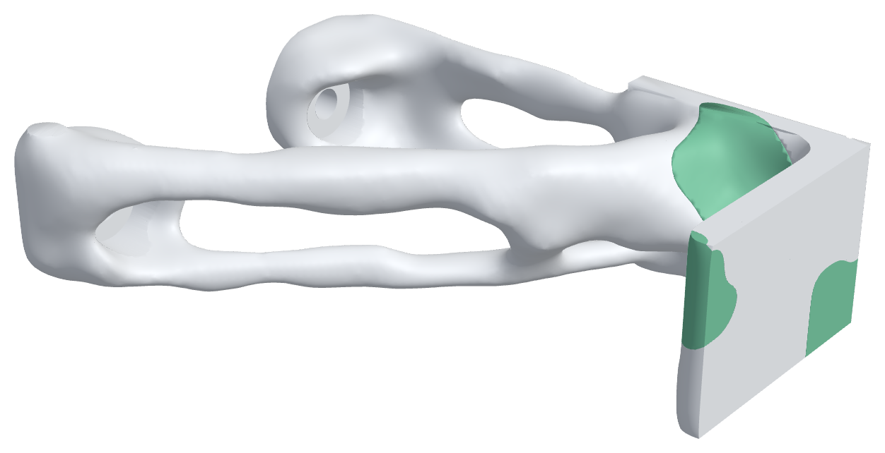
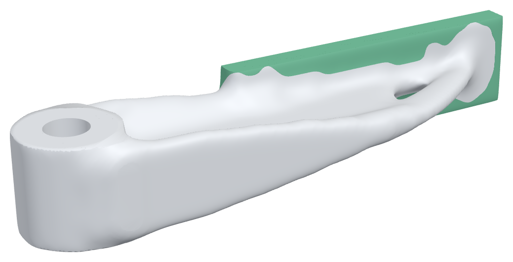

# Multi-material design

A multi-material FDM printer (Bambu AMS, Prusa MMU / XL, an IDEX) or a
material jetter (Stratasys PolyJet) prints a stiff plastic and a rubber in one
part. loadpath designs for that in two ways:

* **The optimizer places the materials** (`multiMaterial` in a study,
  `loadpath/multimat.py`): it decides where material goes at all and which
  material goes where, against stiffness, softness requirements and the
  strength of the bond between materials.
* **Fields place the materials** (`materials` in a field graph,
  `loadpath/fields.py`, see [fields.md](fields.md#multi-material-bodies)): a
  body per material from solids or field thresholds ("TPU wherever the
  distance to the gripping face is under 2.5 mm", "TPU where the stress
  field is low"), or a continuous mix for jetting.

Both deliver one watertight body per material that share their interface
surfaces exactly (no gaps, no overlap), one STL per material and a
multi-material 3MF with an extruder per body.

## A study

```json
"multiMaterial": {
  "materials": ["petg", "tpu"],
  "assign": [{"region": "shelf-pad", "material": "petg"}],
  "requirements": [{"case": "knock", "knock": {"energy": 0.2, "maxForce": 150}}],
  "maxFraction": {"tpu": 0.3},
  "interfaceSafetyFactor": 2,
  "export": {"slicer": "all", "extruders": {"petg": 1, "tpu": 2}}
}
```

Examples: `loadpath/examples/bumpered-bracket.json` (a PETG shelf bracket
with a TPU bumper on its nose) and `loadpath/examples/gripper-finger-mm.json`
(a GRIP-like finger, stiff PETG core, soft TPU contact face). Run either with
`python -m loadpath run <study> --out out/`.

### What the optimizer does

Per cell: a density (material or void) and, for N materials, N - 1
material fractions (stick-breaking, so the N weights are non-negative and sum
to one). Both are filtered and projected with the same Heaviside
continuation, so the material map comes out crisp as well as the topology.
Each material keeps its own Poisson's ratio: the hex8 element matrix is
split into its Lamé parts, `K = lambda K_lambda + mu K_mu`, so a TPU cell
(nu 0.45) and a PETG cell (nu 0.38) sit side by side in one assembly. The
weights are penalized (`w^3`), so a 50/50 blend costs both materials and
gives the stiffness of neither: the optimizer picks one.

The objective is the compliance of the load cases that are not softness
requirements. Constraints (MMA):

| | what it asks |
|---|---|
| volume | the fraction of the design space that is solid |
| `maxFraction` / `minFraction` | how much of the part each material may / must be |
| `knock` | a mass that hits with `energy` stops on the part as on a spring, at peak force `F = sqrt(2 E / c)` with `c` the part's compliance at the knock (mm/N). So `F <= maxForce` is a lower limit on `c`. And a **stored-energy limit**: at the peak, every cell's strain energy must stay under what its material can hold, `S^2 / 2E` (TPU 95A holds ~4.2 mJ/mm³, PETG ~0.7), with the safety factor. Without it the optimizer met "soft" by thinning a neck, or by carrying the knock through void |
| `indentation` | a small patch's load (an object's edge) must sink at least `atLeast` mm further than the same patch moves when the same force is spread over the face (`relativeTo`): the face's local give, read at the patch so the finger's bending there cancels |
| bond stage | see below |

**Interfaces.** Two materials meet at a bond weaker than either.
`loadpath/interface_library.py` holds sourced bond strengths per pair
(tensile and shear, in-layer and stacked; `interfaces` in the study
overrides them). At each interface cell the traction on the interface's own
normal (the gradient of the material field) is split into pull and shear and
judged `sqrt((pull/S_t)^2 + (shear/S_s)^2)`; compression across a bond does
not open it. For FDM a bond whose normal is along the build direction (one
material printed on top of the other) takes the stacked values.

The bond is handled in a final **bond stage**: once the layout has converged,
the topology is frozen and only the material map moves, minimizing the
bond's p-mean utilization while the stiffness objective may get at most 10%
worse. Constraining the bond from the start was tried first: with a bond
this weak (PETG/TPU 1.5 MPa against PETG's 47) MMA preferred to cut the
part in two, so that no bond carried load. Verification then reads the bond
face by face on the delivered part.

**Search.** With a `volumeFraction` goal, one design. With `safetyFactor` /
`maxDeflection`, a short search over fractions (warm-started from the nearest
fraction above) for the lightest design whose materials, bonds and
requirements all pass. Each material is judged against its own strength (and
its across-layer strength for FDM), each bond against its card.

### Delivery and verification

The solid is meshed by `reconstruct.py` as for any study, then cut into one
body per material with exact booleans (manifold3d) against a mesh of the
material field, so neighbouring bodies share their interface surface. The
bodies are voxelized onto one grid (each cell its material) and solved;
the report has per-material peak stress and safety factor per case, the
bond utilization on every interface face (`peakUtilization`, and the 99th
percentile as `utilization`: the face-by-face peak sits on the voxel
staircase's re-entrant corners, which the smooth delivered interface does
not have), interface area per pair, mass per material, and what each knock
(peak force, stop distance) and indentation reads.

## Results (2026-10-31, one fraction each, cloud box)

**Bumpered bracket** (`bumpered-bracket.json`, 12k cells, 20% fraction,
12 min). The optimizer put 10% of the part in TPU: patches on the nose and a
TPU spring where the nose meets the arm, so the knock (0.2 J) stops at
**140 N** against the 150 N limit, over 2.9 mm. All-PETG it has to be met by
geometry alone. 49.7 g. Verified: PETG safety factor 2.4 under the shelf load
and 1.65 at the knock's peak (goal 3, so a search would add mass); the bond
under the knock reads **0.26**: the PETG/TPU bond (1.5 MPa sourced, flat
butt joint) would let go first. That is the honest answer for a flat bond:
interlock the bumper or use a tougher pair (ASA/TPU 6.4 MPa).



**Gripper finger** (`gripper-finger-mm.json`, 26k cells at 0.8 mm, 7 min).
The 2.5 mm TPU pad is placed by distance from the gripping face; the
optimizer designs the PETG core behind it. 7.1 g, 23% TPU. PETG safety factor
14.6, tip deflection 0.48 mm under the 20 N squeeze; the bond reads 1.70
under the squeeze and 2.30 with 10 N of friction pulling along the face
(goal 2).



**Indentation is experimental.** Asking the pad to give (`indentation`)
works in the optimizer (0.11 mm, met) but the delivered part read far less:
the optimizer made the face soft by leaving the pad over grey or empty core,
and the crisp delivered part does not keep that. Judging softness on the
Voigt bound (grey as stiff as it can be, `VOIGT_SOFTNESS`) closed that
loophole but on the bracket met the knock by geometry and left a bolt boss
floating, so it is off. Use an assigned pad (as the finger does) until this
is fixed.

## Bond strengths

`interface_library.py` (sources and test geometry in the module). MPa,
in-layer (side by side) / stacked (one on the other):

| pair | tensile | shear | bond |
|---|---|---|---|
| PETG + TPU | 1.48 / 1.48 | 0.89 / 0.89 | good |
| PLA + TPU | 1.55 / 0.29 | 0.93 / 0.37 | poor |
| PETG + PLA | 1.6 / 0.04 | 0.96 / 0.024 | none |
| ABS + TPU | 4.7 | 4.7 | fair |
| ASA + TPU | 6.4 | 6.4 | fair |
| ASA + PETG | 8.8 | 5.28 | fair |
| Vero + Agilus30 (jetting) | 1.07 | 0.64 | good |
| PA-CF + PLA / PETG | ~0.9 (no data: default) | | poor |

These are conservative (lowest replicate, flat butt joints, no interlocking).
Bond strength moves a lot with nozzle temperature, print order and
interlocking geometry: for a part that matters, print a coupon and put your
number in `interfaces`.

## Slicer files

`threemf.write_multimaterial_3mf(path, bodies, slicer=...)`:

* `"all"` / `"prusa"` (default): one object, one volume per body with its
  extruder (`Metadata/Slic3r_PE_model.config`). Sliced in PrusaSlicer 2.7.2
  on a two-tool printer: every pad layer on the second tool. OrcaSlicer and
  Bambu Studio open it through their PrusaSlicer importer in the GUI.
* `"bambu"`: Bambu Studio's own layout (production extension, components,
  `Metadata/model_settings.config` with an extruder per part). Imports in
  OrcaSlicer 2.4.2 as one object with two parts on extruders 1 and 2.
  PrusaSlicer refuses this layout.

`threemf.write_material_stls` writes an STL per material, already placed
on the bed, so loading them together lines them up.

## Jetting

`voxelprint.export_voxel_slices` writes a GrabCAD Voxel Print job (PNG per
layer at the printer's resolution, J850 600 x 300 dpi, 27 um High Mix
layers) from a per-cell material fraction field, error-diffused so graded
mixes come out at the requested share (within 0.01% on the test). A field
graph's `mix` body writes one.

## Limits

* Linear elastic. TPU at small strain is a fair spring for a pad or a
  bumper's first millimetres; large strokes belong to `nonlinear.py` (and
  `mechanism_nl.py`, which takes a per-element modulus and Poisson's ratio).
* The knock model is a spring: no rate stiffening (viscoelastic.py has it
  for TPU) and no rebound losses.
* The optimizer solves the full grid each iteration (no reduced systems,
  no multigrid yet): ~7 s an iteration at 12k cells with three cases and a
  knock, so keep `maxElements` near 10-25k.
* `run_study` and the MCP study job do not route multi-material studies yet;
  `loadpath run` and `multimat.run_multimaterial` do.
