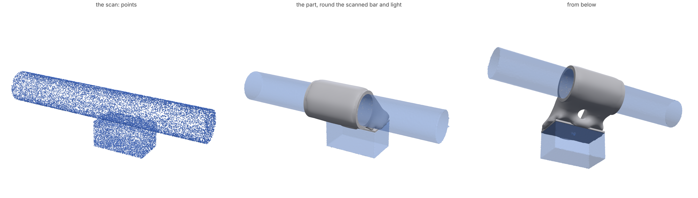

# Scans in: design around what was measured

Point a lidar, a structured-light scanner or a phone at the thing a part has
to fit (a handlebar, a bike light, a motor, a wall), or train a Gaussian
splat of it. `loadpath scan` reads the scan and finds the faces and bars a
part can mount on. It then writes a study that builds the part round the
object. Every clearance and fit comes from **what the scan actually knows**
about where each surface is. None of them is a margin someone picked.

```bash
loadpath scan bar.ply --device artec-eva --units mm --features-only      # what it found, with +- bands
loadpath scan bar.ply --device artec-eva --units mm \
    --support cyl-0 --load plane-1=0,0,-60 --load plane-1=0,-25,-40 \
    --process sls --out draft/                                           # a study round the object
loadpath run draft/bar.study.json --out out/
```

```python
from loadpath.scan import load_scan, fit_primitives, reconstruct
from loadpath.scanstudy import draft_around

s = load_scan("bar.ply", device="artec-eva", units="mm")
feats = fit_primitives(s)              # planes and cylinders, each with its band
mesh, info = reconstruct(s)            # watertight surface, U per vertex, unseen patches
draft_around(s, feats, "draft/", support="cyl-0", loads={"plane-1": [0, 0, -60]}, process="sls")
```

MCP: `loadpath_scan(path, out_dir?, device?, units?, reference?, known?, support?, loads?, brief?, ...)`.

## Near-zero input: a scan and a sentence

The user's whole input can be the scan and one sentence: *"mount this 120 g
light under my handlebar, I ride trails"*. The agent turns the sentence into
a brief, and loadpath does the rest:

```bash
loadpath scan light.splat.ply --mount bar --family handlebar --mass 120 --shock 5 --out draft/
loadpath run draft/light.study.json --out out/
loadpath split-clamp out/part.stl draft/light.clamp.json          # body and cap, to print
```

| What a user would otherwise do | What happens instead |
|---|---|
| Measure a reference for scale | An ID-1 card (bank card, 85.60 x 53.98 mm) anywhere in the frame is found by its aspect and fill, and both its sides set the scale. A coin works when named (`--reference-object us-quarter`): coins of one size look alike. |
| Label the bar and the face | The longest bar is the mount, the face that fills most of the view from it is the face held. Two bars of a length, or no facing face, come back as a question. |
| Measure the bar | When the band covers exactly one standard size of the family (31.8 mm handlebar clamp, ISO 65 pipe, h6 shaft, ISO 273 M3 hole, bearing seat; `scanstd.FAMILIES`, each with its source), the bar snaps to it and takes the standard's tolerance. |
| Work out the loads | The held body's points give its mass centre. The weight plus the shock along each axis, both ways (MIL-STD-810 method 516's way), are applied there, so the lever arm is in. |
| Design the clamp | Bolts sized by friction (below). |

What it cannot know, it asks once, in `asks`: the mass and the shock if the
sentence lacked them (these block the draft), a pick when the bar's band
covers several standard sizes, and **one caliper reading** only when the fit
depends on it: a bar that is no standard size and that the scan can't size
for its fit, or a band so wide that a clamp would grip at two lines and not
all round. A splat with a card and a stock handlebar needs no caliper.

Measured on the synthetic splat with a card (three seeds, 1 mm spacing,
scale unknown to the reader): the scale came out within 0.07% of the truth,
its stated sigma 0.9% (half a spacing at each end of each side, the honest
bound for edges found from points), and the bar read 31.77-31.80 mm and
snapped to 31.8.

### The split clamp

A bar mount is two halves: the body that holds the object and a cap,
bolted across a split through the bar's axis, its normal toward the object.

- **No slip.** Bolts with total preload F press the halves round the bar.
  With a cosine pressure (the contact gathers where the halves push) the
  normal force round the bar is (8/pi) F; uniform pressure would give pi F,
  so this is the low reading. The grip mu (8/pi) F must hold the worst
  sqrt((T/r)^2 + F_axial^2) over every shock direction, times the safety
  factor. mu = 0.2, the low end for nylon on dry metal (`--mu` for a shim).
- **No opening.** F also exceeds the worst load pulling the body off the bar.
- **Preload the plastic can keep.** A quarter of the material's strength
  under an ISO 7089 washer, as `fasteners.py` reads it (plastics relax
  under sustained bearing), and at most 60% of an 8.8 bolt's proof load.
  The smallest M3-M6 pair that reaches F is chosen, or four bolts.
  Tightening torque 0.2 F d (dry steel threads).
- **The gap.** The halves are cut apart by a gap that closes on the
  smallest bar in the band inside the largest hole the process prints, plus
  the print's scatter. So the bore grips before the faces meet.

The study gets the bolts as `fasteners` (seats, the nut faces, the preload
case), a nut-driver path over each nut, and a design space whose cap side
is only the clamp. The optimizer designs one piece, and `split-clamp` cuts
it at the gap. For the 120 g light at 5 g on a 31.8 mm bar in SLS PA12:
2 x M3 with washers and nuts, 368 N each, 0.22 N m, slip margin 14 at a
safety factor of 2 (the bearing limit, not the load, sets the preload),
gap 0.61 mm.



*A synthetic Artec-class scan of a 31.8 mm handlebar with a bike light
(left). The mount was designed from the scan alone (middle, below), for SLS
PA12 with 60 N down and a 25 N sideways knock. The bar was fitted at
31.803 +- 0.392 mm, so its slip-fit bore is drawn for the largest bar in that
band, and the fit row says to ream to 32.05-32.21 mm. The light is kept
0.45 mm clear: 0.1 mm device, 0.19 mm SLS scatter and 0.09 mm SLS wall
growth, at 95%. `python examples/scan/handlebar_mount.py` runs it end to end.*

## What it reads

| source | format |
|---|---|
| point clouds | PLY (any vertex properties), PCD (ascii, binary, LZF-compressed; its `VIEWPOINT` orients the normals), LAS 1.0-1.4 (LAZ with `laspy`), E57 (with `pye57`), XYZ / TXT / CSV / PTS |
| Gaussian splats | the 3D Gaussian splatting PLY (`scale_*`, `rot_*`, `opacity`, `f_dc_*`) and the 32-byte `.splat` web format |
| scanned meshes | PLY with faces, STL, OBJ, GLB (Polycam, Scaniverse, an ARKit mesh): vertices and their normals |

A splat is turned into surface points by the physics of the splat. Each
Gaussian's centre is a point. Its thinnest axis is the surface normal, and
its thickness along that axis is how far the surface may sit from the
centre. Gaussians under 10% opacity say nothing about where a surface is,
so they are dropped (404,068 of the 1,026,508 in the public Tanks and Temples
`train` splat).

Units are required unless the format has a convention. LAS, E57 and PCL clouds
are metres; for any other file, give `--units`, because a guess would move
every clearance. A splat or photogrammetry cloud has no scale until a known
dimension fixes it (below).

## Where the uncertainty comes from

At every point, the one-sided uncertainty U (how far the real surface may
sit outside the measured one, at `--confidence`, 95% by default) is

    U = z * sqrt(random^2 + device^2 + scale^2) + h^2 / (8 rho)

| term | what it is | where the number comes from |
|---|---|---|
| random | the scatter of the point's neighbours about a local quadric (a curved surface's own curvature is not noise), over the number of independent points the surface estimate averages | measured on the scan; neighbours whose scatter is correlated (a phone's smoothed mesh) count for less (`noise.neighbourCorrelation`) |
| device | the scanner's systematic error, which no number of points averages away | the device's published accuracy (table below), or `device={"sigma": ...}` from your unit's certificate or `calibrate_device` |
| scale | the relative scale error times the distance from where the scale is exact | the device's spec, or the scale reference's own uncertainty |
| h^2 / (8 rho) | the bulge a surface of curvature radius rho hides between samples a spacing h apart | measured spacing and curvature |

Where the scan saw nothing (the underside of a light it couldn't reach), the
surface is not known. Those patches are flagged (`unseenArea`, `unseenWorstGap`)
and kept clear by their distance to the nearest point, never filled with a
guess.

Each fitted feature carries the same breakdown: `sigma.fit` (least squares,
inflated for correlated neighbours), `sigma.device`, `sigma.scale`, and a
two-sided band: `diameterBand` for a cylinder, `offsetBand` for a plane.

### Devices

| `--device` | sigma (mm) | scale | source |
|---|---|---|---|
| `iphone-lidar`, `ipad-lidar` | 5.0 | 1% | Luetzenburg, Kroon & Bjork 2021, *Sci. Rep.* 11:22221: absolute accuracy +-1 cm, objects under ~10 cm not resolved. Apple publishes no figure. |
| `artec-eva`, `artec-leo` | 0.1 | 0.03% | Artec datasheets: 3D point accuracy up to 0.1 mm, up to 0.03% over 100 cm |
| `leica-rtc360` | 1.9 | 0.01% | datasheet: 3D point accuracy 1.9 mm at 10 m |
| `leica-blk360` | 6.0 | 0.03% | datasheet (first generation): 6 mm at 10 m |
| `faro-focus` | 1.0 | 0.01% | datasheet: ranging error +-1 mm |
| `splat`, `photogrammetry` | none | none | no published accuracy: scale from a reference, bias from `calibrate_device` |

A +- bound with no stated confidence is read as 2 sigma. A datasheet's "up to"
is a best case and is used as 1 sigma. Your own unit's calibration
certificate wins: `--device '{"base": "artec-eva", "sigma": 0.06}'`.

### What a phone can and can't size

A phone's lidar is good for *where* things are and poor for *how big* a small
thing is. Its +-1 cm puts a 31.8 mm handlebar's diameter at
31.5 +- 19.6 mm. No fit holds across that band. The study says so: the bar is
drawn for the largest bar in the band, and the fit row says to measure it.
Measure the bar with calipers and pass `--known cyl-0=31.8+-0.05`. The scan
then says where the bar is and the calipers say how big it is. To tighten
the phone itself, scan an object with a few caliper-measured sizes and run
`calibrate_device` (below).

## Scale: references

```bash
loadpath scan room.ply --reference cyl-0=31.8+-0.05                  # a diameter
loadpath scan room.ply --reference plane-2/plane-5=40.0+-0.05         # two parallel faces' distance
```

With no reference and no scale, a card or a named coin found in the scan
sets it (above). Python takes `{"points": [a, b], "distance": 85.6}` too. The
scale is the weighted mean of known / measured. Its sigma combines each
fit's sigma with each reference's tolerance (+- read as 2 sigma). With two or
more references, their scatter is checked against that (chi-squared): a
misread reference or a distorted scan shows up as `chi2PerDof` and a todo.
The scale is exact at the references' centre (`datum`), and its error grows
with distance from it. Features keep their ids through the rescale.

## Fitting: planes and cylinders

RANSAC on oriented points (after Schnabel, Wahl & Klein 2007), refined by
weighted least squares. Nothing in it is a set tolerance:

- **inlier bands** are 3 sigma of the scatter about the surface itself, which
  starts at the local measured noise and widens to the fit's robust
  residual. A stereo or phone scan's low-frequency waviness isn't in the
  local scatter, and leaving it out shatters a table into tiles.
- **normal agreement** is three times the normals' own measured scatter (the
  median angle to their neighbours).
- **a cylinder is a cylinder** only when its patch curves past the noise: its
  sagitta w^2 / (8 r) is at least 3 sigma. Otherwise, as far as this scan can
  tell, it's a plane.
- cylinders are seeded from a neighbourhood at three scales: the axis is the
  smallest eigenvector of the normals' scatter, the circle a least-squares fit
  across it. A big radius needs a wide patch to show its curvature above the
  normals' scatter.
- **bars and bores**: a convex cylinder (normals away from the axis) is a
  `bar` (a tube or handlebar a clamp goes round); a concave one is a `bore`.
- **self-consistency**: pieces of one surface fitted apart (a mug either side
  of its handle) must agree to their bands. When they don't, the scan
  disagrees with itself by more than it claims, and `selfConsistency` says the
  device's sigma is too small.

## The study round the object

`draft_around` (and `loadpath scan --support ... --load ...`) writes:

- **the object, kept out** by its reconstructed surface moved out vertex by
  vertex by U. The process's scatter is added in quadrature (half the
  `fits.HOLES` band as a sigma), plus its inward wall bias (powder and FDM
  walls grow in). The report gives the split: an Artec-class scan for SLS
  comes to 0.45 mm (device 0.1, SLS scatter 0.19, SLS wall bias 0.09).
- **bars** the part mounts on, as cylindrical keep-outs at the fitted diameter
  with `fit` (default `slip`) and **`mateUncertainty`**, the diameter's
  measured band (a new keep-out field, fits.py). The fit's window shrinks by
  the band from each side, so the hole suits every bar the scan allows. When
  the band is wider than the window, sliding and bolt fits are drawn for the
  largest bar (with the extra play reported), and press fits report
  `measure`. A ring (the import's wall for a bore that size) is kept round
  the bar over the stretch the other features span, and the bar runs on
  through the design space.
- **faces** the part bears on (the light's top), as pads set off the face by
  its own one-sided band plus the process's scatter, with the face's solid
  side kept out.
- **bores** in the object (an insert, a socket), kept open along their axis
  through the design space so a screw still goes in.
- supports and loads by feature id. The design space is a box round the
  features the part touches, grown `--grow` mm; that box is a design choice,
  and the todo says so.

## Validation

### Synthetic scans of known geometry

`loadpath.scansim` is a scanner in software. It casts rays from sensor
positions onto a known mesh, keeps only the first hit, and moves each point
along its ray by random range noise (correlated over 10 mm for a phone's
fused depth), a systematic range bias drawn from the device's sigma (one for
the whole scan by default, the case no averaging helps), and a scale error.
`examples/scan/validate.py` repeats that over fresh random draws. The scene
is a 31.8 mm handlebar and a 60 x 34 x 30 mm light hanging off it. For each
run it checks whether the stated bands cover the truth. At 95% they should
cover about 95%.

| scan (12 runs each) | bar diameter: rms error, band, covered | light top: rms error, band, covered | true surface within U |
|---|---|---|---|
| Artec-class (0.1 mm, one bias for the scan) | 0.096 mm, +-0.39, 12/12 | 0.046 mm, +-0.20, 12/12 | 99.2% (U 0.17 mm) |
| Leica RTC360-class at 1.5 m (1.9 mm) | 1.84 mm, +-7.4, 12/12 | 0.54 mm, +-3.7, 10/10 | 100% (U 3.2 mm) |
| iPhone lidar (5 mm, 1%, correlated noise) | 2.6 mm, +-19.6, 10/10 | 1.6 mm, +-9.8, 7/7 | 100% (U 8.4 mm) |
| splat, scaled by the bar (31.8 +- 0.05) | (the reference) | 0.006 mm, +-0.078, 12/12 | 99.3% (U 0.11 mm) |
| Artec-class, an independent bias per view | 0.030 mm, +-0.39, 12/12 | 0.015 mm, +-0.20, 12/12 | |

None of the stated bands missed the truth. Faces the scan saw too thinly
aren't fitted, which is why fewer than 12 tops were found for the phone and
the Leica. The bands come out two to seven times the error because the device's sigma
is applied along the surface normal, as a bias that changes sizes (the
worst case). A range bias moves points along the ray. On a cylinder seen
from the side, that ray meets the surface at an angle, and from one sensor
it mostly shifts the whole surface rather than resizing it. That's on the
safe side, and the right side for a clearance. For a phone, it means the
published +-1 cm is mostly absolute position, and a phone calibrated on a
known object (`calibrate_device`) will likely size things several times
better than its spec.

What this validates: the noise measurement, the correlation, the fits, the
error propagation and the reconstruction, *given* a device that behaves as
its spec says. It doesn't validate the specs. That needs a real scan of
something with known sizes (see `calibrate_device`).

### Real scans (public)

- **PCL `table_scene_mug_stereo_textured`** (a stereo camera's cloud of a mug
  on a table, the PCL cylinder-segmentation tutorial's data): the table is
  found as one 0.115 m^2 plane, and the mug as cylinders whose axis is square
  to it (outside r 37.8 and 40.1 mm, inside r 36.9 mm). The two outside
  pieces disagree by 2.3 mm against bands of 0.2 mm, and `selfConsistency`
  flags it: stereo depth has systematic error the scatter doesn't show, and
  the scan says so instead of claiming 0.2 mm.
- **PCL `table_scene_lms400`** (a SICK LMS400 lidar): read from its
  LZF-compressed PCD; the table and the floor are fitted as planes.
- **Open3D/Redwood `fragment.ply`** (an RGB-D fusion fragment of a room): the
  walls and the floor are fitted as planes.
- **Tanks and Temples `train` splat** (1.03 M Gaussians, `.splat`): read, 62%
  kept by opacity. The ground is found. A splat trained for appearance on an
  unbounded scene has geometry noise close to its Gaussians' spacing (0.055 vs
  0.079 units here). For parts, use a splat trained for surfaces (2D
  Gaussians, or a mesh extracted from one) and a scale reference.

## calibrate_device

```python
from loadpath.scan import load_scan, fit_primitives, calibrate_device
s = load_scan("step-block.ply", device="iphone-lidar", units="m")
f = fit_primitives(s)
cal = calibrate_device(s, f, [{"feature": "cyl-0", "diameter": 66.2, "tolerance": 0.05},
                              {"feature": "plane-0", "to": "plane-3", "distance": 40.0}])
# cal["sigma"]: an upper 95% bound on the device's systematic sigma from those comparisons
```

Each comparison's error, less what its fit and the calipers explain, is a
draw of the device's bias. The sigma returned is the chi-squared upper bound
on n draws, so three references give a cautious number and ten a tight one.
Pass it back as `device={"base": "iphone-lidar", "sigma": cal["sigma"]}`.

## Limits

- The split clamp is sized by friction on the bar and by bearing under the
  washers. The bolts' own thread strip in a nut is far above these
  preloads and isn't checked. A clamp over a carbon bar needs the bar
  maker's torque limit, which loadpath doesn't know.
- Ports (USB-C and other slots) aren't fitted as features yet, so they
  don't snap to a standard. Only round bars and bores do.
- Gravity is the scan's -z (after `--up`). A phone scan is gravity-aligned;
  a splat trainer's frame may not be, so give `--up`, or `gravity` in the
  brief.

- Planes and cylinders only. Cones, spheres and tori (a tapered bar, a ball
  joint) are kept out by the reconstructed surface but aren't fitted as
  mounts yet.
- Normals come from the file, the sensor position (PCD `VIEWPOINT`, E57
  poses), or a spanning-tree propagation. On a thin sheet seen from both
  sides, propagation can't tell the sides apart.
- The device's sigma is applied along the normal, which is conservative where
  the scanner's error is along its rays and the rays meet the surface at an
  angle. Sensor positions, when known, could tighten that; this isn't done yet.
