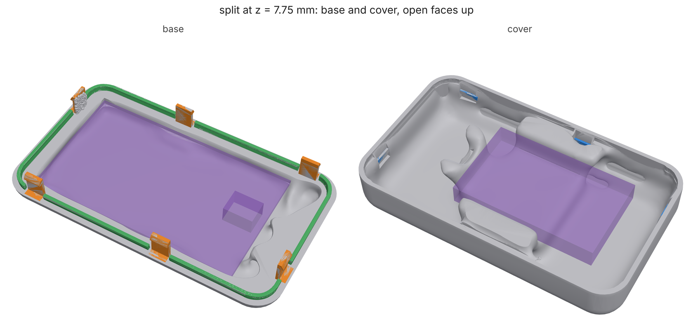

# Split shells: one exterior, two parts that go together

A designer draws the exterior whole, but the product gets built in two
parts. Somebody has to decide where the seam goes, how the halves line up,
what holds them shut, and whether every part inside can actually get in.
Usually that somebody is an engineer redrawing bosses and clips by hand.
`loadpath split` makes those calls from the study and checks them, all
inside the skin. The exterior stays exactly as drawn, except for screw
holes, and those only go through a face the designer names.

```
loadpath split study.json --out dir        # MCP loadpath_split; schema: loadpath schema split
```

The study is the whole product: the exterior as `designSpace`, a `skin`,
and the components as keep-outs with `insertFrom`. A `loadpath enclosure`
or `loadpath handoff` study is already in this form. Add a `split` block
to it. The command writes `<name>-base.study.json`,
`<name>-cover.study.json` and `split.json`, and you run each half as an
ordinary study.



*A generic handheld (96 x 56 x 26 mm, PA12 SLS, 1.6 mm skin, a board and a
battery), split with `normal: auto`. The search picked z = 7.75 mm. The
base carries six snap hooks (orange) and the alignment lip (green), and
the cover carries the six ledges they catch (blue). Components are shown
ghosted. Both halves come from a quick run.
[examples/shells/handheld.py](../examples/shells/handheld.py), then
[verify.py](../examples/shells/verify.py) and
[render.py](../examples/shells/render.py).*

## The cut

Give `normal` and `at` when the designer has drawn the parting line.
Otherwise loadpath tries cuts across x, y and z and scores each one in
millimetres:

- the seam's length (the seam is visible, so shorter is better),
- plus four times how far each component has to travel to go in (a
  battery dropped 8 mm into a tray beats one slid 60 mm down a tube),
- plus 20 for each component the cut runs through,
- plus 10 for each millimetre a half falls short of a joint's depth.

That score is a rule of thumb, so give `at` to overrule it. The four best
cuts that pass the checks below each get their joints laid out, and the
first one with room for all of them wins. On the handheld, z = 6.0 had the
shortest seam, but the bottom edge's 9 mm round leaves no straight wall
for a snap there. The search moved to 7.75, where six snaps fit.

A cut passes when:

- **every component goes into its half with the other half off.** The
  search uses the same path search as `loadpath handoff`: six axes, then
  slide-and-drop, with the half's skin as the obstacle. A part with no
  way in rejects the cut and the report says what it hits;
- **the cover lifts off without catching.** Two halves of one solid cut by
  a plane always part along its normal. What can catch is a component, for
  example a connector on the base tucked under the cover's wall;
- **the seam misses every `avoid` shape**, which marks the designer's A
  surfaces.

`componentsIn` pins a component to a half. By default a component goes to
the half that holds most of it. Each half's study sweeps every component
out through that half's own cut face: its own components on their way in,
and the other half's components as the half comes down over them.

## The joints

Every joint sits inside the skin.

- **Lip.** A tongue on the base stands `height` mm up inside the cover's
  wall, with `clearance` (0.2 mm; 0.25 for FDM) on both sides. It lines
  the halves up across the seam and hides the light gap. It is a band that
  follows the inner wall exactly, meshed on a 0.15 mm grid and simplified
  into `cad/lip.stl`. The cover keeps `cad/lip-room.stl` clear. The lip
  breaks wherever a snap or a screw post sits.
- **Snaps.** A cantilever beam carries a barb with a lead-in and a square
  return, which springs under a ledge on the other half's inner wall. The
  beam is sized so its strain while the barb passes the ledge,
  1.5 t y / L^2, stays within `snap_allowable`. That allowance is 60% of
  the material's strain at yield, or 30% of its strain at break when only
  that is published, capped at 5%. An FDM beam bent across its layers
  gets less, and so does a snap meant to be opened often. The allowance is
  a house rule, not a measured value, so treat it as a start. The hooks
  hang from whichever half has straight wall for them. Where the wall
  curves in below the cut, the hook steps in and its ledge and root reach
  out to the wall. The other half keeps clear the room the beam bends
  into, the barb's path and its landing. `split.json` gives each snap's
  strain, the push it takes to close, and what holds it: a square return
  holds until something breaks, and `returnAngle` below 90 degrees lets
  it part at `pull`.
- **Screw posts** need `screws.from`, the base's far face, which the
  designer allows holes through. Each post is a `fasteners` entry in each
  half. The base gets a clearance bore whose fit is drawn for the process
  (fits.py) and a counterbore inside the exterior for the head. The cover
  gets a thread, tapped or for a heat-set `insert`. The optimizer grows
  the material between the rings, as for any fastener. Posts sit against
  the wall, or step in to where the face is flat enough for the
  counterbore. Each hole is listed in `exteriorChanges` for the designer.

Each half gets the study's supports and loads that act on it. A load case
that acts only on the cover reaches the base as `<case>-through-seam`, the
same force on the base's rim. Each half also gets a `snap-pull` case that
pulls every barb against its ledge.

## Checks on the parts as built

On the handheld (`examples/shells/verify.py`, both halves from `loadpath
run --quick`):

| check | result |
| --- | --- |
| overlap of the built halves, closed | 0.0002 mm^3 |
| overlap while the cover lifts off (hooks bend past their ledges and are left out of this check) | 0.0001 mm^3 |
| lip in the built base / cover material in the lip's room | 100% / 0.00001 mm^3 |
| snap hooks, ledges in the built halves; material in the bending rooms | 100%, 100%; 0 |
| exterior surface kept (20,000 points 0.4 mm inside it) | 99.985% (the 3 misses are degenerate facets on the source mesh) |
| snap root strain, beam formula / cut cells (`verify_snap`) | 4.13% / 2.78% (allowance 5%) |

`verify_snap` solves the hook as drawn on cut cells. Its root is held and
its barb is pushed in by the undercut. On the 60 x 40 x 20 mm test box it
reads 3.75% against the formula's 4.13%. On the handheld it reads 2.78%,
because the stepped-in hook's longer root block bends too. Either way the
formula comes out on the safe side. The force to push the barb in reads
about half the formula's, because the formula loads the beam at its free
length and the barb sits further out.

## What it does not do yet

- **Only flat cuts across x, y or z.** A stepped or curved parting line
  is not supported. Give the closest plane, or use `avoid` to keep the
  seam off the surfaces that matter.
- **Snap allowances are not measured.** They come from the material
  cards' elongation, so a snap coupon on the calibration sheet is the
  next step.
- **A screw boss's thread is only modelled as preload.** Pull-out
  strength of a thread in plastic is not checked.
