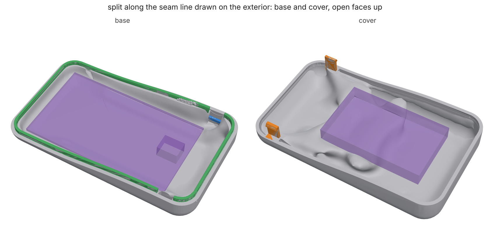

# Split shells: one exterior, two parts that go together

A designer draws the exterior whole, but the product gets built in two
parts. Somebody has to decide where the seam goes, how the halves line up,
what holds them shut, and whether every part inside can actually get in.
Usually that somebody is an engineer redrawing bosses and clips by hand.
`loadpath split` makes those calls from the study and checks them, all
inside the skin. The exterior stays exactly as drawn, except for screw
holes, and those only go through a face the designer names.

```
loadpath split study.json --out dir        # MCP loadpath_split; schema: loadpath schema split
```

The study is the whole product: the exterior as `designSpace`, a `skin`,
and the components as keep-outs with `insertFrom`. A `loadpath enclosure`
or `loadpath handoff` study is already in this form. Add a `split` block
to it. The command writes `<name>-base.study.json`,
`<name>-cover.study.json` and `split.json`, and you run each half as an
ordinary study.


*A generic handheld (96 x 56 x 26 mm, PA12 SLS, 1.6 mm skin, a board and a
battery), split with `normal: auto`. The search picked z = 7.75 mm. The
base carries six snap hooks (orange) and the alignment lip (green), and
the cover carries the six ledges they catch (blue). Components are shown
ghosted. Both halves come from a quick run.
[examples/shells/handheld.py](../examples/shells/handheld.py), then
[verify.py](../examples/shells/verify.py) and
[render.py](../examples/shells/render.py).*

## The cut

Give `normal` and `at` (or `steps`, or a `seam`) when the designer has
drawn the parting line. Otherwise loadpath searches for one. It tries flat
cuts across x, y and z, then, from the two best lift directions and their
two best levels, cuts that are not flat (see
[the search proposes curved lines](#the-search-proposes-curved-lines)).
Each is scored in millimetres:

- the seam's length where it shows (the seam is visible, so shorter is
  better). Seam that runs in a crease, or inside a region listed in
  `hidden` (an underside, an opening), counts a quarter of its length,
- plus four times how far each component has to travel to go in (a
  battery dropped 8 mm into a tray beats one slid 60 mm down a tube),
- plus 20 for each component the cut runs through,
- plus 10 for each millimetre a half falls short of a joint's depth,
- plus, for FDM, half the seam that does not lie on one plane: a half
  whose rim is not flat cannot stand on it to print.

The best cuts are checked (below) until four pass. Each of those four
gets its joints laid out, and the score goes up by 15 for each joint
short of the count, 50 if the snaps bend past their allowance and 10 per
warning. The lowest wins. That score is a rule of thumb, so give `at` to
overrule it. On the handheld, z = 6.0 had the shortest seam, but the
bottom edge's 9 mm round leaves no straight wall for a snap there. The
search moved to 7.75, where six snaps fit. `"search": "flat"` keeps to
axis planes.

### Cuts that are not flat

A product's parting line is rarely one flat level all the way round. It
dips under a button, climbs over a handle, or follows a crease the
designer drew. Three forms cover that:

```json
"split": {"normal": [0, 0.15, 1], "at": 11}                  // a tilted plane: n.x = 11
"split": {"normal": "+z", "at": 9,
          "steps": [{"at": 13, "where": {"type": "box", ...}}]}  // 9 mm, up to 13 over one end
"split": {"seam": {"points": [[x, y, z], ...]}}               // through a line drawn on the exterior
```

The cover lifts off along `normal`. Any surface that is a height over the
plane across that direction parts cleanly along it, because nothing on
either side reaches under the other. That is the general cut: a height
field over that plane. A step climbs over `stepWidth` (0.5 mm), so the
seam's riser is nearly parallel to the lift. A `seam` is kept exactly
where it was drawn on the outside. Inside, where nobody sees it, the
surface runs smoothly between those points (a harmonic fill). Without a
`normal` a seam lifts along its own best plane, or straight along an axis
when that plane is within 15 degrees of it. A line that rises toward one
end is no reason to tilt the tool. The halves' design spaces are the
exterior on each side of that surface (a `heightfield` shape). Each half's
skin lines the whole exterior and stops at the cut (`skin.of`), so it is
never drawn across the seam. Snaps go only where the seam runs level
across the hook: a hook on a step's riser would straddle the two halves.
The lip follows the seam up and down.



*The handheld again, split along a line that sweeps from 8 mm at the front
up to 15 mm at the back.*

### The search proposes curved lines

With no `at`, the search does not stop at flat cuts. From the two best
lift directions and their two best flat levels, `loadpath/parting.py`
proposes:

- **tilted planes** through those levels, leaning 8 and 15 degrees about
  each axis across the lift;
- **stepped lines**: the flat level climbing over, or dipping under, each
  component it would cut through and each `avoid` region it would cross,
  so the part sits whole in one half;
- **the silhouette**: the widest line round the form seen along the lift,
  the parting line a mould would use. Along a straight wall it keeps to
  the middle of the wall, and it rises and falls where a curved form makes
  it;
- **creases**: a line that follows a kink in the exterior's section all
  the way round, such as a reveal, a shoulder or a character line. Rays
  come in from outside at every angle and height, and wherever the
  section turns by more than 20 degrees within a millimetre, that height
  is a crease. Creases that continue angle to angle within 1.5 mm are
  linked into a line. A step puts the seam just onto the face that stands
  in, not along the ledge.

Each comes back as an ordinary cut (a plane, or a height field through the
line), so the checks below and the joints are the same as for a cut drawn
by hand. A seam is hidden where the exterior's section across it turns by
more than 20 degrees within 1 mm (it runs in a crease, not just across
one). The search only tries short slides into a half (4 mm, then out
through the cut), because a part with no way in costs a full path search.
A cut given by hand gets the full 12 mm.

| part | flat search only | full search |
| --- | --- | --- |
| handheld (soft box, no creases) | z = 7.75, 288 mm of seam seen, 6 snaps, 51 s | same cut: the 40 non-flat ones (tilted, stepped over the board) score worse, 59 s |
| handheld with a reveal (upper body 0.8 mm in, the line level at 11 mm along the front, sweeping up to 15 over the back) | z = 7.9: 289 mm of seam seen, below the reveal, so the product shows two lines; 6 snaps; 51 s | the reveal itself (picked from 43 non-flat cuts): 283 of 289 mm of seam hidden in it, score 147 against 349; 1 of 6 snaps fits (below); 265 s |
| sensor puck (`loadpath enclosure`, 84 x 56 x 24 mm pebble, USB-C port, battery door) | z = 2.57, 6 snaps, 137 s | same cut: 37 non-flat cuts tried, none better, 172 s |

On the reveal the hooks are the limit: where the seam runs in a step, the
inner wall steps by the reveal's depth across the seam, and a hook's root
block has to sit in the skin on one side and stand out from it on the
other. Five of the six sites fail that, so the report has the crease cut
with one snap and a score that says so (`final`, 75 for the missing five).
`screws`, or a hook that steps with the wall, are the ways round it.

A cut passes when:

- **every component goes into its half with the other half off.** The
  search uses the same path search as `loadpath handoff`: six axes, then
  slide-and-drop, with the half's skin as the obstacle. A part with no
  way in rejects the cut and the report says what it hits;
- **the cover lifts off without catching.** Two halves of one solid cut by
  a plane always part along its normal. What can catch is a component, for
  example a connector on the base tucked under the cover's wall;
- **the seam misses every `avoid` shape**, which marks the designer's A
  surfaces.

`componentsIn` pins a component to a half. By default a component goes to
the half that holds most of it. Each half's study sweeps every component
out through that half's own cut face: its own components on their way in,
and the other half's components as the half comes down over them.

## The joints

Every joint sits inside the skin.

- **Lip.** A tongue on the base stands `height` mm up inside the cover's
  wall, with `clearance` (0.2 mm; 0.25 for FDM) on both sides. It lines
  the halves up across the seam and hides the light gap. It is a band that
  follows the inner wall exactly, meshed on a 0.15 mm grid and simplified
  into `cad/lip.stl`. The cover keeps `cad/lip-room.stl` clear. The lip
  breaks wherever a snap or a screw post sits.
- **Snaps.** A cantilever beam carries a barb with a lead-in and a square
  return, which springs under a ledge on the other half's inner wall. The
  beam is sized so its strain while the barb passes the ledge,
  1.5 t y / L^2, stays within `snap_allowable`. That allowance is 60% of
  the material's strain at yield, or 30% of its strain at break when only
  that is published, capped at 5%. An FDM beam bent across its layers
  gets less, and so does a snap meant to be opened often. The allowance is
  a house rule until a calibration card with snap readings (the kit's S
  coupons) replaces it. The hooks
  hang from whichever half has straight wall for them. Where the wall
  curves in below the cut, the hook steps in and its ledge and root reach
  out to the wall. The other half keeps clear the room the beam bends
  into, the barb's path and its landing. `split.json` gives each snap's
  strain, the push it takes to close, and what holds it: a square return
  holds until something breaks, and `returnAngle` below 90 degrees lets
  it part at `pull`.
- **Screw posts** need `screws.from`, the base's far face, which the
  designer allows holes through. Each post is a `fasteners` entry in each
  half. The base gets a clearance bore whose fit is drawn for the process
  (fits.py) and a counterbore inside the exterior for the head. The cover
  gets a thread, tapped or for a heat-set `insert`. The optimizer grows
  the material between the rings, as for any fastener. Posts sit against
  the wall, or step in to where the face is flat enough for the
  counterbore. Each hole is listed in `exteriorChanges` for the designer.

## Tolerances

A printed face is not where it was drawn. The process's band (fits.py's
numbers, which a calibration card replaces with your printer's) moves
every joint face, so each joint is sized against a stack-up, and
`split.json` reports it under `tolerance`:

- **Clearances.** The lip's gap and the snaps' side gaps have two faces,
  each off by up to half the process band at the part's size (+-0.17 mm a
  face for SLS on the 96 mm handheld). The gap is widened until it still
  clears by root sum square (RSS), and then drawn wider again by the
  process's gap bias, since printed walls grow into gaps as they do into
  holes. On the handheld that gives 0.29 mm as built, drawn at 0.44 mm.
- **Snap catch.** How far the barb overlaps the ledge is the undercut
  less the gap. It moves with the hook's face, the ledge's face, the
  barb's own size, and how far the lip lets the halves shift. The
  undercut is set so 0.35 mm of catch is left by RSS (1.03 mm on the
  handheld, instead of a flat 0.8). The beam is sized for the most it
  bends, so the strain check uses the RSS deflection, not the drawn one,
  and the report gives the worst-case strain as well (5.3% against a 5%
  allowance on the handheld).
- **Worst case.** Each stack-up says whether it holds at worst case, by
  RSS only, or only on a tuned printer (one that holds its repeatability,
  about a third of the band). `"stackup": "worst"` sizes every joint for
  all faces at their limits at once, which means wider gaps, deeper
  undercuts and longer beams.
- **Screw bores** go through fits.py like every other hole: drawn for the
  process's bias, with the fit checked against its band.

Each half gets the study's supports and loads that act on it. A load case
that acts only on the cover reaches the base as `<case>-through-seam`, the
same force on the base's rim. Each half also gets a `snap-pull` case that
pulls every barb against its ledge.

## Checks on the parts as built

On the handheld (`examples/shells/verify.py`, both halves from `loadpath
run --quick`):

| check | result |
| --- | --- |
| overlap of the built halves, closed | 0.0002 mm^3 |
| overlap while the cover lifts off (hooks bend past their ledges and are left out of this check) | 0.0001 mm^3 |
| lip in the built base / cover material in the lip's room | 100% / 0.00001 mm^3 |
| snap hooks, ledges in the built halves; material in the bending rooms | 100%, 100%; 0 |
| exterior surface kept (20,000 points 0.4 mm inside it) | 99.985% (the 3 misses are degenerate facets on the source mesh) |
| snap root strain, beam formula / cut cells (`verify_snap`) | 4.13% / 2.78% (allowance 5%) |

`verify_snap` solves the hook as drawn on cut cells. Its root is held and
its barb is pushed in by the undercut. On the 60 x 40 x 20 mm test box it
reads 3.75% against the formula's 4.13%. On the handheld it reads 2.78%,
because the stepped-in hook's longer root block bends too. Either way the
formula comes out on the safe side. The force to push the barb in reads
about half the formula's, because the formula loads the beam at its free
length and the barb sits further out.

## What it does not do yet

- **Snaps do not cross a step in the wall.** A seam in a reveal or on a
  shoulder fits a hook only where the wall runs straight across the seam
  (1 of 6 on the reveal handheld). Use screws there, or give the count.
- **The search's paths are short.** While searching, a part may slide 4 mm
  before it goes in through the cut. A cut that needs a longer slide is
  rejected with that reason; give it by hand to check every path.
- **Creases come from the exterior's section round the lift axis.** A
  crease that only runs part of the way round, or one on a face the lift
  looks straight down on, is not proposed. Draw it as a `seam`.
- **A parting surface has to be a height over the lift plane.** A seam
  that doubles back on itself along the lift direction (an undercut
  parting line, which needs side actions in a mould too) is not
  supported.
- **Snap allowances are a house rule until measured.** They come from
  the material card's elongation. The calibration kit's S coupons
  ([CALIBRATION.md](CALIBRATION.md#snap-fits-a-ladder-no-measuring))
  measure them on your printer, and a card fitted from them replaces the
  rule.
- **A screw boss's thread is only modelled as preload.** Pull-out
  strength of a thread in plastic is not checked.
