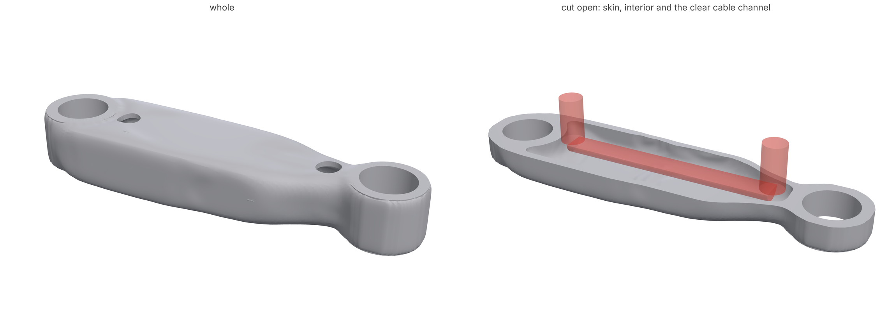
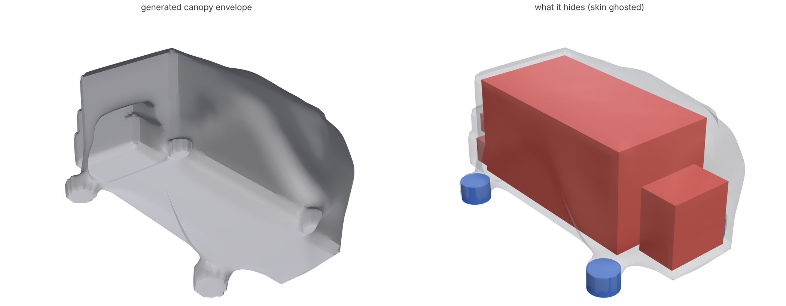
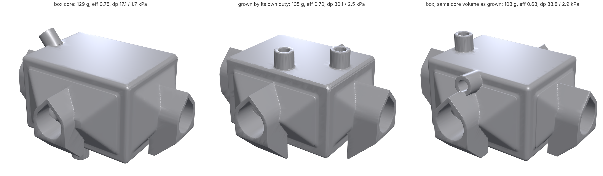

# Generated exteriors: the outside designed with the inside

Topology optimization usually hands back a skeleton: struts and webs with
the interfaces cut in. That works for a bracket. It doesn't work for a
robot arm with cables and tendons running through it, a handheld with a
board inside, or anything whose outside people see. Somebody then draws a
cover over the skeleton, and the cover carries no load because it was
never in the analysis.

`loadpath enclosure`, `handoff` and `split` handle the case where a
designer has already drawn that outside ([ENCLOSURE.md](ENCLOSURE.md)).
A `shroud` handles the case where nobody has. You give it the room the
part may take up, the interfaces, and what has to be hidden. loadpath
grows a smooth skin round the load paths and round everything hidden,
shapes that skin by the load it carries, and then designs the interior
with the skin in every analysis, so the skin works as a monocoque.

```json
"shroud": {"thickness": 2.0, "conceal": ["cable-channel"]}
```

```
loadpath run study.json                     # expands the shroud, then runs as skin-and-rib
loadpath shroud study.json --out d          # just the exterior: d/<name>.study.json, envelope.npz, envelope.stl
```



*A robot-arm link between two 22 mm bearings, 140 mm apart, PA12 (SLS),
with a 10 mm cable channel running its length and leaving through a port
beside each joint. Left, the part whole. Right, cut open at z = 0: the
2 mm generated skin, the interior the optimizer put behind it, and the
channel (red, ghosted) clear the whole way. The goal search settled on
67.9 g (SF 40.8, deflection under the 0.5 mm limit), and almost all of that
is the skin: a closed 2 mm section is stiff enough that the interior
it still needs is a few webs near the bearings.
[examples/shroud/arm-link.json](../examples/shroud/arm-link.json), rendered
with [render.py](../examples/shroud/render.py).*

## How the exterior is made

1. **Seed.** The study is optimized without the shroud on a coarse grid
   (about 25,000 cells) at a low volume fraction (`seedFraction`, 0.15).
   That gives the load paths between the interfaces.
2. **Envelope.** The seed's members, the preserved interfaces and every
   region listed in `conceal` are wrapped in one closed surface. Concealed
   regions are grown by the skin plus `gap` first, so the skin clears them.
   The wrap is a morphological closing of radius `reach` (12 mm): gaps
   between members narrower than about twice that are bridged. Cavities
   are then filled, and the signed distance is smoothed over `smooth`
   (8 mm), so the surface sweeps instead of following every member.
   Each interface joins the skin with a true circular root fillet of
   0.3 times its own size (twice its inscribed radius: 2.7 mm on a 9 mm
   post), where a shoulder's stress concentration levels off near 1.2
   (Peterson); concealed regions are blended back in with a smooth union.
   After the shape steps the surface is faired once and the fillets put
   back. A `bore: false` keep-out that is not concealed, such as a
   neighbour's swept volume, is blended out. The result is clipped to
   the design space with a rounded edge.
3. **Shape steps** (`rounds`, 10). The skin alone is analysed, and every
   skin cell's share of the strain energy is read, with each load case
   normalized by its compliance. The envelope then moves along its normal:
   out where the skin works hardest, in where it idles. That is the
   boundary velocity of level-set shape optimization, with a price on
   skin area. Each round tries five prices and keeps the step that most
   reduces skin volume while the skin stays at least as stiff as the free
   seed it replaces. A round where no price helps halves the step.
4. **Skin and interior together.** The envelope becomes the study's design
   space, and a `skin` of `thickness` lines it. From there the study runs
   as skin-and-rib: the skin is preserved and carries load, and the goal
   search decides how much interior it still needs.

Step 3 is where the shape comes from. Asking only for the stiffest skin
per gram drives the envelope back out to the walls of the design space,
because bending always rewards material far from the neutral axis. On the
arm link that came out as the design-space box with rounded edges. Asking
for the lightest skin that is still as stiff as the free design lets the
envelope pull in wherever the bending moment is low. The link then tapers
from the shoulder toward the wrist and necks round the channel. On the
arm link, a closed skin round the cable channel was about four times
stiffer than the free seed it replaced, at less volume. A closed section
is a far better use of material than a truss for both bending and
torsion.

## What keeps its meaning

- **Bores cut the skin.** A keep-out with `bore: true` (the default) goes
  through the skin wherever it crosses it: a bearing seat, a bolt, or a
  cable port.
- **Concealed regions end up inside.** List a board, a motor or a cable
  channel in `conceal`, and the skin wraps it with `gap` to spare. A
  channel is a bore keep-out, so it stays clear inside the part and opens
  only where it leaves the design space or meets an exit port. A
  `bore: false` component is sealed from view.
- **Everything else stays outside.** A `bore: false` keep-out that is not
  concealed is kept outside the envelope.
- **Printability.** Behind a closed skin, the interior is a sealed cavity.
  On SLS, MJF, resin and LPBF, the study's `drains` (on by default there)
  drill escape holes through the calmest thin wall, and processcheck reads
  the delivered part for trapped powder. A cavity that already opens
  through a channel port or a bore needs no extra hole.

## Hiding cables and components

A cable channel is a keep-out. `loadpath wires` lays the harness as
elastic rods and writes each cable's swept channel as
`out/channels/<id>.stl` ([WIRES.md](WIRES.md)). Name that file as a bore
keep-out, list its id in `conceal`, and the skin wraps the real cable run,
held to its bend radius, instead of a straight tube.



*A drone canopy, [examples/shroud/drone-canopy.json](../examples/shroud/drone-canopy.json).
A 4S battery, a video transmitter, a 19 mm camera and a receiver sit on
four frame posts. The canopy is a 1.2 mm PA12 skin, screwed to the posts
and loaded by a nose crash and a hard landing. Its camera window is a bore
through the skin, and its `cooling` block holds the transmitter's 4 W in
the prop wash. The envelope takes about two minutes, and the skin weighs
about 18 g. Where the envelope meets the design space's walls it is flat,
so give the box room wherever you want the canopy rounded.*

## Unibody or split

A unibody is the default. When the part has to come apart, for example so
the cable can be laid in or a board put in, `loadpath shroud` writes the
expanded study. Give it a `split` block and run `loadpath split`
([SHELLS.md](SHELLS.md)). The generated exterior is then an ordinary
skinned exterior. The cut can be given or searched, and the alignment lip,
screw posts and snaps are laid inside the skin as for a drawn one. The
arm link splits as a clamshell at z = 0 with its lip. Snaps don't find
room on its curving wall, so screws would join it, through a face you name
in `screws.from`.

## Heat exchangers: should the core follow the heat?

Exchanger cores are boxes mostly out of habit. `heatx` already takes any
closed core shape and lofts headers onto it, and its `simulate` option runs
the whole exchanger (porous core, open headers, both fluids and the wall;
`loadpath/porous.py`). The
question is whether the core itself should be shaped by the flow and heat.
`loadpath.coreshape` answers it for a given duty. `grow_core` simulates
the exchanger in its packaging space and reads where heat actually
crosses the wall (h |T_fluid - T_wall| on both sides of the sheet). It
keeps the share of the core that moves the most heat, smooths that into
one surface and writes it as an SDF core. `compare` then designs and
simulates three exchangers under the same duty, cell, wall and ports: the
box, the grown core, and a control. The control is the box scaled down to
the grown core's volume, so any win can be credited to the shape and not
just to having less core.



*The LPBF intercooler eval case (AlSi10Mg, gyroid, hot air across x,
50% glycol across y, built along +z), simulated whole with porous.py.*

| core | mass | effectiveness | air dp | coolant dp | internal flat area |
| --- | --- | --- | --- | --- | --- |
| box, 48 x 36 x 30 mm | 129 g | 0.753 | 17.1 kPa | 1.69 kPa | 657 mm² |
| kept 80% by duty (91% of the heat) | 105 g | 0.697 | 30.1 kPa | 2.46 kPa | 538 mm² |
| box scaled to the same core volume | 103 g | 0.681 | 33.8 kPa | 2.86 kPa | 156 mm² |
| kept 90% by duty (97% of the heat) | 113 g | 0.703 | 40.9 kPa | 2.62 kPa | 551 mm² |
| box scaled to that volume | 112 g | 0.705 | 27.7 kPa | 2.35 kPa | 517 mm² |
| grown in a 1.2x package to the box's volume | 142 g | 0.721 | 22.4 kPa | 2.20 kPa | 187 mm² |

The box mostly holds up. Cutting the core down by duty beat a same-volume
box once, at 80% kept: +2% effectiveness and 11 to 14% less pressure drop.
At 90% kept it tied on effectiveness and lost on pressure drop. A core
grown in a larger package and kept at the box's own volume lost to the box
on every number. For a crossflow core fed from full-face plenums, the
straight flow path of a box is close to what the physics wants. Removing
low-duty corners shortens some streams and leaves the faces ragged for
the headers. Where organic shape pays on an exchanger is around the core,
not inside it. That means the lofted headers and blended exterior heatx
already makes, and a core shaped to the space it has to fit in. A core
whose duty is very uneven, such as a cylinder fed from one side port or a
counterflow core with long header runs, may come out differently, and
`compare` is how to find out for a given case.

## Options

| field | default | meaning |
| --- | --- | --- |
| `thickness` | 2 | mm of skin |
| `conceal` | [] | preserve or keep-out ids wrapped inside the skin |
| `reach` | 12 | mm, closing radius: gaps narrower than about twice it are bridged |
| `smooth` | 8 | mm the envelope is smoothed over |
| `gap` | 1 | mm the skin keeps off a concealed region |
| `rounds` | 10 | shape steps from the skin's load share (0: the seed's smoothed hull) |
| `step` | 1.5 | mm, the largest move of a shape step |
| `soft` | 0 | mm: grow the wrap by this much and smooth it over as much again, for a full, soft form (shape steps default to 0 with it, since they pull it back to the load paths) |
| `seedFraction`, `seedCells`, `seedIterations` | 0.15, 25000, 70 | the coarse free design |
| `openings` | [] | as `skin.openings`: where the skin is left open |
| `pitch` | auto | mm, the envelope's grid |

The envelope is cached by the study's content (`LOADPATH_CACHE`, default
`~/.cache/loadpath/shroud`), so parsing the study again doesn't rerun the
seed. The expanded study names its envelope by key
(`{"type": "sdf", "shroud": key}`).

## Parts with nowhere drawn to go

`shroud.place` takes the parts themselves, `{id, size | shape, mass,
watts, maxTemp, against, near, rotate, installedOn}`, and lays them out in
the design space before anything is wrapped: the same search `loadpath
enclosure` runs inside a drawn exterior (placement.py: heat, a low or
targeted centre of mass, `near`, wires when given), with every part kept
the skin and its gap off the room's walls. The placed parts become
concealed keep-outs, so the envelope grows round them, and a part with
`watts` or `maxTemp` joins the cooling block.
[examples/shroud/drone-canopy-placed.json](../examples/shroud/drone-canopy-placed.json)
places the canopy's battery, VTX and receiver this way (the camera stays
where its window is): the battery low on the posts, the 4 W VTX in the
top front corner, in the prop wash and as far from the battery's centre as
the room allows. The search's heat term is a point source between part
centres, so it does not yet see that the VTX ends up 3.5 mm from the
battery's face; the cooling block is the check.

## Limits

- The skin has one thickness everywhere. A thinner skin where it idles
  (`skin.zones` exists for drawn exteriors) would save more. On the arm
  link it is the main lever: the 2 mm skin is SF 40 where 3 is asked.
- The shape steps analyse the skin alone, at a coarse pitch. The interior
  that the final run adds is not in them.
- The envelope's surface is a marching-cubes mesh of a sampled distance
  (about 0.7 mm on the arm link): smooth, but faceted at close range.
- The skin needs about two cells of the main run's grid. A 2 mm skin wants
  a pitch of 1 mm or finer.
