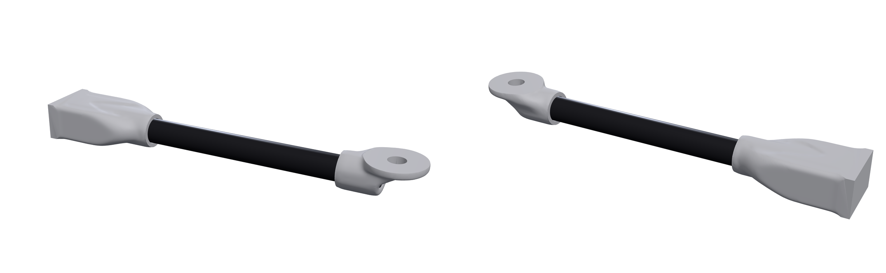
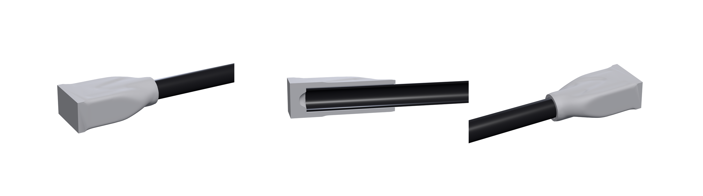
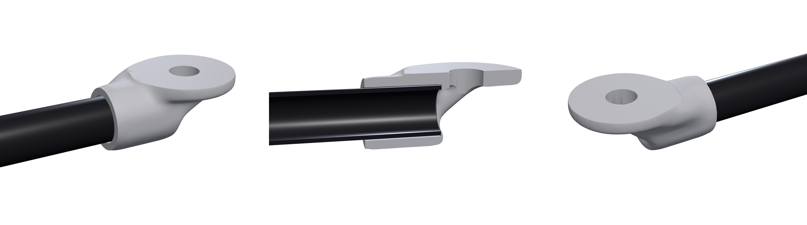

# Bought stock: printed nodes round carbon tubes

A printed polymer is about a hundredth as stiff as carbon fibre along the
fibre and a twentieth as strong. A part that has to span a distance (a
drone arm, a robot link, a bike's stays, a camera boom) is lighter as bought
stock between printed nodes than printed whole, which is how such frames
are built. The stock is not designed: a tube is a tube. What is designed is
the printed part round it, and what has to be right is the joint.

Topology optimization codes take one material and stop at a density field.
Frame and beam codes know tubes and nothing about the lug. loadpath puts
the bought member in the same study as the printed part: a body with its
own orthotropic material in every solve, the printed nodes designed round
it, and each joint checked from the forces the solved assembly puts on it.

    "stock": [{
      "id": "arm", "type": "tube", "material": "cfrp-pultruded",
      "od": 12, "wall": 1, "from": [-24, 0, 0], "to": [136, 0, 0],
      "joint": {"type": "bond", "adhesive": "epoxy"}
    }]

## The case: a drone arm

`examples/stock/tube-arm.json`: a 160 mm pultruded carbon tube, 12 mm
across with a 1 mm wall, bonded into a printed PA12 hub socket at one end
and a printed motor mount at the other. Two load cases: full thrust (12 N
up at the motor with 180 N·mm of torque reaction) and a wall hit (72 N on
the motor mount, mostly along the arm). Safety factor 2.

    loadpath run examples/stock/tube-arm.json --out out/
    python examples/stock/render.py examples/stock/tube-arm.json out/tube-arm.stl out/arm

The lightest passing design of the volume-fraction search (about 20
minutes on 4 cores at 1 mm cells):

| | |
| --- | --- |
| printed nodes (PA12) | 21.4 g, two bodies joined only by the tube |
| tube | 8.3 g |
| printed stress | SF 5.6 (wall hit), buckling 6.2× |
| tube | SF 10.3, limited by shear: 4650 N·mm of bending, 282 N·mm of torsion and 60 N of compression in the wall hit; a pultruded tube is weak in shear |
| hub bond (46 mm socket) | **SF 2.03, bond shear: the limit of the whole assembly** |
| motor-mount bond (18 mm) | SF 9.7, limited by the tube wall splitting in hoop tension |

The forces are statics: the hub's reaction is the 72 N applied, the tube's
bending near the socket mouth is 40 N × 120 mm, and each joint's resultant
is the load on the far side of it.

The printed plastic is nowhere near its limit. The joint is. With epoxy
the same design holds 1.8×, because epoxy holds 3.8 MPa on printed PA12
against 19 MPa on steel; the report said so and named the fixes (a
stronger adhesive on this plastic, a larger tube, a pin). A structural
polyurethane holds 5.0 MPa on PA12 and passes. A 10 mm tube bonded with epoxy
held 1.7× in a 32 mm socket and in a 46 mm one, since the load rides
the stiff tube to its inner end and enters the hub there: more socket does
not help, more diameter does. None of that is visible to an optimizer
that only knows the printed material.

Each joint, whole and cut along the tube:

## What a member does to a study

`loadpath.stock.expand_stock` turns each member into regions the rest of
the library already understands, so nothing downstream is special-cased:

- a keep-out with the member's id: its body plus the joint's gap (the
  bond line, or a clamp's slip fit). The bore is cut exactly and sized for
  the process by the fits machinery, so the file prints to the diameter
  the joint needs;
- a preserved sleeve per joint, as thin as the process prints: the surface
  the joint acts on. Everything else round the member is the optimizer's;
- a clear zone round the stretches that are not joined, so nothing printed
  grows onto the free tube;
- a load or support whose `region` is the member's id acts on the member
  itself.

With no `span`, one `joint` stands for every stretch of the member that
runs through the design space, so a tube through two design boxes gets two
joints.

| field | |
| --- | --- |
| `type` | `tube`, `rod` or `plate` |
| `material` | a stock card, a library metal (`6061-t6`, `7075-t6`, `304`, `ti64`), a card with your own `layup`, or measured constants |
| `od`, `wall` / `width`, `thickness`, `widthAxis` | the section |
| `from`, `to` | the two ends of its axis |
| `joint` / `joints` | `bond`, `clamp` or `pin`, with `span`, `adhesive`, `gap`, `sleeve`, `friction`, `fasteners`, `clampForce`, `diameter`, `at` |

`loadpath materials --stock` prints every card with its sources.

## The physics

**The member is in the solve.** Its cells are in the grid the optimizer
and the verification solve, each with the member's own elasticity matrix
turned to the member's axis: a pultruded tube is 134 GPa along its length
and 8 GPa across it, and the joint feels both. The solvers keep one element
matrix for the printed material, so the member enters as the difference,
share × K_member − share × K_printed on its cells: one fixed sparse operator
added to every stiffness matrix the way a pin's springs are, in the
optimizer, the stress check, the buckling check and the modal check alike.
Its mass enters the same way. Checked against beam theory on the grid
(`tests/test_stock.py`): a 10 × 1 mm tube at 1.5 mm cells bends within 12%
and stretches within 8% of EI and EA.

**The member is checked on its real section, not on voxels.** A 1 mm wall
is one cell thick; its stress read from the grid would be noise. Instead
the force and moment the member carries at every station come from the
free body of its own cells (the nodal forces beyond a cut sum to the
section's resultant, exactly, for the solved model), and the stresses
follow in closed form on the true section: axial, bending, torsion and
transverse shear against the laminate's strengths, the wall against
buckling (NASA SP-8007's orthotropic cylinder with its knock-down), and
each free length against Euler buckling.

**The joint is checked from the interface forces.** At every node of the
member's surface the solved assembly gives the force the printed part puts
on the member. Binned into patches and resolved along and across the
surface, that is the traction the joint has to carry:

- **bond**: shear and peel, averaged over the overlap the adhesive's
  lap-shear strength was measured on (12.7 mm, ASTM D1002) because the
  strength on the data sheet is itself an average over that length, and
  held against the adhesive's strength *on these two materials*. Epoxy
  holds 19 MPa on abraded steel and 3.8 MPa on printed PA12: the plastic
  decides. The report says which side limits and how long the joint would
  have to be for the goal;
- **clamp**: the grip (the screws' preload, read from a load case named
  `preload`, or `clampForce`) times friction against the force and torque
  that would slide the member;
- **pin**: bearing at the bore, shear-out to the member's end and the net
  section through the hole;
- **every joint**: the tube's wall under the pressure on it. The uniform
  part is hoop stress, the part that ovalizes the tube bends the wall
  (ring bending, harmonic by harmonic), and external pressure is held
  against ring collapse. A thin pultruded wall splits long before the
  tube bends, which is why clamps on it want length.

The member and joint margins join the part's own in the pass/fail
(`report.stock.margin`), so a part whose printed stress holds 5× but whose
bond holds 1.6× does not pass.

**An end face in a socket is not a joint.** A tube butted on a socket's
floor cannot pull, and adhesive there is not what holds it. Solved as
stuck, a stiff tube levers on the floor and takes the load off the bond
that has to hold it, so the member's last cell layer at a buried end
carries nothing and the sides take everything.

## Sources

| card | from |
| --- | --- |
| `carbon-epoxy-ud`, `carbon-epoxy-fabric` laminae | Toray 2510 prepreg data sheet (T700 unidirectional tape and plain weave, room temperature) |
| `cfrp-pultruded` | a pultruded tube's data sheet (134 GPa, 1650 MPa tension, 41 MPa shear, 60% fibre) |
| `cfrp-roll-wrapped`, `cfrp-fabric`, `cfrp-quasi-isotropic` | classical lamination theory on the laminae; the roll-wrapped layup (two thirds along, a third round) is an estimate, so give `layup` when the seller states it |
| `epoxy` | 3M Scotch-Weld DP460 overlap shear by substrate |
| `polyurethane`, epoxy on PA12 | measured lap shear of four adhesives on Multi Jet Fusion PA12 (Polymers 17(22), 3020) |

Estimates are labelled in the cards (`"source": "estimate"`): friction 0.2
for printed polymer on carbon, some transverse laminate strengths, and bond
strengths on plastics no sheet lists.

## Limits

- The interface is solved as stuck. That is a bond; a clamp is checked
  for slip but slip itself and the contact opening on the far side are not
  modelled.
- The adhesive's own compliance is not in the model, so the shear at the
  very end of an overlap reads sharper than a real bond line spreads it.
  The check reads it over the test overlap for that reason.
- The optimizer minimizes compliance with the member in place and does not
  yet shape the node to lower the bond's peak; the verification catches a
  joint that fails and says what to change (a longer joint, a larger tube,
  a different adhesive, a pin).
- Thermal mismatch between carbon and plastic, fatigue of the joint, and a
  clamp's split and screws (draw them as `fasteners`) are the study's to
  state. The tetrahedral cross-check does not run with stock.
- No printed validation coupon yet: a pull-out test of a bonded tube is
  the first one to make.
