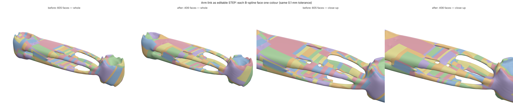
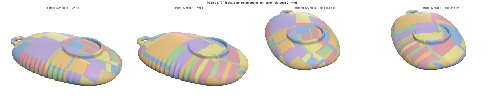
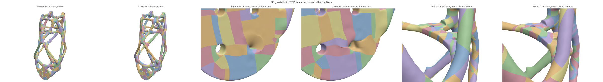
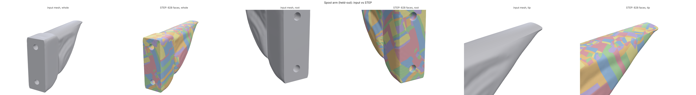
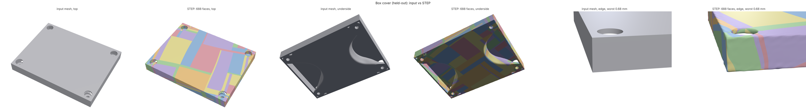
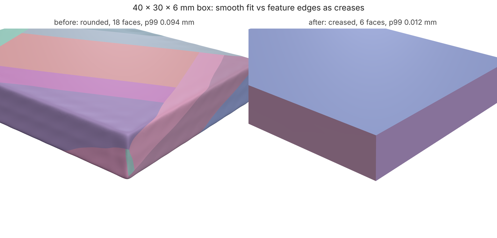

# Organic surfacing: any mesh in, editable smooth STEP out

A topology-optimized body, a scan or an AI-generated mesh (Tripo, Meshy) is
hundreds of thousands of triangles and no surface a CAD user can pick,
fillet, offset or shell. Topology-optimization codes stop at that mesh;
`loadpath surface` turns it into what a surfacing artist would have drawn:

    pip install "loadpath[surface]"
    loadpath surface generated.glb --size 72 --out pebble.step
    # pebble.step       one closed solid of B-spline patches
    # pebble.cage.obj   the Catmull-Clark control cage (the editable design)
    # pebble.json       tolerance and why, deviation both ways, smoothness

    # a loadpath part: the body smooth, bores and mounts still exact cylinders
    export_step(part, "part.step", surface="subd")

## How

1. **Intake.** Open, self-intersecting, double-walled meshes are wrapped by
   `exterior.load_exterior` (generalized winding number) onto the source's
   own triangles.
2. **Quad cage.** Instant Meshes (Jakob et al. 2015, BSD, `pyinstantmeshes`)
   lays an all-quad mesh whose edges follow the principal curvature
   directions. Its occasional leftovers (a small hole, a pinched vertex, a
   doublet) are repaired: holes are traced face by face round each corner,
   so one that passes a vertex twice is followed right, and an odd-sided
   hole (no quad tiling has an odd boundary) is closed after splitting every
   quad in four. Slivers in the input (exact bores and mount faces cut by
   manifold booleans are long triangles beside 0.07 mm ones) leave Instant
   Meshes nothing to extract at any density; the cage is then laid over an
   even resampling of the same shape and fitted to the original. The first
   density comes from the part: faces no wider than 1.2 x its thin walls and
   members (10th percentile of the distance straight through it).
3. **Fit.** The cage's control points move until its Catmull-Clark limit
   surface lies on the mesh: least squares between exact limit points and
   their closest points on the mesh, both ways, with correspondences across
   a thin wall rejected by their normals and the cage stiffened wherever the
   surface would fold.
4. **Tolerance from physics.** The cage is laid again finer until the
   two-way deviation (99th percentile) is within the tolerance, then faired:
   the bending weight rises until that budget is spent, so noise goes and
   design stays. The tolerance is a third of the process accuracy (FDM
   +-0.3 mm gives 0.1 mm: it adds 5% to the printed error, sqrt(1 + 1/9)),
   or twice the input's own measured noise when that is larger (fitting
   closer would fit the noise).

   **The worst point, not only the 99th percentile.** Every place where the
   surface misses the mesh by more than the process accuracy (three times
   the tolerance) is found and sorted. A place where the surface spans air
   (a ray along its normal goes on through air both ways) is a through-hole
   the cage closed: Instant Meshes drops handles smaller than its faces,
   and which ones it drops changes from run to run. Its diameter is twice
   the surface's miss there (the membrane sits a radius from the wall). A
   hole the process could print open (FDM: 2 mm and up) makes the cage
   finer, to an edge under 0.7 of the diameter (four edges round it); a
   smaller one is reported in `worst.holesClosed`, since the printer would
   not leave it open either. Every other miss is a surface miss. One over
   twice the accuracy is a feature narrower than the faces, and the cage
   gets finer for it too; the rest pull harder (minimax reweighting, each
   point's weight times (miss / 0.75 aim)^6 a round, at most x17) until every place is within the accuracy
   less the patches' own third of the tolerance, so the fit spends its
   freedom only where the shape is tight, and the 99th percentile still
   holds. `worst.patchesMax` bounds the written faces (limit miss plus
   patch-to-limit). Euler numbers of mesh and cage are reported side by
   side, so a lost handle is never silent.

   **Put right in place, not laid again.** Instant Meshes lays one edge
   length everywhere and lays the whole cage afresh each time it is asked,
   so a finer cage for one tight place moves every other place too (a hole
   kept open on one lay closed on the next, on the arm link). Once the
   part as a whole is within the tolerance the cage that is already fitted
   is edited where it is wrong (`subdedit.py`), and every other face keeps
   its corners and its control points:

   - *A bridged hole is cut in.* The surface over each mouth of the hole is
     a membrane in air; two membranes that face opposite ways with a
     straight way through air between them are the two mouths of one hole.
     The face over each mouth is removed and the two openings are joined
     by a tube of quads down the hole (four faces on a thin web). A handle
     costs eight valence-5 vertices on any quad mesh (sum(4 - valence) =
     4 x Euler number), here the corners of the two removed faces.
   - *Two holes run together get their bridge back.* The remesher
     sometimes joins two holes through the material between them; the
     slit's two walls then sit inside the solid facing each other, where
     no closest point pulls them out (the mesh round them faces the other
     way). Limit points inside the mesh whose normal leads through solid
     to the facing wall mark it; the wall faces are removed and joined by
     a tube whose inside is material.
   - *Faces too wide for the shape* (a miss over twice the accuracy) are
     first fitted again on their own: on a 5-7k cage the whole-cage fit
     stops with a few places unconverged, and most such misses go with
     nothing but that. What is left is inset: a ring of quads inside the
     flagged faces' outline, eight star points per place (any local
     refinement of a quad mesh ends its new lines in 3-5 pairs; a ring is
     the cheapest).
   - *Only the control points round an edit are fitted again* (four rings
     of faces), the same two-way least squares on the limit points they
     move, the rest held. The worst-point pull uses the same local fit,
     and where a pull stops gaining (the worst miss falls by under a
     tenth) the faces that still miss are inset and fitted, so a place
     over the accuracy gets finer faces rather than a finer cage.

   An edit that folds the surface, leaves the cage open or makes the
   worst point worse is not made. Only if edits leave a printable hole
   closed or a miss over three times the accuracy does the old route run (the cage laid once more
   with space blown up round the flagged places, `quad_cage(..., finer=)`,
   then finer everywhere). A cage whose 99th percentile is within 15% of
   the tolerance is fitted on from where it stands before any new cage is
   laid. `tries[].edits` in the report lists what was done. If the
   rectangles along the lines do not sew into a closed solid, or the
   written file does not read back as one, the faces are written one by
   one.
5. **Patches along the cage's own lines.** Every edge line leaving a star
   point (a vertex with 3 or 5+ edges) is drawn on until it meets another
   star point or a line already drawn (a motorcycle graph). Between the
   lines lie rectangles of cage faces with star points only at their
   corners, and each rectangle is one bicubic B-spline face. Every line is
   fitted once as a cubic spline (exact where the limit surface is
   bicubic; toward a star point its knots halve four times, to 1/16 of an
   edge, and it is fitted to the exact limit points and tangent planes),
   and both rectangles beside it take that same curve as their edge, so
   neighbours share edges exactly. Inside, the poles are fitted to the
   exact limit points and tangent planes (Halstead masks at the star
   points). A rectangle that wraps round a member (the lines closed a
   band round it, so two opposite sides meet) is cut across the middle:
   as one face its 2-D curves are ambiguous at the seam and a reader that
   rebuilds them by projection gets the face back invalid. Face count goes
   with the star points, not the cage: a few
   hundred faces where face-by-face patches gave thousands. Where the
   layout does not come out (a line that closes on itself, a fit outside a
   third of the tolerance, neighbours meeting at more than 1 degree) the
   faces are written one by one as before: regular ones exact bicubics
   packed into rectangles, star point ones degree-7 patches.
6. **Solid.** Sewn, checked, written; for a part with exact features the
   smooth body is cut by the exact cylinders, boxes and spheres in
   OpenCascade.

## Numbers (2026-11-21)

| input | cage | STEP faces | time | deviation p99 / max | worst kink | valid, volume |
|---|---|---|---|---|---|---|
| Tripo-style pebble (holes, double wall, jitter) | 5642 quads | 241 (was 525) | 2.2 min (was 12.5) | 0.071 / 0.27 mm, every place within 0.3 (was 0.095 / 0.35) | 0.005 deg (was 0.63) | yes, -0.004% (was -0.14%) |
| optimized arm link body (quick run, 2026-11-21) | 6.5-7.0k quads (was 8383) | 653-750 (was 4173) | 2.6-3.7 min (was 20.5) | 0.09 / 0.27 mm away from 1 mm pinholes (was 0.093 / 0.65) | 0.03 deg | yes, -0.01% (the old route left 4 free edges: not a solid) |

Tolerance 0.1 mm (a third of FDM's +-0.3 mm) on both, on the 99th
percentile; the worst point is held to the accuracy itself. On the arm
link the first version of this table (6389 quads, 598 faces, 3.2 min) held
only the 99th percentile: the worst point was 1.37 mm on one run and 0.58
on the next, where the cage had closed a 2.7 mm through-hole at a member
join on one and not the other. Bounding it by laying finer cages until
every printable hole came out open took a 12-13k cage, 887-957 faces and
8-10 min (6.4 min on the machine these rows were run on). Now the first
cage within the tolerance is put right in place: over nine runs the edits
were a hole cut in (4 faces), a bridge laid across a slit (4 faces), a
few faces fitted again, and one to three places inset at the worst-point
stage, 5-31 s a cage; every run a valid closed solid with every place
within 0.3 mm. What is left closed is the ~1 mm pinholes FDM cannot print
open (`worst.holesClosed`, mesh Euler number -32, cage -22 to -26). The
first cage's edge is now the member thickness (it was 1.2 times it, and
on every run the first cage missed the tolerance and a second was laid).
Same machine (4 cores), same input, run one at a time. Earlier
(2026-11-17): soft plate + exact bore 146 B-spline faces + 1 cylinder,
250 s.

**Fewer star points (`subdcoarse.py`).** Every STEP face is a rectangle
between lines drawn from star points, so the face count goes with them.
Instant Meshes leaves many in pairs (a 3 diagonal to a 5, two 3s across a
quad) where its field turns and the shape does not ask for it. Once the
cage is within the tolerance and put right in place, edge rotations and
diagonal collapses (Tarini et al. 2010) take such pairs away, a move kept
when the lines its vertices send out (a star point sends one per edge)
fall; a rotation that changes nothing on its own is taken when the move it
makes possible next to it gains. The moved neighbourhoods are fitted again
and the moves stand only if the 99th percentile holds and no new place
misses by twice the bound (else the vertices round the new miss are left
alone and the rest tried again). Polychord collapse, the usual global
move, does not apply: on the arm link's cage three rings of quads out of
thousands do not cross themselves. Arm link: 279 -> 214 star points, 774
-> 611 STEP faces; pebble 93 -> 86, 241 -> 230.

Where the time went: the fit's closest points (now a compiled kernel,
`closestjit.py`), the least squares (the sample rows are gathered onto the
limit points they pull, so the normal equations are M^T diag M and the
matrix with one row per sample is never formed; conjugate gradients from
the last answer, preconditioned by one factorization a round; a round stops
once no control point moves more than a fiftieth of the tolerance) and the
density search (the next cage's size from the error rate the last two
tries show, aiming just under the tolerance: the old step overshot to a
cage half again as fine as needed, with more star points).

Fewer faces again (2026-11-24): rectangles side by side that together
make one rectangle are merged into one B-spline (the motorcycle graph runs
every line on until it meets another, so a line often parts two
rectangles of the same width; a B-rep face may meet several neighbours
along one side); the star points the worst-point insets cut in (eight a
rectangle) are cancelled in a second pass held to the pulls' aim; and the
density search steps without a 4x cap, with a rate floor of 3 (near the
tolerance the bench parts converge at 2.6-4.5; a floor of 2.5 laid the
pebble's cage 40% finer than needed). Pebble: 4 lays -> 3, 5642 -> 4223
cage faces, 86 -> 71 star points, 230 -> 174 STEP faces, 172 -> 147 s.
Arm link: no change beyond run-to-run scatter (back to back, same machine:
605 -> 610 STEP faces, 325 -> 358 s; five runs span 547-646): its cage
meets the tolerance on the first lay, merges take 18-37 faces off, and
Instant Meshes' scatter in star points is larger. Its remaining star points
are mostly 3-5 pairs one or two edges apart (dislocations): they cancel only
by gliding to a partner (below).

Pairs slid together (2026-11-24, `subdcoarse.glide`): most star points
left after cancelling are a 3 and a 5 on one quad, a dislocation of the
grid that no single move removes. An edge rotation that takes an edge
from the 5 and gives one to the 3 moves the pair whole one edge on (Peng
et al. 2011); a breadth-first search over such rotations (at most 24, each
place once) finds the shortest walk to where a move takes star points
away, and only that walk is made. The fit check is the same as for
cancelling. Arm link: 245 -> 156 star points, 466 STEP faces (605-646
before), valid, every place within the bound, 311 s; pebble 52 star
points, 132 STEP faces (174).

After the worst-point insets (2026-11-24): an inset's finer faces are
bounded by four 3-5 pairs at its corners, so they cannot all go; the
second pass slides and cancels the rest held to the aim, and where a place
would miss again the star points round it stay (up to four tries). A ring
of quads split instead adds no star points but runs 1,400-10,800 faces
round the arm link's cage. Arm link now 406-447 STEP faces (605-646 at the
start of the day), 300-320 s, valid, within the bound; pebble 132.

**Face by face (the fallback).** Rectangles of regular cage faces are grown
greedily and each becomes one clamped bicubic B-spline; faces at a star
point stay whole as degree-7 patches, split once toward it where that
misses the limit by more than a third of the tolerance. The file's points
are written unrounded: rounding a degree-7 patch's poles to 10 nm moved it
off its own edges and readers could not mesh it.

## Parts it had not seen (2026-11-24)

Run cold on the 35 g wrist link (genus 34) and two held-out benchmark
parts (`loadpath/evals/heldout`), one at a time beside other work:

| part | cage faces | STEP faces | p99 mm | worst mm | time | |
|---|---|---|---|---|---|---|
| wrist link, 35 g | 11941 | 1228 (was 1635) | 0.094 | 0.64 (0.46 before a pull that is now undone), one 2.6 mm hole closed | 46 min | valid |
| spool arm | 6576 | 628 | 0.088 | 0.26 | 10.5 min | valid, within the bound |
| box cover | 11875 | 694 | 0.123 | 0.68 | 14.5 min | valid, over tolerance at the face cap |

What broke, and what was fixed at the cause:

- Every edit and every star-point move on the wrist link was refused: the
  fit had left four folds, and `repair` refused any edit whose surface had
  any fold. It now refuses only folds the cage did not have
  (`subdedit._new_folds`). A place that already missed counted as new when
  its middle shifted by half a millimetre; places are now matched within a
  face.
- The density search kept its last try. A lay with finer spots at the
  12000-face cap closed five holes where the plain cage closed one, and
  then laid the same cage three times; the best try is kept, and the cap
  stops the search after its one spot lay.
- The box cover had no cage at any density: its flat faces are 48 mm
  triangles, and Instant Meshes lays its field over the input's vertex
  graph. A mesh with an edge longer than the quads is laid out on an even
  resampling, whose signed distance is now signed by pseudonormal (1720 s
  to 122 s).
- Instant Meshes can leave two quads closed on each other (a shell of no
  volume); they are dropped instead of failing the cage.
- A worst-point pull that makes the worst place worse is undone.

Left open: a sharp-edged part (the box cover) does not reach 0.1 mm at
12000 faces (error falls as h^1.5 at its creases; the edges come out
rounded and wavy, see the close-up), so prismatic parts want creases;
the wrist link's 2.6 mm hole through a 1.1 mm web cannot be cut into faces
wider than the web (its tube folds), which wants local refinement before
the cut; the worst-point pull on the wrist link moves control points 2-3
mm near that bridged hole and is undone.

## Sharp creases (2026-11-24)

A box's edges are not rounded: the feature lines of the mesh become
infinitely sharp crease edges of the cage, and the limit surface turns the
corner there exactly (`loadpath/subdcrease.py`, on by default,
`surface_mesh(creases=False)` to switch off).

- **Which edges.** A smooth surface rounds a corner of turn theta over
  about one face h and misses it by the sagitta, h theta / 8; so an edge
  is a feature once theta > 8 tol / h. The turn must also hold half a face
  away on both flanks (a marching-cubes ripple turns sharply between two
  triangles and is level again a millimetre on), the line must not zigzag
  more than the tolerance about itself averaged over a face (a field's rim
  cut on the voxel grid), a network with a corner every face or so is a
  staircase, not lines, and an open line must end at a corner (a fragment
  of a rim whose rest is ragged). The arm link body has sharp rims round
  its holes, all ragged: it gets no creases and fits as before. The box
  cover gets 31 clean lines, its outline and the four bolt holes' rims.
- **Laying them.** Instant Meshes' field is turned along the creases
  (extrinsic, so the rows lie on both sides of a narrow face), each line
  is traced through the cage's edges (shortest path, weighted by distance
  from the line) and its vertices moved onto it.
- **The rules.** A crease edge's new point is its midpoint, a crease
  vertex goes (1/8, 6/8, 1/8) along its two crease edges, a corner of
  three stays put; the limit is (a + 4v + b) / 6 on a crease. Fairing,
  star-point moves and edits all carry the creases; the patch layout cuts
  its rectangles along them and fits each side with its own normals.
- **Box (40 x 30 x 6 mm, tol 0.1):** 18 faces, p99 0.094 mm, max 0.3 mm
  smooth -> 6 faces, p99 0.012 mm, max 0.019 mm creased.
- **All or nothing.** A part creased in places fits worse than one rounded
  everywhere (the box cover with 5 of its 31 lines laid: p99 0.36 mm
  against 0.18 smooth at the same density, and the layout tears round a
  crease that stops). Creases are laid only when 95% of the lines' length
  lands on cage edges; otherwise the cage is laid again without them.
  The cover is such a part today: its long flat triangles, split fine,
  tear Instant Meshes' crease-aligned extraction, and the plain field's
  rows miss its lines.

## Not yet

- Adaptive density for the first cage: measured, and not a lever on
  patches (2026-11-24). Instant Meshes has no sizing field, so it was given
  one by laying it on an as-similar-as-possible copy of the surface (each
  edge scaled by the size wanted there, local rotations free; a constant
  size reproduces the plain cage exactly) with the size from the last
  cage's own per-face error (eroded, then diffused). Same tolerance, same
  machine:

  | | cage faces | star points | p99 mm |
  |---|---|---|---|
  | arm link, uniform | 6369 / 4749 | 267 / 254 | 0.098 / 0.158 |
  | arm link, adaptive (15 mm smoothing) | 4231 | 275 | 0.111 |
  | pebble, uniform | 3140 / 4641 | 82 / 85 | 0.118 / 0.071 |
  | pebble, adaptive (6 / 12 mm) | 3093 / 4635 | 106 / 108 | 0.106 / 0.076 |

  A third fewer cage faces on the arm link, none on the pebble, and never
  fewer star points: a size that changes over the surface is a curved
  metric, and the cross field pays for that curvature with singularities
  (Gauss-Bonnet), about +25 on the pebble; a rougher size field doubled
  them on the arm link (267 -> 496). Star points, not cage faces, set the
  patch count (about 2.4 per star point), and on the arm link they sit
  near the floor its genus sets (Euler -32: at least 128 five-valent
  points) times two. What is left on patch count is laying out fewer
  rectangles per star point and cancelling more pairs, not sizing.
  Scripts: project files `surface/adaptive/`.
- Slits and bridged holes more than one face deep or with outlines of
  different lengths on their two walls are joined one face pair at a time,
  or left to the old route.
- Zebra stripes still wobble on large flats of field parts: the fit follows
  the marching-cubes mesh's small ripples within the tolerance.
- Sharp creases on an organic body (a generated mesh's hard rim) are
  rounded to within the tolerance, not kept as creases; and a CAD-like
  part whose remesh cannot lay a row of edges on every feature line (the
  box cover) is fitted smooth. A feature-preserving remesh before Instant
  Meshes is the next step there.
- A hole through a web thinner than the faces over it (the wrist link's
  2.6 mm hole in a 1.1 mm web) stays bridged: the plain cut folds the
  surface, and refining the two mouth faces and setting them on the
  hole's rim before the cut still closes on refit
  (project files `surface/thin-web-fitted-mouths-attempt.patch`).
- A coarse first cage can come out with holes round thin members; the
  density search then steps finer (2.5x) until it closes.
