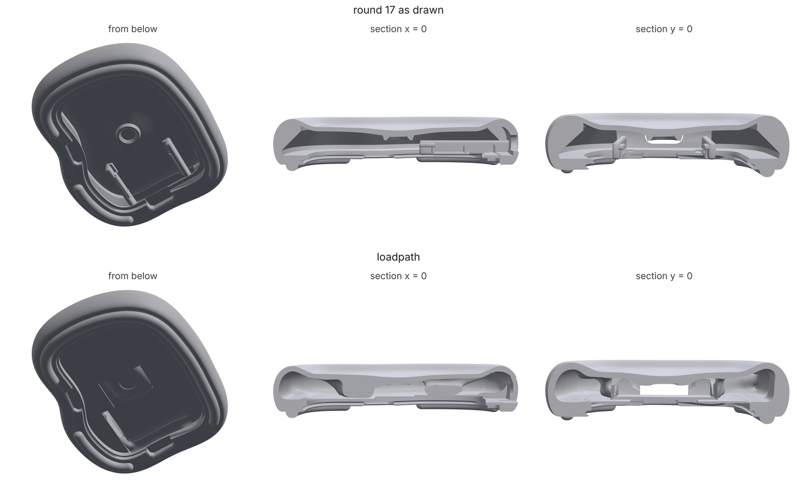
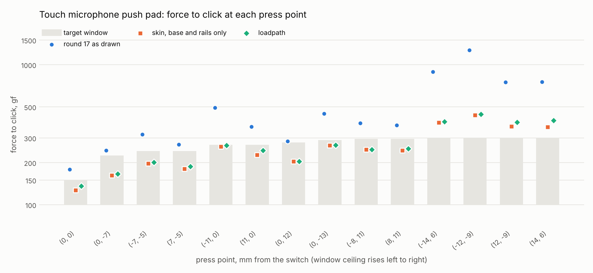
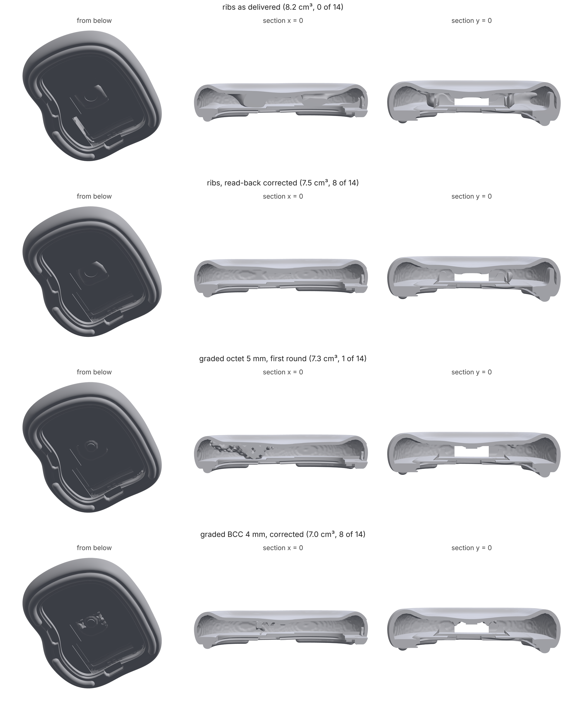
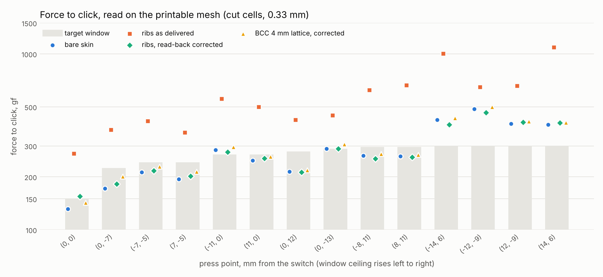

# Push pads: force-tuned interiors under a fixed exterior

An industrial designer hands over the surfacing. The board, the switch
and the other parts that sit inside are known, and so is how the product
should feel: a press anywhere on the touch area should click at about the
same force, or along a gradient someone picked, and a thumb resting on it
should not set it off. Everything inside the exterior is invisible, so it
should be designed for that feel, with the least material.

`loadpath switch` does this. The exterior is kept as a thin cosmetic skin
(the study's `skin`), so the skin's own thickness under the touch area,
the walls and the rim are design space too. The board and switch are
keep-outs, each with its **assembly path** (`insertFrom`), so nothing
generated gets in the way when the part is put together. A study's
`switch` block says where the plunger is, how far it is from the stem,
what force fires the switch, and the force window at each press point.

```json
"skin": {"thickness": 1.0, "open": ["-z"]},
"keepOut": [
  {"id": "board",  "insertFrom": "-z", "bore": false, "shape": {...}},
  {"id": "switch", "insertFrom": "-z", "bore": false, "shape": {...}}
],
"switch": {
  "unit": "gf",
  "output": {"region": "plunger", "direction": "-z", "gap": 0.4, "trigger": 65, "travel": 0.25},
  "field": {"center": [0, 0], "radius": 12, "max": [160, 200], "min": 110},
  "clearance": {"region": "skin", "gap": 1.6},
  "hold": [{"case": "squeeze", "maxDeflection": 0.25}],
  "pitches": [1.0, 0.7]
}
```

```
python -m loadpath switch pad.study.json --out pad-out/
```

The whole example is `examples/switch/touch_pad.py`. It builds a
synthetic touch pad, writes its study, and runs it.

**The skin is the process's minimum wall.** Take it from the material,
not from memory. With the Materialize MCP server connected,
`materialize_get_material` lists each material's design limits: SLS
flexible TPU gives a 0.8 mm minimum wall and 0.3 mm minimum detail. Use
the larger of that and the designer's own rule (1.0 mm for SLS TPU in the
touch microphone below), and set `minMember` the same. Once the part is
meshed, `materialize_check_printability` on the STL flags thin walls
before a quote. (The synthetic pad's 0.7 mm skin is under that minimum;
it is there to test the thin-skin model.)

## The model

The plunger has to cross the gap g, then push the stem through the
switch's own travel s until the stem's force reaches the trigger force T.
For a press at point i, with K the stiffness of the current design:

```
u_i = K^-1 f_i     (f_i: 1 N spread over a fingertip disc at i)
lam = K^-1 l       (l: the plunger face's mean travel along the stroke)
a_i = l . u_i      plunger travel per newton pressed at i
c   = l . lam      the plunger's own compliance
F_i = (g + s + T c) / a_i
```

This follows from superposition of the press and the stem's reaction.
Every quantity is a product of two solves, so every sensitivity comes
from solves that are already done: one per press point and one for the
plunger, per iteration. The press travel at the click,
`d_i = (f_i . u_i) F_i - a_i T`, is the "mush" before the click.

The optimizer minimizes volume with one constraint per press point (MMA),
written on log F so that a factor of two weighs the same at 100 gf and at
800 gf:

| constraint | what it is for |
|---|---|
| `F_i <= max_i` | the ceiling: any gradient over the area (`field.max: [centre, rim]`) |
| `F_i >= min_i` | the floor: a resting thumb does not fire it |
| `d_i <= maxTravel` | crispness |
| skin travel over `clearance` <= gap | the skin does not reach the board (KS over nodes and presses), each press at its fire force or at its window's limit if it fires beyond it (a press over a rigid part barely moves the plunger) |
| mean deflection under each `hold` case <= limit | squeeze, drop: the rim keeps its shape |

## What it does on the touch pad

The synthetic pad is 50 x 59 x 9 mm in SLS TPU 88A. It has a 1 mm deep
dish in its top, a 0.7 mm skin, a 6 x 6 mm switch (65 gf, 0.25 mm of
travel) whose stem is 0.4 mm under the plunger, and 13 press points on two
rings out to 12 mm. The target is 160 gf at the centre rising to 200 gf at
the outer ring, never under 110 gf.

| design (1 mm cells) | fire force | interior used |
|---|---|---|
| skin only | 76-122 gf: under the floor everywhere | 0 |
| filled | 730-2370 gf | 100% |
| **optimized** | **150 gf centre, 162-164 inner ring, 200 outer ring: all in their windows** | 28% |

That run took 80 iterations and 281 s on 4 CPU cores. Starting from a
uniform 50% fill, the forces went from 166-445 gf to inside their windows
by about iteration 20. The rest of the run removed material while keeping
the forces in place.

## On a real product: the touch microphone

`examples/switch/touch_mic.py` runs the same thing on a real design: the
push pad of a touch microphone (round 17 of its CAD, built from its
OpenSCAD source). It is a 50 x 59 x 12.3 mm SLS TPU 88A pillow with a sunk
touch area over a 6 x 6 mm tactile switch (65 gf, 0.25 mm travel); a cone
under the dish is the plunger, 0.4 mm over the actuator. The board goes up
through an opening in the underside into rails on the body, and a USB-C
plug comes in from the back.

The study keeps the designer's exterior as a 1.0 mm skin, the base ring
with the flap's seat, latch groove and feet, the board rails, and the
plunger tip. The opening, the board, the switch column, the stem and the
USB-C plug's path (`insertFrom: "+y"`) stay clear. Everything else (how
thick the skin is under the touch area, the cone, the rim's walls) is
design space. The target is a ceiling of 150 gf at the centre rising to
300 gf at 14 mm, a 100 gf floor, at the 14 press points the product's own
review used, and the flanks holding under a squeeze.





Every number here is the mesh read back on its own cut cells
(`switch_lattice.readback`, 0.5 mm), which holds a 1.0 mm wall at 1.0 mm
on any grid:

| part | in window | force to click | squeeze | volume |
|---|---|---|---|---|
| round 17 as drawn | 0 of 14 | 179 gf centre, 244-1272 gf elsewhere | 0.03 mm | 9.7 cm^3 |
| skin, base and rails only | 10 of 14 | 127 gf centre, 360-436 gf at the four rim corners | | 6.3 cm^3 |
| **loadpath, delivered mesh** (1.0 → 0.7 mm cells) | **10 of 14** | 136 gf centre, 388-443 gf at the four rim corners | 0.06 mm | **7.06 cm^3** |

The drawn interior is stiff where the product wants it soft: the corners
take up to 4.2 times their ceiling. Loadpath's interior meets every press
the exterior allows, with 27% less material than the drawn one, the squeeze
held, every board part's clearance kept (pcb 64%, receptacle 69%, chip 81%
of its room at the worst press) and nothing in the assembly paths. The four
rim corners are over 300 gf on the bare skin alone, so no interior can
bring them in. That is the designer's call (a ceiling of about 400-450 gf
there, or changed rim surfacing), and the report's `skinReview` makes it
with numbers (see "When the exterior decides" below). On this exterior the
skin decides the feel: the right interior is light, and it works mostly by
carrying the press to the plunger rather than by stiffening.

Two fixes got the delivered part from 9 to 10 of 14.

- **An exact skin.** Earlier renders of this part showed a rippled inner
  skin. The skin is an inward offset of the designer's surface, and a
  surface mesh's distance field was sampled on a voxel grid good only to
  half a 0.37 mm cell, so the 1.0 mm skin came out 0.65-1.18 mm thick in
  bands. An `Offset` of a mesh now gets exact closest-point distances in a
  narrow band around the surface (`MeshShape.exact_band`, cached under
  `~/.cache/loadpath/sdf`, `LOADPATH_SDF_CACHE` to move it), and the skin
  is 1.00 mm everywhere. The rippled skin had been stiff in places and soft
  in others; on the exact skin the bare exterior reads 10 of 14, not 9.
- **Ceilings the skin already misses.** A ceiling the bare skin alone
  exceeds cannot be met, and working toward it made the optimizer strip
  material the other presses needed (the centre came out 6% over). Those
  ceilings are now worked to the bare skin's own force plus 2%, and the
  report keeps the real windows and lists them under `relaxedCeilings`.

Earlier versions of this section claimed 13 of 14 on 1 mm cells. That
design read 0 of 14 on cut cells. Two models were wrong. A thin skin on
coarse cells was read as a density floor, 20-35% soft wherever the skin
split across two cell layers. And the delivered mesh was read back as its
volume share per cell, which turns thin ribs into soft hinges. Both are
cut cells now (below). The optimizer's own reading of this design is 8 of
14 on 0.7 mm cells, and the mesh read back on those cells gives 10 of 14.

The clearance limit in those runs (1.4 mm of skin travel toward anything
on the board) was not met by any design, round 17 included. It was the
smallest gap over the board (the USB-C receptacle's) applied to the whole
board. It is a clearance per component now (below), and every design
since meets it.

The run took 60 iterations on 1.0 mm cells and 60 on 0.7 mm cells, about
1.2 hours on 4 CPU cores (the designer-handoff setup below: openings, the
flap as the switch seat, a clearance per board part). A press counts as in window within 2%.

It is an eval case, `touch-mic-pad`. The product's CAD is not in this
repository: `touch_mic.py --stl-only` writes the case's STLs from a
touch-mic checkout, `LOADPATH_TOUCH_MIC_STL` points the suite at them, and
the case is skipped where that is not set. It passes with at least 8
presses in window on the design and 8 on the delivered mesh's cut-cell
read-back, under 9.0 cm^3, a watertight mesh, and the squeeze held. The
coarse tier (1.0 mm only, 40 iterations) gives 9 and 9 of 14 in 7.4 cm^3.
Since the designer-handoff work the case also keeps no skin across the
opening, bears the switch on the closed flap and holds a clearance per
board part (below). On the exact skin the coarse tier gives 10 and 10 of
14 in 6.9 cm^3 (1114 s), and the full tier 10 and 10 in 7.06 cm^3.
Every `loadpath switch` report carries the read-back (`deliveredForceGf`,
`deliveredInWindow`, `deliveredHold`). A shareable comparison sheet:
https://claude.ai/artifact/DevY83gMUWnygXPb2Jkm5v.

## From the designer's handoff

Writing the study above meant reading the CAD for numbers: where the
switch's actuator is, how far over it the plunger tip sits, which way the
board goes in, what the part stands on. `loadpath handoff` reads them off
the geometry. The brief is what a designer hands over: the exterior, its
openings, their own internal geometry (rails, a base ring), each
component's CAD (STL or STEP), the order they go in, and the switch's
trigger force, travel and press windows (`loadpath schema handoff`).

```json
{"exterior": "outer.stl", "skin": 1.0, "openings": ["opening.stl"],
 "fixed": [{"id": "base", "shape": "base.stl"}, {"id": "rails", "shape": "rails.stl"}],
 "components": [
   {"id": "pcb", "shape": "pcb.stl"},
   {"id": "receptacle", "shape": "receptacle.stl", "installedOn": "pcb"},
   {"id": "flap", "shape": "flap.stl", "role": "seat", "pathTolerance": 0.7},
   {"id": "switch", "shape": "switch.stl", "role": "switch", "installedOn": "flap"},
   {"id": "usb-plug", "shape": {...}, "external": true, "fixed": true, "insertFrom": "+y"}],
 "assembly": ["pcb", "flap", "usb-plug"],
 "switch": {"unit": "gf", "trigger": 65, "travel": 0.25, "gap": 0.4, "presses": [...]}}
```

```
python -m loadpath handoff brief.json --out handoff/      # study + handoff.json
python -m loadpath handoff brief.json --out handoff/ --run
```

What it writes, and how it finds each part (`handoff.json` says which):

- **Keep-outs and their paths.** Every component is a keep-out. In
  assembly order, each one (with everything installed on it) is moved out
  of its place along each of the six axes, the designer's hint first, and
  the first way that does not pass through the skin, the fixed geometry or
  a component already in place is its `insertFrom`. When no single axis
  is clear, a slide then a drop: the shortest first leg after which some
  other axis is clear. `insertFrom` takes such a path as a list of legs.
  Fixed material is counted less every component's place (each keep-out
  cuts it from the part), and up to `pathTolerance` (0.25 mm, for crush
  ribs and lips) of interference is allowed. A component with no way in is
  not given one: it is reported `blocked`, with what it hits and where,
  for the designer.
- **Supports**: a slab on the side the part stands on (`rest`, by default
  the press direction).
- **The plunger**: the switch's highest cap is its actuator (its axis and
  radius from the cap's vertices); the tip is `gap` over it and runs up
  into the skin, preserved; the column from the switch body up to the tip
  is kept clear, 1 mm wider than the plunger.
- **What the switch bears on** (`role: "seat"`): `switch.output.bearsOn`,
  the seat under the switch's footprint and the part held where it stands
  (below).
- **A clearance per component** under the skin (below), 0.2 mm margin.
- **Openings**: no skin is kept across an opening's inner end
  (`skin.openings`). The exterior solid ends there, and a skin lining it is
  a membrane across the cavity behind. The touch microphone's first
  studies had one: their delivered parts carry a 0.3-0.4 mm sheet at
  z 4.3-4.6 mm across the board bay over the flap, where the flap's fence
  and plug have to go.

Paths are translations. A part that really goes in tilted gets a longer
straight path than it needs (a little less design space); give its own
path with `"fixed": true` when that matters. The study is self-contained:
the meshes are copied into `cad/` beside it.

On the touch microphone (round 17's CAD, the parts extracted from its
OpenSCAD source: `touch_mic.py --handoff`), in under 2 minutes:

- the board, with its receptacle and chip, cannot drop straight out: its
  far end sits in a slot over the base ring. It slides back 8.5 mm, then
  drops out through the opening;
- the flap, carrying the switch, closes from below (its snap bead runs
  0.22 mm into the base on the way, inside its 0.7 mm allowance);
- the plunger tip lands at z 8.1, 0.4 mm over the actuator's top at 7.7,
  on its axis, as drawn; the actuator reads 3.5 mm across;
- the USB-C plug's path is the designer's (`fixed`).

Designed from that study (1 mm cells, 40 iterations, 150 s to optimize;
the designer's own clear zone over the board passed through as a keep-out):

| | in window | force to click | clearance used (worst) | squeeze | volume |
|---|---|---|---|---|---|
| design (1 mm) | 9 of 14 | 150 gf centre, 412-430 gf at the rim corners | pcb 71%, receptacle 41%, chip 93% | 0.06 mm | 7.4 cm^3 |
| delivered mesh, cut cells 0.5 mm | 10 of 14 | | pcb 68%, receptacle 41%, chip 88% (1 mm read) | 0.06 mm | |

The misses are the rim presses the bare skin already puts over their
ceilings (`skinReview`), as with the hand-written study. That study, with
the same three changes (no skin across the opening, the switch bearing on
the flap, a clearance per board part), passes its coarse eval tier with 9
of 14 on the design and 8 delivered, 7.2 cm^3, in 383 s. The handoff's
study, written from the CAD alone, does as well.

## What the switch stands on

The stem pushes the plunger back with the trigger force, and the switch
pushes what it stands on down with the same force. The model above took
that as rigid ground. `switch.output.bearsOn` counts its give:

- `{"region": id}` (or `shape`): the switch's seat in this mesh, a
  preserved flap or boss. The closure that fires the switch is the
  plunger's travel less the seat's: with m the seat's mean travel along the
  stroke, r = l - m takes the place of l in every formula, F = (g + s + T
  r.K^-1 r) / r.K^-1 f, and the reaction loads both;
- `{"part": {shape, seat, supports}}`: a separate part (a flap that closes
  the underside and stands on the desk), solved on its own on cut cells
  (`switch.part_compliance`) for its seat's compliance c_b. The plunger
  has to go T c_b further: F = (g + s + T (c + c_b)) / a. It is held at its
  supports only, so a snap bead or press fit to the body is left out;
- `{"compliance": mm/N}`: a measured one.

On the touch microphone the switch stands in a pocket on the flap, and
the flap stands on a foot on the desk right under it, so every link is in
compression. Its seat gives 0.23-0.47 um per newton (0.4 and 0.5 mm cut
cells): 0.15-0.3 um at the click, against 0.65 mm of stroke. Joined to the
body at its rim instead, the bare skin's forces move 0-3% (the rim corner
(-12, -9): 510 to 523 gf on 1 mm cells). On this product the flap does not
matter; the report gives `bearsOn.giveAtTrigger` so a softer seat (a
switch on a board spanning two rails) shows.

## A clearance per component

`switch.clearance` was one region and one gap. It is now one entry per
component, and each node gets its own room:

```json
"clearance": [{"component": "pcb", "margin": 0.2, "region": "skin"},
              {"component": "receptacle", "margin": 0.2, "region": "skin"}]
```

`component` is a keep-out id (its shape before any assembly sweep) or a
shape. For every node whose line along the press meets the component
within `reach` (10 mm), the room is that distance less `margin`; `region`
limits which nodes count. Nodes already resting on it (a rail on the
board's edge) are left out. The constraint is the same KS over nodes and
presses, of travel over each node's own room, and the report lists each
component's worst share of its room (`clearance`, `deliveredClearance`).

The skin by default: with every node counted, interior material over the
board had to hold to the room of the first grid plane above it (0.4 mm),
and the optimizer could not place any. Keep space over a part clear with a
keep-out instead, as a designer would.

On the touch microphone's bare skin (1 mm cells), the old single 1.4 mm
gap reads 2.7 times over (3.8 mm of travel over the chip). Per component
the bare skin uses 90% of its room over the board, 83% over the
receptacle, and 109% over the chip (a press at (0, 12), right over it,
bottoms the bare skin on it). Every design since meets all three.

## A skin of more than one thickness

An interior can only stiffen a press, so a touch area cannot be made
softer than its skin. What can change without touching the exterior is
the skin's inside: `skin.zones` gives a place its own thickness, and only
the inner surface moves.

```json
"skin": {"thickness": 1.0,
         "zones": [{"shape": {"type": "cylinder", "p0": [0, 0, 0], "p1": [0, 0, 20], "r": 12},
                    "thickness": 0.8, "blend": 2.0}]}
```

The thickness ramps across the zone's edge over `blend` mm (default 2),
as one smooth inner surface, so the cut-cell skin and the lining see no
step. Zones can be thicker too (a rim that should be firm). The grid
checks and the process's minimum wall use the thinnest skin. On the test
pad a 0.6 mm disc under the press point takes the bare skin's force down
by more than a fifth.

## When the exterior decides: feedback for the designer

Some presses are set by the skin, and no interior can fix them. The
fixed exterior is the designer's, and loadpath never edits it. What it
can do is say where the skin is the problem, by how much, and what change
would fix it. Every `loadpath switch` report carries that as
`skinReview`, and `loadpath switch study.json --skin-review` reads the
bare skin alone before anything is designed (3 minutes for the touch
microphone on 1 mm cells, its cut-cell read included).

For each press, the review gives:

- **skinOnly**: the bare skin's fire force against the press's window.
  A bare skin under its floor is normal, because the interior's job is to
  stiffen it. A bare skin over its ceiling is a risk: the interior can
  carry part of the press to the plunger, but only so far.
- **misses**: every press the design misses, which side and by how much
  (gf and %), the bare skin's reading, and `limitedBy`. That is `skin`
  when the bare skin alone is over the same ceiling, or `interior` when it
  is not (then a finer pitch or more iterations fixes it, and the designer
  needs to do nothing).
- **where**: the skin cells that set that press's force, found from the
  force's sensitivity to each cell (solves already done): their centroid
  and extent. On the touch microphone this is the fold where the top turns
  down into the side wall, 3-4 mm outboard of the finger, not the skin
  under it.
- **suggestions**, each read back through the same model with the interior
  held as designed: `target` (the ceiling the design meets as it is),
  `localSkin` (the thickness within 4 and 8 mm of the press, and round
  the stiffest skin, that brings it into window), and `wholeSkin`
  (one thickness for the whole skin). Each one lists any other press it
  pushes out of its window and whether the thickness is at or over the
  minimum wall (`skinReview.minWall`; by default the process's or the
  material's rule, 1.0 mm for TPU powder).

With the interior held, a suggested change is enough but may not be the
least: a re-run with the change re-optimizes the interior around it.
Thinning is modelled as a lower density in the skin cells, which bends
like the thinner skin (as in the thin-skin floor above), so treat the
thickness as an estimate to confirm with that re-run.

**Quote the cut-cell numbers.** The review reads the bare skin, and the
delivered part when there is one, again on the mesh itself. This is
`switch_lattice.readback`: the mesh itself on 0.5 mm cells, each cell the
surface cuts integrated over its solid part, so a 1.0 mm skin is 1.0 mm on
any grid. It runs whenever the skin is thinner than two cells or the grid
is over 0.75 times the skin or `minMember` (`skinReview.grid.check`, about a
minute on the touch microphone). The summary then leads with the cut-cell
reading. The design grid's own account, with its local suggestions,
moves to `estimateSummary`, and `trusted` says whether the two agree
within 10%. A whole-skin suggestion is read again on cut cells at its
thickness (`wholeSkin.cutCell`), and only that reading counts.
`skinReview.gridCheck` sets the cut-cell pitch, or false skips the check.

Why: the design grid's skin model has been wrong before, in both
directions, and the optimizer can meet the map on one grid and on no
other. The touch microphone's 1 mm design met 13 of 14 presses at 1 mm
and 1 of 14 when its delivered part was read on 0.75 mm cells. A
converged reading of the bare skin is cheap, so the review always says
what it is.

The touch microphone's bare skin, in gf (ceilings 300 at the rim, 150 at
the centre):

| reading | (-12, -9) | (-14, 6) | (12, -9) | (14, 6) | centre |
|---|---|---|---|---|---|
| floored, 1.0 mm | 388 | 304 | 354 | 309 | 96 |
| floored, 0.7 mm | 389 | 338 | 341 | 311 | 103 |
| whole cells, 0.5 mm (30% too thick) | 565 | 487 | 503 | 479 | 154 |
| **cut cells, 0.5 mm** | **476** | **421** | **391** | **388** | **128** |
| cut cells, 0.5 mm, a 0.5 mm skin everywhere | 422 | 365 | 308 | 343 | 82 |

The floored rows are the density floor that cut cells replaced. A floor
reads a skin soft where it splits across two cell layers: on the flat
1.0 mm skin of the test pad, 0.25 mm whole cells fire the centre at
230 gf, and floored 0.75-0.9 mm cells gave 175-185 gf. On 0.5 mm cells the
touch microphone's skin is whole cells instead, and on its curved surface
those make a skin about 1.3 mm thick (565 gf at the corner).

Thin skins are now cut cells (`switch._thin_skin`, below). On the test pad
they fire the centre at 250-265 gf on every grid from 1.0 to 0.55 mm (5-15%
over the 0.25 mm reference, about what one layer of whole cells gives).
On the touch microphone's bare skin at 0.7 mm they read 129 gf at the
centre and 378-477 gf at the rim corners. The mesh read back on its own
cut cells at 0.33 mm (`switch_lattice.readback`) gives 131 and 397-486.
The review reports `skinModel.model` and the share of skin in split
cells. `LOADPATH_SKIN_MODEL=floor` brings back the floor for comparison.

What the review tells the designer, from the cut-cell rows: the bare
1.0 mm skin is over its ceiling at the four rim presses by 29-59%, and
5% over at (-11, 0). Thinning the skin is not the lever. Even half the
skin leaves the corners at 308-422 gf and drops the centre under its
100 gf floor, because a press that far from the plunger moves it little,
whatever the skin. What is left is the designer's call: raise those
ceilings to what the skin gives (`cutCellTargets`: 395, 390, 480, 285
and 425 gf), or change the surfacing at the rim. An interior can help a
little by carrying a corner press to the plunger: the touch-mic thread's
0.7 mm design reads 426 gf at (-12, -9) on cut cells, against 476 for the
bare skin. The 1 mm design's suggestions (0.80 mm locally, 0.90 mm
overall) are withdrawn. `"skinReview": false` in the switch block turns
the review off.

## A graded lattice instead of ribs

`loadpath switch` grows ribs. With a `lattice` block (or `--lattice
octet:5:where-needed`), it fills the interior with one lattice instead,
a TPMS sheet or a strut cell of one size, and grades only how thick its
walls or struts are, cell by cell, to hit each press window
(`switch_lattice.py`). `mode: "fill"` puts lattice everywhere inside the
skin; `"where-needed"` also decides where there is lattice at all, in
regions about a cell across.

```json
"switch": {..., "lattice": {"type": "bcc", "cell": 4, "mode": "where-needed", "rounds": 3}}
```

The optimizer works on the lattice's homogenized modulus on the same 1 mm
grid as the ribs. A lattice under a push pad's skin is one or two cells
deep, where homogenization is a guess, so every round is **read back on
the printable mesh**: the exact lattice joined to the designer's skin,
solved with cut cells (each cell the surface cuts integrated over its
solid part, `readback`), at 0.5 mm. Each press's window is then divided by
how far that reading was off, and the next round optimizes for that. The
part comes with a powder check (no void a 1 mm ball cannot leave, and the
largest ball that rolls out of every room) and the material it added
inside each keep-out and its assembly path.

On the touch microphone (round 17's exterior, 1.0 mm SLS TPU skin, struts
and walls at least 1.0 mm), every design here read back the same way,
cut cells at 0.33 mm:

| design | in window | force / ceiling, median and worst | spread | part | added to assembly paths |
|---|---|---|---|---|---|
| round 17 as drawn (1 mm model, no mesh here) | 6 of 14 | 1.17, 4.79 | 0.66 | 9.7 cm^3 | |
| bare skin, base, rails and plunger tip | 9 of 14 | 0.91, 1.62 | 0.25 | 6.9 cm^3 | 0 |
| ribs as `loadpath switch` delivers them | **0 of 14** | 1.97, 3.64 | 0.30 | 8.2 cm^3 | 1.9 mm^3 (board) |
| ribs, read-back corrected (best of 3 rounds) | 8 of 14 | 0.97, 1.55 | 0.23 | 7.5 cm^3 | 0.9 mm^3 (board) |
| **graded BCC 4 mm lattice, corrected** | **8 of 14** | 0.96, 1.66 | 0.23 | **7.0 cm^3** | **0** |
| graded octet 5 mm, first round | 1 of 14 | 1.36, 1.82 | 0.18 | 7.3 cm^3 | 0 |

Spread is the coefficient of variation of force over ceiling across the
14 presses: how even the feel is against the map. A 4 mm ball rolls out of
every one of these parts (the underside is open to the board bay).





What this says:

- **A lattice that fills the interior is far too stiff.** At their
  thinnest printable wall (1.0 mm) a 6 mm gyroid is 45% solid and an 8 mm
  one 36%; filled, the corners need 7 kgf. Even the softest strut cell
  (BCC 8 mm, 7.5% solid) graded over the whole interior meets 5 of 14 on
  the design model. Strut cells, which bend, are the only lattices soft
  enough for a TPU push pad; sheets are a perforated solid at this scale.
- **The homogenized design does not survive the read-back.** The first
  round's octet met 14 of 14 on its own model and 1 of 14 on the mesh;
  the first BCC round 12 and 2. The 1 mm model reads this curved 1.0 mm
  skin about 30% soft, the same thing the skin review above found from
  the other side. The ribs fail the same check harder: their delivered
  mesh, which reads 11 of 14 through the 1 mm grid, reads 0 of 14 on cut
  cells.
- **Corrected, ribs and lattice tie, and neither beats the bare skin.**
  With the windows divided by the read-back error, both settle at 8 of 14
  with the same evenness. The lattice does it with 0.5 cm^3 less material
  and adds nothing inside the board, switch or plug paths (the ribs'
  smoothing leaks 0.9 mm^3 into the board space). The octet's second round
  removed every strut: on this exterior, the best interior is almost none.
  The bare skin's 9 of 14 is the ceiling, because the four rim presses at
  (+-12, -9) and (+-14, 6) need 397-486 gf from the skin alone against
  300, and any interior only adds to that. That is the designer's call
  (a thinner skin at the rim folds, or higher rim ceilings), which the
  skin review already points at.

A lattice will earn its place under a skin soft enough to need stiffening
everywhere, or where a press must be carried a long way to the plunger.
On this exterior the skin is already doing all of it.

The read-back on cut cells converges: the bare skin moves under 3%
between 0.5 and 0.33 mm (131 / 128 gf centre, 486 / 476 at the worst
corner). Designs with 1 mm members inside still stiffen a little from 0.5
to 0.33 mm (BCC centre 136 to 143 after correction, ribs 215 to 272 as
delivered), so a 0.33 mm reading is the one to quote, and a miss there is
at least that large; 0.25 mm did not fit in 15 GB. Reading a cell's filled
share as a density (E ~ x^3 or E ~ x) instead did not converge at all on
ribs, and pressing on the design grid's outermost cells (which the part
may barely touch) lost the load: the read-back presses the outermost node
of cells at least half full.

Run it: `examples/switch/touch_mic_lattice.py --stl <case STLs> --type bcc
--cell 4` (about 40 minutes for three rounds on 4 cores), and
`--readback part.stl` reads any delivered mesh the same way. The
corrected ribs come from the same loop around `run_switch`
(windows divided by `corrected_windows`).

## Three things that had to change

**A thin skin on a coarse grid.** Preserved cells are whole cells, so a
0.7 mm skin on 1 mm cells is a 1 mm skin. Bending goes as thickness cubed,
so the click came out about three times too stiff, and the optimizer could
only add material on top of that. It removed everything and stopped at
the skin, which is the same thing the touch-mic run saw with its whole
shell preserved. When the skin is under two cells thick, `switch` now
turns each cell the skin passes through into a design cell, with its
density floored at its share of skin volume φ. The stiffness of the cell is
the skin's own, integrated over 4^3 sub-cells weighted by the skin's share
of each (from its signed distance, so the thickness is not rounded to a
sub-cell). The incompatible-mode element keeps a skin that only partly
fills a cell from locking. Material the optimizer adds above φ fills the
rest of the cell: K = K_skin + s (K_solid - K_skin), with s = ((x - φ)/(1 -
φ))^3. Below φ (the skin review thinning the skin), the skin's matrix scales
as (x/φ)^3. Cells with under 2% skin stay on the floor law, every cut cell
carries 1e-4 of a solid cell's stiffness for conditioning, and the systems
factor with PARDISO (or nested-dissection SuperLU). The first version of
this, E ~ x^3 with x floored at φ, bent like the real skin only when the
skin sat in one cell layer, and read 20-35% soft where it split across
two. The large-deflection check still reads skin cells at E x^3 and
applies its ratio to the cut-cell linear force. From two cells per skin
thickness up, the skin is ordinary preserved cells.

**Void cells.** A pad's optimum is mostly empty. With empty cells kept in
the system at E_MIN, preconditioned CG crawled: 60 s an iteration on 17k
cells. Each solve now keeps only the cells above a density of 0.02 that
connect to a support, plus the preserved ones. Up to 120k unknowns it
factors that system once (SuperLU) and back-substitutes every press point
from it, which takes 3-8 s an iteration. Above that it uses the
matrix-free multigrid (`mg.py`), which runs on a GPU with
`LOADPATH_DEVICE`.

**Reading a thin-skin cell as printed.** The optimizer works on the
density in a thin-skin cell, floored at the skin's share φ. Thresholding
that density at 0.5 made every cell more than half skin a whole solid
cell, so a 0.57 mm skin share read as 1 mm, and the as-printed fire forces
came out 1.6-1.8 times the design's. In such a cell the skin is printed
exactly (the delivered mesh joins the designer's skin), so only what the
optimizer added above φ is structure of its own: its share of the rest of
the cell, (x - φ)/(1 - φ). That is what is meshed and thresholded now, and
the as-printed reading matches the design to within 1 gf. Meshing also no
longer fillets or runs material on into the skin: with a 3 mm fillet to a
skin that wraps the whole exterior, the interior came out solid.

## Coarse to fine

`pitches: [1.0, 0.7, 0.5]` runs the problem on each grid in turn. Each
grid starts from the previous one's design (trilinear), with sharpening
backed off one step.

## Checks on the result

- **Thresholded reading.** The same linear fire forces on the black and
  white design, as it will print (`thresholdedForceGf`).
- **Large deflection** (`check_fire_nonlinear`, on by default;
  `"nonlinear": false` or `loadpath switch --no-nonlinear` skips it). TPU
  skins stiffen as they bow. For one press point per distinct target, the
  solid cells are re-solved with a neo-Hookean large-deflection model, the
  press and the stem's reaction at the trigger force applied together, and
  secant steps find the press force that brings the plunger to gap +
  travel (each secant solve continues from the last converged one, a step
  or two). Thin-skin cells under the threshold stay in at modulus E x^3.
  Above 30k dofs the Newton steps factor the tangent with PARDISO
  (`pypardiso`, in `loadpath[fast]` and `[crosscheck]`) up to 400k dofs:
  CG with AMG struggled with the stiffness jump between a floored skin
  and solid cells (2.5-8 s a solve, 3 min a press on the touch
  microphone's 1 mm grid, a 0.7 mm grid hardly moving). With PARDISO a
  press takes about 36 s at 1 mm (48k dofs) and 3 min at 0.7 mm (128k
  dofs). Without PARDISO, above 30k dofs it falls back to CG.
  Floored skin cells are read at E x^3 like the linear reading, so the
  check's own linear baseline matches `thresholdedForceGf` (within 1 gf on
  the touch microphone); thresholding them made it 1.2-1.4x stiff before
  any large deflection. On the touch microphone's 1 mm design, large
  deflection raises the click force 6-26% (mean 14%): least at the centre
  (140 -> 149 gf), most where the skin bows furthest at the outer ring
  ((12, -9): 299 -> 376 gf; (14, 6): 302 -> 377 gf). 9 of 14 presses stay
  in window (13 linear): the five on or near a ceiling go over it.
  Designing to the linear ceilings leaves no room for this; a margin of
  about 25% at the outer ring would.
- **The delivered mesh** is the isosurface joined to the exact preserved
  geometry, so the cosmetic skin's outside is the designer's mesh
  unchanged.

## Assembly paths

`"insertFrom": "-z"` on a keep-out sweeps it out of the design space on
that side (or along any vector). A board slides in from below, a switch
drops onto it, a driver reaches a screw. As a plain keep-out, the
component's final place stays empty, but a rib could still grow across
the way it has to come in. With `insertFrom`, the whole path stays empty.
Boxes and cylinders moving along one of their own axes are swept exactly.
A mesh moving along an axis is swept on its own distance grid (its
occupancy run along the axis, then one distance transform); anything else
is swept as a union of copies a fraction of a millimetre apart. A swept
keep-out is a clearance, not a bore, so it may end against material.

A path of legs, as the part leaves its place: `"insertFrom": [{"toward":
"-y", "length": 8.5}, "-z"]` slides it back 8.5 mm and then drops it out.
Every leg but the last has a length; the last goes on out of the design
space. `loadpath handoff` finds these from the assembly order (above).

## Limits

- The optimizer's model is linear; the large-deflection check reads the result. Contact
  between the plunger and the stem is modelled by its reaction at the
  click, not as an obstacle on the way there.
- Press directions are along an axis (`pressDirection`). The fingertip
  lands on the outermost node of each column within `pressRadius`.
- `MeshShape` signed distances come from a 160-cell grid over the mesh's
  largest extent (0.37 mm on a 59 mm part). That sets how well a 0.7 mm
  skin is placed. The exterior in the delivered mesh is exact either way.
