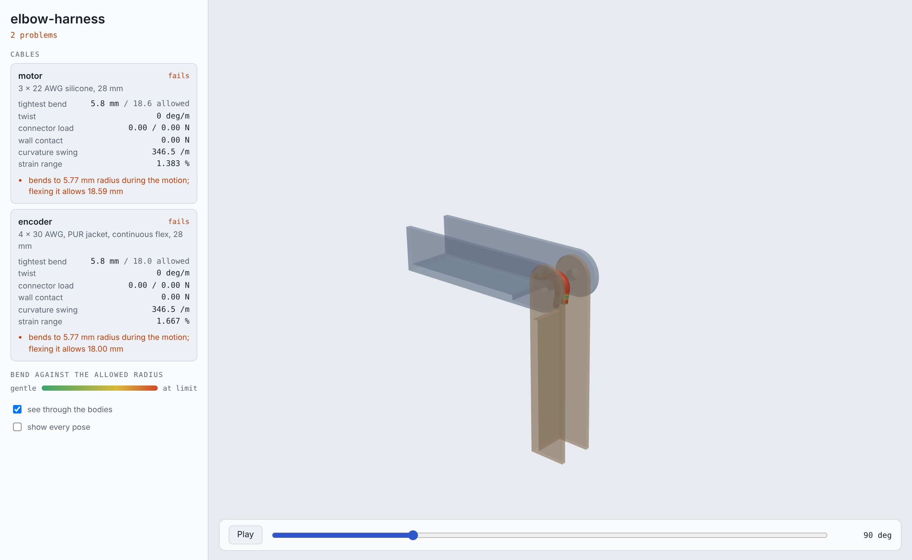
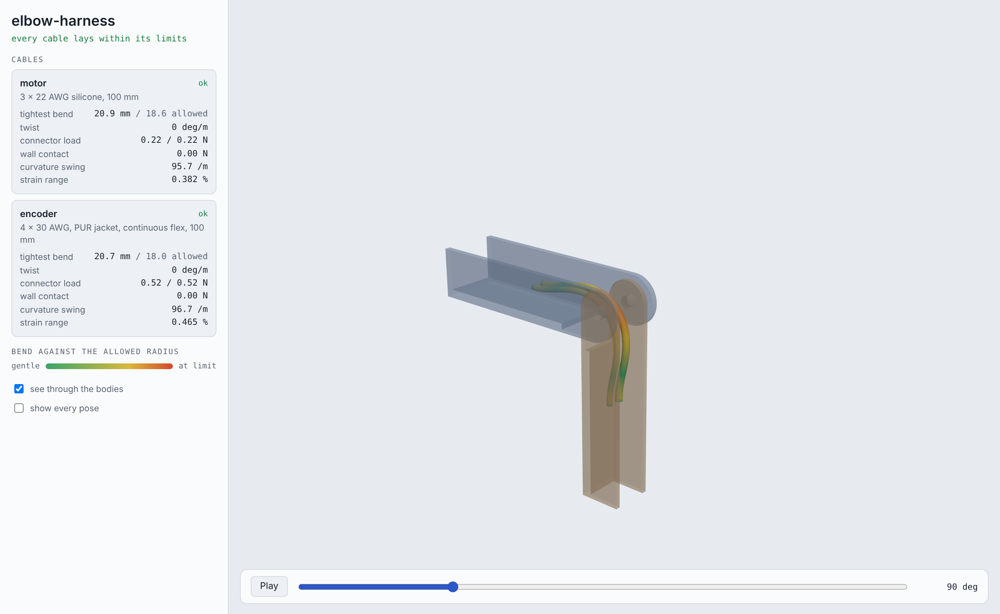
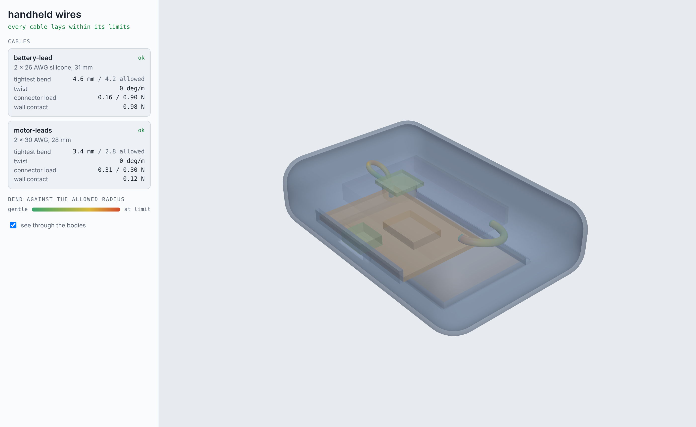
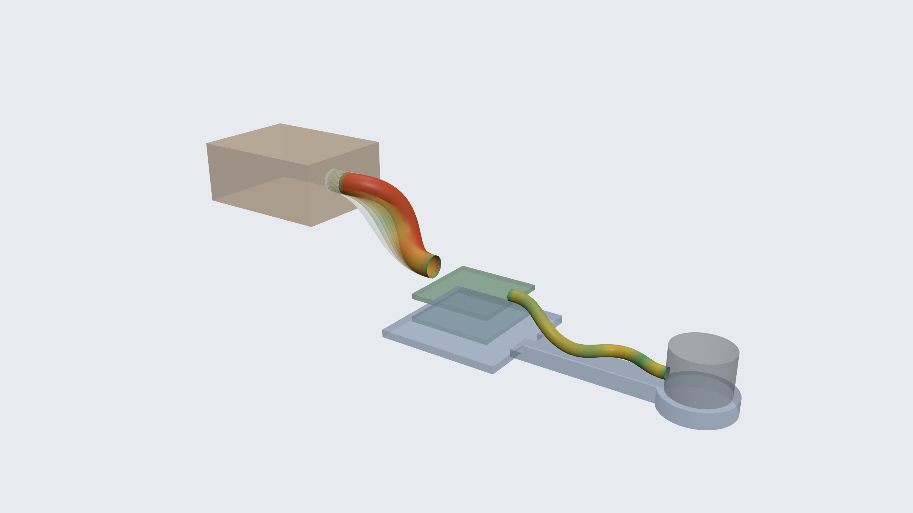

# Wires, cables and what they allow

A layout that fits is not a layout that can be built. Between the parts
of a product run its wires: a battery pigtail, a flat cable to a display,
a motor lead across a joint. Each has a length, a stiffness and a
tightest bend it survives, and the parts can only sit where those cables
can be laid, plugged in by a hand, and (in a joint) flexed a million
times. CAD draws a cable as a spline that will go anywhere. A topology
optimizer does not know it exists. `loadpath` models it as what it is, an
elastic rod, and lets it say no.

```
python -m loadpath wires brief.json --out out/        # MCP: loadpath_wires
```

and, inside a product, the same cables in an enclosure brief
(`components[].ports`, `wires`): then only layouts that can be wired are
kept ([below](#inside-a-product-the-cables-decide-the-layout-too)).

## The rod

`loadpath/rods.py` is a discrete Cosserat rod (Simo-Reissner): a chain of
nodes, and on each edge a frame (a unit quaternion) that says which way
the cable points and how it is rolled. Its energy is quadratic in six
strains per element (two bends, a twist, stretch, two shears), so a wire
and a ribbon are the same code with different stiffnesses: a round wire
bends the same in every direction; a flat cable bends easily across its
face, hardly at all in its own plane, and twists at a price. Equilibrium
is found by Newton's method on that energy with the exact Hessian (the
geometric terms included, checked against finite differences), a banded
solve, and a line search, so a 100-element cable settles in a few
milliseconds per step (the assembly is compiled with numba). Three things
make it usable on real routes:

- **Contact.** Obstacles are distance fields (a sampled grid for a mesh,
  a moving one for a body that moves, a polyline for a cable already
  laid). The cable's surface, sampled across its section (five points
  across a flat cable's width), is pushed out by a penalty. Steps are
  limited so that a cable cannot jump through a thin wall, and a step
  that would is refused.
- **Stability.** Equilibrium is not enough: a cable with slack between
  two clamps has a straight, compressed solution it would never stay in.
  The lowest mode of the Hessian is checked, and an unstable solution is
  kicked along that mode until it buckles into the shape a real cable
  takes.
- **Continuation.** An end is moved, or a length changed, in steps, each
  starting from a secant prediction of the last two, with the step halved
  when it does not converge. That is how a cable is cut to length on its
  route and how it follows a joint.

It is held to closed forms (`tests/test_rods.py`): the elastica of a
tip-loaded cantilever to large deflection (three digits of the published
table), pure bending into an arc, the torque of a twisted rod, Euler's
buckling load, Greenhill's twist at which a straight rod writhes, a
ribbon's two stiffnesses, and a rod lying under its own weight on a plane
with the contact force equal to the weight it carries.

## The cable

`loadpath.wires.cable(spec)` turns a construction into rod properties:

| spec | what it is |
|---|---|
| `"awg26-silicone"`, `{type: "wire", awg, insulation, strands?}` | one stranded wire: every strand bending about its own axis (they slip), plus the insulation tube |
| `{type: "bundle", wires, awg, insulation}` | wires side by side in a sleeve or lacing |
| `{type: "cable", wires, awg, insulation, jacket, jacketWall, shield?}`, `"usb2"` | a jacketed cable, optionally braided |
| `{type: "coax", od, core}`, `"coax-1.13"` | a coax |
| `"ffc-10x0.5"`, `{type: "ffc", conductors, pitch}` | a flat flexible cable |
| `"fpc-6x0.11"`, `{type: "fpc", width, thickness}` | a flex circuit |
| `{type: "round" or "flat", bendStiffness, ...}` | measured values |

Each comes with its weight per metre, resistance, and two bend radii, one
installed once and one flexing in service. Without a datasheet these are
house rules (a round wire 3 times its diameter fixed and 10 times
flexing, a coax 5 and 10, a flat cable 10 and 100 times its thickness),
and the report says so; `minBendRadius: {static, dynamic}` from the
datasheet overrides them. The stiffness of a stranded wire is an
estimate. Where a design is close, measure it: hang a length over a table
edge, measure the droop, and `stiffness_from_droop(overhang, droop,
gramsPerMeter)` gives the bending stiffness back.

## Laying a cable

A wire goes between two **ports**: where the connector is, and which way
the cable leaves it (`at`, `direction`, and for a flat cable `up`, its
face normal). `bodies` are what it may touch and not enter.

1. A way through the free space is found on a grid (a shortest path that
   pays for running close to walls and leaves each port straight).
2. The rod is started on that way, at its length, and then driven to the
   cable's own length: its cut `length`, or the route plus `slack`.
3. It settles, in contact with whatever it touches. Cables already laid
   are obstacles to the next.

The report is what a harness engineer asks of each cable: the tightest
bend against the radius it allows, and where; twist per metre (a flat
cable asked to turn a corner in its own plane fails here); whether it is
too short (pulled taut) or pinched; the pull, side load and moment on
each connector, against `maxPull`, `maxSide`, `maxMoment` where given;
voltage drop and self-heating for its `current`. `channels/<id>.stl` is
the space the cable needs, as a solid to keep clear (its own section
swept along it, the clearance round it: a flat cable's flat section turned
with its frame, not a round tube of its half width), and `wires.html` is
a viewer: each cable coloured by how close it is to its limit.

## Through a joint

With `motion` (a revolute or sliding range, or a path) and bodies marked
`moves`, every cable is followed through the whole travel and judged by
its **flexing** radius. The report adds the curvature swing at the worst
point and the strain range in the outer strands it causes (what fatigues
a conductor), whether it comes taut anywhere, and whether it snaps
through from one shape to another, which is the motion that breaks
strands.

`examples/wires/joint.py --compare` asks the question every arm asks: a
motor lead and an encoder cable across an elbow that turns 90 degrees
each way. Where do the clips go?

| design | motor lead | encoder cable |
|---|---|---|
| along the outside of the links, clips 35 mm from the pin | comes taut as the elbow closes | comes taut |
| through the pin's axis, clips 14 mm from it | folds to 5.8 mm; flexing it allows 18.6 | folds too |
| through the axis, clips set back 50 mm | 20.9 mm against 18.6: passes | 20.7 mm against 18: passes |

| clips close in: folds to 5.8 mm | clips set back: 20.9 mm, passes |
|---|---|
|  |  |

The physics gives the rule of thumb back with a number on it: through
the axis, the tightest bend is about 0.42 times the distance from the pin
to the clip, and slack makes it worse, not better (the spare length has
to go somewhere, and it goes into a tighter fold). The channel each cable
sweeps over the motion is written as a solid (`channels/<id>.stl`). Put
it in the link's study as a keep-out and the generated structure leaves
it clear; list it in `shroud.conceal` ([SHELLS.md](SHELLS.md)) and the
generated skin wraps it, so the wires run hidden inside the link.

## Inside a product: the cables decide the layout too

In an enclosure brief each component says where its connectors are, in
its own frame, and the brief says what joins what:

```json
"components": [
  {"id": "board", "shape": "board.stl", "watts": 1.2,
   "ports": [{"id": "batt", "at": [17, 9, 1.8], "direction": "+x"}]},
  {"id": "battery", "size": [45, 30, 6], "maxTemp": 45,
   "ports": [{"id": "lead", "at": [22.5, 9, 0], "direction": "+x"}]}],
"wires": [{"id": "battery-lead", "from": "battery.lead", "to": "board.batt",
           "cable": {"type": "bundle", "wires": 2, "awg": 26, "insulation": "silicone"},
           "length": 45, "current": 1.0}]
```

Three things then happen that did not before.

**The search places parts where they can be wired.** Every candidate
position is charged for the straight run of its cables, and one further
from its mate than the cable is long is dropped at once. The best few are
then judged properly: each cable is routed through the room that layout
leaves and laid as a rod. No way through, too short for the way there is,
or bent past its radius, and the position is refused; otherwise it costs
its cable's length, and more as its tightest bend nears the limit. A part
with no position its cables allow is reported as that, not placed
somewhere it cannot be connected.

**Heat is in the same search.** A part that gives off heat (`watts`) is
kept away from parts with a temperature limit (`maxTemp`) and from other
hot parts, by a point-source estimate of the rise it causes (and half as
much again for a part above it, when `placement.heat.up` says which way
is up). It is a ranking, not a thermal analysis: the `cooling` block
([COOLING.md](COOLING.md)) is the check. The point is that the charger
does not end up on the cell because that was the shortest wire.

**The cable is assembled, not just drawn.** For a cable between two
parts, the one that goes in later is backed out along its way in with the
cable attached. The report says how far out the part can be with the
connector mated (`reach`; a hand needs about 12 mm), and whether the
cable stows again as the part goes home without a kink. A cable cut to
the layout is lengthened until it does. Each cable's channel then goes
into the study as a keep-out (`wire-<id>`), so the interior that is
designed next, ribs, cradles and lattice, leaves the harness its space.

`examples/wires/handheld.py` is the sensor puck of
[ENCLOSURE.md](ENCLOSURE.md) with its battery pigtail and motor leads,
a 1.2 W charger on the board and a cell that has to stay under 45 C.



| battery pigtail | what the search does |
|---|---|
| cut to the layout | battery beside the board, not under it; a 31 mm lead, tightest bend 4.6 mm against 4.2 allowed; the battery can be 19 mm out with the plug mated |
| a 45 mm pigtail as bought | same layout; the spare length makes a gentler loop (8.7 mm) |
| a 14 mm pigtail | no position of the battery reaches the board's connector: the battery is reported as not placed, with that reason, instead of a layout nobody could wire |

The motor's fine leads (28 mm) follow the board in: the board can be 21
mm out of the shell with them soldered on. `enclosure.json` carries all
of it under `wires`, the study keeps `wire-battery-lead` and
`wire-motor-leads` clear, and `wires.brief.json` is the same harness as a
brief of its own, to try another cable or connector direction with
`loadpath wires` in seconds without placing the parts again.

## A stack of boards

A flight controller over a speed controller, a carrier and its modules:
boards on standoffs, one above another. Which goes where, and how far
apart, is usually copied from the last build. It is a physics question
with three answers that pull against each other, and `loadpath stack`
asks all three of every order and gap:

```
python -m loadpath stack brief.json --out out/        # MCP: loadpath_stack
```

- **Heat.** Each gap is a slot the stream blows through. Its air speed
  is solved, not assumed: the stream's dynamic pressure against the
  slot's entry and exit loss and its laminar friction, so a 1 mm gap in
  an 8 m/s wash gets 3.9 m/s and a 4 mm gap 6.3. Convection is the
  developing flow between parallel plates, the air warms as it crosses
  the board, facing boards exchange radiation, standoffs conduct, and in
  still air the gap is a layer of conducting air. The result is every
  board's temperature against its `maxTemp`.
- **Mass.** The stack's height and centre of mass, with `goal.centerOfMass`
  to pull it low or toward a point.
- **Cables.** The harness between two boards (`wires`, with `ports` in
  each board's own frame) is laid as a rod in every candidate. A gap its
  cable cannot bend in is refused, and the refusal is in `rejected` with
  its reason.

`examples/wires/drone.py` is a 20 x 20 stack for a small quadcopter: a
flight controller (0.8 W) and a four-in-one speed controller (7.5 W in a
climb) in 22 mm under a canopy, in 8 m/s of prop wash.

| question | answer |
|---|---|
| does the order matter for heat? | hardly: the speed controller sits at about 100 C against 105 on the bottom or the top, because each board has a stream on one face either way |
| does the gap? | not above about 4 mm: the slot already gets 6.3 of the stream's 8 m/s |
| what decides, then? | the eight-wire signal harness. With the speed controller on the bottom the lowest stack (12.4 mm) folds it to 1.8 mm against the 3.7 it allows; the stack that can be wired is the flight controller below, 6.0 mm apart, 13.7 mm tall |
| in still air? | 7.5 W on a 27 mm board passes 300 C: reported as not feasible, not as a layout |

The answer hands two things to the frame's study: `inertiaRelief.masses`
(the stack's 13.3 g at its centre of mass, on the `mount` region) and
`envelope`, its keep-out box. `best.z` is where each board sits, for the
leads that leave the stack.

## Strain relief: what a lead asks of its pads

Every report gives the load on each connector as a vector (`ends.from.force`,
with `pull`, `side` and `moment`), and on each clip a cable is tied to
(`via`, reported under `clips`). Through a `motion` these are the worst
over the travel, checked against the port's `maxPull`, `maxSide` and
`maxMoment`. A move that happens once (a battery sliding on its strap in
a crash) is marked `"flexing": false` and judged by the fixed radius, not
the flexing one.

The same example lays the quadcopter's leads in the stack that came out:

| lead | result |
|---|---|
| motor, 3 x 22 AWG, 60 mm, one clip on the arm | tightest bend 7.8 mm against 5.6; the clip holds 0.8 N; the pads see under 1 N |
| battery, 2 x 12 AWG to a pack carried above the stack, 48 mm | bends to 14.0 mm against 13.8 through a 6 mm slide of the pack; the pads see 7 N along the board and 4 N of peel, 38 N mm, inside their 15 N and 150 N mm |
| battery, pack in line behind the stack on a 38 mm lead | comes taut when the pack slides: the pads would stop the battery. Refused |



Those pad forces are the load case for the board's mount, and the clip's
is the load on the arm where it is tied.

## What it is not

- Contact has no friction, and a cable is not held by clips unless a
  `via` says so: the answer is where it would lie on its own.
- Cables are laid one after another; an earlier one does not move for a
  later one.
- A stranded wire's stiffness is an estimate (above), and so are the
  house-rule radii. Both are stated in every report that uses them.
- The stack's thermal model is a resistance network: each board is one
  temperature and the stream is uniform. It ranks orders and gaps and
  finds the infeasible ones; a hot spot on a board is the `cooling`
  block's job ([COOLING.md](COOLING.md)).
- A cable that comes taut is reported as taut. The force printed beside
  it is not a prediction (the rod's stretch stiffness is capped to keep
  the solve well conditioned).
- No electromagnetic view: nothing here knows that a motor lead should
  not run beside an antenna.
- The placement judge works on the placement grid, coarser than the
  final check, so a cable accepted there can still be flagged afterward.

## Python

```python
from loadpath import wires

cab = wires.cable("awg24-silicone")
laid = wires.lay(cab, {"at": [0, 0, 0], "direction": "+x"},
                 {"at": [40, 10, 0], "direction": "-x"}, slack=0.1)
print(laid.report())
```

`loadpath.stack.stack(brief)` searches a board stack (`stack.temperatures`
and `stack.gap_flow` are the network and the slot flow on their own),
`wires.harness(brief)` runs a whole brief, `wires.sweep` a motion,
`wires.channel_mesh` the keep-out, `loadpath.rods.Rod` is the rod itself.
