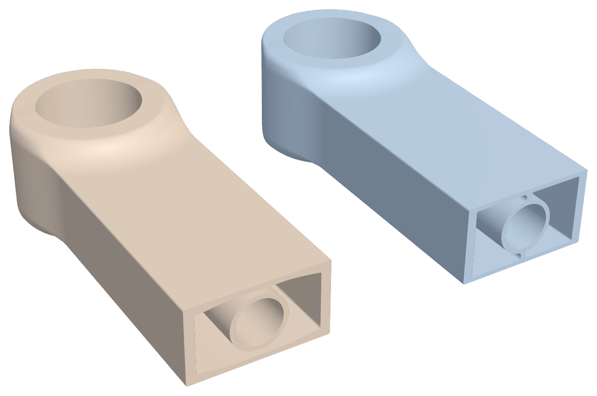
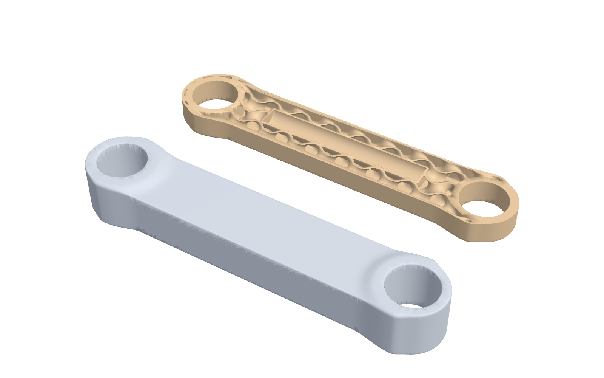

# Arm link: choosing the core for the process

## Problem

The arm link (140 mm between joints, 22 mm bearing seats, a cable channel,
PA12) is limited by stiffness: it must deflect at most 0.5 mm at the wrist
under a 40 N payload and a 15 N side load, with a safety factor of 3. Free-form
topology optimization gets it to 54.2 g. Inside the same envelope it could
also be a hollow skin, a box section, or a skin over a lattice. Which is
lightest depends on the analysis. Which can be printed depends on the
process: a hollow part with a flat roof over a sealed cavity prints on SLS,
where loose powder holds the roof up and drains out of escape holes, but on
FDM the roof needs support that can never be removed.

## Setup

- **Loads and goal:** the arm-link eval study (40 N payload, 15 N side load,
  0.5 mm deflection limit, SF 3, PA12).
- **Options:** four field graphs with tunable numbers
  ([`examples/fields/arm-link-cores.json`](../../examples/fields/arm-link-cores.json)):
  a hollow link with a stress-graded skin; a box section with one 1 mm rib
  and graded walls; the same box with uniform walls; a sandwich of graded
  skin over a gyroid core.
- **Method:** `loadpath cores` tunes each option to the lightest version
  that meets the goal (each candidate meshed and analysed), then reads each
  tuned part the way each process builds it. FDM rejects an option with
  more than 50 mm² of support trapped inside a sealed cavity. SLS and MJF
  accept sealed cavities and add escape holes for the powder.
- **Baselines:** the free-form topology-optimized link from the eval suite
  (54.2 g) and a tuned solid web (54.9 g), both under the same loads.

## Results

| Option | Mass | Deflection (limit 0.5 mm) | Support trapped inside | FDM | SLS / MJF |
| --- | --- | --- | --- | --- | --- |
| Free-form topology optimization (baseline) | 54.2 g | 0.489 mm | not checked | | |
| Tuned solid web (baseline) | 54.9 g | at the limit | 0 | yes | yes |
| Hollow, graded skin | **36.8 g** | 0.484 mm | 2,811 mm² | no | **chosen** |
| Box, graded walls, rib | 42.0 g | 0.493 mm | 0 | **chosen** | yes |
| Box, uniform walls, rib | 43.6 g | 0.494 mm | 0 | yes | yes |
| Sandwich, gyroid core | 44.0 g | 0.465 mm | 725 mm² | no | yes |

- **For FDM: the graded box section, 42.2 g**, after one correction (below).
  That is 23% under the solid web and 22% under free-form topology
  optimization, and it prints flat with nothing supported inside: each roof
  span is a bridge of at most about 13 mm over the rib.
- **For SLS and MJF: the hollow link, 36.8 g** (about 37.5 g with the same
  correction), 33% under the solid web, with escape holes for the powder.
- **Grading had to respect the process.** A stress-graded skin thins the
  box's roof toward the middle, which turns a flat bridge into a shallow
  ramp that needs support. A ribbed hollow with a graded skin still trapped
  1,400 mm² of support. The box therefore grades its walls along the link
  only, so each layer's roof stays flat.
- **Correction for thin walls.** On the fully resolved mesh (1.2 million
  cells at 0.33 mm), thin solid walls read about 3% less stiff than on the
  tuning grid: the hollow link 0.501 mm against 0.484, the graded box 0.506
  against 0.493. The FDM reference design
  ([`arm-link-box-graded.json`](../../examples/fields/arm-link-box-graded.json))
  therefore deepens the web 0.12 mm each side: 42.2 g at 0.492 mm on the
  resolved mesh.



The sandwich (44.0 g) is the most interesting to look at and loses on both
processes: it is heavier than the hollow link for SLS and traps support for
FDM.



## Limitations

- **Simulation only.** Deflections come from loadpath's voxel analysis,
  confirmed on resolved meshes. No link has been printed and measured.
- **Thin walls are where the model is weakest.** The 3% difference between
  grids is corrected for in the reference design, but walls of 1-2 mm are
  also where print quality (perimeter count, layer bond) matters most and
  where datasheet stiffness is least reliable.
- **The trapped-support check is a stencil.** It flags every 45° patch over
  a sealed void; the 50 mm² limit allows a few stray cells. A slicer's
  support may differ.
- **Escape holes weaken the SLS part slightly.** On a drained lattice link
  14 holes left SF essentially unchanged (13.5 vs 13.4) and made it 10% less
  stiff; the hollow link's holes are not included in the 36.8 g number.

## Reproduce

```bash
loadpath cores examples/fields/arm-link-cores.json --out cores-out
```

Each option is tuned by many meshed analyses, so the first run is slow;
tuned options are cached in the output folder and reused.
