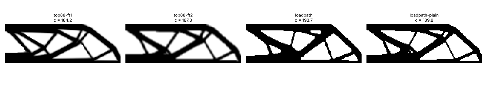
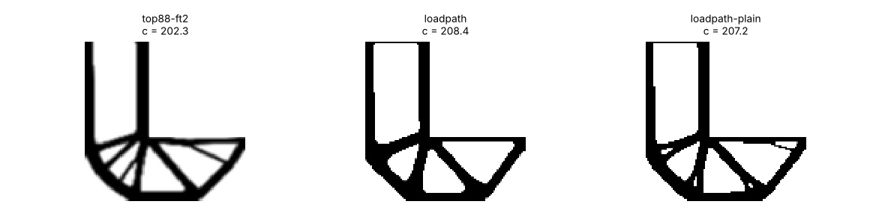
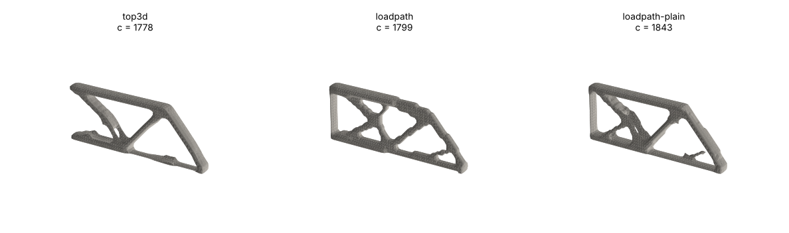
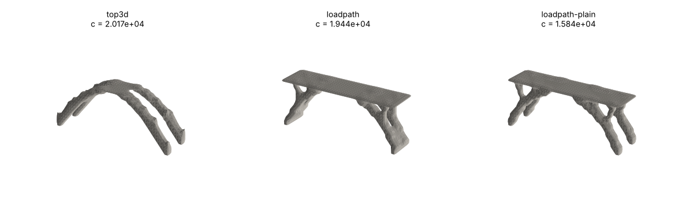
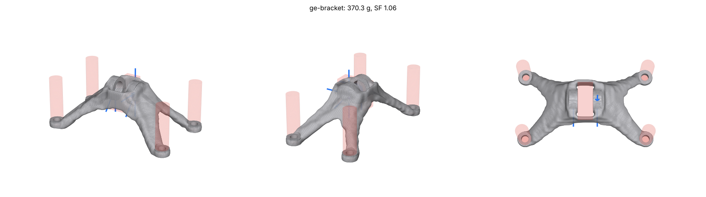

# Benchmarks against top88 and top3d

## Problem

The eval suite asks whether a part is good enough to print. It does not
say how close loadpath's optimizer gets to the best layout. For that,
loadpath is compared with the two codes topology-optimization papers
benchmark against: top88 (Andreassen et al. 2011, 2D) and top3d (Liu and
Tovar 2014, 3D), on their textbook problems.

## Setup

- **References:** line-for-line NumPy ports of top88 (sensitivity filter
  and density filter) and top3d. Running the original MATLAB files in
  Octave was not possible in the environment used, so the ports are what
  was run. On top3d's default problem the port ends at a compliance of
  2418.2 after 133 iterations; a top3d run quoted at 2417.5 was found, but
  without its parameters, so that agreement is suggestive, not proof.
- **Problems:** the MBB beam (2D, 150 x 50, 50% material), an L-bracket
  (2D, 100 x 100, 40%), top3d's cantilever (60 x 20 x 4, 30%) and a 3D
  bridge (48 x 12 x 16, 15%). Each problem is defined once and drives the
  reference, loadpath and the scorer, so all three see the same supports
  and loads.
- **Equal material:** loadpath's volume fraction is lowered to account for
  the cells it pins solid under loads and supports, so the total material
  matches the reference.
- **Scoring:** one evaluator scores every design twice, as delivered
  (penalized, p = 3) and as black-and-white at the target volume, and
  keeps the lower (stiffer) reading. That is the most generous reading of a
  grey reference design.
- **"loadpath, plain"** turns off the three things loadpath adds for
  printability: the robust (eroded) minimum-member formulation, the
  boundary-padded filter and dead-material pruning.

## Results

Compliance, lower is stiffer, all designs at equal material:

| Problem | Best reference | loadpath | loadpath, plain | Iterations (ref / loadpath) |
| --- | --- | --- | --- | --- |
| MBB beam 2D | 184.2 (top88, sensitivity filter) | 193.7 (+5.2%) | 189.8 (+3.0%) | 206 / 60 |
| L-bracket 2D | 202.3 (top88, density filter) | 208.4 (+3.0%) | 207.2 (+2.4%) | 409 / 57 |
| Cantilever 3D | 1778 (top3d) | 1800 (+1.2%) | 1843 (+3.7%) | 133 / 57 |
| Bridge 3D | 20170 (top3d) | 19440 (-3.6%) | 15840 (-21.5%) | 172 / 58 |

| | |
| --- | --- |
|  |  |
|  |  |

What it says:

- **On the 2D problems loadpath is 3-5% less stiff than top88 at the same
  material, and 1.2% on the 3D cantilever.** Turning off the printability
  features brings the MBB beam to within 1.3% of top88's density filter,
  so most of the gap is the price of printable members. Most of the rest is
  how fast loadpath sharpens its projection (below).
- **On the bridge loadpath is stiffer** because top3d's design is grey: it
  scores 20170 as a grey field, but thresholded to a real part it falls
  apart (compliance about 8e9).
- **loadpath converges in 57-60 iterations against 130-410**, and always
  delivers a crisp design (greyness 0.01 against 0.13-0.27).
- **Minimum mass under a stress limit** (`goal.method: "constrained"`): on
  the L-bracket, with top88's peak stress as the limit, loadpath reaches
  30.2% volume at a peak of 0.934 of that limit, 25% less material than the
  stiffness designs need for the same peak.

**A slower projection schedule is stiffer but not lighter.** Sharpening the
projection every 20 iterations instead of 10 makes every benchmark design
stiffer (0.2-12%) for twice the iterations. On the eval suite the same
change made the small parts 2-14% heavier at their target safety factor,
because a safety-factor search pays for peak stress, not stiffness. It is
available as `beta_schedule` and is not the default. Lesson: stiffer on
these benchmarks does not mean lighter at a safety factor.

**GE bracket challenge.** The 2013 GE/GrabCAD bracket, set up from the
challenge's four load cases in Ti-6Al-4V: 370 g at safety factor 1.06
against yield, 79.6% lighter than the 1.81 kg original, level with the
winning entries' "about 80%" (Carter et al. 2014). The envelope is an
approximate box, roomier than the original's L shape, the bolt positions
are assumed, and the check is loadpath's own analysis, so this compares
only roughly.



**Compliant mechanisms.** On the force inverter and gripper, loadpath's
linear mechanism optimizer is within 1-2% of a port of Sigmund's 99-line
mechanism code at equal volume ([MECHANISMS.md](../MECHANISMS.md)).

## Limitations

- The references are ports, not the original MATLAB runs.
- These are compliance (stiffness) benchmarks. They test the optimizer,
  not whether a printed part holds its load.
- No Fusion 360 generative design case study publishes geometry, loads and
  results complete enough to reproduce, so there is no direct Fusion
  comparison.
- Compliance designs from loadpath keep sharp re-entrant corners. On the
  L-bracket its peak stress is above top88's at the same volume.

## Reproduce

```bash
python -m loadpath.benchmarks.run --out bench-out/          # every problem
python -m loadpath.benchmarks.run --refresh                 # rerun the references too
python -m loadpath.benchmarks.mechanisms
```

Full tables, method and the open gaps: [BENCHMARKS.md](../BENCHMARKS.md).
