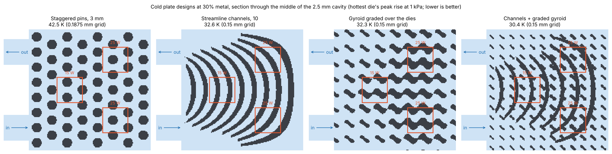

# Liquid cold plate: lattices against channels and pins

## Problem

A printed metal cold plate can have any internal shape: pin fins, curved
channels, or a TPMS lattice graded to put metal where the heat comes in.
Lattices are often claimed to be better heat exchangers. The question is
whether a lattice actually beats well-drawn conventional designs when all
of them hold the same metal and see the same pressure drop.

This plate was chosen to give a lattice its best chance: water, several
heat sources at different powers, and a flow path that turns, so straight
channels cannot simply run end to end.

## Setup

[`bench/cold_plate.py`](../../bench/cold_plate.py), results in
[`bench/cold_plate.json`](../../bench/cold_plate.json):

- **Plate:** 24 x 24 mm AlSi10Mg (LPBF), 1.5 mm base, 2.5 mm cavity under
  an adiabatic lid. Inlet and outlet on the same side, so the water makes a
  U-turn.
- **Heat:** three 5 x 5 mm dies under the base, 25 W, 25 W and 15 W.
- **Every design** holds 30% of the cavity in metal connected to the base,
  and is rated at the same 1 kPa from inlet to outlet.
- **Rating:** lattice-Boltzmann water flow through the plate
  (`flow.network_flow`), then solid and water heat in one finite-volume
  solve (`conjugate.py`). Energy balance closes to 1e-6.
- **Score:** the hottest die's peak temperature rise over the inlet water.
  Lower is better.
- **Designs:** each family's one parameter was swept on a coarse grid, and
  the best of each family was rated on finer grids:
  - staggered pin fins (the usual printable default),
  - curved channels that follow the streamlines of the empty cavity's flow
    (not naive straight channels),
  - a uniform gyroid,
  - a gyroid graded over the dies (denser where heat enters),
  - a hybrid: thinner streamline channels with a die-graded gyroid inside.

## Results



Hottest die rise in kelvin, by grid size:

| Design (best of its family) | 0.25 mm | 0.1875 mm | 0.15 mm |
| --- | --- | --- | --- |
| Staggered pin fins, 3 mm pitch | 43.1 | 42.5 | |
| Uniform gyroid, 3 mm cells | 42.0 | 39.4 | |
| Streamline channels, 10 channels | 40.4 | 35.3 | 32.6 |
| Gyroid 3 mm, graded over the dies | **35.9** | 35.4 | 32.3 |
| Hybrid: 8 streamline channels + die-graded 2 mm gyroid | | **32.8** | **30.4** |
| Channels with walls graded over the dies | | 34.3 | |

Against the streamline channels, the strongest conventional design:

- **The graded gyroid ties the channels.** It is 1% ahead on the 0.15 mm
  grid and 0.3% behind on the 0.1875 mm grid. Every design still drops by
  about 8% per grid refinement, so differences of a few percent are inside
  the grid error.
- **Grading is what makes the lattice competitive.** The graded gyroid
  beats the uniform gyroid by 10% and the pins by 17% on the 0.1875 mm
  grid. Those gaps are larger than the grid error.
- **The hybrid wins by 7%** on both fine grids (32.8 vs 35.3 K and 30.4 vs
  32.6 K). The channels steer the water around the U-turn, and the graded
  lattice inside them takes heat out where the dies are. Grading the
  channel walls alone gained 3%.

**The air-cooled heat sink tells a different story.** In the companion
air-sink benchmark ([BENCHMARKS.md](../BENCHMARKS.md)), gyroids beat
loadpath's earlier solid topology optimization by 22-40%, but they did not
beat straight plate fins: plates won by 10% on the finer grid and by 2% on
a second geometry. A first look on the coarse grid had the lattice ahead,
and that lead disappeared with grid refinement. Lattices are not
automatically better heat exchangers; here they won only where the heat
and the flow path were uneven enough that plates or channels could not
follow them.

## Limitations

- **Simulation only, not grid-converged.** Results still move about 8% per
  refinement, and the finest runs take about 35 minutes each. Treat
  differences under about 5% as ties. No plate has been printed or tested.
- **One geometry.** Three dies on a 24 mm plate with a U-turn. Other
  layouts may rank differently.
- **Laminar flow only.** The heat solver is not reliable above a Reynolds
  number of about 2000.
- **Printability is not checked here.** The 0.5 mm channel walls and the
  2 mm gyroid cells are near the limit of what LPBF resolves, and powder
  removal from a 2.5 mm cavity is not modelled.
- **Grading is by die position**, not from the computed temperature field.
  Grading from the conjugate solution is the obvious next step.
- **Flow-aware topology optimization** (`flowtopo.py`) was tried on the air
  sink and is not yet competitive, so there is no free-form optimized
  design in this comparison.

## Reproduce

```bash
python bench/cold_plate.py --pitch 0.25 --dp 1000 --out cold_plate_025.json          # coarse sweep, resumes per design
python bench/cold_plate.py --pitch 0.15 --dp 1000 --only graded-3-s4,channels-10,hybrid-8-2 --out cold_plate_015.json
python bench/cold_plate_render.py      # the section image above (geometry only, seconds)
```
