# The eval suite: 15 parts with hard requirements

## Problem

An optimizer can look good on the problems it was tuned on and fail on the
next part. loadpath keeps a fixed set of real parts, each with requirements
it must meet, and reruns all of them after any change to the solver. A
change that makes any part fail, or heavier at its target safety factor by
more than 5%, is a regression.

## Setup

Each case is a loadpath study (`loadpath/evals/cases/*.json`) plus a list of
checks on the delivered mesh: mass, safety factor, deflection, keep-out
intrusion, lost interface geometry, number of bodies, thinnest member, and
process checks where the case has a process. The cases:

| Case | Material, process | Goal | What it exercises |
| --- | --- | --- | --- |
| arm-link | PA12 | SF 3, 0.5 mm at the wrist | A 140 mm robot-arm link with 22 mm bearing seats and a cable channel; 40 N payload, 15 N side load. Stiffness-bound. |
| arm-link-driven | PA12 | SF 3, 0.5 mm | The same link held the way a servo holds it: a pin at the shoulder, driven through four M3 horn holes. |
| arm-link-cast | PA12 | SF 3, 0.5 mm | The same link with no undercuts along z (two-part mold). |
| arm-link-sandwich | PA12 | SF 3, 0.5 mm, under 45 g | The link as a field graph: graded skin over a gyroid core. Must also reject a 38 g variant that deflects too much. |
| bell-crank | AlSi10Mg, LPBF | SF 3, 0.1 mm | An aluminium linkage crank, 500 N on one arm. |
| grip-turret | PA12-GF, SLS | SF 2, under 236 g | GRIP's turret: J1 bolt ring with driver access, J2 drive socket, motor and spring anchor. |
| grip-upper-arm | PA12-GF, SLS | SF 2, 0.54 mm, under 214 g | GRIP's upper arm with drive sockets, motor, cable run and driver access. |
| grip-wrist-yoke | PA12-GF, SLS | SF 2, under 26 g | GRIP's wrist yoke: a servo horn hub below and a servo cradle above. |
| grip-wrist-link-mjf | PA12, MJF | SF 2, under 46 g | GRIP's wrist link in MJF, with powder-bed checks (walls, trapped powder, warp-prone panels). |
| mbb-beam | PA12 | SF 1.5 | The textbook simply supported beam. |
| motor-mount | PETG, FDM | three fixed volume fractions | A NEMA 17 bracket; the motor body is an STL keep-out. |
| printed-hook | PETG, FDM upright | SF 2.5, no support | A wall hook carrying 300 N at 92 mm, printed without support. |
| wall-bracket | PLA, FDM | SF 2.5 | A 120 x 100 mm shelf bracket on two M5 screws, 150 N. |
| wall-bracket-fasteners | PLA, FDM | SF 2.5 | The same bracket with its screws modelled as fasteners with preload. |
| lpbf-intercooler-core | AlSi10Mg, LPBF | effectiveness 0.7, pressure-drop limits | A two-fluid gyroid heat exchanger with no unsupported internal ceilings and a powder clean-out per fluid. |

Each safety-factor case searches over volume fractions for the lightest
part that meets its goal. The search's pick is then re-meshed as an STL and
checked by a fresh analysis on a tetrahedral mesh of that STL (P2 elements,
150,000-cell voxel grid for the comparison), so the reported numbers belong
to the delivered part, not to the optimizer's density field.

## Results

Full tier, baseline saved at commit `d044a51` (2026-11-01), on a 4-core,
15 GB cloud machine with two cases at a time. All 15 cases pass. Total
compute time is about 4.3 hours.

"Solid" is the design space filled solid: the mass of the envelope the
part was allowed to occupy. It is an easy baseline. A part that is 90%
lighter than its envelope is not 90% lighter than a part a person would
draw. For comparisons with real, conventionally designed parts, see the
[GRIP case study](grip.md) and the GE bracket in [benchmarks](benchmarks.md).

| Case | Mass | Solid envelope | SF (goal) | Deflection (limit) | What sets the size |
| --- | --- | --- | --- | --- | --- |
| arm-link | 54.2 g | 125.3 g | 10.5 (3) | 0.489 mm (0.5) | deflection |
| arm-link-driven | 51.3 g | 124.5 g | 12.5 (3) | 0.362 mm (0.5) | search step* |
| arm-link-cast | 67.8 g | 125.3 g | 20.5 (3) | 0.478 mm (0.5) | deflection, no undercuts |
| arm-link-sandwich | 42.7 g | | 9.0 (3) | 0.438 mm (0.5) | fixed design (field graph) |
| bell-crank | 22.0 g | 150.7 g | 3.01 (3) | 0.090 mm (0.1) | stress |
| grip-turret | 142.1 g | 1651 g | 2.45 (2) | 0.767 mm | interfaces (see below) |
| grip-upper-arm | 208.1 g | 1692 g | 5.83 (2) | 0.515 mm (0.54) | deflection |
| grip-wrist-yoke | 22.0 g | 248.3 g | 4.34 (2) | 0.112 mm | search step* |
| grip-wrist-link-mjf | 31.4 g | 773.5 g | 2.02 (2) | 0.938 mm | stress (layered, tet-checked) |
| mbb-beam | 14.5 g | 65.4 g | 1.52 (1.5) | 2.93 mm | stress |
| motor-mount | 27.6 g | 89.2 g | 4.07 | 0.431 mm (0.5) | fixed fraction (trade-off set) |
| printed-hook | 27.4 g | 151.4 g | 2.79 (2.5) | 1.04 mm | stress, overhangs |
| wall-bracket | 64.4 g | 419.2 g | 2.85 (2.5) | 0.199 mm (1.5) | stress |
| wall-bracket-fasteners | 41.0 g | 421.6 g | 2.95 (2.5) | 0.552 mm (1.5) | stress |
| lpbf-intercooler-core | 131.8 g | | | | effectiveness 0.77 (0.7), 1.0 mm wall between fluids, 126 mm² flat ceiling (limit 200) |

\* The search brackets in volume-fraction steps. The next lighter step
(48.5 g for arm-link-driven, about 20 g for the yoke) did not meet the goal
on the delivered mesh, so the lightest passing step is reported, with margin
to spare.

A high safety factor on a stiffness-bound part (the arm links, the upper
arm) is expected: the deflection limit sizes the part, and stress is far
from the limit.

| | | |
| --- | --- | --- |
| 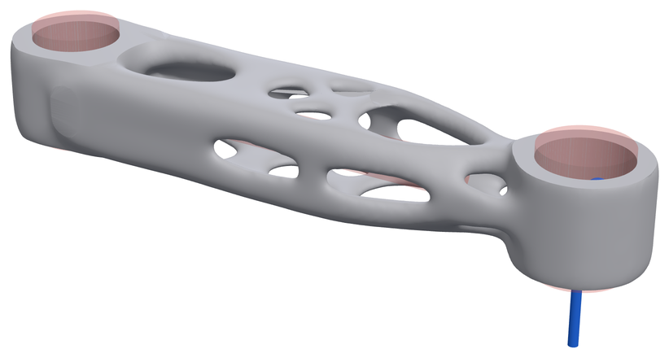 | 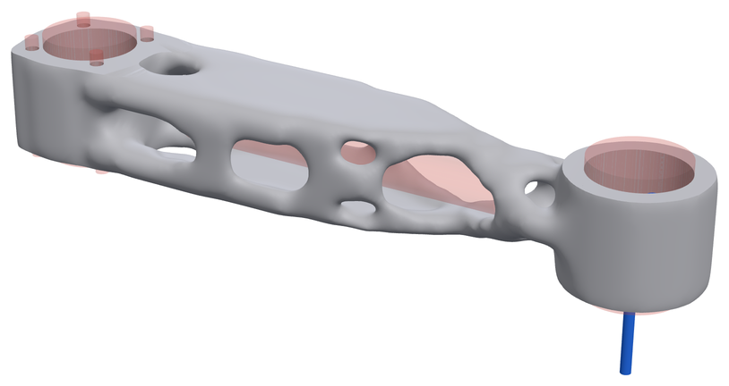 | 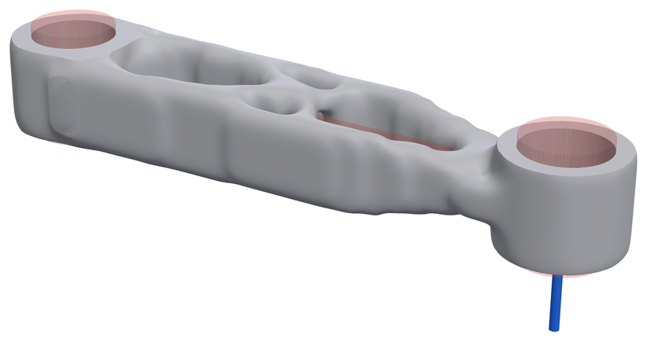 |
| arm-link | arm-link-driven | arm-link-cast |
| 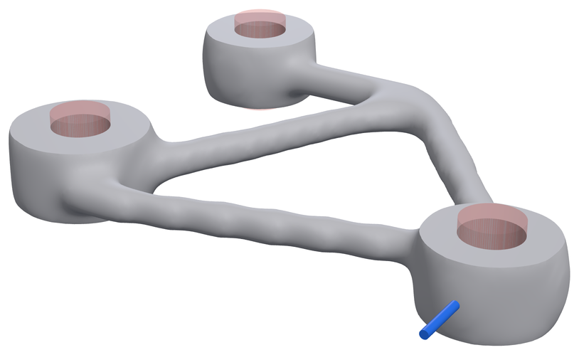 | 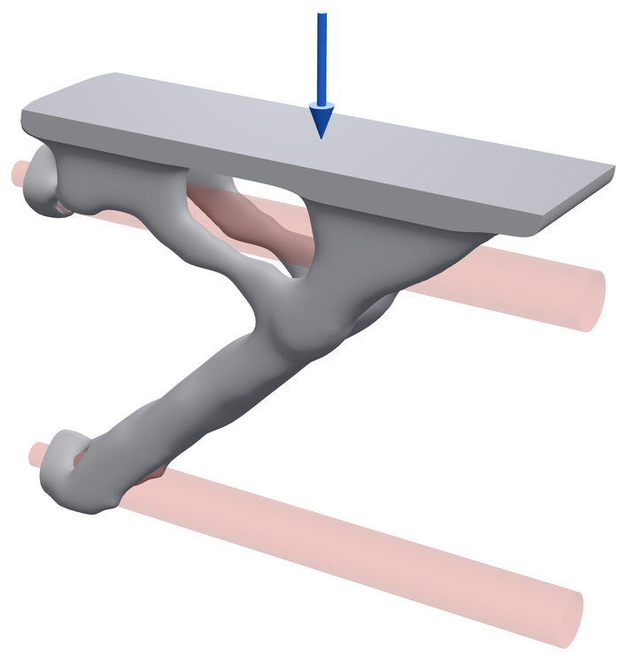 | 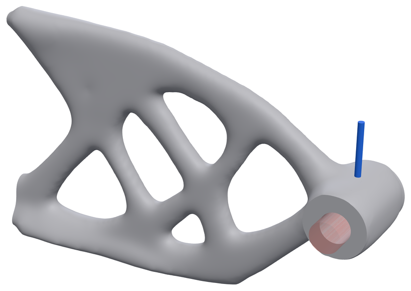 |
| bell-crank | wall-bracket | printed-hook |
| 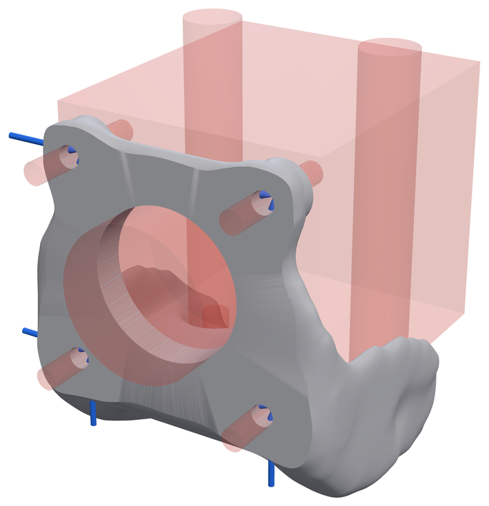 | 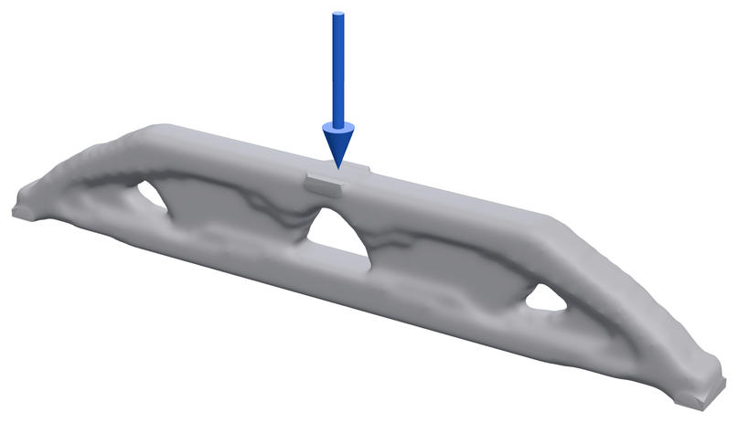 | 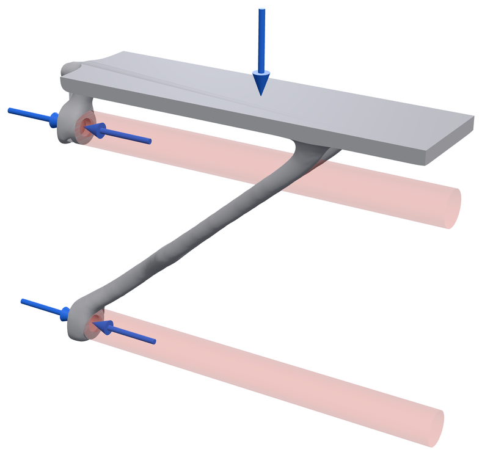 |
| motor-mount | mbb-beam | wall-bracket-fasteners |

Stress on the delivered part, worst load case, blue (none) to red (the
part's 98th percentile):

| | | |
| --- | --- | --- |
| 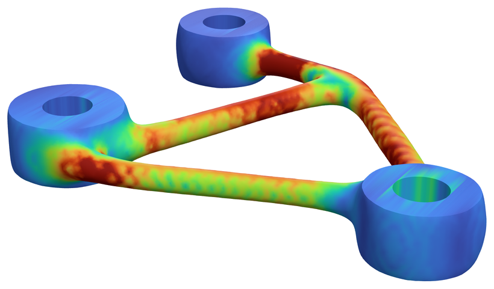 | 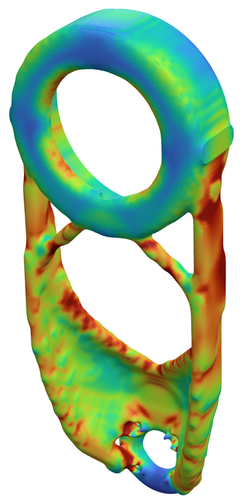 | 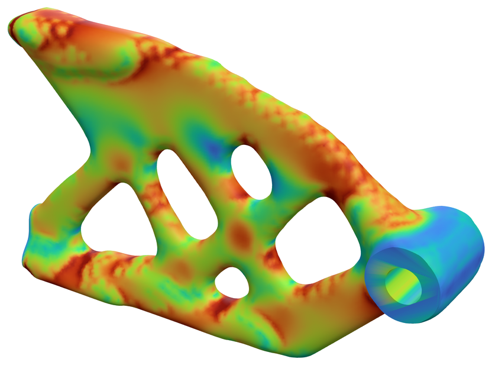 |

Renders are from the run at `063c233`, the baseline before `d044a51`.
Thirteen of the parts are the same in both. The MJF wrist link (41.0 g in
the render, 31.4 g now) and the bell crank (23.8 g in the render, 22.0 g
now) changed: the newer run checks layered (printed) parts on tetrahedra
too, and tet meshes vary slightly from run to run. Every view and stress
map is in [GALLERY.md](../GALLERY.md).

## Limitations

- **All numbers are simulation.** The analysis is linear elastic with
  datasheet material values. No part in the suite has been printed and
  tested ([VALIDATION.md](../VALIDATION.md)).
- **The turret's tet check disagrees with its voxel check.** The voxel
  check reads SF 2.45. The tet check reads 1.2-1.4 at a wall beside a J1
  bolt's driver access, below the goal of 2, and no heavier outcome fixed it.
  The case falls back to the voxel reading with a warning. About 76% of the
  turret's mass is fixed interface geometry, so the optimizer has little
  room to move there. Treat the turret as unresolved.
- **Run-to-run spread.** Restarting the search from a different volume
  fraction moves mass at the target safety factor by 3.5-7%; a 3% change of
  grid pitch moves it by about 5% (median). Mass differences under about 5%
  between runs are noise.
- **Tet meshes are not deterministic.** fTetWild meshes change from run to
  run, which moves tet readings by about 3%.
- **The suite is small and GRIP-heavy.** A generated corpus of brackets,
  links and three-point mounts (`--corpus N`) runs in the coarse tier to
  catch fixes that only help the hand-written cases.

## Reproduce

```bash
pip install -e ".[crosscheck]"        # the tet mesher; the full tier refuses to run without it
python -m loadpath.evals.run --out evals-out/                     # full tier, hours
python -m loadpath.evals.run --tier coarse --corpus 6 \
    --baseline loadpath/evals/baselines/coarse.json --gate regressions   # coarse tier, under 30 min
```

The exit code is the number of failing cases. `evals-out/scorecard.md` has
the table above; `loadpath/evals/baselines/full.json` holds the numbers
quoted here.
