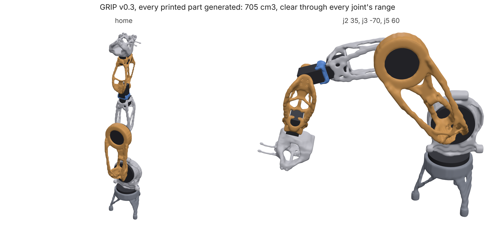
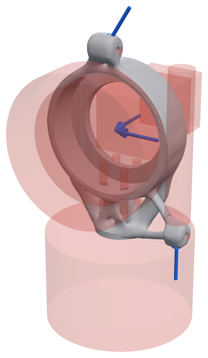
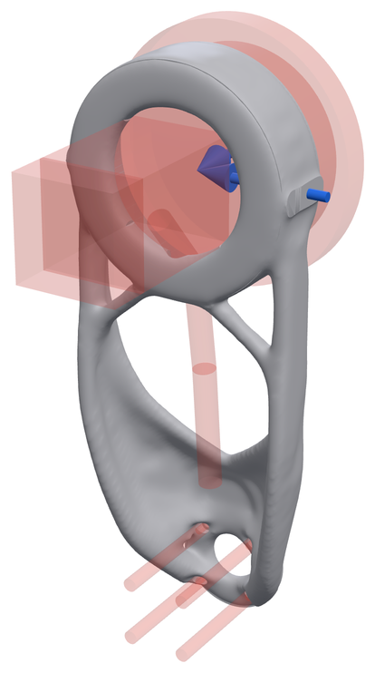
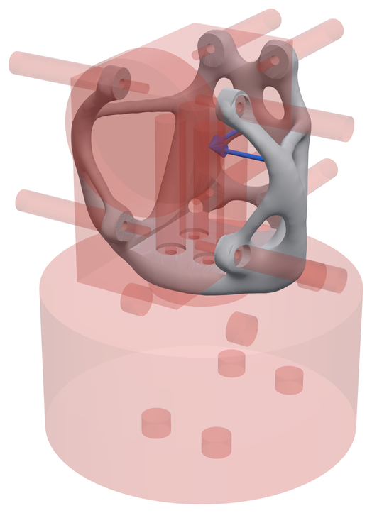

# GRIP: the links of a printed 6-axis robot arm

## Problem

[GRIP](https://github.com/connorwhite-online/grip) is an open-source 6-axis
robot arm whose structural links are printed in SLS nylon. Each link has
real interfaces that cannot move: servo cradles and their screw bosses,
horn hubs, cycloidal-drive sockets with hex-driver access to every bolt,
motor mounts, cable runs and a counterbalance spring. The question is
whether loadpath can design these links from their interfaces and loads,
and whether the loads it is given are the right ones.

## Setup

- **Studies.** One study per link, written by GRIP's own generator
  (`generative/v3.py`) and copied into
  [`examples/grip/studies/`](../../examples/grip/studies/). Material: SLS
  PA12-GF. Goal: safety factor 2.
- **Hand-written loads** (GRIP's originals): the arm at full reach with 1 kg
  at the gripper and a 1.5x dynamic factor, each joint above at its rated
  torque, and a 20 N push along the joint's axis.
- **Derived loads** (`loadpath assembly`, [`derive.py`](../../examples/grip/derive.py)):
  about 11,000 states per link swept from GRIP's URDF. Limit poses and
  random poses; the same poses moving at the URDF speed limits with 0.2 s
  ramps, cut back to what each joint's rated torque can deliver; a 0-1 kg
  payload; a 20 N push at the tool in any direction; each upstream joint
  stalled against an obstacle. These collapse to two or three governing
  cases per link.
- **Baseline.** GRIP's committed v0.3 parts. These were themselves made by
  an earlier version of loadpath with the hand-written loads, so this is a
  comparison against previous loadpath code and older load assumptions,
  not against hand-drawn parts.
- **Checks.** Every part is re-verified on a 150,000-cell grid. GRIP's
  `assembly_check.py` intersects every part with every other part, the
  drives, servo bodies and horns, at home and through each joint's range
  in 10° steps.

## Results

### 1. The hand-written loads were missing the worst cases

GRIP's committed parts, analysed under both load sets:

| Link | Mass | SF, hand-written loads | SF, derived loads |
| --- | --- | --- | --- |
| Turret | 236 g | 2.67 | 2.13 |
| Upper arm | 179 g | 2.81 | **0.93** |
| Forearm | 78 g | 4.20 | **0.69** |
| Wrist yoke | 24 g | 2.89 | **0.61** |
| Wrist link | 67 g | 4.23 | 1.72 |

The derived peak loads are not much larger (1.35x on the upper arm). What
changes is direction. Every hand-written case loads the links in the arm's
plane. J1 swinging the arm, or a sideways push at the tool, bends them out
of that plane, about an axis the optimizer was never asked to make stiff.
Three of the five links fail their goal under loads the arm can actually
apply. This is the most useful result of the GRIP work, and it came from
the load sweep, not from the optimizer.

### 2. The whole arm, regrown under the derived loads



| Part | Committed | Regrown | SF |
| --- | --- | --- | --- |
| Base | 189.0 cm³ | 124.8 cm³ | 5.37 |
| Turret | 205.2 cm³ | 174.6 cm³ | 2.59 |
| Upper arm | 176.6 cm³ | 182.7 cm³ | 2.08 |
| Forearm | 90.0 cm³ | 76.8 cm³ | 2.37 |
| Wrist yoke | 77.8 cm³ | 10.6 cm³ | 2.35 |
| Wrist link | 80.0 cm³ | 42.9 cm³ | 3.42 |
| Palm | 38.4 cm³ | 92.7 cm³ | 4.25 |
| **All printed parts** | **857 cm³** | **705 cm³ (-18%)** | ≥ 2.08 |

Every regrown part meets SF 2 under loads that three of the committed parts
fail, and the set is 18% smaller by volume. The assembly check finds no
overlap at home or anywhere in the joint ranges. The palm grew because it
now carries the hand's real loads.

### 3. The links sized together

Sizing each link with the URDF's masses treats every link as if it carried
the old, heavier parts beyond it. [`coopt.py`](../../examples/grip/coopt.py)
(`loadpath.coopt`) puts the regrown parts' real masses back into the URDF,
re-sweeps the loads, and regrows links from the tip to the base until no
link's loads move by more than 2%. A regrown part replaces the current one
only if it is lighter or the current one fails.

| Link | Sized alone | SF | Sized together | SF |
| --- | --- | --- | --- | --- |
| Wrist link | 52.3 g | 4.60 | 52.3 g (kept) | 4.60 |
| Wrist yoke | 13.0 g | 2.24 | 10.9 g | 2.01 |
| Forearm | 93.8 g | 2.73 | 93.8 g (kept) | 2.73 |
| Upper arm | 222.9 g | **1.89** | 260.3 g | 2.59 |
| Turret | 213.0 g | 2.78 | 203.1 g | 2.66 |
| Printed links | 595.0 g | | 620.4 g | |

- It converged in one pass: a link's loads depend only on the masses beyond
  it, which a tip-to-base pass has already settled.
- The arm got heavier, not lighter. The real masses beyond J3 are 30%
  lower, but link loads moved only 9-14%, because they are set by joint
  stalls and the 20 N tool push, which the motors' torque limits bound, not
  by inertia. What did change is which cases govern each link: the upper
  arm sized alone reads SF 1.89 under its own arm's sweep (J1 stalled
  sideways), so its extra 37 g is a correction.
- Payload: the arm can hold 1.24 kg still anywhere in range. The J4 servo
  (STS3215, 2.9 N·m) is the limit, not the printed parts. Moving at the
  URDF speed limits with 0.5 s ramps it carries 0.42 kg.

### 4. The eval versions

Three links run in the [eval suite](evals.md) with tighter settings. Against
GRIP's committed parts (hand-written loads in both):

| Link | Committed | Eval part | SF (goal 2) |
| --- | --- | --- | --- |
| Turret | 236 g | 142.1 g | 2.45 voxel; 1.2-1.4 on tets at one wall (unresolved) |
| Upper arm | 179 g | 208.1 g | 5.83, deflection 0.515 mm of 0.54 |
| Wrist yoke | 24 g | 22.0 g | 4.34 |

The eval upper arm is heavier than GRIP's because the eval adds a
deflection limit the committed part was not sized for.

| | | |
| --- | --- | --- |
|  |  |  |
| turret | upper arm | wrist yoke |

## Limitations

- **Simulation only.** No GRIP link has been load tested. A bench test of
  the PETG wrist yoke is designed (`examples/grip/yoke_test.py`, predicted
  1.13 mrad of rotation per kg) and waiting on a print.
- **Fatigue is not settled.** On the PA12 fatigue curve the links read a
  fatigue safety factor of 0.91-2.20 when every cycle is at the governing
  peak, and 1.76-3.47 with the sweep's own spread of states as the duty
  spectrum. Which is closer to real use depends on how the arm is driven.
- **The derived loads rest on assumptions.** The 0.2 s ramps and the 20 N
  tool contact drive the governing cases. Both are worth questioning
  against what GRIP's controller actually commands.
- **Run-to-run spread is as large as some effects.** Regrown under new
  loads, the forearm came out at 112 g while the 94 g part still carried
  those loads at SF 2.73. That is why a regrown part only replaces a
  lighter passing one if it is lighter still.
- **The turret's tet check fails at one wall** (see above).

## Reproduce

Needs a checkout of GRIP next to loadpath. Each step takes about an hour on
4 cores.

```bash
python examples/grip/run.py                                       # regrow the five links
python examples/grip/derive.py --grip ../grip                     # derive loads, verify committed parts
python examples/grip/run.py --loads derived                       # regrow under derived loads
python examples/grip/coopt.py --grip ../grip --build DIR run      # size the links together (resumable)
python examples/grip/coopt.py --grip ../grip --build DIR report
```

Numbers: [`examples/grip/README.md`](../../examples/grip/README.md),
[`examples/grip/derived/coopt.json`](../../examples/grip/derived/coopt.json).
