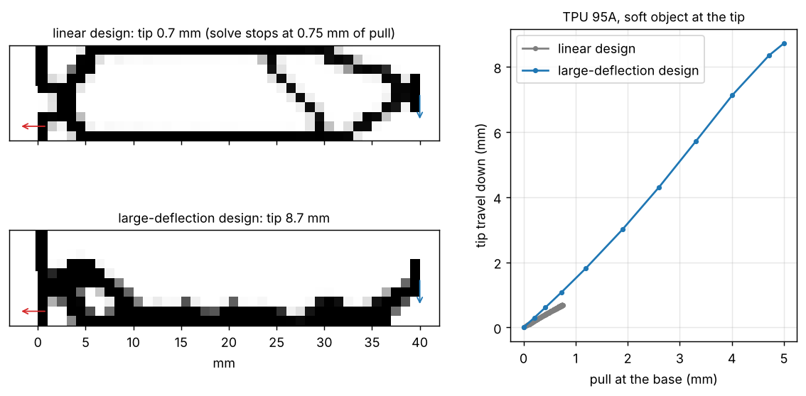
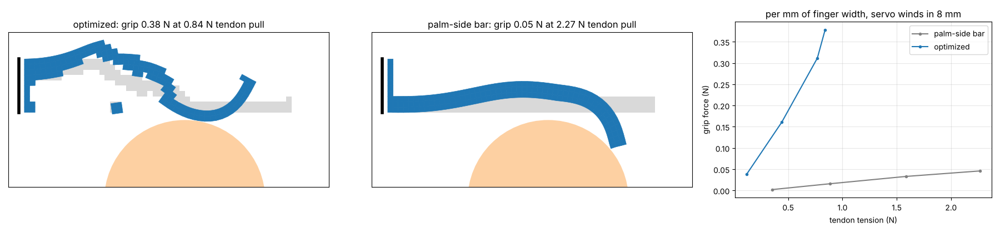

# A TPU finger that curls and grips

## Problem

A soft gripper finger printed in TPU should curl when its base is pulled,
and press on what it holds. Standard compliant-mechanism optimization
designs on the linear (small-deflection) model. A finger moves far past
where that model holds: it rotates, its members swing past their leverage,
and hinges that looked fine at small strokes lock up or tear. The question
is whether optimizing on the large-deflection response gives a finger that
works through its whole stroke.

## Setup

**Curling finger** ([`examples/mechanism/curling_finger.py`](../../examples/mechanism/curling_finger.py)):

- A 40 x 10 mm plate of TPU 95A (E = 26 MPa, ν = 0.45), printed flat, 1 mm
  cells.
- Clamped along the top half of its base. A tendon or servo horn pulls the
  bottom of the base 5 mm back. The tip should curl down against a soft
  object (a 0.01 N/mm spring).
- **Baseline:** the same problem optimized on the linear model
  (`mechanism.py`). Both designs use the robust option (eroded, blueprint
  and dilated designs must all work), so neither can rely on one-node
  hinges.
- **Judge:** both designs, thresholded to solid and void, are driven
  through the full 5 mm pull by the large-deflection solver
  (`nonlinear.stroke_mechanism`: total Lagrangian hex8, neo-Hookean,
  Newton).

**Tendon finger** ([`examples/mechanism/tendon_grip.py`](../../examples/mechanism/tendon_grip.py)):

- A 50 x 10 mm TPU 95A finger clamped to a palm. A servo winds in 8 mm of
  cable (cable and servo give modelled as a 0.5 N/mm spring), running from
  a spool behind the palm through guides to a knot at the tip.
- A 30 mm rigid cylinder sits 1.5 mm below the finger. The objective is the
  grip force: the total normal contact force on the cylinder.
- **Baseline:** a plain bar along the palm side with the same volume of
  material.

## Results

**Curling finger**

| | Linear design (baseline) | Large-deflection design |
| --- | --- | --- |
| Tip travel for a 5 mm pull | 0.7 mm (the solve stops at 0.75 mm of pull) | **8.7 mm** (full stroke) |
| One-node hinges | 8 | **0** |
| Pull force at 5 mm | | 7.1 N |
| Peak strain | | 45% (TPU 95A elongation at break is past 400%) |



The linear design is a set of corner hinges. Under a real stroke they lock
and the solve cannot follow it past 0.75 mm of pull. The design optimized
on the large-deflection response curls its tip 8.7 mm for 5 mm of pull,
through the whole stroke.

**Tendon finger** (forces per mm of finger width; a 15 mm wide finger
grips 15 times as much)

| | Plain bar, same volume (baseline) | Optimized |
| --- | --- | --- |
| Grip force | 0.046 N | **0.42 N** (9x) |
| Tendon tension at full wind | 2.27 N | 0.88 N |
| Grip per newton of tendon pull | 0.02 | **0.48** |
| One-node hinges | 0 | 0 |



The optimized finger is a lever, not a wrap. A diagonal strut from the top
of the palm mount carries the tendon's pull into a knee that presses on the
top of the cylinder, while the tip beyond it buckles up out of the way. The
plain bar curls past the cylinder and touches it with one edge.

**What made the large-deflection optimizer work**, all in
`mechanism_nl.py`: Newton steps are damped until no cell inverts; a
sharper projection that cannot reach the stroke is retried rather than
abandoned; and the robust option. Without the robust option the optimizer
finds a grey design whose travel (11-25 mm) runs through partly filled
cells, and thresholding it to a printable part drops the travel to
0.01 mm.

## Limitations

- **Simulation only.** No finger has been printed and tested. A TPU creep
  coupon and crush coupons are in the calibration kit.
- **2.5D plates.** Both fingers are designed as plates of uniform
  thickness. The optimizer is 3D, but GRIP's actual tendon finger
  (`examples/grip/finger.py`) has only the nonlinear analysis so far, not a
  mechanism design. That analysis reads about 2x too stiff with three cells
  across its 2.2 mm flexure; a finer grid (`--pitch 0.55`) removes it.
- **Contact is simplified.** One rigid, fixed cylinder; no friction; no
  second finger or palm opposing the grip. The cable does not touch the
  object, so check its path on the deformed shape.
- **The optimizer cut one tendon guide free** on the tendon finger. Printed,
  it would be a loose bead on the cable; leave it out.
- **Material model.** Neo-Hookean TPU with datasheet modulus. TPU creep
  (modelled separately in `viscoelastic.py`) relaxes grip over time; a TPU
  gripper in [MECHANISMS.md](../MECHANISMS.md) loses about 30% of its grip
  over a day.

## Reproduce

```bash
python examples/mechanism/curling_finger.py     # about 20 min
python examples/mechanism/tendon_grip.py        # about 25 min
python -m loadpath.benchmarks.mechanisms        # the linear optimizer against Sigmund's 99-line code
```
