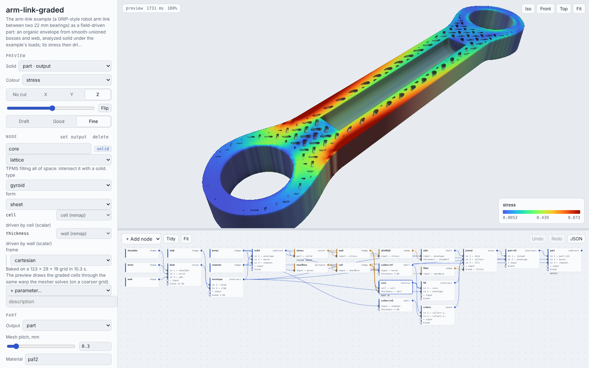
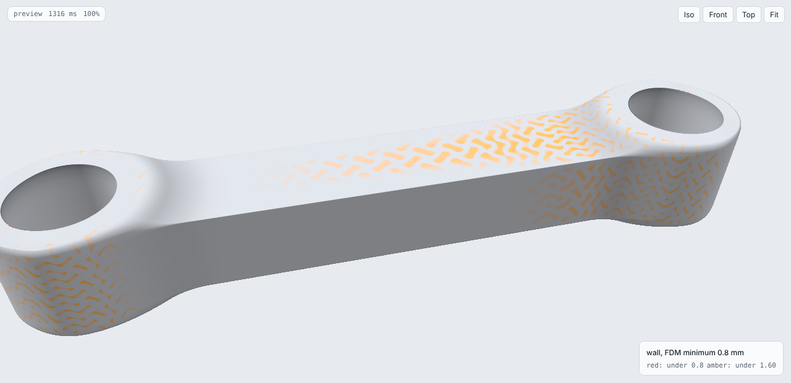
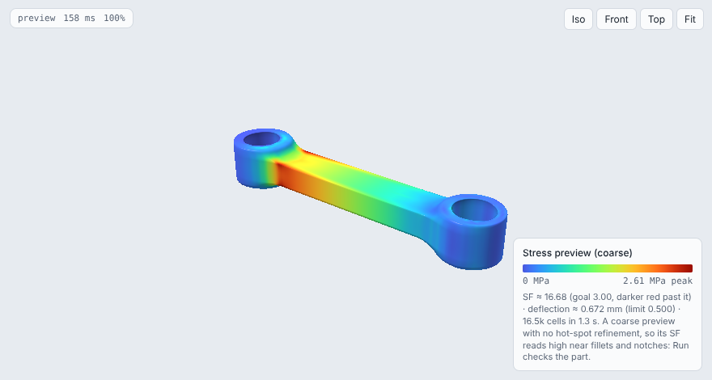
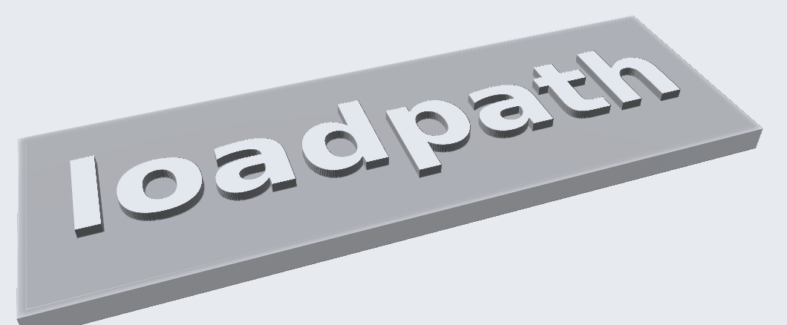
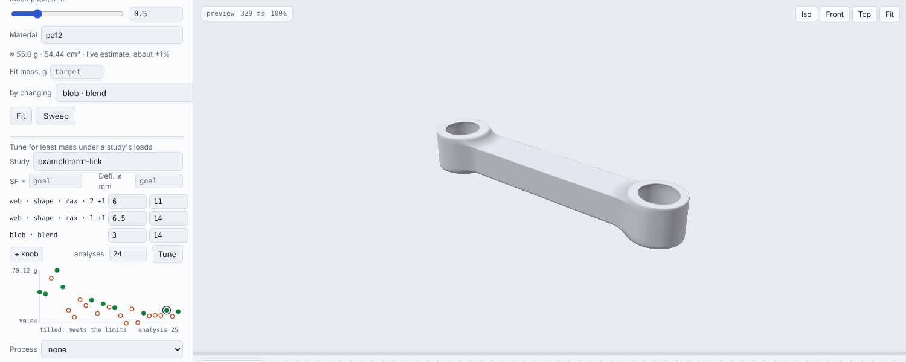
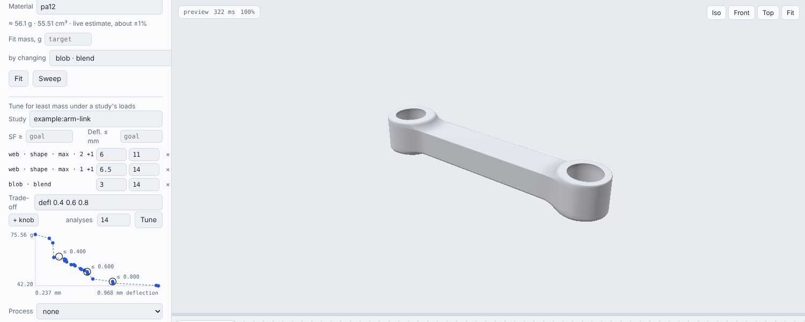
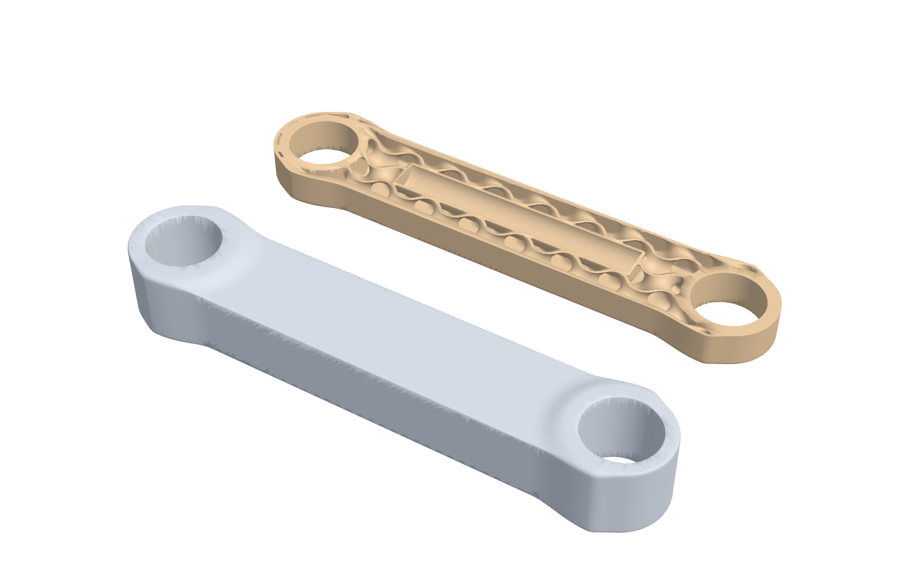
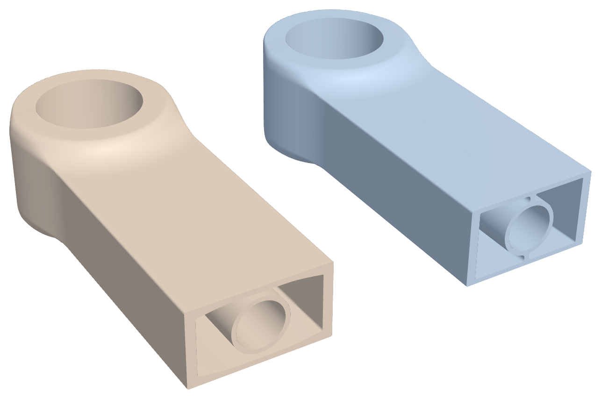
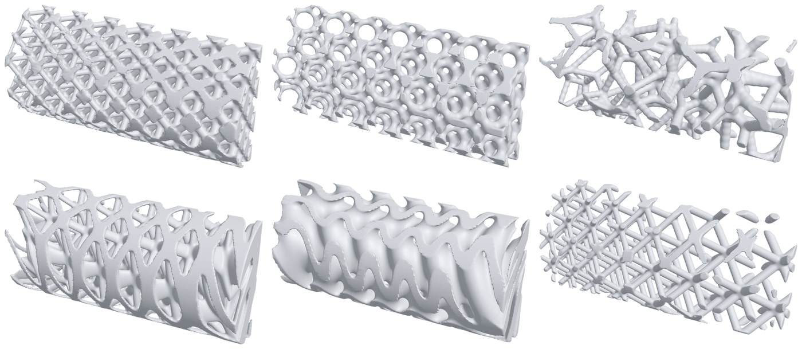
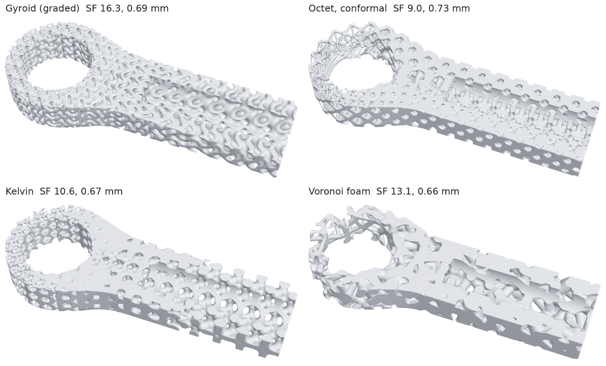

# Field-driven design

`loadpath field` builds a part from a graph of implicit fields, the way nTop
does: every solid is a signed distance (mm, negative inside), every other
quantity is a scalar field, and any number in the graph can be replaced by a
field. The wall follows the stress, the lattice cell grows away from the
bolts, the fillet is larger where the load comes in.

```
loadpath field part.json --out out/          # mesh it, check it, write part.stl + report.json
                                             # (with `materials`: one STL per body and part.3mf too)
loadpath schema field                        # the JSON Schema
```

From Python: `FieldGraph(doc).mesh()` or `run_field(doc, out_dir)` in
`loadpath.fields`; agents can call `loadpath_field` over MCP.

## Editing in the browser

```
loadpath edit part.json                      # opens http://127.0.0.1:8765: edit, preview, Save, Run
loadpath edit part.json --html editor.html   # one self-contained page, no server
```



The editor shows the graph as nodes and wires, an inspector for the
selected node, and a live preview of the part above them. Drag from a node's
output dot onto another node's port to wire a field into a parameter; pick
"number" in the inspector to unwire it. Every number has a slider. The
preview redraws as a slider moves: the page compiles the graph to a GLSL
signed-distance function and raymarches it on the GPU, and every number in
the graph is a shader uniform, so only a change of structure (an op, a
wire, an expression) recompiles, in milliseconds.

- **Solid** shows the output or the selected node; **Colour** paints any
  scalar node on it (the stress, a wall ramp, a distance); a **section**
  cuts it open and paints the cut face the same way, which is how you see
  a graded lattice inside its skin. Hover reads the position and the
  colour field's value.
- What the GPU cannot evaluate is baked on the server and sent as a 3D
  texture: a `mesh` node's distance, a `result` node's stress (its study
  runs on load: about a minute for the arm link), a `grid`, and the cell
  warp of a graded lattice (the same map the mesher solves, so the
  preview's walls sit where the part's will; it re-bakes in under a
  second as a cell slider moves). A bake that a later edit made stale
  stays on screen until its replacement arrives; an analysis re-runs only
  when asked, and later bakes and Run reuse it while its part is unchanged.
- **Colour → wall thickness** paints every wall by its thickness, traced
  in along the surface normal: red under the process's smallest feature
  (`minFeature`: FDM and SLS 0.8 mm, SLA 0.5, LPBF 0.4, ...), amber under
  twice it. Hover reads the thickness. On the arm link it shows the skin
  over the gyroid's voids at 1 to 1.6 mm, thicker where a lattice wall
  backs it.

  

  **Colour → overhangs** paints faces that point down past 45 degrees
  from vertical along the build direction (the graph's `build`, else +z)
  red, and those within 10 degrees of it amber; the face on the plate is
  left alone. `minWall` in the graph overrides the process's wall.

- **Mass** is live: the page weighs the output on the GPU as you edit
  (its volume on a grid of samples at two spacings, extrapolated; within
  about 1% of the meshed part) and multiplies by the material's density.
  The **material picker** lists the library with each card's datasheet, and
  rescales the last run's or tune's safety factor and deflection as you
  switch ([materials.md](materials.md#in-the-editor)). The graph's material
  is also the one its studies check the part in.
  **Fit mass** finds the value of any one number (a wall, a blend, a remap
  end) that gives a target mass, in a second or two; **Sweep** charts the
  mass across that number's range, and clicking a point uses that value.
- **Colour → stress (live preview)** solves the part under the graph's
  study (its tune block's, else a result node's) on a coarse grid and
  paints the stress on it, scaled to its peak, deep red past the goal's
  safety factor. It updates as you drag: the server samples the field at
  cell centres (no mesh), gives each surface cell its filled share of the
  stiffness so the reading moves smoothly with a slider, and solves with
  the matrix-free multigrid (on a GPU when torch has one). On the arm link
  that is 16-19k cells and 1.2-1.9 s per slider value on the 4-core cloud
  box. The legend says it is a preview.

  Its safety factor is made to read under the full check (verify on the
  meshed part, 35-80 s), never over it. The coarse solve alone reads
  high where stress concentrates (the arm link's web edge at the boss, a
  sharp inner corner): up to 1.45x the check. So the two highest spots
  per load case are re-solved in a small box at 2.5x finer cells, from
  the field, driven by the coarse displacements on the box faces (+0.3 s;
  the check's own submodelling, without a mesh), and the peak is then
  multiplied by 1.3 (`preview.HOTSPOT_FACTOR`), set from
  `bench/preview_calibration.py` over eight parts:

  | part | coarse | refined | preview | check | preview / check |
  |---|---|---|---|---|---|
  | arm link, web 9 mm | 23.65 | 20.56 | 15.81 | 17.84 | 0.89 |
  | arm link, web 6.5 mm | 17.92 | 15.48 | 11.90 | 12.66 | 0.94 |
  | arm link, narrow web | 9.23 | 8.02 | 6.17 | 6.69 | 0.92 |
  | arm link, blend 3 | 21.46 | 21.46 | 16.50 | 17.68 | 0.93 |
  | cantilever bar | 3.46 | 3.40 | 2.61 | 3.22 | 0.81 |
  | L-bracket, fillet 3 | 3.60 | 3.60 | 2.77 | 3.84 | 0.72 |
  | L-bracket, fillet 1 | 4.64 | 3.92 | 3.02 | 3.19 | 0.95 |
  | plate with hole | 2.87 | 2.63 | 2.02 | 2.66 | 0.76 |

  The refined preview over the check spans 0.94-1.23, so 1.3 leaves 5%
  on the worst part and costs up to 28% on the mildest. That is a
  calibration on eight parts, not a bound: a sharper raiser than these
  could still read over, so Run before trusting a margin. Mass agrees
  with the check to 0.2% and deflection to within 13% (the bar reads 12% more,
  the arm link 1-7% less).

  

- **Tune** goes past mass to strength: name a study (its loads, supports
  and limits), add knobs with **+ knob**, and the server meshes and
  analyzes candidates until the part is as light as it can be while it
  still meets the study's safety factor and deflection (see Tuning). The
  chart fills in as each analysis lands; the best values go into the
  graph, and Undo takes them back.
- **Run** meshes the graph with `run_field`, exactly as `loadpath field`
  does, at the graph's pitch, then shows the mesh, the report (mass,
  watertightness, sealed voids, drains, printability) and links to the
  STL, report.json and the full viewer. Runs go to `loadpath-edit/` beside
  the graph (`--out`).
- **mesh** in a solid node's inspector meshes just that node the same way
  (a boss, the lattice before it's clipped, one copy of a group), to its
  own `<name>-<node>.stl`; on the command line, `loadpath field graph.json
  --node <node>` (a copy's nodes are `<copy>__<node>`).
- **Save** writes the graph back to its file. Inline nodes get names
  (`owner-key`) when the graph is opened, which is the same graph;
  node positions go under `editor`, which nothing else reads. The JSON tab
  edits the text directly; Ctrl+Z undoes. Ctrl+D duplicates the selected
  node; Ctrl+C and Ctrl+V copy it between graphs, and pasting node JSON
  (`{"nodes": {...}}` or one node) adds it, renaming what clashes and
  keeping the pasted nodes wired to each other.
- The standalone page (`--html`) carries its bakes, so it opens anywhere,
  offline once three.js is cached. It cannot re-bake or run: Run
  downloads the JSON and gives the `loadpath field` command.

The preview is checked against the mesher: `tests/test_editor.py`
evaluates every op on the GPU at 4000 points and compares them with
`FieldGraph.evaluate` (to 1e-6 mm for shapes, booleans, shells, distances,
remaps, expressions and lattices; to the bake's grid for meshes). The
server listens on 127.0.0.1 unless `--host` says otherwise: it reads and
writes files in the graph's folder.

## The graph

```json
{
  "name": "bracket",
  "nodes": {
    "body":  {"op": "mesh", "path": "bracket.stl"},
    "load":  {"op": "result", "study": "bracket-study.json", "part": "bracket.stl"},
    "skinT": {"op": "remap", "input": "load", "from": [2, 20], "to": [1.0, 3.0], "curve": "smoothstep"},
    "skin":  {"op": "shell", "input": "body", "thickness": "skinT"},
    "core":  {"op": "lattice", "type": "gyroid", "cell": 6, "thickness": 0.8},
    "fill":  {"op": "intersect", "inputs": ["core", "body"]},
    "part":  {"op": "intersect", "inputs": [{"op": "union", "inputs": ["skin", "fill"], "blend": 1.0}, "body"]}
  },
  "output": "part",
  "mesh": {"pitch": 0.3},
  "material": "petg"
}
```

A parameter is a number, the name of another node, or an inline node
object. `output` names the node to mesh (default: the last one).
`loadpath check`-style linting runs first: misspelt keys, unknown ops,
references to nodes that don't exist, cycles and bad expressions all come
back at once with suggestions.

## Operations

| op | what it is | fields it takes |
| --- | --- | --- |
| `shape` | exact box, cylinder, tube, sphere or union (same JSON as a study) | |
| `mesh` | a closed STL/3MF/OBJ as a solid; distance exact near the surface | |
| `constant`, `coordinate` | a number; position along x/y/z or a direction | |
| `distance` | unsigned distance to a solid (`input`), points, a segment, a plane or a shape | `input` |
| `result` | von Mises or displacement of a part under a study (run on demand, also on one of the graph's own nodes), or a saved `.npz` | |
| `grid` | an imported scalar field on a regular grid (`.npz`: origin, pitch, values) | |
| `remap` | `from` [a, b] to `to` [c, d], linear / smoothstep / smootherstep / sqrt / square or a drawn curve (`[[u, v], ...]` over the unit square; the editor has a curve editor), clamped | `input` |
| `expr` | arithmetic over node names and x, y, z: `"0.8 + 1.2 * smoothstep(5, 30, stress)"` | `vars` |
| `union`, `intersect`, `subtract` | booleans; `blend` is the fillet radius | `inputs`, `blend` |
| `shell` | a wall inside, outside or centred on a surface | `input`, `thickness` |
| `offset` | grow or shrink | `input`, `distance` |
| `lattice` | TPMS sheets (gyroid, diamond, Schwarz P; sheet or network), strut cells (cubic, BCC, BCCz, FCC, FCCz, octet, Kelvin, diamond-strut) or a Voronoi foam; cartesian, cylindrical, spherical or conformal frame; `aspect` stretches the cell | `cell`, `thickness` or `density`, `blend` (node fillets), `offset` |
| `transform` | translate, rotate, scale an input | `input` |
| `image` | a picture (PNG/JPG) laid on a plane as a 0..1 field: brightness or one channel, optional invert (see Images) | `path`, `size` |
| `group` | a copy of a sub-graph from `groups` with its own `params` and `inputs` (see Groups) | |

`expr` knows `abs sqrt exp log sin cos tan floor ceil sign min max clamp
lerp smoothstep step where`, comparisons and `a if c else b`; nothing else
(no attributes, no imports).

## Groups

A group is a sub-graph you use more than once, like nTop's custom blocks: a
boss, a rib, a lattice infill recipe. Define it once under `groups`, with
the knobs it takes (`params`, with defaults) and the nodes it needs from
the graph (`inputs`); then each `group` node is a copy with its own
values:

```json
"groups": {
  "boss": {"params": {"r": 2, "t": 1.5}, "inputs": ["body"],
           "nodes": {"ring": {"op": "shape", "shape": {"type": "tube", "center": [0, 0, 0], "axis": "z",
                                                       "length": 10, "r": 8, "rInner": 4}},
                     "wall": {"op": "shell", "input": "ring", "thickness": "t"},
                     "out":  {"op": "union", "inputs": ["body", "wall"], "blend": "r"}},
           "output": "out"}},
"nodes": {
  "plate": {"op": "shape", "shape": {"type": "box", "min": [-20, -20, -2], "max": [20, 20, 2]}},
  "b1": {"op": "group", "group": "boss", "params": {"t": 1.0}, "inputs": {"body": "plate"}}
}
```

Inside the group, params and inputs are referred to by name like any
node. A copy stands for the group's output, so other nodes use `b1` as
usual; its nodes come in as `b1__ring`, `b1__wall` (what `report.json` and
errors call them). Groups can use groups. In the editor, **make group** on
a node turns it and everything only it uses into a group (its constants
become knobs, what it shares with the rest of the graph its inputs), and
**ungroup** puts a copy's nodes back. A copy's knobs are sliders that move
the preview without recompiling.

## Images

An `image` node lays a picture on a plane, like nTop's image-to-field: a
logo to emboss, a texture map, a hand-painted density. `plane` is `xy`,
`xz` or `yz`; `origin` is where the picture's lower-left corner sits (mm,
in that plane) and `size` its width and height; the value is the pixel's
brightness (or `channel` r, g, b, a) from 0 to 1, `invert` flips it. It
runs through the picture along the third axis and holds its edge pixels
beyond the picture. Pictures are resized to at most 1024 px. Use it in an
`expr` like any field, for example raised lettering limited to a band:

```json
"logo":    {"op": "image", "path": "logo.png", "plane": "xy", "origin": [-40, -12], "size": [80, 24]},
"band":    {"op": "shape", "shape": {"type": "box", "min": [-41, -13, -1], "max": [41, 13, 1.2]}},
"letters": {"op": "expr", "expr": "max(band, (0.5 - logo) * 0.3)",
            "bounds": {"min": [-41, -13, -1], "max": [41, 13, 1.2]}}
```



The whole graph is examples/fields/nameplate.json. The editor bakes the
picture into a texture once; moving the picture (origin, size) re-bakes,
while the nodes around it stay live sliders.

## Tuning against a simulation

nTop's sliders move the geometry; whether the part still holds is a
separate trip to a solver. `loadpath tune` closes that loop: it turns the
numbers you name until the part is as light as it can be while every
load case of a study keeps its safety factor and deflection. Each
candidate is meshed (`tune.pitch`, default 1 mm) and analyzed by the same
FE check a study's outcome gets (`verify_part`, `tune.cells` cells), and
the search (COBYQA, derivative-free and inside each knob's range) spends
`evaluations` analyses. What comes back is the lightest candidate that met
every limit and was one body, not wherever the search stopped.

The search analyzes on a coarse grid, and a voxel reading moves as the
part slides across its grid: on the arm link the start deflects 0.500 mm
on 30k cells and 0.487 mm on 60k, while one thinner candidate read 0.485
coarse and 0.623 fine. So the start is analyzed on both and every coarse
reading is scaled by that ratio before it meets the limits;
at the end the lightest few that passed are analyzed again on the fine
grid and the first that still passes is the answer (if none does, the
lightest is returned marked `unconfirmed`).

The coarse grid also gives each surface cell its filled share of the
stiffness (`verify_part(fractional=True)`). With whole cells a 7.4 mm bar
read as 8.1 mm at one height and 7.2 mm at the next, so its safety factor
jumped about as the search thinned it (a thinner bar read stronger, 4.29
against 4.05). With filled shares the reading rises steadily with the
height. The fine check that confirms the answer stays on whole cells.

```json
"tune": {"study": "example:arm-link",
         "params": [{"path": "nodes/web/shape/max/2", "also": ["-nodes/web/shape/min/2"], "min": 6, "max": 11},
                    {"path": "nodes/web/shape/max/1", "also": ["-nodes/web/shape/min/1"], "min": 6.5, "max": 14},
                    {"path": "nodes/blob/blend", "min": 3, "max": 14}],
         "evaluations": 24}
```

`path` is where the number sits in the graph, the same key the editor's
sliders use; `also` are numbers that move with it (`-` first for the
other way, so a box stays centred). The limits default to the study's
`goal`; `safetyFactor` and `maxDeflection` here override them.
`loadpath tune graph.json --out tune/` writes `tuned.json` (the graph with
the best values) and `tune.json` (every candidate). An analysis takes
about 12 s on the arm link, so 24 of them are about five minutes.
examples/fields/arm-link-tune.json is that example: its stiffness limit
(0.5 mm at the wrist bearing) is what binds. 25 analyses took it from
61.8 g to 54.9 g (a lower, slightly wider web and a smaller blend),
0.490 mm on the fine grid.



### The trade-off

One limit is rarely fixed in stone: 0.5 mm of deflection might be worth
relaxing for a few grams, or tightening for a stiffer arm. `tune.sweep`
runs the search again held to each value of one limit, each warm-started
from the lightest candidate that already meets it and sharing every
analysis so far:

```json
"tune": {"study": "example:arm-link", "params": [...], "sweep": {"maxDeflection": [0.4, 0.6, 0.8]}}
```

Each value's lightest confirmed part is in `tune.json` under `sweep`, and
`front` lists every candidate no other beats on mass, deflection and safety
factor at once. In the editor (Trade-off: `defl 0.4 0.6 0.8` or `SF 2 4 6`)
the chart becomes mass against deflection when the run ends, with the
sweep's picks ringed; click any point to put its values in the graph.

On the arm link (three knobs, 14 analyses per limit, 56 in all, about 20
minutes) the lightest confirmed link is 61.2 g at 0.4 mm, 55.9 g at 0.5,
51.3 g at 0.6 and 45.0 g at 0.8: every tenth of a millimetre of deflection
the arm can live with is worth 4-6 g of web.



### Lattices are tuned homogenized

A lattice's walls are a fraction of a millimetre, so analyzing the real
geometry takes cells a few tenths of a millimetre across and around a
million of them per candidate. A part with a lattice in it is analyzed with
the lattice homogenized instead (homogenized.py, `tune.analysis` `auto`):
the graph is evaluated with the lattice node filled solid and with it empty,
so each analysis cell knows its share of solid skin and of lattice; the
lattice's own wall (or density) and cell fields give the lattice's relative
density there, and the unit-cell tables give its stiffness and its peak wall
stress: by default the full anisotropic tensors (lattice_tensors.py, see
"Lattices are read anisotropic" below), or with `anisotropic: false`
lattice.py's scalar fits (modulus E C rho^n, peak wall stress A rho^-m times
the stress it carries on average). A `result` node behind the wall field
runs its study once for the whole search. Sheet and strut lattices
(lattice.SHEETS, lattice.STRUTS); a stretched `aspect` cell has no tables
and is refused.

Checked against the resolved geometry: a 60 mm skin-and-gyroid bar (1 mm
skin, 0.8 mm walls in 6 mm cells) under a tip load deflects 1.07-1.15 mm
homogenized (8k-250k cells) and 0.95-1.00 mm meshed at 0.12 mm and
verified on 150k-900k voxels, so the homogenized reading errs 10-15% on
the safe side; it weighs 6.87 g on every grid against 6.86 g meshed.

Each analysis cell counts by the share of it the part fills (sub-samples
weighted by how deep they sit), as stiff and as heavy as that share, down
to a tenth full. An earlier version kept only cells at least half full,
which peeled up to half a cell off every face: a 1 mm skin read 13%
light on a grid whose cells straddled it and 6% heavy on others, and its
deflection swung by a third from one grid to the next. The check also
solves on matrix-free multigrid from 100k cells (as verify_part does): the
arm link on 1M cells takes about 3 minutes and 1.4 GB.

The search confirms its answer on a finer grid: twice its own cells, and
for a part with a shell, at least two cells through the thinnest wall
(`tune.thinnest_wall`, the least value of each shell's thickness field) on
two grids, 0.7x apart in cell count, the worse reading counting
(`checkCells` caps it, default 2M). A candidate that fails there is
returned with `ok: false` and `unconfirmed: true`, never as a result.

### Lattices are read anisotropic

Lattice cells are not isotropic. A simple cubic cell is 10-25x stiffer
along its rods than along the cube diagonal, an octet 1.5x stiffer along
its struts than along the cube axes, a BCCz 30x stiffer along z than
across. The scalar fits (SHEETS, STRUTS) read every cell at its weakest
direction and its worst stress concentration, which is safe in stiffness
and throws mass away wherever the cells are loaded the way they are strong.
The scalar fits also scale the wall stress by the macro von Mises stress, so
a hydrostatic load, which the walls feel in full, read as zero.

The homogenized check now reads each cell from its full tensor
(lattice_tensors.py, the default whenever the cell has tables; `anisotropic:
false` in `homogenized_check`, or LOADPATH_LATTICE_ANISO=0, gives the scalar
reading):

- **Stiffness**: six periodic unit-cell solves per cell type and density (a
  unit macro strain per Voigt component, nodes wrapping across the cell
  faces) give the full 6x6 effective stiffness, symmetrized over the cell's
  cubic or tetragonal (BCCz, FCCz) group. Tables for every sheet and strut
  cell at 7-8 densities from 0.06 to 0.9 are in
  `loadpath/data/lattice_tensors.json` (bench/lattice_tensors.py rebuilds
  them in about an hour on 4 cores); between rows the leading entry is
  interpolated log-log and the shape linearly in log density, up to the solid
  at 1.
- **Wall stress**: the six unit-cell stress fields superpose to the walls'
  stress under any macro stress. Sampled over ~15,000 directions (axes,
  diagonals, shears, hydrostatic, random, and their symmetry images), the
  walls' peak (99.5th percentile of nodal von Mises, as the scalar fits read
  it) is fitted by a quartic surface in the macro stress, floored by a
  positive-definite quadratic one and scaled onto or above every sample. On
  200 held-out directions per row, solved directly, it reads 3-11% high on
  average and is never more than 1% low. A quadratic (Hill-type) surface
  alone read 10-41% high.
- **Frame**: each analysis cell's tensors are rotated by the polar factor of
  the lattice coordinates' Jacobian (central differences), so cylindrical,
  spherical, conformal and graded frames, and lattices turned by a
  `transform` node above them, are read the way they lie.
- **Solve**: each element gets its own elasticity matrix, with the
  incompatible-mode bubbles condensed per element (`fem.hex8_ke_batch`).
  Under 100k cells the matrix is assembled; above that the operator runs
  matrix-free inside CG, preconditioned by the isotropic multigrid. Both
  paths agree to 1e-4.

Checked against the resolved lattice (bench/lattice_aniso_validate.py): the
field graph voxelized at 0.15-0.2 mm, five or more voxels across a strut,
solved on the same hex8 elements. CalculiX (C3D8I) on the same voxels agrees
with loadpath's resolved solve to 1e-8 in all three load cases. Compliance
(f·u) and the worst lattice cell's 99.5th-percentile wall stress, each over
the resolved value:

| bar (bend, pull and twist; ranges over the three) | compliance, tensor | compliance, scalar | wall stress, tensor | wall stress, scalar |
|---|---|---|---|---|
| simple cubic, turned 45 deg, 1 mm skin, 4 cells | 0.95-1.01 | 1.02-1.04 | 0.95-1.20 | 0.85-1.18 |
| BCCz, z struts along the beam, 1 mm skin, 4 cells | 1.00-1.02 | 1.18-1.32 | 1.09-1.43 | 1.35-1.89 |
| simple cubic, along the beam, no skin, 4 cells across | 1.14-1.39 | 1.31-15.29 | 1.28-1.41 | 1.59-8.39 |
| simple cubic, along the bar, no skin, 2 cells across | 1.40-2.07 | 1.91-19.20 | 1.58-2.01 | 2.09-10.58 |
| simple cubic, turned 45 deg, no skin, 2 cells | 0.64-1.43 | 1.38-2.07 | 1.39-2.23 | 1.33-3.03 |
| BCCz, z across the bar, no skin, 2 cells | 1.27-1.36 | 1.70-14.30 | 1.43-2.18 | 3.27-21.00 |
| BCCz, z struts along the bar, no skin, 2 cells | 1.33-2.05 | 9.86-14.36 | 1.64-2.20 | 9.77-22.87 |
| gyroid, no skin, 2 cells | 1.09-1.47 | 1.02-1.67 | 1.36-2.13 | 1.22-2.57 |
| gyroid, turned 45 deg, no skin, 2 cells | 1.10-1.32 | 1.14-1.38 | 1.02-1.24 | 1.08-1.30 |
| octet, no skin, 2 cells (resolved at 0.25 mm) | 1.81-2.00 | 1.76-3.00 | 2.02-3.20 | 1.71-4.97 |
| octet, turned 45 deg, no skin, 2 cells (0.25 mm) | 1.40-1.64 | 1.81-2.12 | 1.67-2.88 | 1.80-2.83 |

Bars are 48 x 12 x 12 mm (2 cells of 6 mm across) or 60 x 24 x 24 mm (4
cells), solid end blocks, tip bend, pull and twist; above 1 errs safe. With
a skin over the lattice, the way a printed part carries one, the tensor
reading is within 5% of the resolved stiffness and 0.95-1.43x on stress,
where the scalar reading was up to 32% soft and read one twist 15% low on
stress. Where the cells line up with the load (cubic or BCCz along the
bar) the scalar reading was 10-20x too soft and 8-23x too high on stress,
which a sizing pays for in mass.

**Free faces.** A lattice cut open by the part's face with no skin over it
ends in free struts and sheet edges that carry less than the periodic unit
cell says. Before the knockdown below, the skinless 2-cell bars read too
stiff under both models (gyroid 0.69x of the resolved compliance, the
cubic turned 45 degrees 0.40x in twist) and gyroid wall stress read
0.70-0.81x. `free_surface_exposure` marks each lattice cell by its distance
to an unskinned face (one at the face, zero a lattice cell in, zero under
a skin), and the cell keeps 1 - 0.5 x that of its lattice stiffness
(`FREE_SURFACE_KNOCKDOWN`, `free_surface` in `homogenized_check`); stress is
read from the full tensor times the larger strain, so it errs high too.
The table is with it. One case stays under: the turned cubic bar in twist,
0.64x. The report's `latticeExposed` is the share of lattice within half a
cell of such a face; a part with much of it and fewer than about four cells
across a member is one to check resolved.

The sandwich arm link eval case (1M cells, skinned gyroid core) reads 42.7 g
as before, deflection 0.432 mm (was 0.438) and safety factor 6.65 (was 9.0;
the meshed part verified resolved reads 13.5): the gyroid's quartic stress
surface reads combined and hydrostatic stress states the scalar factor
missed.

**As printed.** All of the above is the designed geometry, which reads
1.0-4.1x stiffer than printed lattices measured in 33 published compression
tests ([VALIDATION.md](VALIDATION.md#as-printed-lattice-stiffness)). When the
study names a process, the check multiplies the lattice's stiffness by an
as-printed factor fitted to those tests (`lattice_print.print_factor`: FDM,
SLS/MJF or resin, strut or sheet, density; about 0.65 for an FDM gyroid,
0.4 for FDM struts, 0.93 for SLS sheets). Sheets, as for free faces, read
wall stress from the larger strain; struts from the stress they carry
(`lattice_print.STRAIN_SHARE`, [VALIDATION.md](VALIDATION.md#strength-of-printed-lattices)). `process.latticeStiffness` (a number or
`"designed"`) or a calibrated card's measured lattice factor replaces it;
`as_printed=False` turns it off. The report's `latticePrint` gives the
factor and its basis.

**Buckling.** Each lattice cell's most compressive principal macro stress
is also compared with its walls' buckling stress: a perfect periodic
lattice's eigenvalue buckling stress (`lattice_buckling.py`, tables per
cell, density and direction, the least direction used), times 0.5 for
imperfections (`BUCKLING_KNOCKDOWN`), times the cell's as-printed and
free-face stiffness share. A case's `safetyFactor` is the lesser of the
yield and buckling factors (`yieldSafetyFactor`, `bucklingFactor`,
`governs`). Sheet TPMS at ordinary densities buckle far past yield; slender
struts at low density (rho under about 0.1: perfect struts there buckle
at 2-3% strain, halved for imperfections) are where it governs.

**Stretched cells.** A lattice with `aspect` (say a tall BCC, [1, 1, 1.5],
whose struts rise above 45 degrees and print on FDM without support) is read
from its own tensors: the unit cell is solved in its stretched box (box
dimensions from the shortest side, orthorhombic symmetry), at six densities
on first use, and cached on disk (`~/.cache/loadpath/lattice-tensors`, or
`LOADPATH_CACHE`; about 3 minutes per cell and aspect on 4 cores). The
density at a given strut or wall comes from the same solves. Before this a
stretched cell was refused by the homogenized check. Against the resolved
lattice (1 mm skin, 60 x 24 x 24 mm beams, `bench/results/lattice-aniso-aspect*.json`;
each resolved peak read per lattice cell box, as the tables are), compliance
is within 2% on all three:

| beam | compliance | peak stress |
|---|---|---|
| tall BCC [1, 1, 1.5], long axis across the beam | 0.98-1.02x | 1.01-1.37x (contact band 12 mm); 0.88-1.37x (6 mm) |
| tall BCC, long axis along the beam (turned 90 degrees) | 0.98-1.01x | 1.29-1.55x |
| flat octet [1.4, 1, 1], turned 45 degrees | 0.98-1.00x | 1.07-1.44x |

**Where the lattice roots into a skin.** The tall BCC beam first read
0.87-0.90x in bend and pull. Away from the faces its lattice read safe
(1.04x); the resolved peak sat in the skin, where each strut pulls on it
over a small patch, 10-13% above the smooth stress the homogenized skin
carries. Analysis cells that hold both skin and lattice now read 1.25x
their stress (`SKIN_JUNCTION`, `skin_junction` in `homogenized_check`),
which brings that beam to 1.01-1.05x and moves the other skinned beams to
1.07-1.89x (they were 0.95-1.43x). One reading stays under: with the
default 6 mm contact band, the tall BCC pull peaks 0.88x right at the band's
edge by the loaded end block, where the load spreads from the block into
skin and lattice; with a 12 mm band that spot reads 1.05x. The sandwich arm
link eval reads the same with it (SF 6.65; its peak is not at a junction).

**Infill sizing on the same tensors.** `lattice_infill` sizes an STL's TPMS
infill to a safety factor by fully stressed iteration on a homogenized grid.
It now runs on the cell tensors as well (`LatticeOptions.anisotropic`, on by
default; LOADPATH_LATTICE_ANISO=0 off): each cell's stiffness is its 6x6
tensor, and its density is the least of 28 candidates whose wall stress
surface stays under the allowable with the cell's macro stress held. On the
SLS cantilever block in the tests (target SF 1.2, verified resolved after
meshing), gyroid infill comes out 3% heavier and verifies at SF 1.59 against
1.33 with the scalar fits; Schwarz-P comes out the same mass, verifying at
1.42 either way, with the sizing's own prediction landing nearer the target
(1.18 against 1.43). TPMS sheets are close to isotropic, so the tensors buy
consistency with the part check here, not mass.

### Turning the cells to the load

A lattice node's `orient` turns its cells (a rotation vector in degrees,
or {"axis", "degrees"}) about the lattice's origin and leaves the fields that
grade it where they are; a `transform` node would move those too.
`loadpath lattice-orient graph.json --study study.json` (or
`lattice_orient.optimize_orientation`) picks the orient:

1. one homogenized analysis with the cells as they lie gives every lattice
   cell's macro stress;
2. a screen holds those stresses and scores about 1,500 rotations from the
   tensors alone (a p-norm of the wall stress, and the complementary
   energy): turns that put each of the cell's stiffest directions on the
   dominant stress direction, spun about it, plus random ones, in a few
   seconds;
3. the best three that the cell's symmetry does not make the same get a
   full analysis each, and Nelder-Mead on the rotation vector refines the
   best (16 more analyses by default). It returns the graph with the orient
   written in, for the best worst-case safety factor or, with
   `--objective stiffness`, the least compliance.

`bench/lattice_orient_mass.py`: lattice-only 48 x 12 x 12 mm bars with
solid ends, 6 mm cells. The cells as they lie at a 2 mm wall set the
target safety factor; the cells are turned at that wall, then the wall is
bisected to the same safety factor. All homogenized on 8k cells:

| bar | SF at 2 mm, as laid / turned | wall to the same SF | mass |
|---|---|---|---|
| BCCz, z struts across the bar; bend + pull | 0.68 / 1.17 | 1.56 mm | -23% |
| simple cubic in twist | 0.048 / 0.087 | 1.64 mm | -15% |
| octet in a pull | 7.5 / 10.0 | 1.84 mm | -7% |
| simple cubic, rods along the bar; bend + pull (control) | 0.52 / 0.52 | 2.00 mm | 0% |

> **These gains do not hold at full resolution.** The bars have no skin,
> so their cells are cut open at bare faces. `bench/lattice_orient_confirm.py`
> voxelizes each pair (as laid at 2 mm, turned at its thinner wall) at
> 0.15 mm and solves the struts as they are:
>
> | bar | homogenized, turned / as laid peak | resolved, turned / as laid peak |
> |---|---|---|
> | BCCz, bend + pull (-23%) | 0.96 | 3.23 |
> | simple cubic in twist (-15%) | 0.98 | 2.23 |
> | octet in a pull (-7%) | 0.99 | 1.34 |
>
> Each turned bar is weaker than the one it was meant to beat. The
> homogenized check is not wrong the same way on both: the cells as laid
> are cut square, so struts run on along each face and carry load, and the
> free-surface knockdown (fitted to be safe) reads their peak 1.5-2.8x high;
> turned, they are cut on the bias into stubs and read 0.8-1.1x. The
> optimizer turns the cells because that error favours turning. So by
> default (`confirm="auto"`) `optimize_orientation`, `optimize_zones` and
> `grade_lattice` keep a lattice with more than 10% of its volume at a bare
> face as laid and return a `guard` saying why (the turn found is in
> `candidate`). `--confirm resolved` (`confirm="resolved"`) checks the turn
> against as laid at full resolution (`resolved.resolved_check`, a few
> minutes for a part this size; `loadpath resolved-check graph.json --study
> study.json` runs it on its own) and keeps it only if the turned part is at
> least as strong (stiff). `--confirm none` trusts the homogenized reading.
> One skinless turn has held at full resolution: a graded cubic deep beam
> turned 45 degrees (within 4%, `bench/results/lattice-seams-deep-beam.json`).

**A knockdown that follows the cut.** Since then the check reads each
bare-faced cell by the angle its face cuts it at (`homogenized.FACE_CUT`,
`face_alignment`: 1 cut square, 1/sqrt(3) on the body diagonal) and by the
cell's family. `bench/lattice_face_cut_fit.py` fits it on the 18 skinless
designs that have full-resolution results (bars, beams, the pairs above, the
L-bracket): cut square, every family keeps nearly all its stiffness
(knockdown 0.1-0.3); cut on the bias, bending cells (cubic, BCC, BCCz)
lose more than all of it within a cell (1.4, with the stubs' wall stress
read up to 2x), an octet 0.5, sheets 0.5. Over the 18 the worst peak
under-read went from 0.31x to 0.91x and the compliance range from
0.40-2.0x to 0.62-2.0x (`bench/results/lattice-face-cut.json`).

Re-optimized on it with the guard off (`lattice-orient-mass-facecut.json`,
`lattice-zones-mass-facecut.json`), then checked at full resolution
(`lattice-orient-confirm-facecut.json`, 0.2 mm):

| part | homogenized gain | full resolution, turned / as laid |
|---|---|---|
| BCCz bar, bend + pull | 0% (keeps as laid) | |
| simple cubic in twist | -1% | |
| octet in a pull | -5% | peak 0.91: **confirmed** |
| BCCz L-bracket, safety factor | -40% | peak 3.36: refuted |
| BCCz L-bracket, stiffness | -44% | compliance 1.67: refuted |

So the bending cells' bias cuts are still beyond the model (the turned
bracket's peak read 0.53x of resolved), and only the octet's turn is
trusted (`homogenized.FACE_CUT_VALIDATED`): `optimize_orientation` turns a
bare-faced octet lattice without asking, and keeps the guard for every
other cell, for zones and for `grade_lattice`.

The control comes back unturned. The orientation is one rotation for the
whole lattice; a cell that follows the stress from place to place (a
conformal or stress-aligned frame) is the next step. Each analysis takes
10-25 s at 8k cells on the cloud box, so a run is 5-10 minutes. The
turned readings rest on the tensors' validation above (turned cells
included), not on a resolved solve of each optimum.

**Direction that follows the stress.** `orient` can also be
`{"zones": [{"at": [x, y, z], "rotate": [rx, ry, rz]}, ...], "blend": mm}`:
the lattice split between the zones' points (a soft Voronoi split), each
zone's cells turned their own way, the zones' lattices cross-faded over
`blend` (default one cell) where they meet, so the struts or sheets run on
through the seam. The homogenized check reads each cell in the polar factor
of the zones' rotations weighted where it sits. `loadpath lattice-orient
--zones N` (`optimize_zones`) starts from the best single direction, splits
the lattice into N zones by k-means on each cell's principal stress axis and
position, screens each zone's rotations on its own cells, tries the runners
up with full analyses and refines each zone's rotation by Nelder-Mead.

`bench/lattice_zones_mass.py`, skinless lattice parts, 3 zones, homogenized:

| part | holding | as laid | one direction | zones |
|---|---|---|---|---|
| BCCz L-bracket (an arm along x, an arm up z) | safety factor | 4.96 g | 2.93 g (-41%) | 2.87 g (-42%) |
| same | stiffness | 4.96 g | 2.45 g (-51%) | 2.42 g (-51%) |
| simple cubic deep cantilever 60 x 12 x 24 mm | safety factor | 4.47 g | 4.46 g (0%) | 4.46 g (0%) |
| same | stiffness | 4.47 g | 4.47 g (0%) | 4.25 g (-5%; 16% stiffer at the same wall) |

> **The one-direction L-bracket rows do not hold at full resolution**
> (0.2 mm voxels, `bench/results/lattice-orient-confirm-lbracket.json`):
> turned at its thinner wall the bracket's peak is 1.97x the as-laid
> bracket's (claimed -41%), its compliance 2.26x (claimed -51%). The turned
> lattice reads 1.4-1.9x too stiff homogenized, the as-laid one 1.2x too
> soft. The zones there start from that turn and are no better confirmed.

Most of the win is in turning the cells at all; zones add little on top
while the wall is one thickness everywhere. The safety factor is set by the
one most stressed spot, so turning cells elsewhere cannot raise it, and
stiffness gains only where the stress direction changes across the part (the
deep beam's shear-carrying middle against its axial top and bottom).

Where zones meet, both zones' lattices are present, each worn away (by up
to half a cell) as its share falls, so the struts on either side stay
joined. (Averaging the two fields, the first version, left gaps in the seam
that cut a strut lattice in two.)

### Walls graded to the stress

`loadpath lattice-grade graph.json --study study.json [--orient uniform|N]`
(`lattice_grade.grade_lattice`) replaces the lattice's constant `thickness`
with a `density` grid sized by fully stressed iteration on the homogenized
check: each cell takes the least of 28 candidate densities whose wall stress
surface, under the cell's macro stress held and in its own axes, stays under
the allowable in every load case (the skin-junction factor included). The
requirement spreads over a quarter cell, a pass at most halves or doubles a
cell, and the allowable follows how far each analysis lands from the target.
The density goes to an .npz the graded graph's `grid` node reads, so `loadpath
field` meshes it as sized.

With `--orient` the cells are turned too, chosen for the least material the
sized lattice needs rather than for the peak. Holding each cell's stress, a
candidate rotation's need per cell is a few matrix products (the quartic
features of the turned stress against every candidate density's surface),
so about 850 rotations per zone are scored by mass. Zones start from the
best single direction; sizing and turning alternate.

`bench/lattice_grade_mass.py`, same parts as above, each sized to the
safety factor the uniform 2 mm wall gives (homogenized, 8k cells):

| part | uniform wall, as laid | graded | graded + one direction | graded + 3 zones |
|---|---|---|---|---|
| BCCz L-bracket | 4.96 g | 2.57 g (-48%) | 2.06 g (-59%) | 2.06 g (-59%) |
| simple cubic deep cantilever | 4.47 g | 3.72 g (-17%) | 3.70 g (-17%) | 3.49 g (-22%) |

**Where the zones' error came from.** The skinless 3-zone row did not
hold up at full resolution (0.2 mm voxels, bench/lattice_aniso_validate.py
`resolved`): same mass, but 3.5x softer and its peak 4x higher. Taking the
design apart, each piece checked at full resolution (compliance and peak,
homogenized at 8k-30k cells over resolved; the deep beam, skinless;
bench/results/lattice-seams-deep-beam.json):

| deep beam, skinless | compliance | peak |
|---|---|---|
| uniform 1.6 mm wall, as laid | 1.38-1.47x | 1.64x |
| graded, as laid | 1.18-1.25x | 1.11-1.15x |
| graded, one direction (-45 deg about x), new tables | 0.96-1.02x | 0.96-0.99x |
| 3 zones, uniform wall, cross-faded | 0.84-0.90x | 0.65x |
| graded + 3 zones, cross-faded, old tables | 0.27-0.28x | 0.22-0.25x |
| same, re-graded on the new tables | 0.67-0.72x | 0.39-0.42x |
| the re-graded zones with 1 mm seam plates | 0.73-0.80x | 1.19-1.34x |

Two causes, neither of them the bare faces:

- **Under the table.** Graded walls went down to density 0.022, under the
  tables' lowest row (0.06), where holding the first row's shape read the
  cubic cell's shear (a bending mode, about rho^2.3) 3x too stiff. The
  tables now have rows at 0.02 and 0.035 for every strut cell, and under
  the table each eigen-mode runs on its own power law.
- **Zone seams.** Every resolved peak sat on a seam: cross-faded zones join
  two directions of thin struts at a few small joints. `orient.seam` (mm,
  default 1 in `optimize_zones`, `grade_lattice` and the CLIs' `--seam`)
  puts a solid plate on each face between zones, and both zones' cells end
  on it as on a skin. With plates the peak reads on the safe side; the
  stiffness still reads 20-27% high. Sized with plates, the deep beam's
  lightest design drops the zones for one direction: the plates cost more
  than the zones save. The check warns on zones without plates.

With a 1 mm skin (`--skin 1.0`, the regime the tensors were validated in):

| part | uniform wall, as laid | graded | graded + one direction | graded + 3 zones |
|---|---|---|---|---|
| BCCz L-bracket | 8.25 g | 6.18 g (-25%) | same, left unturned | same, left unturned |
| simple cubic deep cantilever | 7.53 g | 6.75 g (-10%) | same, left unturned | same, left unturned |

At full resolution the graded skinned deep beam bears the homogenized
reading out: 6.48 g resolved against 6.75 g, compliance 76.0 against 71.5
(8k cells) and 74.8 (30k), so 2-6% softer, and a peak of 12.5 MPa against
18.8-22.0 homogenized, the check on the safe side.

Grading pays in both regimes. With a skin, the skin carries the bending and
turning the core buys nothing: the L-bracket's lattice drops to the
thinnest wall everywhere, the deep beam's runs from the thinnest wall to
the density cap (0.6) where the shear is, and the orientation search keeps
the cells as laid. Without a skin, turning and zones read as large gains
that the resolved check bears out for one direction (the deep beam) but not
for cross-faded zones. In the skinless homogenized rows, turning on top of
grading pays on the L-bracket.
Zones pay only where the stress direction really changes across the part
(the deep beam); on the L-bracket one tilted direction serves both arms. A
sizing run takes 15 s to 5 minutes. The sizing grid matters: the deep beam
sized on 8k cells reads SF 0.161 there and 0.144 (-10%) on 30k cells, so
size on the grid you will check on, or leave margin.

Tuning the graded-lattice arm link (examples/fields/arm-link-lattice-tune.json:
the skin's thinnest and thickest wall and the gyroid's thickest wall, same
study and limits as the solid one above) does not beat the solid: the
lightest lattice link that came near 0.5 mm was 58.2 g (0.498 mm coarse,
0.511 mm on the fine grid), with the skin at the top of its range (6 mm),
against 54.9 g for the tuned solid web. It is the same answer the moonshot
experiments got: for a stiffness-bound part, a lattice costs mass per unit
of stiffness, as long as the lattice has to live inside the solid link's
envelope.

### A sandwich arm link beats the solid web

Let the envelope grow with the skin and the answer turns.
examples/fields/arm-link-sandwich-tune.json tunes the web's width and
height together with the skin's thinnest and thickest wall, the gyroid's
wall (never under 0.8 mm) and its cell; the stress that grades the skin
comes from the largest envelope the search can reach, so the study runs
once. The search drives the core sparse (16 mm cells at the 0.8 mm
minimum) and puts the mass in a taller, wider skin: a sandwich beam.
examples/fields/arm-link-sandwich.json is the result:

| arm link | mass | deflection | safety factor |
|---|---|---|---|
| tuned solid web (arm-link-tune.json) | 54.9 g | 0.490 mm | |
| sandwich: 29.6 x 20 mm web, skin 0.84-2.35 mm, 16 mm gyroid, homogenized on 1M cells | 42.8 g | 0.436 mm | 9.2 |
| the same, meshed at 0.3 mm and verified resolved on 1.2M cells | 44.5 g | 0.40 mm | 13.5 |
| the same skin with no core, homogenized | 35.9 g | 0.508 mm | 7.0 |
| the search run again with the confirming check (37 analyses) | 42.3 g | 0.465 mm on 1.4M and 1M cells | 11.5 |

The sandwich is 19-22% lighter than the solid web at the same limit, and
the homogenized reading errs on the safe side of the resolved one (0.436
against 0.40 mm, mass 4% light: the blends round the collars are finer
than the analysis grid).



Thin skins once fooled the search. The first sandwich search ran on 120k
cells, about one cell through the thinnest skin, and passed a 38 g
candidate at 0.554 mm; the same part read 0.748 mm on 240k cells and
0.58 mm on 1M. With every cell counted by its fill (above) it reads
0.597-0.611 mm on all four grids and fails on each, and the 42.8 g
result 0.425-0.436 mm. The eval case `arm-link-sandwich` holds both: the
tuned link must pass, and the 38 g one must fail.

### Hollow or sandwich?

Most of the sandwich's win is the hollow section, so the plain hollow link
was tuned on equal terms (examples/fields/arm-link-hollow-tune.json: the
same envelope and skin knobs, no core, `analysis: homogenized`, which reads
a part with no lattice on the same fill-weighted grid). Both checked the
same ways: the search's confirming grids, the mesh verified resolved on
1.2M cells, and FDM printability flat on the bed (`check_print`, 0.4 mm
cells; support area net of the 3,300 mm^2 the solid envelope itself needs
under its web, so what is left is inside the part, where no support can be
removed):

| arm link | mass (meshed) | deflection, homogenized | deflection, resolved | support inside, flat | longest bridge on its side |
|---|---|---|---|---|---|
| hollow, skin 0.88-3.05 mm | 36.8 g | 0.484 mm | 0.501 mm | ~2,800 mm^2 and a 325 mm^2 island (the roof) | 14.8 mm |
| sandwich, 14 mm gyroid (search result) | 44.0 g | 0.465 mm | 0.462 mm | ~560 mm^2 (down-facing gyroid patches) | 10 mm |

The hollow link is 16% lighter but sits on the limit when resolved, and
its roof is a 26 mm span over a sealed cavity: on FDM it needs support
that stays inside, or it sags. The gyroid holds the roof up every half
cell, but still leaves ~700 mm^2 of down-facing patches inside.

### The core chosen by process: `loadpath cores`

`loadpath cores` makes that choice itself. It takes a list of core options
(each a tunable graph), tunes each one (the confirmed search above), meshes
the tuned part and reads it the way each process builds it
(`cores.choose_core`):

- **fdm**: support that would sit over a sealed void can never come out, so
  `check_print` now reports `trappedSupportArea` (support needed over void
  not connected to the outside) and `sealedVoidVolume`. FDM refuses an
  option with more than 50 mm^2 trapped (`trappedLimit`).
- **sls, mjf**: nothing needs support; a sealed void gets a note to add
  escape holes (see Drain holes).

The lightest option that met its loads and the process wins, by meshed
mass. Tuned options are cached in the output folder, keyed by their graph.

    loadpath cores examples/fields/arm-link-cores.json --out cores-out

The FDM-printable option is a box section
(examples/fields/arm-link-box-tune.json, arm-link-box-graded-tune.json): a
flat-roofed rectangular cavity with one 1 mm rib down the middle, so every
roof span is a bridge of at most ~13 mm and nothing inside needs support.
A stress-graded skin does not work here: grading thins the roof toward the
middle, which turns it into a shallow ramp that needs support (a ribbed
hollow with a graded skin still trapped 1,400 mm^2). The graded box grades
its flanges and walls along the link only, so each layer's roof stays flat.

| arm link option | mass (meshed) | deflection (confirming grid) | trapped support, flat | FDM | SLS / MJF |
|---|---|---|---|---|---|
| hollow, graded skin | 36.8 g | 0.484 mm | 2,811 mm^2 | no | **wins** (escape holes) |
| box, graded walls, rib | 42.0 g | 0.493 mm | 0 | **wins** | yes |
| (the same, web 0.12 mm deeper) | 42.2 g | 0.492 mm resolved | 0 | reference | |
| box, uniform walls, rib | 43.6 g | 0.494 mm | 0 | yes | yes |
| sandwich, gyroid core | 44.0 g | 0.465 mm | 725 mm^2 | no | yes |



Thin solid walls read about 3% stiffer on the confirming grid than on the
resolved mesh (1.2M cells, 0.33 mm): the hollow link 0.484 against 0.501 mm,
the graded box 0.493 against 0.506 mm. So the FDM reference
(examples/fields/arm-link-box-graded.json) is the graded box with its web
0.12 mm deeper each side: 42.2 g, 0.492 mm resolved, SF 10. That is 23%
under the 54.9 g solid web and 4% under the sandwich, printable flat with
no support inside. SLS and MJF take the 36.8 g hollow link (about 37.5 g
with the same margin) with escape holes.

### Strut and conformal lattices against the gyroid

The strut cells' fits (lattice.STRUTS, from bench/strut_fits.py: unit-cell
FEA at 48 voxels a cell) are the conservative isotropic reading of
anisotropic cells: modulus the lesser of [100] and [111], stress factor the
worst of a [100] pull, a [111] pull and a shear. The power laws were fitted
over relative density 0.06-0.34 and fall far short past it (the octet at
rho 0.8: E*/E 0.27 from the fit, 0.56 solved; stress factor 8.8 against
4.3), so the analysis reads lattice.STRUT_TABLES instead, the solves from
rho 0.06 to 0.92 interpolated log-log up to the solid.

Per gram at rho 0.15, against the gyroid sheet (E*/E 0.043):

| cell | E*/E at rho 0.15 | behaviour |
|---|---|---|
| octet | 0.028 | stretch dominated (n 1.36) |
| FCC, FCCz | 0.031, 0.028 | stretch dominated along the face diagonals |
| Kelvin | 0.019 | bending (n 2.07) |
| diamond-strut | 0.013 | bending |
| Voronoi foam | 0.022 | bending, near isotropic |
| BCC, BCCz, cubic | 0.004-0.008 | bending; cubic is stiff on its axes, near zero on [111] |

Checked against the resolved geometry: a 60 mm bar of 1 mm octet struts
in 6 mm cells (no skin, so the lattice carries everything) deflects 11.9 mm
homogenized and 11.1 mm meshed at 0.12 mm and verified on 400k voxels
(7% conservative); mass 4.41 g against 4.19 g. The same bar in a 0.8 mm
gyroid reads 5.0 mm homogenized against 7.6 mm resolved at 400k voxels:
sheets cut by the bar's sides lose more than struts do, so for a lattice
with no skin the gyroid's homogenized stiffness is optimistic.

The arm link at equal mass (examples/fields/strut_lattices.py: the graded
arm-link graph with its core swapped, each core's stress-graded thickness
scaled until the part weighs what the graded gyroid does, 49.9 g;
homogenized, worst load case):

| core | mass | safety factor | deflection | FDM: strut length bridging |
|---|---|---|---|---|
| gyroid (graded cell) | 50.0 g | 16.3 | 0.688 mm | |
| gyroid, conformal | 50.5 g | 16.2 | 0.675 mm | |
| Voronoi | 49.7 g | 14.9 | 0.651 mm | 70% |
| FCC | 49.5 g | 14.8 | 0.676 mm | 60% |
| BCC | 49.7 g | 13.9 | 0.696 mm | 100% |
| Kelvin | 49.7 g | 13.5 | 0.667 mm | 60% |
| octet, conformal | 50.2 g | 13.5 | 0.647 mm | 70% |
| octet | 50.3 g | 12.7 | 0.670 mm | 60% |

The skin carries most of the bending, so deflection barely moves (0.65 to
0.70 mm; none reaches the study's 0.5 mm at this mass). Read with the
tables, the dense strut cores (rho 0.2-0.95 here) are stiffer than the
power laws said: Voronoi and the conformal octet now deflect least, and
every strut core gains 1.5-4.5 of safety factor. The gyroid's walls still
see the least stress concentration, 10% more safety factor than the best
strut core. Struts are for what sheets can't do: an open cell that
drains powder and resin through any face, a part that is mostly air (rho
under 0.1, where sheets get too thin to print), beam cells for impact and
energy absorption, and a cell whose struts can be stretched (`aspect`) to
print on FDM without support.





## What the field-driven operations mean

- **Variable wall** (`shell` with a field `thickness`): the wall at each point
  of the surface is the field's value there. Drive it from `result` to put
  material where the stress is. `"scale": "peak"` on the result divides it
  by the part's own peak (99.5th percentile), so the remap reads in
  fractions of the worst stress (`"from": [0.1, 0.8]`) and works whatever the
  load level.
- **Variable fillet** (`blend` as a field): a smooth union whose radius
  changes along the joint. Larger where members meet under load, small where
  they don't.
- **Graded lattice**: `cell` as a field bends the lattice's coordinates so
  that one period is one local cell (a Poisson solve for the map whose
  gradient is 1/cell, over the output's box). Walls stay continuous through
  the whole grading, with no seams between cell sizes; where the cell field
  changes direction faster than the map can follow, cells come out a few
  percent off square. `grading: "blend"` instead cross-fades lattices of
  fixed periods (needed with a cylindrical frame; it leaves crumbs where
  they disagree). `density` uses the homogenized tables in `lattice.py` to
  turn a relative density into a wall.
- **Cylindrical lattice** (`"frame": {"type": "cylindrical", "axis": "z",
  "radius": 20}`): cells wrapped round an axis, with a whole number of cells
  round the circumference, for tubes and rings. `"spherical"` wraps them
  round a centre (whole cells round the equator and pole to pole).
- **Strut lattice** (`"type": "octet"`, `"bcc"`, `"kelvin"`, ...): beams
  between the cell's nodes; `thickness` is the strut diameter (a field
  thickens struts where it says), `blend` fillets the nodes, `density`
  picks the diameter from the cell's density table. The field is the exact
  distance to the nearest strut (struts.py folds each point into the cell's
  fundamental region, found from its symmetry, and tests only the few
  struts that can be nearest), so meshes and the narrow band behave as with
  any exact solid. `"voronoi"` is a stochastic foam: seeds `cell` mm apart
  on average (a field makes them denser), relaxed so cells are even, `seed`
  picks the draw.
- **Conformal lattice** (`"frame": {"type": "conformal", "surface":
  "envelope"}`): cells laid along a solid's surface. The layer coordinate
  is the surface's signed distance over the cell, exact, so cell layers run
  parallel to the skin and the first layer of nodes sits on it: no cell is
  cut by the skin. The two in-plane coordinates follow the surface's
  tangents (`axis` picks the direction cells line up with). Round a closed
  section (a tube, a boss, the arm link's cross-section) no coordinate can
  follow the tangent, so they are phases: a stripe pattern (Knoeppel et al.
  2015), the lowest eigenvector of a connection Laplacian on a coarse grid,
  weighted towards the skin. A whole number of cells fits round at the skin
  (10 cells of 6 mm round a 20 mm tube); where fewer fit deeper in, the
  pattern puts a defect in the middle rather than shearing every cell.
  `normalCell` sets the cell through the thickness.
- **Strut overhangs (FDM)**: a strut flatter than 45 degrees prints as a
  bridge. The field report's `lattices` block measures it on the part, the
  cell mapped through its real coordinates (graded, stretched, conformal):
  unsupported strut length, flattest strut, longest bridge. Axis-aligned
  BCC is all bridges (struts rise 35.3 degrees); octet, FCC and Kelvin
  have a third of their length flat; `"aspect": [1, 1, 1.5]` lifts BCC's
  struts to 46.7 degrees and it prints unsupported. `struts.best_orientation`
  searches cell rotations for the least bridging.

## Meshes come out smooth

Marching cubes alone leaves every vertex on a grid edge, up to a third of a
pitch off a curved surface. `field_mesh` then relaxes the vertices along the
surface and projects each one onto the field's zero level along its
gradient, so vertices sit on the true surface to about 1e-5 mm: a bore is
round and a sweep is smooth at any pitch. A crease made inside the field
(two field surfaces meeting) comes out rounded over about one pitch.

## Sharp edges where the graph asks for them

A hard boolean (`union`, `intersect` or `subtract` with no `blend`) between
the organic part and a plain shape (a `shape` node: box, cylinder, sphere,
a union of those) or an imported `mesh` node is done exactly (sharp.py):
the organic side is meshed from its field, the shape is built exactly, and
manifold3d does the boolean. So a bearing bore, a bolt face or a keep-out
cut from the part has a true edge where it meets the part, not a fillet one
pitch wide. Booleans with a blend, and booleans between field-only inputs
(a skin and the envelope it was shelled from), stay in the field, rounded
as before. `"mesh": {"sharp": false}` turns it off.

The organic side is meshed from an extended field: inside what the exact
shape cuts away it carries on from just outside along the shape's normal,
so a collar built as a shell of the bore, whose inner wall sits exactly on
the bore, leaves no film of slivers behind when the bore is cut.

`run_field` reports `sharpEdges`: samples of every exact shape's surface
where it is the part's boundary, and how far the mesh is from them (mean,
p99, max, `exactFraction` within 0.01 mm, and the same for the samples
within 1 mm of a crease, `edges`). On the arm link (bench/sharp_edges.py),
the bearing bores and cable channel:

| arm link, 0.3-0.4 mm pitch | edge samples off by (max / p99) | within 0.01 mm at the edges |
| --- | --- | --- |
| solid envelope, field only (before) | 0.217 / 0.173 mm | 42% |
| solid envelope, sharp | 0.012 / 0.002 mm | 100% |
| graded lattice part, field only (before) | 0.197 / 0.174 mm | 54% |
| graded lattice part, sharp | 0.007 / 0.002 mm | 100% |

Sharp meshing costs nothing extra (9 s either way on the solid; 100 s
against 138 s on the lattice part, since the organic field no longer has to
draw the bores).

### Creases between field surfaces (opt-in)

A hard boolean between two fields (a lattice clipped by a body, two bodies
unioned with no blend, a body minus another, a shell's rim) has no exact
shape to hand to manifold3d. `"mesh": {"creases": true}` puts those creases
back on the meshed field instead (crease.py). The graph says which input is
active on each side, so every edge whose ends lie on different inputs'
surfaces is split on the true intersection curve (Gauss-Newton on both
inputs' zero levels), slivers and turned-over triangles near the crease are
collapsed, and any crease vertex that would make the mesh cross itself goes
back to where the plain mesh had it. Measured in
`moonshots/round2/crease_bench.py` against the true curve, distance from the
curve to the mesh (max / RMS, mm):

| part | pitch | plain | creases |
| --- | --- | --- | --- |
| two organic spheres, 90 degree rim | 0.4 | 0.258 / 0.149 | 0.004 / 0.001 |
| the same, 30 degree wedge | 0.4 | 0.956 / 0.749 | 0.008 / 0.003 |
| organic body minus a torus | 0.4 | 0.805 / 0.361 | 0.255 / 0.014 |
| gyroid clipped by an organic body | 0.25 | 0.634 / 0.134 | 0.445 / 0.026 |

On smooth bodies the rim comes out at its true dihedral angle with no
slivers or folds. On lattices the RMS error drops five to ten times, but
the plain lattice mesh already has folds and self-intersections where its
walls meet the body, and wherever a crease would touch those it is left
rounded, so the worst point barely moves. The pass costs 2 to 4 times the
meshing time on a lattice, a fraction of it on a solid. Not with `stream`.

## Lattices as lattices: 3MF

`"lattice3mf": true` (or `loadpath field graph.json --lattice-3mf`; needs
`pip install "loadpath[3mf]"`, lib3mf) also writes `<name>-lattice.3mf`
with every lattice kept as a lattice instead of its triangles
(loadpath/lattice3mf.py):

- a TPMS (gyroid, diamond, Schwarz P; sheet or network) is a level set of
  the 3MF Volumetric & Implicit extension: the TPMS formula loadpath meshes,
  written as an implicit function (about 50-90 nodes). What a field grades
  is sampled into 3D images (16-bit PNG stacks, `grid` mm, default the
  smaller of cell / 6 and 1 mm, one voxel of margin) the function reads:
  the wall, an offset, and for a graded cell (warp grading) or a conformal
  frame the lattice coordinates themselves, which are smooth, so the
  surface stays within 0.05 mm of the field (0.015 mm p99);
- a strut cell (cubic, BCC, octet, Kelvin, ...) is a beam lattice of the
  Beam Lattice extension, each strut a beam with its radius at each end
  from the thickness field. The same object carries the struts as
  octagonal prisms inside the beams (a beam lattice object is its
  triangles and its beams), so a mesh-only reader still gets the lattice,
  about 1-10% thinner.

Each lattice is clipped by its own region: the part with that lattice solid
and the others gone, so a part can hold several (a gyroid core and an octet
end, say). The rest of the part, skin, bosses and bores, is an ordinary
mesh beside them; meshes are decimated to `decimate` mm (default 0.02).
Where the graph unions a TPMS into the body with a `blend` (a number or a
graded field, sampled like the wall), the level set is the blend itself,
max(smin(body, lattice in its region, r), region), with body and region as
signed distances to their meshes (the extension's mesh node), so the
fillets carry over. Strut lattices meet the body sharp. The file is read
back with lib3mf as a check (`lattice3mf.readBack`).

Fidelity (Monte Carlo against the field, 150-200k points): box with a
gyroid, graded cell, blended gyroid, gyroid plus octet: 0.13-0.23% of
points differ (the 0.02 mm decimation). Arm link sandwich (graded blend
radius): 0.22% with the blend, 1.3% when the fillets were dropped (they are
about 4% of the part); 1.7 MB against a 37.7 MB STL, 2 minutes.

Readers. lib3mf reads everything. PrusaSlicer 2.x reads neither extension
and refuses any 3MF holding an object outside the build (the clip
regions); with `"lattice3mf": {"meshReaders": true}` the regions are type
"other" (which it skips; the Beam Lattice spec asks for "model", which
lib3mf does not enforce) and the body goes into the beam lattice's mesh as
one shell with the prisms, so PrusaSlicer opens and slices a strut lattice
file as one part (box octet: 2427 mm3 of prisms + body against 2460 in the
STL). A level set file needs an implicit-capable reader (few yet; ship the
STL to the rest). Refused, with the reason in the report: cylindrical and
spherical frames, blend grading, strut lattices with a graded cell, frame
or offset, Voronoi foams.

## STEP

`"step": true` (or `loadpath field graph.json --step`) also writes
`<name>.step` (needs `pip install "loadpath[step]"`, OpenCascade). The exact
shapes stay exact: bores are cylinders, box faces planes, so a CAD user can
mate and dimension against them. Organic regions are faceted, one planar
face per triangle, decimated first to `"step": {"faces": 20000}` (about
14 MB; coplanar facets merge; the file carries no 2-D curves on faces,
which readers rebuild and which were over half of it). The report gives the faces by type, the
share of the area on exact geometry, the volume against the STL's, and what
decimating cost (`decimated[].deviation`, mm). A lattice does not decimate
to a useful size, so for a graph with `lattice` nodes the STEP file is the
part with every lattice solid: a sandwich's skin, bosses, bores and faces
exactly as printed, which is all an assembly mates against or checks for
interference, while the STL carries the lattice. `step.lattice` in the
report says so, with the envelope's and the part's volumes (use the part's
for mass) and `trueSurface`, the share of the STEP's outside that is the
printed part's own surface: 1.0 under a closed skin, less where a lattice
is open to the outside. Drain holes are in it, their bores true
cylinders through the skin (blind, since the voids they drain are solid
here); on the sandwich printed in MJF, 8 drain bores, 11.8 MB, patches
within 0.087 mm, `trueSurface` 0.97. The arm link sandwich
(`examples/fields/arm-link-sandwich.json`, pitch 0.4, `"surface": "smooth"`):
4374 patches, 3 cylinders, 2 planes, 7.5 MB, patches within 0.023 mm p99 /
0.079 mm max, `trueSurface` 1.0, 5 minutes with the part.

Smooth patches fitted over a lattice mesh were tried and are not practical (the field route below works):
on the sandwich's gyroid, 18k patches that did not make a valid solid and
missed by about a millimetre at the knife-edge junctions with the skin. A
part's sealed voids (a skin round its core) are kept, as inner shells of
the one solid.

### The lattice itself in the STEP: `"lattice": "exact"`

`"step": {"lattice": "exact"}` writes a lattice part as true CAD, lattice
and all (loadpath/latticestep.py, ibrep.py): strut cells (octet, bcc, bccz,
cubic, kelvin, ...), Voronoi foams, TPMS sheets or networks, graded, under a
skin or open at the outside, node blends and lattice-to-body fillets
included. Every surface is bicubic patches sitting on the part's true field
(not fitted to the STL), so the STEP is closer to the design than the STL
is: on the open cubic block below, the STL's facets are 0.0027 mm off the
field on average and the STEP's patches 0.0008 mm. Two routes, picked by
the part (`step.route` in the report):

**cavities**, for one TPMS sheet lattice sealed under a skin. A sheet under
a skin splits the inside into cavities, the channels on each side of the
walls, so the part is the envelope (the part with the lattice solid, smooth
patches and exact faces as above) less its cavities. Each cavity is bounded
by one smooth level set, the part's own field with the lattice replaced by
one side of its wall: wall side, skin inner face and the blend fillets
between them are one surface with no crease, since a sheet's two sides
never meet. So nothing is trimmed and nothing goes through a boolean: the
level set is meshed by manifold surface nets (cell / 6 by default,
`"latticeGrid"`), every quad becomes a bicubic patch on the true field
(edges shared, so the patches sew exactly), and each closed shell is an
inner shell of the one solid. A small cavity whose patches fold (a sliver
pocket where the wall meets the skin) is meshed again on its own at half
and quarter spacing. Drain bores are cut last, as plain cylinders. The
file is read back and its volume checked (`readBack`).

**void**, for everything else (`export_void_step`). The part is the
envelope less its void, and the void is one smooth level set: inside the
envelope the part's own field; outside it, what the envelope cut carried
on (the raw lattice, so struts run on past the envelope and cross its
surface instead of ending on it; over a skin or boss, solid, so no void
face lies on the part's outside), capped two patches out. Void sealed
inside the part goes in as inner shells, as above. Void that reaches the
outside (an open lattice) is not cut with an OpenCascade boolean (on struts
grazing a box face that took up to 26 minutes, or hung): the envelope and
the void are split against each other (one general fuse), each piece is
kept or dropped by the fields at a point inside it (OpenCascade's own
classifier for slivers within a tenth of a patch of the other surface), and
the kept pieces are sewn, 1e-4 mm first, looser only if a sliver left a
hole. The patch grid is shifted off the envelope's flat faces so no row of
patch corners lies in one. Patches are half the thinnest strut or wall (the 5th
percentile of the thickness field, so graded struts set it where they are
thin) or cell / 6, whichever is smaller. Where two sheets of the void
nearly touch (a strut's fillet that just kisses the skin, a saddle within
the grid's reach of zero) the mesher would join them through one vertex;
those pinches are pulled apart (`ibrep.split_pinches`), and a void surface
that still does not close is meshed again at 0.7x the spacing, twice at
most. The report says whether every void went in (`complete`; `ok` =
valid, read back, complete) and how far the STEP is from the STL both ways
(`stlDistance`, points on each against the other).

12 mm blocks (cell 6, struts 1 mm, node blend 0.4; 0.15 mm STL), void
route, valid in OpenCascade and read back to the same volume unless noted:

| block | patches | size | volume vs STL | STEP to STL p99 / max | STL to STEP p99 / max | time |
| --- | --- | --- | --- | --- | --- | --- |
| octet, open | 16.6k | 15.5 MB | +0.38% | 0.015 / 0.023 mm | 0.016 / 0.033 mm | 2.5 min |
| BCC, open | 9.7k | 7.6 MB | +0.54% | 0.020 / 0.057 | 0.029 / 0.078 | 1.5 min |
| BCCz, open | 10.8k | 8.7 MB | +0.54% | 0.018 / 0.053 | 0.024 / 0.073 | 1.2 min |
| cubic, open | 8.9k | 3.1 MB | +0.77% | 0.017 / 0.025 | 0.023 / 0.029 | 0.9 min |
| gyroid sheet 0.8 mm, open | 26.3k | 29.9 MB | -0.21% | 0.067 / 0.135 | 0.061 / 0.116 | 2.4 min |
| octet graded 0.8-1.4 mm, open | 23.1k | 23.9 MB | +0.24% | 0.015 / 0.038 | 0.015 / 0.040 | 3.7 min |
| octet under a 1.2 mm skin | 6.4k | 9.9 MB | -0.06% | 0.014 / 0.130 | 0.011 / 0.078 | 0.9 min |
| Voronoi under a 1.2 mm skin | 4.3k | 6.5 MB | -0.01% | 0.026 / 0.191 | 0.013 / 0.215 | 3.8 min |
| octet, conformal frame, under a skin | 12.7k | 20.0 MB | -0.02% | 0.17 / 0.59 | 0.19 / 0.68 | 7.9 min |

The open blocks read 0.2-0.8% over the STL because the STL's facets are
chords inside the struts' curve (thin cubic struts most). The conformal
block is worse because the conformal frame's field itself jumps by up to
about a millimetre at its phase seams (struts end abruptly there, in the
STL too); the patches straddle the jumps.

Pockets thinner than the patches can be lost: on an 8 mm BCC block under
a skin (cell 4), wedges where the diagonal struts meet the skin at a
shallow angle are about 0.2 mm³ each, and depending on where the grid
falls up to 48 of them are missed (the STEP 2.4% heavier than the STL).
The report flags a solid more than 1.5% heavier than the STL
(`complete: false`, with a warning to set a finer `latticeGrid`); it does
not re-mesh finer on its own, since meshing those pockets finer made
OpenCascade's solid check crash.

Not yet: a full-size strut part. The arm link sandwich with a 12 mm octet
core (cell 12, struts 2 mm, skin 1.2 mm; 42k void patches, 20 sealed voids,
72 MB, about 90 minutes) writes, but reads back invalid and 24% heavier
than the STL, so some of its voids are lost on the way out; not yet
diagnosed.

Not yet: an open **Voronoi** foam. Its void closes and the split takes 12
s, but one envelope face comes out invalid: two void sheets cross the box
face about 0.01 mm apart, so that face's outline folds over itself, and
neither OpenCascade's ShapeFix nor two finer grids fix it. The report says
`valid: false`, `ok: false` with a warning. Under a skin (no cut) it goes
through. The Voronoi field was also fixed for this (struts.py): its blend
smoothed over the pieces each strut is split into, which beaded every strut
where its pieces join and stepped by up to 0.01 mm where a node's struts
did not all fit in the 16 nearest pieces; it now takes each strut once,
from the 32 nearest pieces.

Measured on the arm link sandwich (`examples/fields/arm-link-sandwich.json`,
gyroid cell 8 under a skin, STL at pitch 0.4: 755k triangles, 37.7 MB):

| | patches | size | volume vs STL | distance to STL mean / p99 / max | re-open | time |
| --- | --- | --- | --- | --- | --- | --- |
| arm link sandwich | 4.6k envelope + 25.3k cavity | 48 MB | +0.22% | 0.005 / 0.068 / 0.57 mm | 29 s (OpenCascade) | 14 min |
| GRIP wrist link, SLS (3 drain bores) | 38k envelope facets + 3.4k cavity | 37.5 MB (STL 34.6 MB) | -0.3% | 0.049 / 0.31 / 2.3 mm | 29 s | 23 min with the part |

Both valid in OpenCascade, same volume read back. On the arm link the worst
points are tight inner skin corners, and one 17 mm³ loose wall fragment the
solid check rejects is left out. The wrist link's envelope fell back to
facets (`"faces": 40000`: its 587k-triangle body does not decimate to the
default 20000), and two cavities whose meshes stay non-manifold are left
solid; that is most of its error. A finer grid there (`latticeGrid` 0.9,
`faces` 60000) closed those cavities but the drain cut left the solid
invalid (65 MB): the faceted envelope, not the cavities, is what to fix
next for parts like it. A coarser grid (`latticeGrid` 2.67) is about a
quarter the size but misses those fillets by 0.5 mm p99. Not for a lattice
whose blend into the skin is not clipped by the envelope (the blend then
bulges the outside, so the envelope is not the part's outside; clip it, as
the GRIP SLS graphs do). `"lattice": "cavities"` forces this route.

A route with patches on each surface trimmed along the creases where they
meet was tried first and not kept: 1-3% of trimmed faces failed at grazing
creases.

Study parts carry their plan too (`loadpath run study.json --step`): the
keep-outs, preserved shapes and design space are exact, the organic body
faceted. Each OpenCascade boolean is checked against manifold3d's result
for the same solids and retried (fuzz, tools apart or fused) until it is
valid and its volume agrees, so a STEP file does not quietly differ from
the STL. Measured (bench/sharp_edges.py, coarse eval tier):

| part | STEP faces | exact area | volume vs STL | size, time |
| --- | --- | --- | --- | --- |
| arm-link example | 13 cylinders, 6 planes, 13.2k facets | 22% | -0.02% | 33 MB, 24 s |
| GRIP turret | 24 cylinders, 26 planes, 12.6k facets | 49% | -0.01% | 33 MB, 39 s (14 MB since 1568466) |
| GRIP wrist yoke | 42 cylinders, 29 planes, 16.3k facets | 28% | -0.002% | 42 MB, 34 s |
| arm link field graph (solid) | 3 cylinders, 2 planes, 11.4k facets | 29% | -0.02% | 28 MB, 16 s (12.7 MB, 20 s since 8b54f5d) |

`"step": {"surface": "smooth"}` (`export_step(..., surface="smooth")`)
writes editable CAD instead: the organic body as smooth Bezier patches a
CAD user can fillet, offset and shell, the bores, bosses and flat faces
still true cylinders and planes (loadpath/brep.py). It works on the
finished mesh, after the booleans, so OpenCascade never has to cut a
smooth surface: triangles on exact surfaces are labelled, the mesh is
coarsened without moving a seam (`"patches"`, default 2000, counts the
organic triangles to start from), pairs of triangles become one cubic
patch through points of the surface, and each exact region becomes one face
bounded by its seams (one whose seams will not make a valid face, such as
a seam that doubles back, is patched instead and reported as
`exactDemoted`). A result that is not a valid solid within 0.2% of
the mesh's volume falls back to facets, with a warning in `decimated`.
Then the layout is refined where it misses: each patch is sampled on a
9 x 9 grid and each edge curve at 12 points against the mesh, and the
edges of patches more than 0.07 mm off are split (the one bending most
for a bad patch, every edge that misses), up to 8 rounds, so tight bends
get small patches and flat sweeps stay big (`refinedEdges`). Points are
written to 5 decimals and shared points written once, which with cubic
patches keeps the file well under the faceted one. The report's
`decimated[0].deviation` is the distance (mm) from the patches to the
mesh; the mesh's own flat facets sag off big bores by more than that
(0.22 mm on the arm link), so the bores and planes, exact, are left out of
it. Measured (re-read from the file):

| part | STEP faces | deviation p99 / max | volume vs STL | size (facets) | time |
| --- | --- | --- | --- | --- | --- |
| GRIP turret | 3624 patches, 24 cylinders, 20 planes | 0.046 / 0.081 mm | -0.01% | 6.8 MB (14.4 MB) | 3.4 min |
| arm link field graph (solid) | 2351 patches, 10 cylinders, 6 planes | 0.033 / 0.077 mm | -0.009% | 4.2 MB (12.7 MB) | 85 s |

Needs `embreex` (in the `step` extra) for fast ray casts: seconds
instead of minutes on the turret. Lattices are refused as for facets.

The study STLs' circles are now 0.002 mm true as well (they were 96-gons:
the turret's 48 mm J2 sleeve was 0.026 mm off, and only 59% of its keep-out
surface was within 0.01 mm; now 100%).

Pick the pitch from the thinnest wall: a third of it or finer.

### Fewer triangles: decimation

`"mesh": {"decimate": 0.02}` (or `--decimate 0.02`) collapses edges
wherever the mesh stays within 0.02 mm of the true surface, checked
against the field itself at every reshaped triangle. Flat and gently
curved regions lose most of their triangles, creases and small fillets
keep theirs, the mesh stays watertight and every vertex stays on the
surface. A solid link at 0.15 mm pitch drops from 781k to 49k triangles;
a gyroid lattice, curved everywhere, to about a quarter. It also works
with `stream`.

### Very large parts

A fine lattice through a big part is tens of millions of triangles, more
than fits in memory as one mesh. `"mesh": {"stream": true}` (or
`loadpath field --stream`) writes the STL slab by slab instead: memory is
one slab of blocks 32 cells thick whatever the part, there is no cell
budget, and the report still has the volume, area, mass and a watertight
check (each slab's open edges are matched against its neighbours'). The
checks that need the whole mesh (printability, bodies, the render) are
skipped. Field evaluation runs on every core (`LOADPATH_THREADS` caps it).

On a lattice most of the meshing time is not the field but the mesh
bookkeeping after marching cubes: the relax's check that it folded no
sheet through another (a self-intersection search run ~20 times a mesh),
vertex normals, the edge adjacency. Those run as compiled numba kernels,
parallel over the faces (`loadpath/selfx.py`, `loadpath/meshops.py`; strut
lattice distances too, in `struts.py`), each with its numpy path as a
fallback (`LOADPATH_SELFX=numpy`, `LOADPATH_MESHOPS=numpy`). The kernels
compile once into numba's cache (~18 s the first time), then load in about
a second. Measured on the 4-core cloud box (`bench/huge_lattices.py`, an
80 x 80 x 40 mm box with a 1.2 mm skin and a graded 5 mm core), the same
mesh to the face either way:

| part, pitch | faces | numpy | compiled |
|---|---|---|---|
| graded gyroid box, 0.4 mm | 5.9M | 327 s | 53 s |
| graded gyroid box, 0.25 mm | 14.8M | 519 s | 133 s |
| graded octet box, 0.4 mm | 5.4M | 384 s | 67 s |
| graded arm link, 0.4 mm | 0.7M | 14.2 s | 9.2 s |
| graded arm link, 0.2 mm | 2.9M | 48.0 s | 27.7 s |

The hottest field ops are compiled too (`loadpath/fieldops.py`): TPMS
distances in double precision (~4x numpy, bit for bit) and a graded
cell's warp lookup (~5x); `LOADPATH_FIELDOPS=numpy` turns them off. The
arm link's organic leaf evaluates at 3.5M points/s on 4 cores (was 2.1M).

### Compiled graphs

Past those two ops, a graph evaluates as one compiled pass
(`loadpath/fieldjit.py`): the whole graph under the node asked for becomes
one numba loop over the points, each node a few scalar lines, instead of a
dozen whole-array numpy passes per node, so the mesher's four threads stop
waiting on memory. Numbers are kernel arguments, not code, so a tune's next
candidate reuses the compiled kernel; a new graph structure compiles once
(~2 s) into `~/.cache/loadpath/fieldjit` (`LOADPATH_FIELDJIT_CACHE`) and
loads from there afterwards. Nodes it does not compile (an exact mesh
distance, distance to points, strut, conformal, zoned or density-driven
lattices, blend grading) run on numpy first and are read as inputs.
`LOADPATH_FIELDJIT=0` turns it off.

An exact mesh distance (`mesh` nodes, as the GRIP SLS links use for their
v0.3 load path) spends its time finding each point's 12 nearest triangle
centroids. `loadpath/knn.py` does that with a compiled k-d tree whose
search starts from the previous point's neighbours (the mesher asks in
order), same neighbours as scipy's in the same order (`LOADPATH_KNN=kdtree`
keeps scipy's).

The values are numpy's bit for bit (the same 4M points read the same on
all three parts below), except where numpy hands a 3-vector dot product to
BLAS or uses its own SIMD pow/exp/log (~1e-15 relative). The mesher's
float32 lattice trig for grid sampling (`lattice.single_precision`) is
libm's here and numpy's SIMD there, ~2e-6 mm apart; the meshes come out
with the same triangles and vertices within 0.001 mm (bit-identical with
that shortcut off). Measured on the 4-core cloud box (`bench/field_eval.py`,
warm kernel cache, FE stress cached; old = `LOADPATH_FIELDJIT=0
LOADPATH_KNN=kdtree`):

| part, pitch | field eval, M points/s | field eval in meshing | meshing | peak RSS |
|---|---|---|---|---|
| arm link, graded gyroid (`arm-link-graded.json`), 0.3 mm | 6.1 -> 15.7 | 5.5 -> 1.9 s | 12.3 -> 9.3 s | 1.27 -> 1.14 GB |
| arm link, graded box (`arm-link-box-graded.json`), 0.3 mm | 9.7 -> 36.6 | 2.1 -> 0.6 s | 6.0 -> 4.6 s | 0.87 -> 0.70 GB |
| GRIP SLS wrist link (`examples/grip/sls.py`), 0.35 mm | 0.24 -> 0.51 | 123.5 -> 46.9 s | 170.7 -> 102.1 s | 2.27 -> 2.18 GB |

Two more pieces of meshing go through compiled kernels too. Sharp plans'
keep-out regions (the don't-care field `sharp.py` extends into, its
primitives and meshes' voxel distances) compile with
`fieldjit.compile_shapes`, and a crease tree's leaves evaluate in one
compiled pass (`fieldjit.compile_rows`); points a full blend deep inside a
cut skip the field, whose value there the clamp discards. Both bit for bit.
Meshing, all three steps together (same check: same triangles, vertices as
above):

| part, pitch | meshing | peak RSS |
|---|---|---|
| arm link, graded gyroid, 0.3 mm | 12.3 -> 6.8 s | 1.27 -> 1.05 GB |
| arm link, graded box, 0.3 mm | 6.0 -> 3.2 s | 0.87 -> 0.68 GB |
| GRIP SLS wrist link, 0.35 mm | 170.7 -> 40.5 s | 2.27 -> 2.03 GB |

On the arm links what is left is the mesher's own bookkeeping (relax ~2 s,
narrowband glue ~1.5 s, manifold3d's constructor, unfolding). On the GRIP
links it is the exact mesh distance's nearest-centroid query; skipping it
where the result can't depend on it qualifies only ~6% of the points (the
blend reaches deep), so that was left out.

### Evaluating on the GPU

Once meshing is narrow-band, evaluating the graph is most of the time
(marching cubes is ~4%). With the `gpu` extra installed (PyTorch), graphs
evaluate with torch (`loadpath/fieldtorch.py`): on an NVIDIA or Apple
Silicon GPU by default, or on the CPU with `LOADPATH_FIELD_DEVICE=torch`.
`LOADPATH_FIELD_DEVICE=numpy` turns it off, and `LOADPATH_FIELD_DTYPE`
picks float32 (GPU default) or float64 (CPU default). Every op runs in
torch except meshes, point clouds, scattered samples, strut lattices and a
few rarer options, which run on numpy for that node only and are copied
over. Answers match numpy to ~1e-7 mm in float64
and ~5e-4 mm in float32 (the arm link meshes to the same 822,842 faces).

Measured on the 4-core cloud box, graded arm link at 0.4 mm pitch: numpy
17.3 s, torch on the CPU 10.5 s (float32) or 12.3 s (float64); raw
evaluation of 1M points goes 2.1 s to 0.3 s. **The GPU speedup is
unmeasured** (no GPU in the cloud). On the CPU, evaluation is still ~7 of
those 10 s; a GPU should take most of that away, leaving marching cubes
and the vertex bookkeeping (~2-3 s) as the floor. Graphs with numpy-only
nodes gain less.

## Drain holes

A skin over a lattice traps whatever the lattice was printed in: powder
(SLS, MJF, metal powder bed) or uncured resin (SLA, DLP, volumetric). With
`"process": "sls"` (or `mjf`, `sla`, `dlp`, `volumetric`, `lpbf`) the
graph drills its own drain holes before it is meshed:

```json
{"process": "sls", "drains": {"keepClear": ["bores"]}}
```

1. The output is sampled on a grid (the mesh pitch) and every void that
   cannot reach the outside is found, down to the slivers where a lattice
   wall grazes the skin.
2. Voids smaller than the escape ball (`fillBelow`) are filled solid.
3. Every other void gets `count` holes (default 2), then more until no
   powder is over `maxPath` (default 60 mm) from one. Powder removal is
   where a part fails in production, so the holes are well over the
   process's minimum escape hole: 1.5 x it or 2 mm over, whichever is
   larger (SLS 6 mm, MJF 7.5, SLA/DLP 5.5, volumetric 5; LPBF 6.8, an M8
   tap drill, so it can be plugged). `diameter` and `"maxPath": null`
   take it back toward the minimum. The
   sites are ranked by the graph's own stress (the first `result` node, or
   `stress`), calmest first: a hole is a stress raiser. The first goes
   lowest along the build and the second highest, well apart, so air or
   rinse flows through, and resin has a drain at the bottom and a vent at
   the top. A site has to be on the void's wall just under the skin, with
   a straight way out, on a face flat out past the boss (no edges, no
   bores or seats: a concave face is refused), and clear of `keepClear`.
4. Each hole gets a solid boss (1.5 x the minimum wall, smooth-unioned in)
   so the bore has a clean wall and the lattice walls it cuts are tied in.
5. The grid is labelled again; anything a boss walled off gets the same
   treatment, up to four rounds.

The holes, bosses and fill are ordinary nodes added to the graph
(`drain-bore-1`, `drain-boss-1`, ..., output `drained`). The report's
`drains` says what was done and checks it: `sealedAfter` (on the grid),
each void's `farthestFromOpening` (the powder path, mm) and
`unreachedVolume`, processcheck's escape ball on the drilled field and on
the delivered mesh (`meshEscape`), and the mesh's own `enclosedVoids`.
`drains.ok` is true only when all of them are clear. `"drains": false`
turns it off; `"drains": true` drills for any process.

Sites are chosen calm first: the stress a hole sees is the worse of its
inner end's and its mouth's (a bending part is calm at the core, not at
the skin). The holes `maxPath` adds go where the powder is farthest,
calmest first, so they sit hotter than the first two.

On the arm-link example in PA12 (`"process": "sls"`): 47 sealed voids
(both gyroid labyrinths, the cable channel and 378 slivers by the bearing
collars, 16.6 cm^3) become 14 holes of 6 mm and 0.4 cm^3 of fill. No
powder is more than 50 mm from a hole (two minimum-size holes a void left
it 124 mm away). The meshed part has no sealed shell and the 4 mm escape
ball reaches every chamber. The first holes sit at 4 to 15% of the peak
stress, the added ones at 17 to 30%. Under the arm-link study
(verify_part, 400k cells): undrilled SF 13.4 and 0.587 mm, drilled SF
13.5 and 0.647 mm, 0.9 g lighter. The holes cost about 10% of stiffness,
not strength.


## Multi-material bodies

A graph can say which material goes where. `materials` lists the part's
bodies, each with a `name` and a `material`, in precedence order:

```json
"materials": [
  {"name": "pad",  "material": "tpu",  "solid": "padZone", "where": "faceDistance", "below": 2.5},
  {"name": "skin", "material": "tpu",  "where": "stress", "above": 0.6},
  {"name": "core", "material": "petg"}
]
```

- `solid` takes the body from a solid node (a boss, a shell, a box that
  marks a zone); without it the body is drawn from the whole part.
- `where` with `above` and/or `below` takes the points of that solid where a
  scalar field is past a threshold: TPU within 2.5 mm of the gripping face
  (a `distance`), wherever a `result` stress is over 60% of its peak
  (`"scale": "peak"`), wherever a remapped ramp says. The thresholds are
  fields like any number in the graph (`"below": {"op": "expr", "expr":
  "0.2 * x"}` tilts the interface).
- Earlier bodies win: each body is its region of the part less what the
  bodies before it took, so bodies never overlap and together they are the
  part. A body with neither `solid` nor `where` takes whatever is left; end
  with one (the report warns about part volume no body claims, and a body
  that came out empty). Bodies are clipped to the graph's output.
- `mix` (a field from 0 to 1) with a material pair `[A, B]` makes a graded
  blend instead of a hard partition, for multi-material jetting: 0 is all
  A, 1 all B. The body is still a body (its region is chosen as above);
  inside it the fraction is written as a voxel print job
  (`voxelprint.export_voxel_slices`: `voxel` sets `pitch`, `printer`,
  default j850, and the resins, by default `vero` -> VeroCyan and
  `agilus30` -> Agilus30Blk) and the body is weighed by the blend.
- `extruder` and `color` go into the 3MF (default: one extruder per
  distinct material, in order).

**Coincident interfaces.** The part is meshed once, exactly as without
materials (sharp edges and all). Each body's region is then meshed from its
own field and manifold3d splits what is left of the part by it: one exact
boolean gives both sides of the cut, so two bodies share their interface
surface exactly (the same triangles' vertices, no gap, no overlap) and
each is watertight, as a slicer wants for a multi-material object. The
region's field is carried on outside the part (as sharp.py's extended
field: it reads its value a pitch inside along the part's normal, and is
solid from three pitches out), so its surface only exists where it cuts
through the part; a body whose solid is a shell of the part (its outer
wall exactly on the part's surface) splits without slivers. A threshold on
a field that is not a distance (a stress) has no slope bound for the
narrow band, so regions are sampled densely while the grid fits (16M
cells). The interface is where the region's field crosses zero, to the
mesher's usual accuracy; a crease inside a region (a box's corner) comes
out rounded over a pitch, as anywhere in a field.

`run_field` then writes `<name>-<body>.stl` for each body (the union is
still `<name>.stl`) and `<name>.3mf` with one part per body and its
extruder (`threemf.write_multimaterial_3mf`; PrusaSlicer and Bambu/Orca
read it as one object). The report's `materials` gives each body's volume
(mm^3), mass (g, from its material's density), share of the part, faces and
watertightness; `interfaces`, the area (mm^2) between each pair of bodies
that touch; and `check`: the bodies' volume against the part's
(`volumeError`), what no body claimed and the largest pairwise overlap
(mm^3). The graph's `mass` is the bodies' total.

[`examples/fields/gripper_pad.json`](../examples/fields/gripper_pad.json) is
a gripper finger, 70 x 16 x 12 mm (a rounded box with a 5.2 mm pin bore at
the base), in PETG with a TPU contact pad 2.5 mm thick on its gripping face
from 24 mm out to the tip: the pad is where the distance to the face plane
is under 2.5 mm. At 0.35 mm pitch it runs in 6 s on the 4-core box: pad
1176.6 mm^3 (1.42 g of TPU), core 11283.7 mm^3 (14.33 g of PETG), 15.75 g in
all; the interface is 559.7 mm^2 (the 46 mm long face and the pad's end);
the bodies sum to the part's 12460.3 mm^3 to 1e-10, overlap by 1e-8 mm^3,
and both are watertight.

`tests/test_field_materials.py` checks the bodies against volumes and
areas worked out by hand: a slab above a plane, overlapping solids taken
in order, a tilted field threshold, a threshold on a non-distance field,
a skin that is a shell of a sphere, and a mix body's mass.

## Pitfalls

- A big `blend` in a union bulges past the inputs by up to blend/4: a link
  whose bosses are unioned to a web with a 12 mm blend gets domed boss
  faces. Intersect with a slab (or the design box) afterwards.
- Union a lattice with its skin inside the envelope, then intersect the
  result with the envelope again, or the blend pushes lattice ridges through
  the outer skin.
- A closed skin over a lattice seals the voids in. The report counts them
  (`enclosedVoids`, `enclosedVoidVolume`). Give the graph a `process` and
  it drills them (next section); without one nothing is drilled.
- A bare lattice fills all of space: intersect it with a solid, or give the
  graph `bounds`.

## Example

[`examples/fields/arm-link-graded.json`](../examples/fields/arm-link-graded.json)
is the arm-link example rebuilt as a field part: an organic envelope from
smooth-unioned bosses and web, analyzed solid under the example's loads by a
`result` node; that stress sets the skin thickness and the gyroid wall, the
gyroid cell grows away from the bearings, solid collars ring the bearing
seats, a liner wraps the cable channel and the fillet where everything meets
is larger near the bearings. `python examples/fields/arm_link.py` meshes it,
and a uniform lattice of about the same mass, and verifies both.
