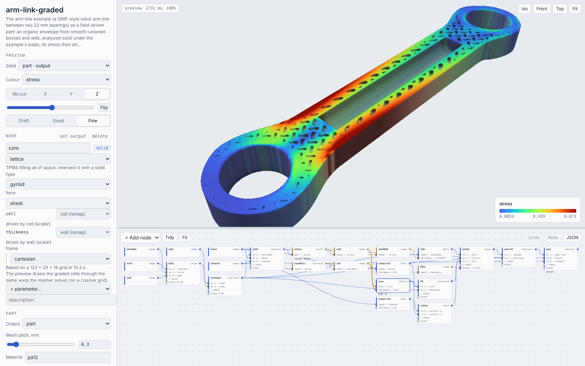
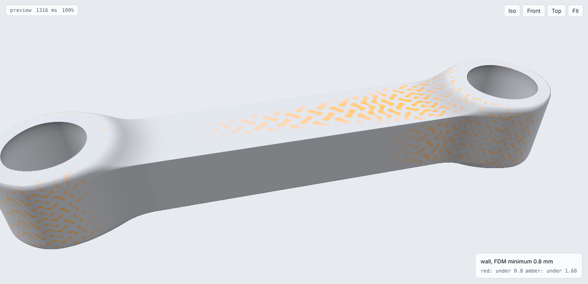
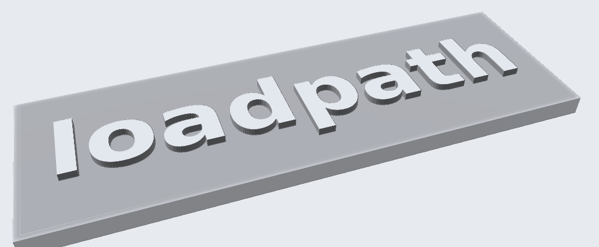
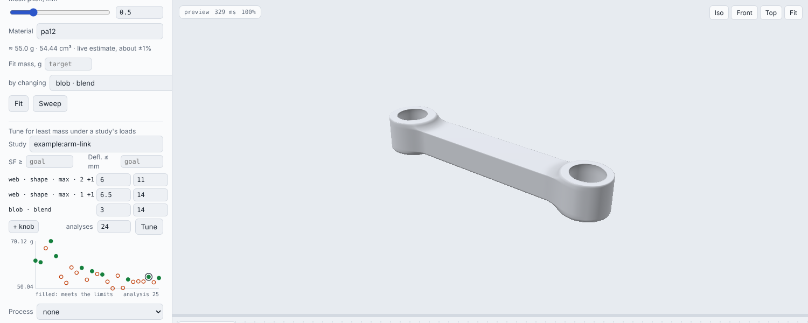
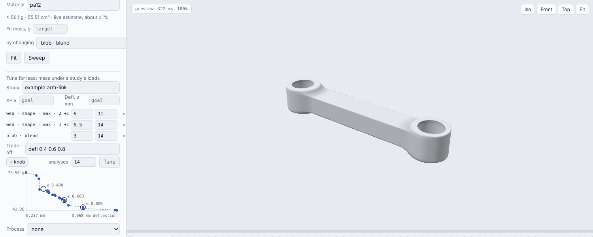

# Field-driven design

`loadpath field` builds a part from a graph of implicit fields, the way nTop
does: every solid is a signed distance (mm, negative inside), every other
quantity is a scalar field, and any number in the graph can be replaced by a
field. The wall follows the stress, the lattice cell grows away from the
bolts, the fillet is larger where the load comes in.

```
loadpath field part.json --out out/          # mesh it, check it, write part.stl + report.json
                                             # (with `materials`: one STL per body and part.3mf too)
loadpath schema field                        # the JSON Schema
```

From Python: `FieldGraph(doc).mesh()` or `run_field(doc, out_dir)` in
`loadpath.fields`; agents can call `loadpath_field` over MCP.

## Editing in the browser

```
loadpath edit part.json                      # opens http://127.0.0.1:8765: edit, preview, Save, Run
loadpath edit part.json --html editor.html   # one self-contained page, no server
```



The editor shows the graph as nodes and wires, an inspector for the
selected node, and a live preview of the part above them. Drag from a node's
output dot onto another node's port to wire a field into a parameter; pick
"number" in the inspector to unwire it. Every number has a slider. The
preview redraws as a slider moves: the page compiles the graph to a GLSL
signed-distance function and raymarches it on the GPU, and every number in
the graph is a shader uniform, so only a change of structure (an op, a
wire, an expression) recompiles, in milliseconds.

- **Solid** shows the output or the selected node; **Colour** paints any
  scalar node on it (the stress, a wall ramp, a distance); a **section**
  cuts it open and paints the cut face the same way, which is how you see
  a graded lattice inside its skin. Hover reads the position and the
  colour field's value.
- What the GPU cannot evaluate is baked on the server and sent as a 3D
  texture: a `mesh` node's distance, a `result` node's stress (its study
  runs on load: about a minute for the arm link), a `grid`, and the cell
  warp of a graded lattice (the same map the mesher solves, so the
  preview's walls sit where the part's will; it re-bakes in under a
  second as a cell slider moves). A bake that a later edit made stale
  stays on screen until its replacement arrives; an analysis re-runs only
  when asked, and later bakes and Run reuse it while its part is unchanged.
- **Colour → wall thickness** paints every wall by its thickness, traced
  in along the surface normal: red under the process's smallest feature
  (`minFeature`: FDM and SLS 0.8 mm, SLA 0.5, LPBF 0.4, ...), amber under
  twice it. Hover reads the thickness. On the arm link it shows the skin
  over the gyroid's voids at 1 to 1.6 mm, thicker where a lattice wall
  backs it.

  

  **Colour → overhangs** paints faces that point down past 45 degrees
  from vertical along the build direction (the graph's `build`, else +z)
  red, and those within 10 degrees of it amber; the face on the plate is
  left alone. `minWall` in the graph overrides the process's wall.

- **Mass** is live: the page weighs the output on the GPU as you edit
  (its volume on a grid of samples at two spacings, extrapolated; within
  about 1% of the meshed part) and multiplies by the material's density.
  **Fit mass** finds the value of any one number (a wall, a blend, a remap
  end) that gives a target mass, in a second or two; **Sweep** charts the
  mass across that number's range, and clicking a point uses that value.
- **Tune** goes past mass to strength: name a study (its loads, supports
  and limits), add knobs with **+ knob**, and the server meshes and
  analyzes candidates until the part is as light as it can be while it
  still meets the study's safety factor and deflection (see Tuning). The
  chart fills in as each analysis lands; the best values go into the
  graph, and Undo takes them back.
- **Run** meshes the graph with `run_field`, exactly as `loadpath field`
  does, at the graph's pitch, then shows the mesh, the report (mass,
  watertightness, sealed voids, drains, printability) and links to the
  STL, report.json and the full viewer. Runs go to `loadpath-edit/` beside
  the graph (`--out`).
- **mesh** in a solid node's inspector meshes just that node the same way
  (a boss, the lattice before it's clipped, one copy of a group), to its
  own `<name>-<node>.stl`; on the command line, `loadpath field graph.json
  --node <node>` (a copy's nodes are `<copy>__<node>`).
- **Save** writes the graph back to its file. Inline nodes get names
  (`owner-key`) when the graph is opened, which is the same graph;
  node positions go under `editor`, which nothing else reads. The JSON tab
  edits the text directly; Ctrl+Z undoes. Ctrl+D duplicates the selected
  node; Ctrl+C and Ctrl+V copy it between graphs, and pasting node JSON
  (`{"nodes": {...}}` or one node) adds it, renaming what clashes and
  keeping the pasted nodes wired to each other.
- The standalone page (`--html`) carries its bakes, so it opens anywhere,
  offline once three.js is cached. It cannot re-bake or run: Run
  downloads the JSON and gives the `loadpath field` command.

The preview is checked against the mesher: `tests/test_editor.py`
evaluates every op on the GPU at 4000 points and compares them with
`FieldGraph.evaluate` (to 1e-6 mm for shapes, booleans, shells, distances,
remaps, expressions and lattices; to the bake's grid for meshes). The
server listens on 127.0.0.1 unless `--host` says otherwise: it reads and
writes files in the graph's folder.

## The graph

```json
{
  "name": "bracket",
  "nodes": {
    "body":  {"op": "mesh", "path": "bracket.stl"},
    "load":  {"op": "result", "study": "bracket-study.json", "part": "bracket.stl"},
    "skinT": {"op": "remap", "input": "load", "from": [2, 20], "to": [1.0, 3.0], "curve": "smoothstep"},
    "skin":  {"op": "shell", "input": "body", "thickness": "skinT"},
    "core":  {"op": "lattice", "type": "gyroid", "cell": 6, "thickness": 0.8},
    "fill":  {"op": "intersect", "inputs": ["core", "body"]},
    "part":  {"op": "intersect", "inputs": [{"op": "union", "inputs": ["skin", "fill"], "blend": 1.0}, "body"]}
  },
  "output": "part",
  "mesh": {"pitch": 0.3},
  "material": "petg"
}
```

A parameter is a number, the name of another node, or an inline node
object. `output` names the node to mesh (default: the last one).
`loadpath check`-style linting runs first: misspelt keys, unknown ops,
references to nodes that don't exist, cycles and bad expressions all come
back at once with suggestions.

## Operations

| op | what it is | fields it takes |
| --- | --- | --- |
| `shape` | exact box, cylinder, tube, sphere or union (same JSON as a study) | |
| `mesh` | a closed STL/3MF/OBJ as a solid; distance exact near the surface | |
| `constant`, `coordinate` | a number; position along x/y/z or a direction | |
| `distance` | unsigned distance to a solid (`input`), points, a segment, a plane or a shape | `input` |
| `result` | von Mises or displacement of a part under a study (run on demand, also on one of the graph's own nodes), or a saved `.npz` | |
| `grid` | an imported scalar field on a regular grid (`.npz`: origin, pitch, values) | |
| `remap` | `from` [a, b] to `to` [c, d], linear / smoothstep / smootherstep / sqrt / square or a drawn curve (`[[u, v], ...]` over the unit square; the editor has a curve editor), clamped | `input` |
| `expr` | arithmetic over node names and x, y, z: `"0.8 + 1.2 * smoothstep(5, 30, stress)"` | `vars` |
| `union`, `intersect`, `subtract` | booleans; `blend` is the fillet radius | `inputs`, `blend` |
| `shell` | a wall inside, outside or centred on a surface | `input`, `thickness` |
| `offset` | grow or shrink | `input`, `distance` |
| `lattice` | gyroid, diamond or Schwarz P; sheet or network; cartesian or cylindrical frame | `cell`, `thickness` or `density`, `offset` |
| `transform` | translate, rotate, scale an input | `input` |
| `image` | a picture (PNG/JPG) laid on a plane as a 0..1 field: brightness or one channel, optional invert (see Images) | `path`, `size` |
| `group` | a copy of a sub-graph from `groups` with its own `params` and `inputs` (see Groups) | |

`expr` knows `abs sqrt exp log sin cos tan floor ceil sign min max clamp
lerp smoothstep step where`, comparisons and `a if c else b`; nothing else
(no attributes, no imports).

## Groups

A group is a sub-graph you use more than once, like nTop's custom blocks: a
boss, a rib, a lattice infill recipe. Define it once under `groups`, with
the knobs it takes (`params`, with defaults) and the nodes it needs from
the graph (`inputs`); then each `group` node is a copy with its own
values:

```json
"groups": {
  "boss": {"params": {"r": 2, "t": 1.5}, "inputs": ["body"],
           "nodes": {"ring": {"op": "shape", "shape": {"type": "tube", "center": [0, 0, 0], "axis": "z",
                                                       "length": 10, "r": 8, "rInner": 4}},
                     "wall": {"op": "shell", "input": "ring", "thickness": "t"},
                     "out":  {"op": "union", "inputs": ["body", "wall"], "blend": "r"}},
           "output": "out"}},
"nodes": {
  "plate": {"op": "shape", "shape": {"type": "box", "min": [-20, -20, -2], "max": [20, 20, 2]}},
  "b1": {"op": "group", "group": "boss", "params": {"t": 1.0}, "inputs": {"body": "plate"}}
}
```

Inside the group, params and inputs are referred to by name like any
node. A copy stands for the group's output, so other nodes use `b1` as
usual; its nodes come in as `b1__ring`, `b1__wall` (what `report.json` and
errors call them). Groups can use groups. In the editor, **make group** on
a node turns it and everything only it uses into a group (its constants
become knobs, what it shares with the rest of the graph its inputs), and
**ungroup** puts a copy's nodes back. A copy's knobs are sliders that move
the preview without recompiling.

## Images

An `image` node lays a picture on a plane, like nTop's image-to-field: a
logo to emboss, a texture map, a hand-painted density. `plane` is `xy`,
`xz` or `yz`; `origin` is where the picture's lower-left corner sits (mm,
in that plane) and `size` its width and height; the value is the pixel's
brightness (or `channel` r, g, b, a) from 0 to 1, `invert` flips it. It
runs through the picture along the third axis and holds its edge pixels
beyond the picture. Pictures are resized to at most 1024 px. Use it in an
`expr` like any field, for example raised lettering limited to a band:

```json
"logo":    {"op": "image", "path": "logo.png", "plane": "xy", "origin": [-40, -12], "size": [80, 24]},
"band":    {"op": "shape", "shape": {"type": "box", "min": [-41, -13, -1], "max": [41, 13, 1.2]}},
"letters": {"op": "expr", "expr": "max(band, (0.5 - logo) * 0.3)",
            "bounds": {"min": [-41, -13, -1], "max": [41, 13, 1.2]}}
```



The whole graph is examples/fields/nameplate.json. The editor bakes the
picture into a texture once; moving the picture (origin, size) re-bakes,
while the nodes around it stay live sliders.

## Tuning against a simulation

nTop's sliders move the geometry; whether the part still holds is a
separate trip to a solver. `loadpath tune` closes that loop: it turns the
numbers you name until the part is as light as it can be while every
load case of a study keeps its safety factor and deflection. Each
candidate is meshed (`tune.pitch`, default 1 mm) and analyzed by the same
FE check a study's outcome gets (`verify_part`, `tune.cells` cells), and
the search (COBYQA, derivative-free and inside each knob's range) spends
`evaluations` analyses. What comes back is the lightest candidate that met
every limit and was one body, not wherever the search stopped.

The search analyzes on a coarse grid, and a voxel reading moves as the
part slides across its grid: on the arm link the start deflects 0.500 mm
on 30k cells and 0.487 mm on 60k, while one thinner candidate read 0.485
coarse and 0.623 fine. So the start is analyzed on both and every coarse
reading is scaled by that ratio before it meets the limits;
at the end the lightest few that passed are analyzed again on the fine
grid and the first that still passes is the answer (if none does, the
lightest is returned marked `unconfirmed`).

```json
"tune": {"study": "example:arm-link",
         "params": [{"path": "nodes/web/shape/max/2", "also": ["-nodes/web/shape/min/2"], "min": 6, "max": 11},
                    {"path": "nodes/web/shape/max/1", "also": ["-nodes/web/shape/min/1"], "min": 6.5, "max": 14},
                    {"path": "nodes/blob/blend", "min": 3, "max": 14}],
         "evaluations": 24}
```

`path` is where the number sits in the graph, the same key the editor's
sliders use; `also` are numbers that move with it (`-` first for the
other way, so a box stays centred). The limits default to the study's
`goal`; `safetyFactor` and `maxDeflection` here override them.
`loadpath tune graph.json --out tune/` writes `tuned.json` (the graph with
the best values) and `tune.json` (every candidate). An analysis takes
about 12 s on the arm link, so 24 of them are about five minutes.
examples/fields/arm-link-tune.json is that example: its stiffness limit
(0.5 mm at the wrist bearing) is what binds. 25 analyses took it from
61.8 g to 54.9 g (a lower, slightly wider web and a smaller blend),
0.490 mm on the fine grid.



### The trade-off

One limit is rarely fixed in stone: 0.5 mm of deflection might be worth
relaxing for a few grams, or tightening for a stiffer arm. `tune.sweep`
runs the search again held to each value of one limit, each warm-started
from the lightest candidate that already meets it and sharing every
analysis so far:

```json
"tune": {"study": "example:arm-link", "params": [...], "sweep": {"maxDeflection": [0.4, 0.6, 0.8]}}
```

Each value's lightest confirmed part is in `tune.json` under `sweep`, and
`front` lists every candidate no other beats on mass, deflection and safety
factor at once. In the editor (Trade-off: `defl 0.4 0.6 0.8` or `SF 2 4 6`)
the chart becomes mass against deflection when the run ends, with the
sweep's picks ringed; click any point to put its values in the graph.

On the arm link (three knobs, 14 analyses per limit, 56 in all, about 20
minutes) the lightest confirmed link is 61.2 g at 0.4 mm, 55.9 g at 0.5,
51.3 g at 0.6 and 45.0 g at 0.8: every tenth of a millimetre of deflection
the arm can live with is worth 4-6 g of web.



### Lattices are tuned homogenized

A lattice's walls are a fraction of a millimetre, so analyzing the real
geometry takes cells a few tenths of a millimetre across and around a
million of them per candidate. A part with a lattice in it is analyzed with
the lattice homogenized instead (homogenized.py, `tune.analysis` `auto`):
the graph is evaluated with the lattice node filled solid and with it empty,
so each analysis cell knows its share of solid skin and of lattice; the
lattice's own wall (or density) and cell fields give the lattice's relative
density there, and lattice.py's unit-cell fits give its modulus
(E C rho^n) and its peak wall stress (A rho^-m times the stress it carries
on average). A `result` node behind the wall field runs its study once for
the whole search. Sheet lattices only.

Checked against the resolved geometry: a 60 mm skin-and-gyroid bar (1 mm
skin, 0.8 mm walls in 6 mm cells) under a tip load deflects 0.99-1.04 mm
homogenized (8k-50k cells, 3-12 s) and 0.95-1.00 mm meshed at 0.12 mm and
verified on 150k-900k voxels; the homogenized mass reads about 6% heavy
(7.3 g against 6.86 g), the safety factor 2.7-2.9 against 2.1-2.9.

Tuning the graded-lattice arm link (examples/fields/arm-link-lattice-tune.json:
the skin's thinnest and thickest wall and the gyroid's thickest wall, same
study and limits as the solid one above) does not beat the solid: the
lightest lattice link that came near 0.5 mm was 58.2 g (0.498 mm coarse,
0.511 mm on the fine grid), with the skin at the top of its range (6 mm),
against 54.9 g for the tuned solid web. It is the same answer the moonshot
experiments got: for a stiffness-bound part, a lattice costs mass per unit
of stiffness. Lattices earn their keep on impact, damping, heat transfer
and print time, not here.

## What the field-driven operations mean

- **Variable wall** (`shell` with a field `thickness`): the wall at each point
  of the surface is the field's value there. Drive it from `result` to put
  material where the stress is. `"scale": "peak"` on the result divides it
  by the part's own peak (99.5th percentile), so the remap reads in
  fractions of the worst stress (`"from": [0.1, 0.8]`) and works whatever the
  load level.
- **Variable fillet** (`blend` as a field): a smooth union whose radius
  changes along the joint. Larger where members meet under load, small where
  they don't.
- **Graded lattice**: `cell` as a field bends the lattice's coordinates so
  that one period is one local cell (a Poisson solve for the map whose
  gradient is 1/cell, over the output's box). Walls stay continuous through
  the whole grading, with no seams between cell sizes; where the cell field
  changes direction faster than the map can follow, cells come out a few
  percent off square. `grading: "blend"` instead cross-fades lattices of
  fixed periods (needed with a cylindrical frame; it leaves crumbs where
  they disagree). `density` uses the homogenized tables in `lattice.py` to
  turn a relative density into a wall.
- **Cylindrical lattice** (`"frame": {"type": "cylindrical", "axis": "z",
  "radius": 20}`): cells wrapped round an axis, with a whole number of cells
  round the circumference, for tubes and rings.

## Meshes come out smooth

Marching cubes alone leaves every vertex on a grid edge, up to a third of a
pitch off a curved surface. `field_mesh` then relaxes the vertices along the
surface and projects each one onto the field's zero level along its
gradient, so vertices sit on the true surface to about 1e-5 mm: a bore is
round and a sweep is smooth at any pitch. A crease made inside the field
(two field surfaces meeting) comes out rounded over about one pitch.

## Sharp edges where the graph asks for them

A hard boolean (`union`, `intersect` or `subtract` with no `blend`) between
the organic part and a plain shape (a `shape` node: box, cylinder, sphere,
a union of those) or an imported `mesh` node is done exactly (sharp.py):
the organic side is meshed from its field, the shape is built exactly, and
manifold3d does the boolean. So a bearing bore, a bolt face or a keep-out
cut from the part has a true edge where it meets the part, not a fillet one
pitch wide. Booleans with a blend, and booleans between field-only inputs
(a skin and the envelope it was shelled from), stay in the field, rounded
as before. `"mesh": {"sharp": false}` turns it off.

The organic side is meshed from an extended field: inside what the exact
shape cuts away it carries on from just outside along the shape's normal,
so a collar built as a shell of the bore, whose inner wall sits exactly on
the bore, leaves no film of slivers behind when the bore is cut.

`run_field` reports `sharpEdges`: samples of every exact shape's surface
where it is the part's boundary, and how far the mesh is from them (mean,
p99, max, `exactFraction` within 0.01 mm, and the same for the samples
within 1 mm of a crease, `edges`). On the arm link (bench/sharp_edges.py),
the bearing bores and cable channel:

| arm link, 0.3-0.4 mm pitch | edge samples off by (max / p99) | within 0.01 mm at the edges |
| --- | --- | --- |
| solid envelope, field only (before) | 0.217 / 0.173 mm | 42% |
| solid envelope, sharp | 0.012 / 0.002 mm | 100% |
| graded lattice part, field only (before) | 0.197 / 0.174 mm | 54% |
| graded lattice part, sharp | 0.007 / 0.002 mm | 100% |

Sharp meshing costs nothing extra (9 s either way on the solid; 100 s
against 138 s on the lattice part, since the organic field no longer has to
draw the bores).

## STEP

`"step": true` (or `loadpath field graph.json --step`) also writes
`<name>.step` (needs `pip install "loadpath[step]"`, OpenCascade). The exact
shapes stay exact: bores are cylinders, box faces planes, so a CAD user can
mate and dimension against them. Organic regions are faceted, one planar
face per triangle, decimated first to `"step": {"faces": 20000}` (about
45 MB; coplanar facets merge). The report gives the faces by type, the
share of the area on exact geometry, the volume against the STL's, and what
decimating cost (`decimated[].deviation`, mm). A lattice does not decimate
and is refused: ship lattice parts as STL or 3MF.

Study parts carry their plan too (`loadpath run study.json --step`): the
keep-outs, preserved shapes and design space are exact, the organic body
faceted. Each OpenCascade boolean is checked against manifold3d's result
for the same solids and retried (fuzz, tools apart or fused) until it is
valid and its volume agrees, so a STEP file does not quietly differ from
the STL. Measured (bench/sharp_edges.py, coarse eval tier):

| part | STEP faces | exact area | volume vs STL | size, time |
| --- | --- | --- | --- | --- |
| arm-link example | 13 cylinders, 6 planes, 13.2k facets | 22% | -0.02% | 33 MB, 24 s |
| GRIP turret | 24 cylinders, 26 planes, 12.6k facets | 49% | -0.01% | 33 MB, 39 s |
| GRIP wrist yoke | 42 cylinders, 29 planes, 16.3k facets | 28% | -0.002% | 42 MB, 34 s |
| arm link field graph (solid) | 3 cylinders, 2 planes, 11.2k facets | 29% | -0.02% | 28 MB, 16 s |

The study STLs' circles are now 0.002 mm true as well (they were 96-gons:
the turret's 48 mm J2 sleeve was 0.026 mm off, and only 59% of its keep-out
surface was within 0.01 mm; now 100%).

Pick the pitch from the thinnest wall: a third of it or finer.

### Fewer triangles: decimation

`"mesh": {"decimate": 0.02}` (or `--decimate 0.02`) collapses edges
wherever the mesh stays within 0.02 mm of the true surface, checked
against the field itself at every reshaped triangle. Flat and gently
curved regions lose most of their triangles, creases and small fillets
keep theirs, the mesh stays watertight and every vertex stays on the
surface. A solid link at 0.15 mm pitch drops from 781k to 49k triangles;
a gyroid lattice, curved everywhere, to about a quarter. It also works
with `stream`.

### Very large parts

A fine lattice through a big part is tens of millions of triangles, more
than fits in memory as one mesh. `"mesh": {"stream": true}` (or
`loadpath field --stream`) writes the STL slab by slab instead: memory is
one slab of blocks 32 cells thick whatever the part, there is no cell
budget, and the report still has the volume, area, mass and a watertight
check (each slab's open edges are matched against its neighbours'). The
checks that need the whole mesh (printability, bodies, the render) are
skipped. Field evaluation runs on every core (`LOADPATH_THREADS` caps it).

### Evaluating on the GPU

Once meshing is narrow-band, evaluating the graph is most of the time
(marching cubes is ~4%). With the `gpu` extra installed (PyTorch), graphs
evaluate with torch (`loadpath/fieldtorch.py`): on an NVIDIA or Apple
Silicon GPU by default, or on the CPU with `LOADPATH_FIELD_DEVICE=torch`.
`LOADPATH_FIELD_DEVICE=numpy` turns it off, and `LOADPATH_FIELD_DTYPE`
picks float32 (GPU default) or float64 (CPU default). Every op runs in
torch except meshes, point clouds, scattered samples, strut lattices and a
few rarer options, which run on numpy for that node only and are copied
over. Answers match numpy to ~1e-7 mm in float64
and ~5e-4 mm in float32 (the arm link meshes to the same 822,842 faces).

Measured on the 4-core cloud box, graded arm link at 0.4 mm pitch: numpy
17.3 s, torch on the CPU 10.5 s (float32) or 12.3 s (float64); raw
evaluation of 1M points goes 2.1 s to 0.3 s. **The GPU speedup is
unmeasured** (no GPU in the cloud). On the CPU, evaluation is still ~7 of
those 10 s; a GPU should take most of that away, leaving marching cubes
and the vertex bookkeeping (~2-3 s) as the floor. Graphs with numpy-only
nodes gain less.

## Drain holes

A skin over a lattice traps whatever the lattice was printed in: powder
(SLS, MJF, metal powder bed) or uncured resin (SLA, DLP, volumetric). With
`"process": "sls"` (or `mjf`, `sla`, `dlp`, `volumetric`, `lpbf`) the
graph drills its own drain holes before it is meshed:

```json
{"process": "sls", "drains": {"keepClear": ["bores"]}}
```

1. The output is sampled on a grid (the mesh pitch) and every void that
   cannot reach the outside is found, down to the slivers where a lattice
   wall grazes the skin.
2. Voids smaller than the escape ball (`fillBelow`) are filled solid.
3. Every other void gets `count` holes (default 2), then more until no
   powder is over `maxPath` (default 60 mm) from one. Powder removal is
   where a part fails in production, so the holes are well over the
   process's minimum escape hole: 1.5 x it or 2 mm over, whichever is
   larger (SLS 6 mm, MJF 7.5, SLA/DLP 5.5, volumetric 5; LPBF 6.8, an M8
   tap drill, so it can be plugged). `diameter` and `"maxPath": null`
   take it back toward the minimum. The
   sites are ranked by the graph's own stress (the first `result` node, or
   `stress`), calmest first: a hole is a stress raiser. The first goes
   lowest along the build and the second highest, well apart, so air or
   rinse flows through, and resin has a drain at the bottom and a vent at
   the top. A site has to be on the void's wall just under the skin, with
   a straight way out, on a face flat out past the boss (no edges, no
   bores or seats: a concave face is refused), and clear of `keepClear`.
4. Each hole gets a solid boss (1.5 x the minimum wall, smooth-unioned in)
   so the bore has a clean wall and the lattice walls it cuts are tied in.
5. The grid is labelled again; anything a boss walled off gets the same
   treatment, up to four rounds.

The holes, bosses and fill are ordinary nodes added to the graph
(`drain-bore-1`, `drain-boss-1`, ..., output `drained`). The report's
`drains` says what was done and checks it: `sealedAfter` (on the grid),
each void's `farthestFromOpening` (the powder path, mm) and
`unreachedVolume`, processcheck's escape ball on the drilled field and on
the delivered mesh (`meshEscape`), and the mesh's own `enclosedVoids`.
`drains.ok` is true only when all of them are clear. `"drains": false`
turns it off; `"drains": true` drills for any process.

Sites are chosen calm first: the stress a hole sees is the worse of its
inner end's and its mouth's (a bending part is calm at the core, not at
the skin). The holes `maxPath` adds go where the powder is farthest,
calmest first, so they sit hotter than the first two.

On the arm-link example in PA12 (`"process": "sls"`): 47 sealed voids
(both gyroid labyrinths, the cable channel and 378 slivers by the bearing
collars, 16.6 cm^3) become 14 holes of 6 mm and 0.4 cm^3 of fill. No
powder is more than 50 mm from a hole (two minimum-size holes a void left
it 124 mm away). The meshed part has no sealed shell and the 4 mm escape
ball reaches every chamber. The first holes sit at 4 to 15% of the peak
stress, the added ones at 17 to 30%. Under the arm-link study
(verify_part, 400k cells): undrilled SF 13.4 and 0.587 mm, drilled SF
13.5 and 0.647 mm, 0.9 g lighter. The holes cost about 10% of stiffness,
not strength.


## Multi-material bodies

A graph can say which material goes where. `materials` lists the part's
bodies, each with a `name` and a `material`, in precedence order:

```json
"materials": [
  {"name": "pad",  "material": "tpu",  "solid": "padZone", "where": "faceDistance", "below": 2.5},
  {"name": "skin", "material": "tpu",  "where": "stress", "above": 0.6},
  {"name": "core", "material": "petg"}
]
```

- `solid` takes the body from a solid node (a boss, a shell, a box that
  marks a zone); without it the body is drawn from the whole part.
- `where` with `above` and/or `below` takes the points of that solid where a
  scalar field is past a threshold: TPU within 2.5 mm of the gripping face
  (a `distance`), wherever a `result` stress is over 60% of its peak
  (`"scale": "peak"`), wherever a remapped ramp says. The thresholds are
  fields like any number in the graph (`"below": {"op": "expr", "expr":
  "0.2 * x"}` tilts the interface).
- Earlier bodies win: each body is its region of the part less what the
  bodies before it took, so bodies never overlap and together they are the
  part. A body with neither `solid` nor `where` takes whatever is left; end
  with one (the report warns about part volume no body claims, and a body
  that came out empty). Bodies are clipped to the graph's output.
- `mix` (a field from 0 to 1) with a material pair `[A, B]` makes a graded
  blend instead of a hard partition, for multi-material jetting: 0 is all
  A, 1 all B. The body is still a body (its region is chosen as above);
  inside it the fraction is written as a voxel print job
  (`voxelprint.export_voxel_slices`: `voxel` sets `pitch`, `printer`,
  default j850, and the resins, by default `vero` -> VeroCyan and
  `agilus30` -> Agilus30Blk) and the body is weighed by the blend.
- `extruder` and `color` go into the 3MF (default: one extruder per
  distinct material, in order).

**Coincident interfaces.** The part is meshed once, exactly as without
materials (sharp edges and all). Each body's region is then meshed from its
own field and manifold3d splits what is left of the part by it: one exact
boolean gives both sides of the cut, so two bodies share their interface
surface exactly (the same triangles' vertices, no gap, no overlap) and
each is watertight, as a slicer wants for a multi-material object. The
region's field is carried on outside the part (as sharp.py's extended
field: it reads its value a pitch inside along the part's normal, and is
solid from three pitches out), so its surface only exists where it cuts
through the part; a body whose solid is a shell of the part (its outer
wall exactly on the part's surface) splits without slivers. A threshold on
a field that is not a distance (a stress) has no slope bound for the
narrow band, so regions are sampled densely while the grid fits (16M
cells). The interface is where the region's field crosses zero, to the
mesher's usual accuracy; a crease inside a region (a box's corner) comes
out rounded over a pitch, as anywhere in a field.

`run_field` then writes `<name>-<body>.stl` for each body (the union is
still `<name>.stl`) and `<name>.3mf` with one part per body and its
extruder (`threemf.write_multimaterial_3mf`; PrusaSlicer and Bambu/Orca
read it as one object). The report's `materials` gives each body's volume
(mm^3), mass (g, from its material's density), share of the part, faces and
watertightness; `interfaces`, the area (mm^2) between each pair of bodies
that touch; and `check`: the bodies' volume against the part's
(`volumeError`), what no body claimed and the largest pairwise overlap
(mm^3). The graph's `mass` is the bodies' total.

[`examples/fields/gripper_pad.json`](../examples/fields/gripper_pad.json) is
a gripper finger, 70 x 16 x 12 mm (a rounded box with a 5.2 mm pin bore at
the base), in PETG with a TPU contact pad 2.5 mm thick on its gripping face
from 24 mm out to the tip: the pad is where the distance to the face plane
is under 2.5 mm. At 0.35 mm pitch it runs in 6 s on the 4-core box: pad
1176.6 mm^3 (1.42 g of TPU), core 11283.7 mm^3 (14.33 g of PETG), 15.75 g in
all; the interface is 559.7 mm^2 (the 46 mm long face and the pad's end);
the bodies sum to the part's 12460.3 mm^3 to 1e-10, overlap by 1e-8 mm^3,
and both are watertight.

`tests/test_field_materials.py` checks the bodies against volumes and
areas worked out by hand: a slab above a plane, overlapping solids taken
in order, a tilted field threshold, a threshold on a non-distance field,
a skin that is a shell of a sphere, and a mix body's mass.

## Pitfalls

- A big `blend` in a union bulges past the inputs by up to blend/4: a link
  whose bosses are unioned to a web with a 12 mm blend gets domed boss
  faces. Intersect with a slab (or the design box) afterwards.
- Union a lattice with its skin inside the envelope, then intersect the
  result with the envelope again, or the blend pushes lattice ridges through
  the outer skin.
- A closed skin over a lattice seals the voids in. The report counts them
  (`enclosedVoids`, `enclosedVoidVolume`). Give the graph a `process` and
  it drills them (next section); without one nothing is drilled.
- A bare lattice fills all of space: intersect it with a solid, or give the
  graph `bounds`.

## Example

[`examples/fields/arm-link-graded.json`](../examples/fields/arm-link-graded.json)
is the arm-link example rebuilt as a field part: an organic envelope from
smooth-unioned bosses and web, analyzed solid under the example's loads by a
`result` node; that stress sets the skin thickness and the gyroid wall, the
gyroid cell grows away from the bearings, solid collars ring the bearing
seats, a liner wraps the cable channel and the fillet where everything meets
is larger near the bearings. `python examples/fields/arm_link.py` meshes it,
and a uniform lattice of about the same mass, and verifies both.
