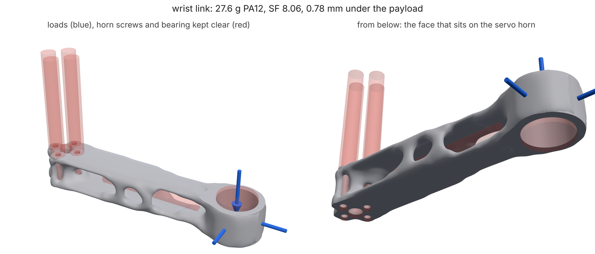

# An agent designs a part through MCP

A coding agent (Claude Code, Claude Desktop, Cursor, anything that speaks
MCP) designs a whole part with loadpath's MCP tools and nothing else: it
finds a starting point, writes the study, lets `loadpath_check` catch its
mistakes, runs the study as a background job, reads the report, tightens
the goal when the report shows a problem, and checks the part it hands
over. The part is a GRIP-style wrist link in SLS PA12: bolted to a servo
horn by four M3 screws at one end, carrying the next joint's 22 mm bearing
110 mm out, with a cable channel down the middle.

Every call and result on this page comes from
[`transcript.py`](transcript.py), which makes the same calls through a real
MCP client session against `python -m loadpath mcp` and records them. About
22 minutes on 4 cores, 6 with `LOADPATH_QUICK=1`.



## 1. Connect the agent

```sh
pip install "loadpath[mcp]"
claude mcp add loadpath -e LOADPATH_RECALL=1 -- loadpath mcp     # Claude Code
```

Claude Desktop (and most other clients) take the same thing as JSON, in
`claude_desktop_config.json` (Settings > Developer > Edit Config):

```json
{"mcpServers": {"loadpath": {"command": "/full/path/to/loadpath", "args": ["mcp"],
                             "env": {"LOADPATH_RECALL": "1"}}}}
```

Give the full path (`which loadpath`): a desktop app does not see your
shell's `PATH`. An MCP client starts the server with a bare environment, so
anything loadpath should read goes in `env`: `LOADPATH_RECALL=1` lets a
rerun reuse the designs earlier runs found (calls 9-11 below),
`LOADPATH_QUICK=1` makes every job a coarse first look (the server then
says so in its check, start and status answers), `LOADPATH_HOME` moves the job folders (default
`~/.loadpath/jobs`). The server runs on the agent's machine; nothing leaves
it. Also give the agent the skill,
[`loadpath/SKILL.md`](../../../loadpath/SKILL.md) (or let it call
`loadpath_guide` once): it is the engineering, the tools are the syntax.

## 2. Replay the session

```bash
python transcript.py
```

It starts the server over stdio, makes the twelve calls below, prints each
with its result (trimmed to what an agent reads; the full answers are under
`jobs/`), and writes `transcript.json` (every step, plus a summary),
`report.json` (the final job's report) and `wrist-link.stl`. It polls every
5 s; an agent should poll every 30-60 s.

## 3. The loop, call by call

Results below are from a full run, trimmed by `transcript.py` (and `...`
where this page shortens them further).

### Find a starting point (calls 1-3)

```text
-> loadpath_examples {}
<- {"examples": ["arm-link (study)", "bumpered-bracket (study)", "gripper-finger-mm (study)", ...]}
-> loadpath_examples {"name": "arm-link"}
<- {"name": "arm-link", "material": "pa12", "process": "sls", "goal": {"safetyFactor": 3.0, "maxDeflection": 0.5},
    "minMember": 3.0}
-> loadpath_schema {"kind": "study"}
<- {"properties": ["name", "description", "designSpace", "preserve", "keepOut", "fasteners", "supports", ...],
    "$defs.fastener.description": "A bolted joint as an interface: ... Adds regions <id>-bore, <id>-head,
                                   <id>-seat, <id>-face or <id>-thread (and <id>-tap)."}
```

`arm-link` is the nearest example (a link between two bearings in SLS
PA12). The schema says how to write the horn screws: as `fasteners`, each
of which adds named regions (`h1-bore`, ...) that supports can use.

### Write the study and check it (calls 4-5)

The agent's study, [`wrist-link.json`](wrist-link.json) (as committed,
fixed):

```text
"designSpace": [{"type": "box", "min": [-14, -16, -10], "max": [124, 16, 10]}]
"fasteners":   four M3 on a 16 mm circle, seats at z = 10, "direction": "-z", "grip": 20, "end": "face"
"preserve":    "bearing-boss", a 29 mm cylinder round the bearing at x = 110
"keepOut":     "horn-hub" (r 3.5), "bearing" (r 11), "cable" (r 4, x = 28 to 88)
"supports":    [{"region": "h1-bore"}, ..., {"region": "h4-bore"}]
"loadCases":   payload: {"region": "bearing", "mass": 1.0, "dynamic": 1.5, "gravity": "-z", "at": [180, 0, 0]}
               push:    {"region": "bearing", "force": [-20, 0, 0]}
               side:    {"region": "bearing", "force": [0, 15, 0], "distribution": "bearing"}
"material": "pa12", "process": "sls", "goal": {"safetyFactor": 2.0}, "minMember": 3.0
```

The payload is GRIP's: 1 kg at the gripper, 70 mm past the bearing, with a
dynamic factor of 1.5; `mass` and `at` turn that into 14.7 N and its moment
about the bearing, so the agent does no arithmetic. The first draft had
`"keepout"` for `"keepOut"` and `"gravity": "down"`:

```text
-> loadpath_check {"study": <wrist-link.json with "keepout" and "gravity": "down">}
<- {"ok": false,
    "error": "$.keepout: unknown key; did you mean 'keepOut'?; $.loadCases[0].loads[0].gravity: 'down' is not valid: like '-x' or '+z'",
    "issues": [{"level": "error", "path": "$.keepout", "message": "unknown key; did you mean 'keepOut'?"},
               {"level": "error", "path": "$.loadCases[0].loads[0].gravity",
                "message": "'down' is not valid: like '-x' or '+z'"}],
    "schema": "loadpath schema study (MCP: loadpath_schema)"}
```

Both problems at once, each with its JSON path and, for the misspelt key,
the fix. The agent fixes both and checks again:

```text
-> loadpath_check {"study": <wrist-link.json>}
<- {"ok": true, "cells": 10862, "pitch": 1.95,
    "regions": ["bearing-boss", "h1-seat", "h1-face", ..., "horn-hub", "bearing", "cable", "h1-bore", "h1-head", ...],
    "loadCases": ["payload", "push", "side", "preload"], "warnings": [],
    "notes": ["pitch 1.95 mm is set by minMember 3 mm (two cells per filter radius; finer cells only cost time),
               so the grid has 10862 cells, fewer than resolution.maxElements 20000"]}
```

`ok`, the grid, the regions the fasteners added and the `preload` case
they added. Fix every warning before running; this study has none, and the
note is information.

### Run it, poll, read the report (calls 6-8)

```text
-> loadpath_start {"study": <wrist-link.json>}
<- {"ok": true, "jobId": "6d4bc109f34b4502b5d5785fab4831e3", "kind": "study", "cells": 10862,
    "next": "Poll loadpath_status every 30-60 seconds; a study takes minutes."}
-> loadpath_status {"job_id": "6d4bc109f34b4502b5d5785fab4831e3"}
<- {"status": "running", "kind": "study", "name": "grip-wrist-link", "elapsedSeconds": 5,
    "latest": {"stage": "optimize", "volumeFraction": 0.3},
    "next": "Poll loadpath_status every 30-60 seconds; a study takes minutes."}
```

`latest` is the job's newest progress event: which volume fraction the
search is optimizing, meshing or verifying. 17 minutes later:

```text
-> loadpath_status {"job_id": "6d4bc109f34b4502b5d5785fab4831e3"}
<- {"status": "done",
    "deliver": {"passes": true, "mass": 24.5, "safetyFactor": 4.82, "safetyFactorMethod": "voxel-fine",
                "governedBy": "safetyFactor", "target": {"safetyFactor": 2.0}, "maxDeflection": 1.04,
                "cases": [{"name": "payload", "safetyFactor": 4.82, "deflection": 1.04},
                          {"name": "push", "safetyFactor": 58.8, "deflection": 0.0126},
                          {"name": "side", "safetyFactor": 6.2, "deflection": 0.819},
                          {"name": "preload", "safetyFactor": 14.4, "deflection": 2.81e-05}],
                "warnings": []},
    "outcomes": [
      {"outcome": 0, "volumeFraction": 0.3, "massGrams": 28.7, "safetyFactor": 8.99, "passes": true, "bodies": 1,
       "start": "cold", "attention": []},
      {"outcome": 1, "volumeFraction": 0.15, "massGrams": 17.0, "safetyFactor": 0.119, "passes": false, "bodies": 1,
       "start": "warm from 0.300",
       "attention": ["does not meet the goal (safety factor 0.12 under 2): raise the volume fraction or the material,
                      or check the loads"]},
      {"outcome": 2, "volumeFraction": 0.225, "massGrams": 22.2, "safetyFactor": 1.71, "passes": false, ...},
      {"outcome": 3, "volumeFraction": 0.262, "massGrams": 25.7, "safetyFactor": 7.49, "passes": true, ...},
      {"outcome": 4, "volumeFraction": 0.244, "massGrams": 24.5, "safetyFactor": 4.82, "passes": true, "bodies": 1,
       "start": "warm from 0.262", "attention": []}],
    "best": 4, "stl": "jobs/6d4bc109.../out/grip-wrist-link-24.stl", "viewer": "jobs/6d4bc109.../out/viewer.html",
    "images": 1}
```

(`images: 1` is the render of the best outcome, which comes back as an
image the agent can look at.)

### Act on the report (calls 9-11)

The part passes: 24.5 g, SF 4.82 on the fine re-check (`voxel-fine`), one
body, nothing in any `attention` list. The search tried five fractions; 22 g
failed at SF 1.7, so the answer sits on that step and its SF is well over
the goal of 2. But the payload case moves the bearing **1.04 mm**, and the
brief for this joint said at most 0.8 mm (any more and the gripper droops
visibly at full reach). The first goal only asked for strength, and SKILL.md
warns that mechanisms are usually limited by deflection. So the agent adds
the limit it left out and starts the same study again:

```text
-> loadpath_start {"study": <wrist-link.json with "goal": {"safetyFactor": 2.0, "maxDeflection": 0.8}>}
<- {"ok": true, "jobId": "5a298f6520934c74945bc285fb0e5b29", "kind": "study", "cells": 10862, "next": "..."}
-> loadpath_status {"job_id": "5a298f6520934c74945bc285fb0e5b29"}
<- {"status": "running", ..., "elapsedSeconds": 5, "latest": {"stage": "mesh", "volumeFraction": 0.3}, ...}
```

8 minutes later:

```text
-> loadpath_status {"job_id": "5a298f6520934c74945bc285fb0e5b29"}
<- {"status": "done",
    "deliver": {"passes": true, "mass": 27.6, "safetyFactor": 8.06, "safetyFactorMethod": "voxel-fine",
                "governedBy": "maxDeflection", "target": {"safetyFactor": 2.0, "maxDeflection": 0.8},
                "maxDeflection": 0.784,
                "cases": [{"name": "payload", "safetyFactor": 8.06, "deflection": 0.784},
                          {"name": "push", "safetyFactor": 84.7, "deflection": 0.00976},
                          {"name": "side", "safetyFactor": 8.96, "deflection": 0.54},
                          {"name": "preload", "safetyFactor": 14.4, "deflection": 7.6e-06}],
                "warnings": []},
    "outcomes": [
      {"outcome": 0, "volumeFraction": 0.3, "massGrams": 28.7, "safetyFactor": 8.99, "passes": true,
       "start": "recalled 0.300", ...},
      {"outcome": 1, "volumeFraction": 0.244, "massGrams": 24.5, "safetyFactor": 5.93, "passes": false,
       "start": "recalled 0.244",
       "attention": ["does not meet the goal (deflection 0.90 mm over 0.8): raise the volume fraction or the
                      material, or check the loads"]},
      {"outcome": 2, "volumeFraction": 0.262, "massGrams": 25.7, "safetyFactor": 7.49, "passes": false,
       "start": "recalled 0.262", ...},
      {"outcome": 3, "volumeFraction": 0.281, "massGrams": 27.6, "safetyFactor": 8.06, "passes": true, "bodies": 1,
       "start": "warm from 0.300", "attention": []}],
    "best": 3, "stl": "jobs/5a298f65.../out/grip-wrist-link-28.stl", ...}
```

`governedBy` is now `maxDeflection`: the bearing moves 0.78 mm and the part
weighs 27.6 g, 3.1 g (13%) more for a quarter less sag; its SF rose to 8 on
the way. The rerun took half the time of the first: with `LOADPATH_RECALL`
set, three of its four outcomes (`"start": "recalled ..."`) are the first
run's designs, re-meshed and re-verified against the new goal instead of
optimized again; only 0.281 is new. Each failing outcome's `attention`
says which limit it missed.

### Check the part it hands over (call 12)

```text
-> loadpath_check_printability {"path": "jobs/5a298f65.../out/grip-wrist-link-28.stl", "process": "sls",
                                "material": "pa12", "min_wall": 1.0}
<- {"ok": true, "watertight": true, "wallP1Mm": 2.5, "trappedVoidCount": 0, "process": {"ok": true, "warnings": []}}
```

Watertight, walls well over SLS's minimum, no powder trapped. This is
where the agent offers the user the `viewer` page and, if they want it, a
print quote (SKILL.md step 10), never an order unasked.

## Before trusting the result

What the agent should look at before it tells anyone the part is done
(SKILL.md step 9, docs/agents.md "The loop"):

- `deliver.passes`, its `safetyFactor` and `safetyFactorMethod`: quote the
  number with where it came from (`tet`, `voxel-fine` or `voxel`), and
  `governedBy`, the limit that set the part's size;
- `deliver.warnings` and every outcome's `attention` list: an empty one
  means the numbers SKILL.md says to check are fine;
- `bodies` 1 (more means a piece is not connected to a support),
  `keepOutIntrusionMm3` and `preserveMissingMm3` near 0 (the screws and the
  bearing go in), `p5MemberMm` above what the printer can make; all in each
  outcome of the full `loadpath_status` answer;
- the render, which `loadpath_status` returns as an image: does material
  go where the load path should, are the interfaces whole? A clean report
  on the wrong problem is still the wrong part;
- a `quick` note in any answer: the server is in quick mode, and the
  numbers are a first look, not the part to print;
- the problem itself: the part is only as right as the loads. Here the
  1.5 dynamic factor, the 70 mm gripper offset and the 0.8 mm limit are
  GRIP's; a different arm needs its own.

## What you should see

| | full run | quick |
|---|---|---|
| calls | 12, in the order above | the same |
| first `loadpath_check` | 2 errors: `$.keepout` (did you mean `keepOut`), `$.loadCases[0].loads[0].gravity` | the same, word for word |
| first run, goal SF 2 | 24.5 g, SF 4.82 (voxel-fine), payload 1.04 mm; 5 outcomes, 17 min | 26.0 g, SF 4.22, payload 2.05 mm |
| final, SF 2 and 0.8 mm | **27.6 g, SF 8.06, payload 0.78 mm**, governed by deflection; 3 of 4 outcomes recalled, 8 min | 39.0 g, SF 9.78, payload 0.41 mm |
| delivered part | one body, watertight, SLS checks clean | the same |

## Quick mode

`LOADPATH_QUICK=1 python transcript.py` passes the variable on to the
server, which runs every job on a coarse grid (6000 cells, 30 iterations,
a shorter search) in about 6 minutes; every `loadpath_check`,
`loadpath_start` and `loadpath_status` answer then carries a `quick` note
so an agent cannot mistake it for the part to print. The coarse grid is
much floppier (2.05 mm against 1.04), so the quick final part is heavier.
CI runs this tutorial that way
([test_tutorials.py](../../../tests/test_tutorials.py)) and holds
`transcript.json` to [expect.json](expect.json): the tool sequence, the
check's two errors word for word as quoted above, the final part passing
under 0.8 mm with recalled outcomes, and its mass and safety factor.

The image comes from [render.py](render.py) after a full run.
