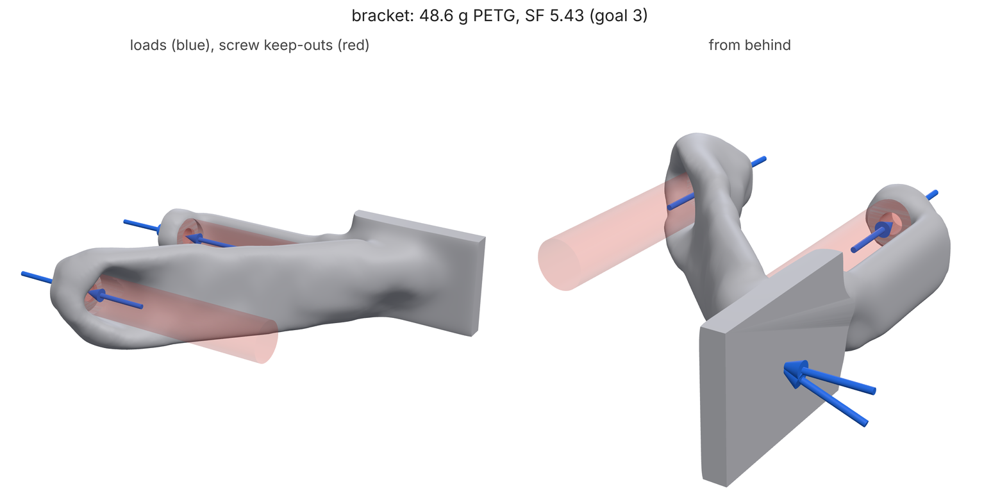
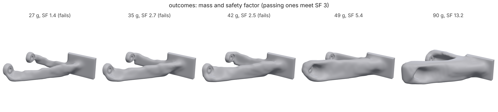
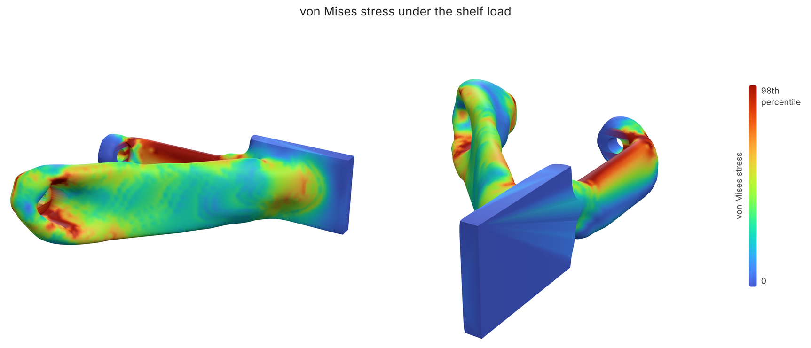

# FDM bracket: topology optimization to a printable 3MF

A wall bracket for a shelf, printed in PETG on an FDM printer. Two M5 screws
hold it to the wall; the shelf sits on a 40 mm pad 100 mm out and puts 100 N
on it (10 kg). You describe the interfaces and the loads, loadpath finds the
lightest shape that holds a safety factor of 3, checks it on a finer grid,
and picks the build direction that prints it best. About 15 minutes on 4
cores, 2 minutes with `--quick`.



## 1. The study

[`bracket.json`](bracket.json) is the whole problem. The pieces:

```text
"designSpace": [{"type": "box", "min": [0, 0, -15], "max": [100, 80, 15]}]
```

Where material may go: a 100 x 80 x 30 mm box, the wall at x = 0.

```text
"fasteners": [
  {"id": "upper", "size": "M5", "seat": [6, 65, 0], "direction": "-x", "grip": 6, "end": "face"},
  {"id": "lower", "size": "M5", "seat": [6, 15, 0], "direction": "-x", "grip": 6, "end": "face"}]
```

Each screw becomes a bore, a keep-out for the screw head and driver (red in
the render), a 6 mm boss to clamp, and named regions (`upper-bore`,
`upper-face`, ...) that supports and loads can use. It also adds a
`preload` load case for the screw's clamp force.

```text
"preserve": [{"id": "shelf-pad", "shape": {"type": "box", "min": [60, 76, -15], "max": [100, 80, 15]}}]
"supports": [{"region": "upper-bore", "fix": "yz"}, {"region": "lower-bore", "fix": "yz"},
             {"shape": {"type": "box", "min": [0, 0, -15], "max": [1, 80, 15]}, "fix": "x"}]
"loadCases": [{"name": "shelf", "loads": [{"region": "shelf-pad", "force": [0, -100, 0]}]},
              {"name": "pull",  "loads": [{"region": "shelf-pad", "force": [0, -40, 15]}]}]
```

The pad stays solid. The screws hold the bracket up and sideways, and the wall
pushes back on its face (x only: the wall can push, the screws pull). Two load
cases: the shelf's weight, and someone pulling the shelf sideways. Every
outcome must survive both.

```text
"material": "petg", "process": {"type": "fdm", "buildDirection": "+z"},
"goal": {"safetyFactor": 3.0}, "minMember": 4.0
```

PETG from the material library (`loadpath materials petg` shows the card and
its sources), printed flat (+z up), weaker across layers than along them; no
member thinner than 4 mm.

## 2. Check it

```bash
loadpath check bracket.json
```

`"ok": true`, a 2.6 mm grid of 13 436 cells, and the regions the fasteners
added. A misspelt key or an impossible support fails here, with the path to
fix, before any solve.

## 3. Run it

```bash
loadpath run bracket.json --out out/
```

Progress streams to stderr as JSON lines. The optimizer runs at several
volume fractions, each outcome is meshed, then verified on a finer grid (82k
cells) with a print check (supports, bed contact, bridges) and the
across-layer stress. `out/` gets one STL, 3MF and render per outcome,
`best.stl` (the lightest that passes), `report.json` and `viewer.html` (open it
to orbit the part, colour it by stress and replay the optimization).



## 4. Read the report

| | full run | `--quick` |
|---|---|---|
| best outcome | volume fraction 0.15 | 0.15 |
| mass | **48.6 g** (83% lighter than the box) | 49.5 g |
| safety factor (worst case) | **5.43** (pull), shelf 6.12 | 6.26 |
| passes SF 3 | yes | yes |
| bodies | 1 | 1 |
| thinnest member | 4.0 mm | |
| shelf-load deflection | 0.23 mm | |
| lighter outcomes | 27-45 g, SF 1.4-2.8: fail | 29 g, SF 0.4: fails |

The search tried nine fractions; below 45 g the bracket drops under SF 3, so
48.6 g is the answer. Its SF of 5.4 is above the goal because the outcomes
step: the next lighter design that held together failed at 2.8.
`keepOutIntrusion` should be ~0 mm³ (the screws go in) and `preserveMissing`
0 (the pad is whole). The stress plot shows the two load paths, the upper arm
in tension and the lower one in compression, both working:



## 5. Orient it and make a 3MF

```bash
loadpath orient out/best.stl --study bracket.json --3mf bracket.3mf > orient.json
```

Every axis direction is ranked by support volume, bed contact and the
across-layer stress under the study's loads. `+z` (flat, as designed) wins.
`bracket.3mf` is stood that way with PETG settings, ready for the slicer
(see [slicer.md](../../slicer.md) for print time and graded infill).

## Quick mode

`loadpath run bracket.json --out out/ --quick` runs the same study on 6000
cells and 30 iterations in about 2 minutes: use it to check the loads and
supports are right before the full run. CI runs this tutorial that way
([test_tutorials.py](../../../tests/test_tutorials.py)) and holds it to
[expect.json](expect.json).

The images come from [render.py](render.py) after a full run.
