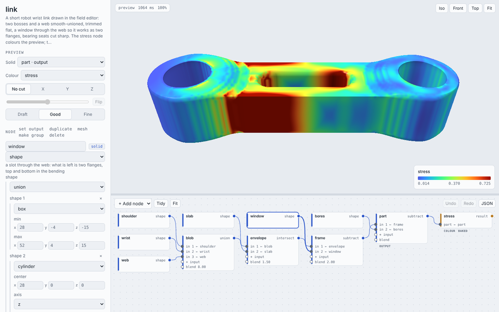
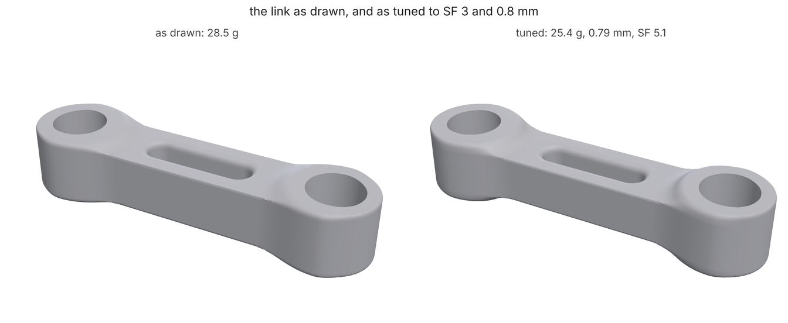

# Field editor: draw a part in the browser, tune it from the command line

A short robot wrist link (two 16 mm bearings, 80 mm apart, PA12 SLS),
built as a field graph: bosses and a web blended into one organic body, a
window through the web, sharp bearing seats. You shape it in loadpath's
browser editor, where every number is a slider over a live GPU preview
coloured by the part's own stress, then mesh it and let `loadpath tune`
turn three of those numbers until the link is as light as it can be while
it still holds a safety factor of 3 and 0.8 mm of deflection under the
arm's loads. The tuned link is 11% lighter than the one drawn. About 10
minutes on 4 cores (the tune is 5 of them), under 4 with `--quick`.



## 1. The files

[`link.json`](link.json) is the graph, [`link.study.json`](link.study.json)
the loads: the shoulder bearing held, 60 N on the wrist bearing (3 kg with a
dynamic factor of 2) and a 20 N side load, PA12, and the goal the tune
holds the link to (`"safetyFactor": 3.0, "maxDeflection": 0.8`). The graph:

```text
"blob":     {"op": "union", "inputs": ["shoulder", "wrist", "web"], "blend": 8}
"envelope": {"op": "intersect", "inputs": ["blob", "slab"], "blend": 1.5}
"frame":    {"op": "subtract", "inputs": ["envelope", "window"], "blend": 2}
"part":     {"op": "subtract", "inputs": ["frame", "bores"]}
"stress":   {"op": "result", "study": "link.study.json", "part": "part", "scale": "peak"}
```

Two bosses and a 20 x 16 mm web smooth-unioned with an 8 mm fillet,
trimmed flat top and bottom with 1.5 mm rounds, a slot through the web
(rounded 2 mm) so the web works as two flanges, and the bearing seats cut
with no blend, so they stay exact cylinders with sharp edges. `stress` is
not part of the shape: it analyzes `part` under the study and gives its von
Mises stress as a field, which the editor paints on the preview.

## 2. Draw it in the editor

```sh
loadpath edit link.json              # serves http://127.0.0.1:8765 and opens it
```

The page is three panes: the graph as nodes and wires (bottom), the
inspector for the selected node (left), and the preview (top). Things to
try on this link:

- **Select `web`** and drag its `max y` slider: the preview redraws as you
  drag, because every number is a shader uniform. `min y` does not follow
  on its own; the tune block below ties them.
- **Colour → stress** (on by default, since the graph has a `result`
  node): the study runs when the page opens, about a minute, and paints
  the part. Red is the flanks beside the window and the root of the web at
  the shoulder; the bosses and the wrist end are blue. That is where a
  thinner web will cost strength and where it won't.
- **Colour → wall thickness** paints anything under SLS's 0.8 mm minimum
  red; on this link nothing is (the thinnest wall is 3.9 mm, beside the
  window).
- **Mass** reads live under Part in the left pane as you edit, weighed
  on the GPU; **Fit mass** finds the value of one number (picked under
  "by changing") that gives a target mass, **Sweep** charts the mass
  across that number's range.
- **Save** writes the graph back to `link.json`; **Run** meshes it exactly
  as `loadpath field` does, into `loadpath-edit/`.

The same page without a server, every bake inside it (so it opens offline
and can be mailed to someone); it cannot re-bake or Run:

```bash
loadpath edit link.json --html editor.html
```

## 3. Mesh it

```bash
loadpath field link.json --out out/
```

`out/link.stl` at the graph's 0.4 mm pitch and `out/report.json`: 28.5 g,
one body, watertight, the bearing seats within 0.01 mm of true cylinders
(`sharpEdges`), the printability check passed, and under `analyses.stress`
what the study said of it: safety factor 5.7, 0.56 mm at the wrist
bearing. Lots of margin on strength; the deflection limit is closer.

## 4. Tune it

The graph's `tune` block names the knobs, by the same paths the editor's
sliders use:

```text
"tune": {"study": "link.study.json",
         "params": [{"path": "nodes/web/shape/max/1", "also": ["-nodes/web/shape/min/1"], "min": 7, "max": 13},
                    {"path": "nodes/web/shape/max/2", "also": ["-nodes/web/shape/min/2"], "min": 5, "max": 10},
                    {"path": "nodes/window/shape/shapes/0/max/1",
                     "also": ["-nodes/window/shape/shapes/0/min/1", "nodes/window/shape/shapes/1/r",
                              "nodes/window/shape/shapes/2/r"], "min": 2, "max": 7}],
         "evaluations": 20}
```

The web's half-width (in the bending plane), its half-height, and the
window's half-width. `also` are numbers that move with a knob, `-` for
ones that move the other way, so the web stays centred and the window's
round ends keep the slot's width. The limits are the study's `goal`
(`safetyFactor` and `maxDeflection` here would override them).

```bash
loadpath tune link.json --out tune/
```

Each candidate is meshed at 1 mm and analyzed by the same FE check a study
outcome gets, on 30k cells (10-12 s each); COBYQA picks the next one. The
coarse grid's reading is scaled by how the drawn link reads on it against
twice the cells, and at the end the lightest passing candidates are
analyzed again on the fine grid; the first that still passes is the answer.
`tune/tune.json` has every candidate, `tune/tuned.json` is the graph with
the best values written in, and the command prints a summary with the next
command to run.

```bash
loadpath field tune/tuned.json --base-dir . --out tuned/
```

`tuned.json` keeps the graph's relative paths (`link.study.json`), and
paths resolve from the graph's folder, so `--base-dir .` points them back
here.



## 5. What you should see

| | full run | `--quick` |
|---|---|---|
| drawn link (`out/report.json` `mass`) | **28.5 g**, SF 5.7, 0.56 mm | 28.5 g |
| tune start (`tune/report.json` `start`) | 28.4 g, SF 7.0, 0.58 mm | 28.3 g |
| tuned (`best`) | **25.3 g** (-11%) | 25.9 g (6 analyses) |
| tuned, fine grid (`best.check`) | SF **5.1**, **0.785 mm** (limit 0.8) | SF 5.6, 0.69 mm |
| web, w x h | 20 x 16 mm to 19.0 x 13.4 mm | 20 x 13.5 mm |
| window width | 8 mm to 7.5 mm | 8 mm |
| tuned link meshed (`tuned/report.json`) | 25.4 g, one body | 26.2 g |

Deflection is what binds: the tune lowered the web from 16 to 13.4 mm,
kept its width and the window nearly as drawn, and stopped where the wrist
bearing moves 0.785 mm. The safety factor never came near 3. A tighter
deflection limit, or a bigger payload in the study, would give a heavier
link; `tune.sweep` (see [fields.md](../../fields.md), "The trade-off") runs
the search for several limits at once and charts mass against deflection.

The `result` node's analysis of the tuned link (`tuned/report.json`
`analyses`) reads SF 4.3 and 0.76 mm: it runs at 120k cells with
refinement round the peak, where the tune's checks run at 60k without, so
its safety factor is the more conservative of the two.

The editor has the same search: in the left pane, **+ knob** adds the
number picked under "by changing" to the `tune` block and **Tune** runs
the candidates on the server, charting each as it lands (`loadpath edit
link.json`, not the standalone page).

## Quick mode

The same commands with `--quick` (or `LOADPATH_QUICK=1`): the analysis
behind `stress` on 30k cells instead of 120k, the mesh at 0.64 mm, and the
tune on 6 analyses instead of 20, in under 4 minutes. Six analyses find
most of the trade (a lower web) but not the last gram. CI runs this
tutorial that way ([test_tutorials.py](../../../tests/test_tutorials.py))
and holds it to [expect.json](expect.json).

The images come from [render.py](render.py) after a full run: the
screenshot is `editor.html` in headless Chromium.
