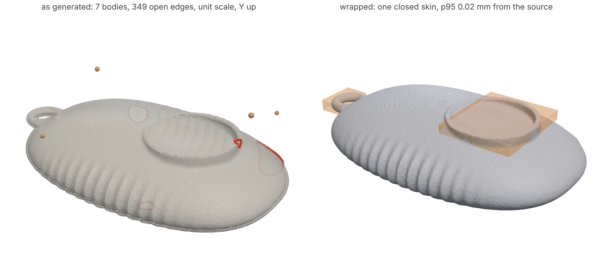
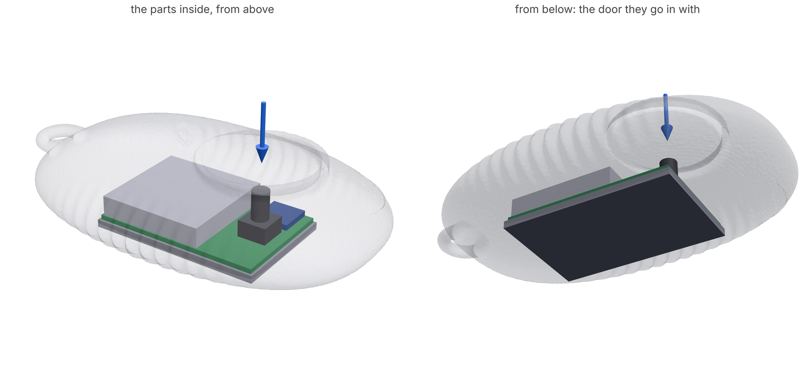
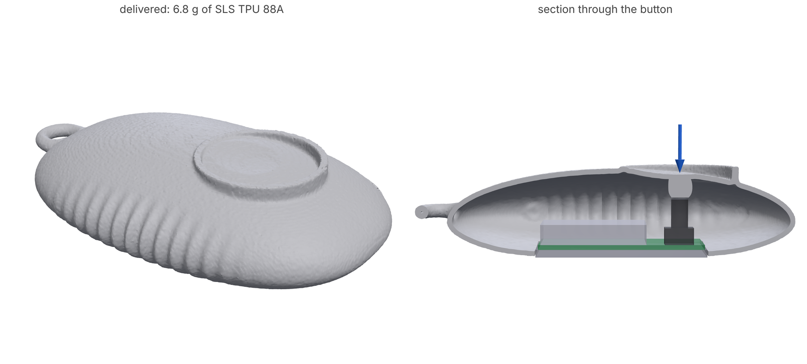
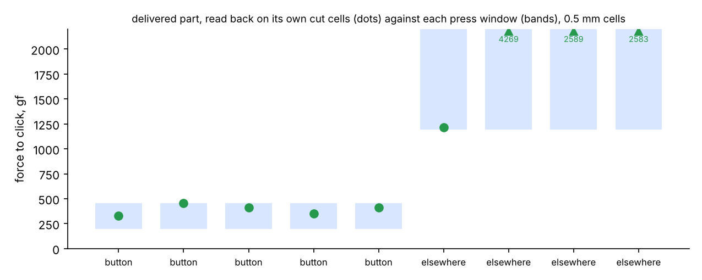

# A generated exterior in, a working part out

**What you'll make:** the inside of a Bluetooth camera shutter remote whose
outside came from a 3D generator. You have a mesh made from a concept
render, the kind Tripo or Meshy hand back, and a paragraph saying what the
device does. loadpath cleans the mesh into a skin it can trust, the agent
(here a short script, [`layout.py`](layout.py)) decides what goes inside
and where from the description, and `loadpath handoff` designs everything
invisible so the button clicks where and how it should, checked on the
printable mesh. The exterior stays exactly as generated. About 5 minutes
with `--quick` (`LOADPATH_QUICK=1`), on 4 cores.



Install the wrap's winding number for broken meshes:
`pip install "loadpath[exterior]"` (libigl). Without it a flood fill does
the wrap, good to about a grid cell.

The description, as a person would give it:

> A palm-sized Bluetooth camera shutter remote. You press the dished button
> on top to take a photo; it should click at a light, definite press there
> and not go off when it is squeezed elsewhere in a pocket. A CR2032 coin
> cell runs it; the battery door is on the underside and comes off with the
> board for a battery change. Soft-touch TPU, SLS.

## 1. The mesh as generated

No generator mesh is checked in, so the tutorial makes one with the
defects they come with ([`generated_standin.py`](generated_standin.py)):
a pebble 78.6 mm long with a dished, rimmed button, grip ridges and a
lanyard loop, written out at unit scale and Y-up as GLB, with three holes
torn in it (the largest 6 mm across), a second inner copy of the whole
surface 0.6 mm in, a patch doubled 0.3 mm proud, a patch of flipped
triangles, 0.03 mm of jitter on every vertex and four bits of floating
debris.

```bash
python generated_standin.py --out generated.glb
```

## 2. One clean skin

```bash
loadpath exterior generated.glb --size 78.6 --skin 1.0 --out exterior/ > exterior.json
```

`--size` is the real length: a generated mesh has no units. `exterior/`
gets `exterior.stl`, closed, in millimetres, Z up, resting on z = 0, and
`exterior.json`:

| | |
|---|---|
| what came in | 450,117 triangles in 7 bodies, 349 open edges, winding inconsistent, 1.0 x 0.33 x 0.64 |
| what went out | one closed body, 78.6 x 47.5 x 19.0 mm, 36.8 cm^3 |
| how far the surface moved | 0.006 mm median, 0.02 mm at the 95th percentile, from the generator's own triangles |
| made up | 10 mm^2 over the holes (the rest of each hole is within a third of a millimetre of its rim) |
| dropped | the debris (5 bodies, the largest 1.3 mm^3); the inner copy is inside the solid and goes |
| room inside | 27.3 cm^3 once a 1.0 mm skin is in; the largest ball 9.2 mm in radius |
| too thin | the button's raised rim (210 mm^2) and the lanyard loop (96 mm^2): all skin, nothing inside |

The wrap decides inside and outside by the generalized winding number,
which reads holes, double walls and flipped patches right, and then puts
the surface back on the generator's triangles to a fraction of the grid
(0.25 mm here), so the ridges, the dish and its rim stay as generated (the
jitter too: it is the generator's surface). The two thin regions are
reported, not thickened: they are the designer's.
[docs/EXTERIOR.md](../../EXTERIOR.md) says what each source needs and where
generated meshes break down.

## 3. What goes inside, from the description

```bash
python layout.py exterior/exterior.stl --out . > layout.out.json
```

The agent's step. Nothing in the mesh says where the button is, so the
script reads it off the shape: the dish is where the top sits deepest
under the exterior's convex hull and curves up like a bowl, and its middle
is the centre of the circle its rim makes (15.3 mm ahead of centre, rim
11.5 mm in radius, as drawn). The battery door goes where the underside is
flat, as large as the flat allows (35.6 x 23.6 mm); the board rides on the
door, the switch (a 6 x 6 mm tall tactile switch, 160 gf, 0.25 mm travel)
on the board under the button, the radio chip beside it, the coin-cell
holder at the other end. Every part is checked against the room inside
once the skin is in; one that does not fit stops the script with by how
much. It writes `brief.json` and the parts as STLs in `parts/`:



The press windows come from "light, definite" and "not in a pocket": a
click between 200 and 450 gf at the button's middle and 5 mm out from it,
and at least 1.2 kgf on the top clear of the rim. The skin is 1.0 mm, SLS
TPU's minimum wall: the first try at 1.2 mm read 486 gf by the rim on the
bare skin alone, over the window before anything was inside, and the skin
review said so.

## 4. Design the inside

```bash
loadpath handoff brief.json --out handoff/ --run
```

`handoff` finds that the door, carrying the board and everything on it,
goes in from below (`-z`), puts the plunger 0.4 mm over the switch's stem
and runs it up into the skin under the button, keeps every part's room
clear under the skin, and designs the interior for the press windows with
the least material (`handoff/handoff.json`, then `handoff/switch/`):





| | quick (1.8 mm cells) | full (1.04 mm cells, 8.5 min on 4 cores) |
|---|---|---|
| press windows met, design | 9 of 9 | 9 of 9 |
| button, design | 351 gf at the middle, 352-450 gf 5 mm out | 311 gf at the middle, 345-423 gf 5 mm out |
| off the button, design | 1200 gf or more everywhere | 1198 gf just behind the button, 1970-4150 gf elsewhere |
| delivered mesh | one watertight body, 6.8 g of TPU 88A | one watertight body, 6.8 g of TPU 88A |
| delivered, read on 0.5 mm cut cells | | 9 of 9: button 331-457 gf, elsewhere 1214 gf and up (the chart) |
| skin review | the bare 1.0 mm skin is 2% over the ceiling by the rim (460 gf): the exterior's own stiffness, for the designer | the same: 460 gf on the rim side on 0.5 mm cells |

The rim side of the button reads 457 gf delivered against the bare skin's
460: the interior adds almost nothing there, the skin sets it. The press
over the coin cell reads over 4 kgf: the cell carries the skin there,
which is what "not in a pocket" wants.

## What the agent did and did not decide

It decided what the description and the mesh say: the button is the dish,
the door goes on the flat, the board goes in with the door, the windows.
It did not touch the exterior. What it reports back to the designer: the
holes it bridged (where), the regions too thin for anything inside (the
rim and the loop), and that the rim side of the button sits right at the
ceiling on the skin alone.
