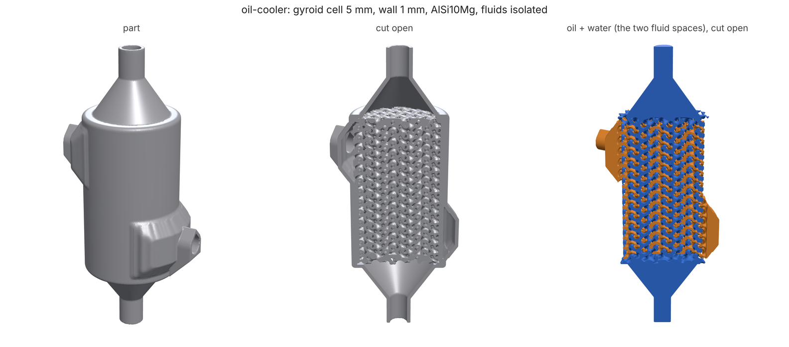
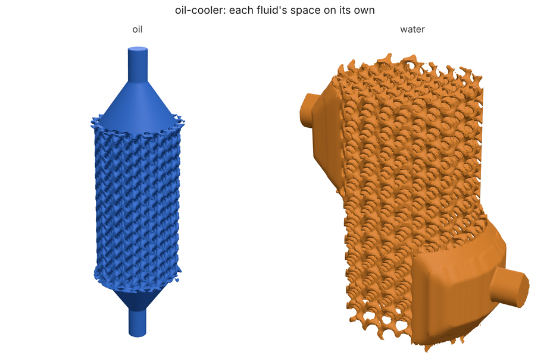
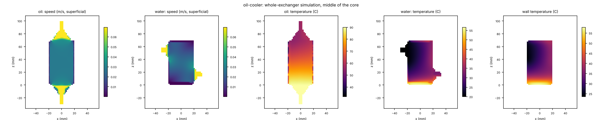
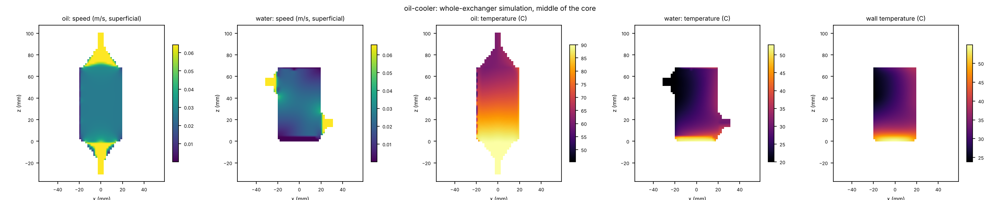

# Heat exchanger: a printed metal oil cooler, sized, designed and simulated

**What you'll make:** a counterflow oil-to-water cooler for a small hydraulic
pack, printed in aluminium (AlSi10Mg) by laser powder-bed fusion. 2 L/min of
90 °C oil and 2 L/min of 20 °C water pass each other through a 40 mm x 70 mm
cylinder of sheet gyroid: the oil end to end through the caps, the water in
and out through the side. The oil pump has little head to spare, so each
fluid gets a 5 kPa (0.05 bar) pressure-drop budget. You'll size the gyroid
for the most heat inside that budget, design the whole part (core, headers,
ports) and check that the two fluids never meet, then simulate the whole
exchanger and compare it with the rating. The first design runs over the oil
budget, as first designs do; step 3 finds out why and fixes it, and the final
cooler meets every budget in the whole-exchanger simulation. About 8 minutes
on 4 cores.



## The spec

[`spec.json`](spec.json) (`loadpath schema heatExchanger` lists every key):

- `core`: the cylinder the gyroid fills, axis along z; `layout: "counter"`
  with `axes: "zx"` puts the first fluid (oil) through the ends along z and
  the second (water) in and out through the side along x;
- `cell`, `wall`, `split`: the gyroid's period, the sheet between the fluids
  and the oil's share of the void. Step 1 picks them;
- `header`, `portDiameter`, `portLength`: the plenums and tubes;
- `build: "z"`, `process: "lpbf"`: printed upright in metal, so nothing
  inside may need support (the channels close in peaked roofs, not flat
  ceilings) and no skirt;
- `duty`: the two streams and the wall material, which turns the design
  into a rating;
- `simulate: true`: also simulate the whole exchanger (`loadpath/porous.py`).

## 1. Size the core

```bash
loadpath heatx spec.json --size --min-wall 1.0 --splits 0.5,0.6,0.66 --max-pressure-drop oil=5000,water=5000 > sizing.json
```

`--size` sweeps cell (4-20 mm), wall (from `--min-wall` to 2 mm) and split
on the correlations alone, in a second, and keeps the candidates inside the
pressure-drop budget and printable (channels at least 1.5 mm across). 1 mm is
the thinnest wall we trust leak-tight in AlSi10Mg; it also keeps the design
grid affordable. The best:

| cell | wall | oil's share of the void | effectiveness | duty | oil drop | water drop |
|---|---|---|---|---|---|---|
| **5 mm** | **1.0 mm** | **0.6** | **0.515** | **1.99 kW** | 4.6 kPa | 2.3 kPa |
| 7 mm | 1.2 mm | 0.5 | 0.480 | 1.85 kW | 4.5 kPa | 1.0 kPa |
| 6 mm | 1.4 mm | 0.6 | 0.460 | 1.78 kW | 4.6 kPa | 2.7 kPa |

Oil is about 30 times as viscous as water, so it is the oil's budget that
binds, and the best cores give the oil the larger share of the void (split
0.6): the sheet moves toward the water side. Without a budget the sweep would
simply pick the smallest cell. [`spec.json`](spec.json) already holds the
pick: cell 5, wall 1.0, split 0.6.

## 2. Design, check, rate and simulate it

```bash
loadpath heatx spec.json --out hx/
```

Writes `hx/oil-cooler.stl` (the part), `hx/oil-cooler-oil.stl` and
`hx/oil-cooler-water.stl` (the two fluid spaces), `hx/oil-cooler.html` (a
viewer), `hx/oil-cooler-simulation.png`, and `hx/report.json`:

- `report`: the checks, made on the design grid. `isolated` (no path from
  one fluid to the other), `connected` (each fluid's in-port reaches its
  out-port), `watertight`, the thinnest wall between the fluids, internal
  flat ceilings and trapped pockets (what a metal print can't support or
  clear of powder);
- `rating`: effectiveness-NTU on the as-designed geometry (porosity, wetted
  area and hydraulic diameter measured on the grid), with the spread of the
  heat-transfer fits;
- `simulation`: the whole exchanger on a voxel grid, both fluids as porous
  flow through the core and open flow through the headers, coupled through
  the wall. It sees what the rating can't: how evenly each plenum feeds the
  core, the headers' own pressure drop, and where the wall runs hot.



## What you should see

Full grid, as the commands above run:

| check | result |
|---|---|
| fluids isolated / each connected / watertight | **yes / yes / yes** |
| thinnest wall between the fluids | 0.94 mm (1.0 drawn, measured on a 0.47 mm grid) |
| part | 65 x 43 x 131 mm overall, 77.1 cm³ of aluminium: **206 g** |
| internal flat ceiling (metal) | 115 mm² |
| trapped pockets | 15, 5.0 mm³ in all |

|  | sizing (step 1) | rating (as designed) | whole-exchanger simulation |
|---|---|---|---|
| effectiveness | 0.515 | **0.499** | **0.480** |
| heat duty | 1.99 kW | **1.92 kW** | **1.85 kW** |
| oil out | | 55.1 °C | 56.4 °C |
| water out | | 33.9 °C | 33.3 °C |
| oil pressure drop | 4.6 kPa | **6.97 kPa** | **8.56 kPa** (7.53 core + 1.03 headers) |
| water pressure drop | 2.3 kPa | **2.42 kPa** | **3.98 kPa** (3.05 core + 0.93 headers) |



The section above cuts through the axis and both water ports. Oil comes in
hot at the bottom and leaves at the top; water comes in at the top left and
leaves at the bottom right, so the two run against each other. The water
takes the diagonal: the bottom-left corner, under the oil's hot inlet, barely
moves, and the water there heats to about 57 °C and stays, carrying little
heat away. The wall is hottest there too (about 58 °C), coolest by the water inlet.

How to read it:

- **The fluids never meet.** `isolated` labels the connected open space on
  the design grid: no region holds ports of both fluids, and the wall between
  them is nowhere under 0.94 mm.
  Check it yourself in the viewer, or in the fluid STLs: they don't touch.
- **The heat is where the sizing said** (within 4% from sizing to rating, 4%
  more to the simulation): 1.85-1.92 kW out of 90 °C oil, which leaves at
  about 56 °C.
- **The pressure drop isn't.** The sizing works on an ideal gyroid; the
  rating measures the built one (porosity, wetted area and channel size on
  the grid, with the plenums' blended mouths), and its oil side comes out
  50% harder to push through. The simulation adds what neither sees: the
  headers (about 1 kPa a side), and flow that doesn't spread evenly: water
  enters through one side port, and 14% of the core's water entry face is
  starved (`simulation.fluids.water.entry`). The oil is at 8.6 kPa, 70%
  over the 5 kPa budget. Step 3 fixes it.
- **The oil runs at Re 6**, below the heat-transfer fits (Re 10-2500); the
  rating says so in `rating.fluids.oil.flags` and its effectiveness range
  (0.23-0.50) is wide for that reason. Treat 0.5 as the optimistic end until
  a printed core is measured.
- **Metal printing:** 115 mm² of internal flat ceiling and 5.0 mm³ of trapped
  pockets are within loadpath's own bars for a metal core (200 mm² and 5 mm³,
  `loadpath/evals/cases/lpbf-intercooler-core.json`), and the oil and water
  spaces drain to a port everywhere (`report.powder`: no unreached space).
  Add `"cleanouts": 1` for a tapped powder clean-out per fluid.

## 3. Bring the oil back inside its budget

Step 2 says how far off the sizing was on this part: its oil drop came out
1.9x the correlations' (8.6 kPa simulated against 4.6 sized). So size again
with half the budget for the oil, leaving the rest for the built core and
its headers:

```bash
loadpath heatx spec.json --size --min-wall 1.0 --splits 0.5,0.6,0.66 --max-pressure-drop oil=2500,water=5000 > sizing-2.json
```

The pick moves from a 5 mm cell to **6 mm** (wall 1.0 mm, split 0.6):
bigger channels, a sized effectiveness of 0.41. [`spec-final.json`](spec-final.json)
takes it, and one more change: `"cap": 1.5`. The cap is how deep each
plenum seals off the other fluid's channels at the core's ends (wall + 1 mm
by default, so 2 mm here); at 1.5 mm, 1 mm of every channel end that was
sealed is open to flow, and fewer dead pockets are left where the seals meet.

```bash
loadpath heatx spec-final.json --out hx-final/
```

| | first design (step 2) | 6 mm cell | **6 mm cell, 1.5 mm cap (final)** |
|---|---|---|---|
| oil pressure drop, simulated | 8.56 kPa | 4.75 kPa | **3.86 kPa** (3.01 core + 0.84 headers) |
| water pressure drop, simulated | 3.98 kPa | 2.44 kPa | **2.02 kPa** |
| effectiveness, simulated (rated) | 0.480 (0.499) | 0.393 (0.407) | **0.404** (0.409) |
| heat duty, simulated | 1.85 kW | 1.51 kW | **1.56 kW**: oil 90 → 61.7 °C, water 20 → 31.2 °C |
| trapped pockets | 5.0 mm³ | 6.0 mm³ | **4.1 mm³** |
| internal flat ceiling | 115 mm² | 130 mm² | **115 mm²** |
| thinnest wall between the fluids | 0.94 mm | 0.94 mm | **0.95 mm** |
| part mass (AlSi10Mg) | 206 g | | **190 g** |
| fluids isolated, connected, watertight | yes | yes | **yes** |

Both fluids are now inside 5 kPa with room to spare (oil 23%, water 60%),
the metal checks are inside their bars, and the part is 16 g lighter.
(Trapped pockets are 15-20 slivers of a voxel or two each, so their total
moves by a few mm³ with the grid: 7.1 mm³ on the quick grid.)

 The
price is heat: 1.56 kW instead of 1.85. That is the trade the budget sets:
a cooler that moves more heat at 5 kPa of oil needs a longer or wider core,
not a finer gyroid. (The middle column is the 6 mm cell with the default
cap, for comparison; it isn't one of the commands.)

## Quick mode

The same commands with `--quick` take about 7 minutes, as long as the full
run: quick mode coarsens a heat exchanger's grid, but this one is already on
the coarsest grid its
1 mm walls allow (the design grid holds at most 16 M points, so a part this
size is at 0.47 mm whatever you ask for), and the simulation keeps its own
voxel. The numbers agree with the full run to 2%. This is what CI runs
(`python tests/test_tutorials.py heat-exchanger`).

---

The images were made by [`render.py`](render.py) from a full run's outputs
(three.js in headless Chromium via [docs/render3d.py](../../render3d.py); the
simulation section is the PNG `loadpath heatx` writes, matplotlib).
