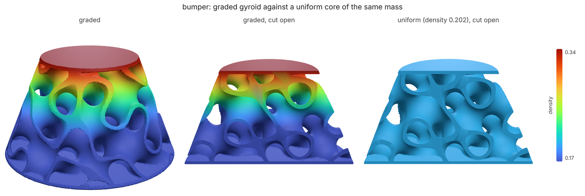
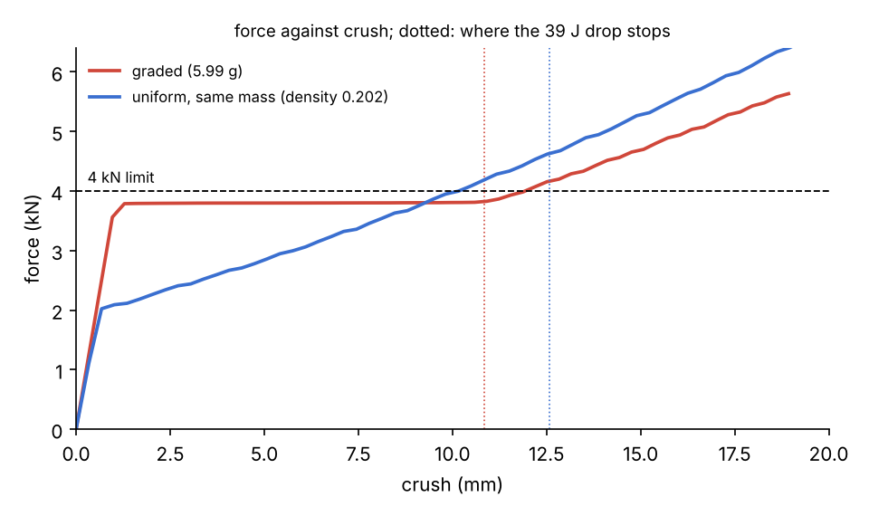

# Impact bumper: a graded gyroid that stops a falling rover

**What you'll make:** a printed corner bumper for a 4 kg rover that rolls off
a 1 m ledge. It lands at 4.43 m/s with 39 J to get rid of, and the chassis
behind the bumper must not feel more than 4 kN (about 100 g). The bumper is a
truncated cone, 44 mm across at the chassis and 24 mm at the tip, 25 mm
tall, filled with a PETG sheet gyroid between two 0.8 mm plates, printed on
FDM. A uniform gyroid in a cone crushes its narrow tip easily and its wide
foot hard, so its force climbs as it crushes and it overshoots the limit.
loadpath grades the density along the height so every layer crushes at the
same force, and the graded bumper stops the rover under the limit at the
same mass. Everything is one field graph and two `loadpath field` commands,
about 10 seconds each.



## The spec

[`bumper.json`](bumper.json) is a field graph (`loadpath schema field`):

- `envelope`: the cone, as a signed distance whose radius is a `remap` of
  height (22 mm at z = 0, 12 mm at z = 25);
- `plates`: the bottom and top 0.8 mm of the envelope, a foot to screw to the
  chassis and a face for the ground to meet;
- `density`: the gyroid's relative density, a constant 0.20 to start;
- `core`: a 14 mm gyroid sheet at that density, cut to the envelope and
  joined to the plates in `part`.

The `impact` block says what to stop and how hard:

```json
"impact": {"envelope": "envelope", "density": "density", "lattice": "gyroid", "axis": "z",
           "mass": 4.0, "velocity": 4.43, "forceLimit": 4000, "pitch": 0.25, "grade": true,
           "cell": 14, "minWall": 0.8}
```

`cell` and `minWall` set the lightest printable core: at 14 mm cells a
0.8 mm sheet (two 0.4 mm lines) is a relative density of 0.175, so grading
never goes below that. The crush model is in [docs/IMPACT.md](../../IMPACT.md):
each layer's plateau force from a fitted gyroid collapse law, layers crushing
in series, densification at 1 - 1.4 rho.

## 1. Crush the starting core and grade it

```bash
loadpath field bumper.json --out start/
```

`start/report.json` has the part (`mass`, `watertight`, `bodies`, the
printability check) and `impact`:

- `response`: the starting core, uniform at 0.20 (5.93 g of core). It stops
  the rover in 12.7 mm, but at **4.58 kN**, over the limit (`ok: false`);
- `graded`: the flattest core for this cone, as a `remap` table of density
  against height (0.175 at the foot up to 0.343 at the tip), and its
  response: 3.80 kN;
- `uniformSameMass`: the fair comparison, a uniform core of the graded
  core's mass (density 0.202): **4.64 kN**, still over.

It also writes `start/bumper-graded.json`: the same graph with the `density`
node replaced by the graded table.

## 2. Mesh the graded bumper and check it again

```bash
loadpath field start/bumper-graded.json --out graded/
```

This builds the graded part (`graded/bumper-graded.stl`) and runs the impact
check again from the graph's own density field rather than from the grading's
table. `graded/report.json`'s `impact.response` is the number to trust: it
agrees with the grading to 0.4%.

## What you should see

Full grid, as the commands above run:

| core | core mass | peak force | crush | energy absorbed | efficiency | under 4 kN? |
|---|---|---|---|---|---|---|
| **graded gyroid** (`graded/report.json`) | **5.99 g** | **3.81 kN** (97 g) | 10.8 mm | 39.2 J | **0.95** | **yes** |
| uniform gyroid, same mass (density 0.202) | 5.99 g | 4.64 kN (118 g) | 12.6 mm | 39.2 J | 0.67 | no |
| starting core (density 0.20) | 5.93 g | 4.58 kN (117 g) | 12.7 mm | 39.2 J | 0.68 | no |

The whole bumper with its plates weighs 7.6 g. Efficiency is energy / (peak
force x crush); 1 is a perfect square pulse. At the same mass, grading cuts
the peak force by 18% and the crush by 14%, and only the graded core meets
the limit. Neither core bottoms out: the graded one uses 57% of the crush it
has before it densifies, the uniform one 63%.



The uniform core's force climbs the whole way down, because each layer it
crushing next is wider than the last, and it passes 4 kN at 10 mm. The
graded one is flat at 3.8 kN: every layer above the bottom 12 mm crushes at
that force. The bottom 12 mm is already at the lightest printable density,
so it is stronger than it needs to be and crushes last, above 3.8 kN, but
only after the rover has stopped at 10.8 mm.

Things to know:

- **The forces are a perfect-cell estimate** (no print defects, quasi-static).
  PETG is stronger at impact rates, which raises the real force, so treat them
  as +-25% until crush coupons calibrate the material
  (`loadpath calibrate kit --material petg --crush`, see
  [docs/CALIBRATION.md](../../CALIBRATION.md)). That margin is why the graded
  bumper aims at 3.8 kN, not 4.
- **The printability check fails on 0.4 mm walls.** They are slivers where
  the cone's side cuts a sheet at a glancing angle; the sheets themselves
  are 0.8 mm and up. A slicer drops or merges them. A side skin would remove
  them, but it also carries load the crush model does not count.
- **The bumper keeps the energy.** PETG yields as it crushes, so it is a
  one-shot part: print a spare. For knocks it should spring back from, see
  the TPU knock pad in [docs/IMPACT.md](../../IMPACT.md).

## Quick mode

The same commands with `--quick` (or `LOADPATH_QUICK=1`) mesh at a 0.4 mm
pitch instead of 0.25 mm and take about 10 seconds in all; the impact numbers
don't change, because the crush analysis keeps its own 0.25 mm grid. This is
what CI runs (`python tests/test_tutorials.py impact-bumper`).

---

The images were made by [`render.py`](render.py) from a full run's outputs
(three.js in headless Chromium via [docs/render3d.py](../../render3d.py) for
the parts, matplotlib for the crush curves).
