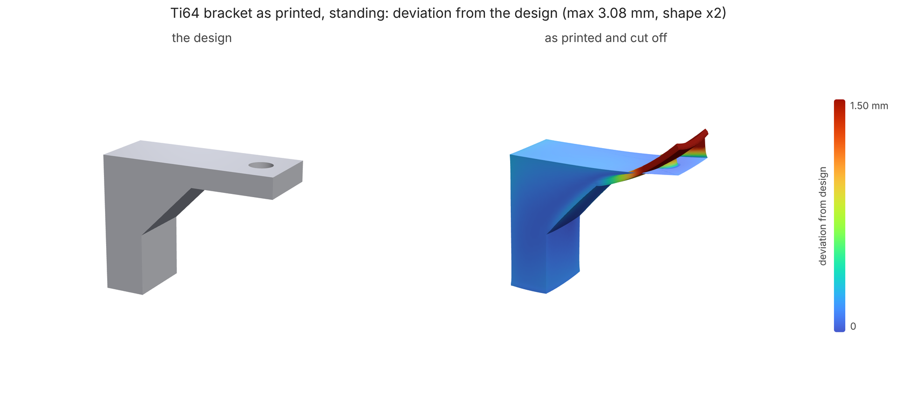
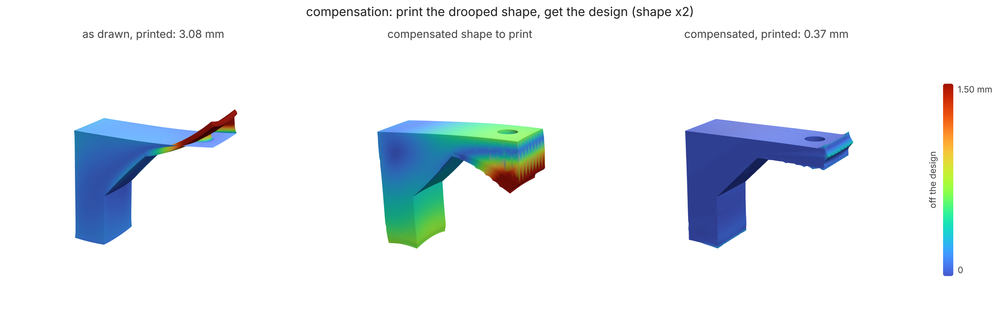

# LPBF build simulation: predict the warp, print it straight

**What you'll make:** a titanium (Ti-6Al-4V) sensor bracket, printed by laser
powder-bed fusion, that comes off the plate the shape you drew.
[`bracket.stl`](bracket.stl) is a 6 x 10 mm post 20 mm tall with an arm
26 mm out from its top, 3 mm thick, an M3 hole at the tip; a 45° gusset
carries the first 8 mm of the arm. You'll simulate its build layer by
layer, read how far it warps and whether it hits the recoater, write a
pre-deformed STL that prints to the nominal shape, and simulate that to
check. About 35 minutes on 4 cores (each simulation is 5-7 minutes at
0.5 mm voxels), 3 with `--quick`.



Every layer of an LPBF part goes down hot, welds to the layer below and
shrinks as it cools; what it is welded to holds it back, and the part is
left with stress that bends it, on the plate and again when it is cut off.
`loadpath buildsim` lays the part down one 0.5 mm analysis layer at a time
on a 10 mm plate with an *inherent strain* per layer, then cuts it free
([docs/BUILDSIM.md](../../BUILDSIM.md): the model, and its check against
NIST's AM-Bench bridge). Units mm and MPa; `--pitch 0.5` is the voxel the
strain is calibrated at.

## 1. Simulate the build

```bash
loadpath buildsim bracket.stl --material ti64 --pitch 0.5 --out sim/
```

`sim/report.json`, and `sim/bracket-printed.stl`: the part as it comes off
the plate, best-fitted onto the design as a scan would be. The parts of the
report to read:

- `distortion`: how far each point moves once the part is cut off the
  plate and springs back (`max`, `rms`, and `at`, where the max is);
- `deviation`: the printed surface against the design, both ways, after a
  best fit (`max`, `p95`, `rms`): what a CMM or a 3D scan would report;
- `recoater`: the biggest lift of the build plane during the print. The
  recoater blade sweeps 0.05 mm above it; anything that curls up more can
  be struck, which stops the build or tears the part;
- `residualStress`: von Mises on the plate (`vmP95Built`, `vmMaxBuilt`)
  and after cut-off, against the yield strength;
- `warnings`: the same, in words.

| | full grid |
|---|---|
| distortion after cut-off | **3.01 mm** max (the arm's tip, up), 0.44 rms |
| deviation from the design (scan-style) | **3.08 mm** max, 0.63 p95, 0.24 rms |
| build-plane lift | **1.27 mm at layer 35** (of 40): recoater risk |
| residual stress on the plate | 1566 MPa p95 against a yield of 1000; 4460 peak |

The arm is the problem. Past the gusset its first layers go down over
nothing, thin and free to move, and as they cool they curl up: that is the
1.27 mm lift at layer 35, the layer after the arm starts. The layers after
them are laid flat by the recoater onto the curled ones, so the arm comes
out with its top roughly where it should be and its underside curled up
towards it, thinnest at the tip (the picture above, the offsets doubled).
That is what an unsupported overhang does; in practice it goes on
supports, which the simulation leaves out, so read this as the worst case.
The stress is over yield in
places: the model is linear, so it overstates the peaks at sharp corners
(BUILDSIM.md, Limits), and a real Ti64 part would be stress-relieved on
the plate before cut-off, which takes out most of this warp. Simulate what
you will actually do: here, cut off as built.

## 2. Compensate

```bash
loadpath buildsim bracket.stl --material ti64 --pitch 0.5 --compensate 2 --out comp/
```

`--compensate 2` moves every vertex of the part against its predicted
displacement, simulates the moved shape, corrects by what is left, and
does that twice. Long CAD triangles are split to the voxel size first, so
the arm can take a curve. It writes `comp/bracket-compensated.stl`, the
shape to send to the printer, and `compensation.rounds` in the report:

| round | max deviation | rms |
|---|---|---|
| 0, the design as drawn | 2.67 mm | 0.66 mm |
| 1 | 1.37 mm | 0.18 mm |
| 2 | 1.08 mm | 0.09 mm |

These follow each vertex to where it should land, so they count a point
that slides along the surface as off, and the max sits on the arm's sharp
tip corner; the scan-style check in step 3 is the number to hold the part
to. The compensated arm's underside hangs lower by about as much as the
printed one would curl up, so the two cancel. Cells of the drooped arm that would be laid in
mid-air before the arm reaches them are added when they join the part, as
if supports had held them.



## 3. Check it: simulate the compensated part

```bash
loadpath buildsim comp/bracket-compensated.stl --nominal bracket.stl --material ti64 --pitch 0.5 --out check/
```

The same simulation, of the compensated shape this time, with `deviation`
measured against the design (`--nominal`) rather than the shape you
simulate:

| | design as drawn (step 1) | compensated (this step) |
|---|---|---|
| deviation from the design, max | 3.08 mm | **0.37 mm** |
| p95 | 0.63 mm | **0.12 mm** |
| rms | 0.24 mm | **0.05 mm** |
| build-plane lift | 1.27 mm | 1.01 mm |

An eighth of the error is left, most of it within a voxel (0.5 mm) of the
tip. Compensation does not stop
the curl during the build: the arm still lifts 1.0 mm under the recoater,
because it still shrinks the same way; it just starts from a shape that
curls into the right one.

## 4. Fix the recoater risk: build it on its side

```bash
loadpath buildsim bracket.stl --material ti64 --pitch 0.5 --build +y --out side/
```

`--build +y` turns the part so its 10 mm width is the build height: every
layer is the whole L-shaped profile, nothing overhangs, and the arm is no
longer a slab laid last.

| | standing (+z) | on its side (+y) |
|---|---|---|
| build-plane lift | 1.27 mm (risk) | **0.02 mm** (clear) |
| distortion after cut-off | 3.01 mm | 0.27 mm |
| deviation from the design, max | 3.08 mm | 0.29 mm |
| analysis layers (build height) | 40 (20 mm) | 20 (10 mm) |

On its side it is shorter to print, needs no support and lifts nothing
into the recoater. Whether it is the better print depends on what the
surface finish and the cut-off face can be (the whole side then sits on
the plate). Standing up, it needs support under the arm (the simulation
leaves supports out, which is its worst case) and compensation.

## What you should see

Full grid (0.5 mm voxels), as the commands above run:

| | |
|---|---|
| distortion after cut-off, as drawn | **3.01 mm** max |
| build-plane lift standing | **1.27 mm**: recoater risk |
| deviation from the design: as drawn → compensated | **3.08 → 0.37 mm** max (0.63 → 0.12 mm p95) |
| compensation rounds (max deviation per vertex) | 2.67 → 1.37 → 1.08 mm |
| on its side | 0.02 mm lift, no risk; 0.27 mm distortion |

These are predictions for Ti64 with IN625's calibrated strain factor (Ti64
has no fit of its own; `strain.kSource` in the report says so).
BUILDSIM.md says what that means: the shape of the warp is the model's, its
size is not calibrated for Ti64. Print a cantilever, measure it, and pass
`--scale` before trusting the millimetres.

## Quick mode

`--quick` runs every command on about 1500 voxels of the part (1.1 mm
instead of 0.5 mm) in about 3 minutes in all. Coarse layers are lumped, so
the warp reads about a third of the full grid's (1.02 mm against 3.01: the
arm is only three voxels thick), but every step tells the same story: the
arm curls (0.72 mm of lift), compensation takes out 80% of the deviation
(0.77 → 0.15 mm),
the side build clears the recoater. CI runs it that way
([test_tutorials.py](../../../tests/test_tutorials.py)) and holds it to
[expect.json](expect.json).

[`make_part.py`](make_part.py) made `bracket.stl`. The images come from
[render.py](render.py) after a full run (three.js in headless Chromium via
[docs/render3d.py](../../render3d.py)).
