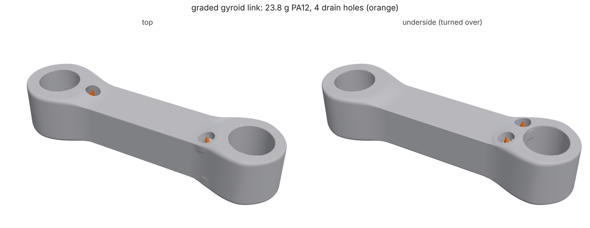
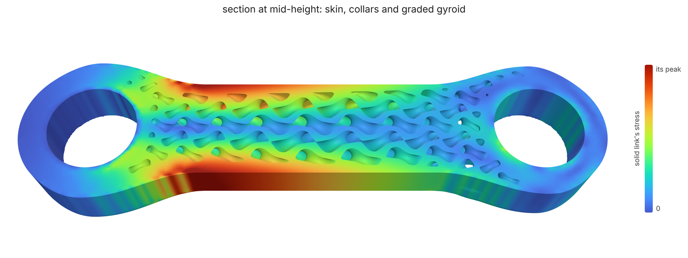
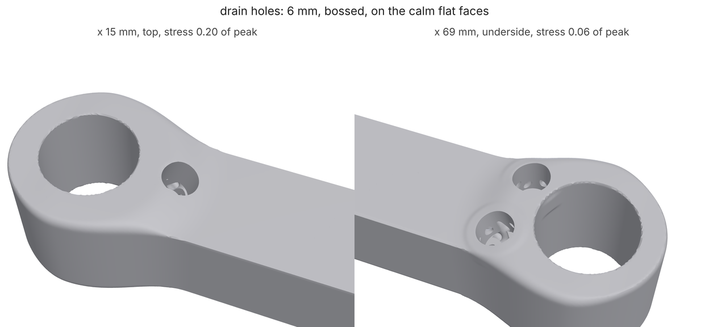

# Graded gyroid link with powder drains (PA12, SLS)

A short robot wrist link, two 16 mm bearings 80 mm apart, printed in PA12
on an SLS machine. Instead of a solid part you build a field graph: a skin
over a gyroid lattice, where the solid link's own stress under the arm's
loads sets how thick the skin and the lattice walls are, and the lattice
cells grow away from the bearings. A skin over a lattice seals the powder
in, so loadpath finds every sealed pocket, fills the ones too small to
matter and drills 6 mm drain holes (with a boss round each) where the part
is calm. The result is 23% lighter than the solid link, one body, with no
sealed powder left. About 4 minutes on 4 cores, under 2 with `--quick`.



## 1. The graph

[`link.json`](link.json) is the part; [`wrist-link.study.json`](wrist-link.study.json)
is the loads (the same study JSON `loadpath run` takes: bearings, a 60 N
payload with a dynamic factor in it, a 20 N side load, PA12). Every solid
in the graph is a signed distance, every other node a scalar field, and any
number can be replaced by a node. The pieces, top to bottom:

```text
"blob":     {"op": "union", "inputs": ["shoulder", "wrist", "web"], "blend": 9}
"envelope": {"op": "intersect", "inputs": ["blob", "slab"], "blend": 1.5}
"solid":    {"op": "subtract", "inputs": ["envelope", "bores"]}
```

Two bosses and a web, smooth-unioned with a 9 mm fillet, trimmed flat top
and bottom, bearing seats cut. `solid` is the link you would print without
a lattice: the mass to beat, and the part that gets analyzed.

```text
"stress":   {"op": "result", "study": "wrist-link.study.json", "part": "solid", "scale": "peak"}
"skinWall": {"op": "remap", "input": "stress", "from": [0.1, 0.8], "to": [0.9, 2.0], "curve": "smoothstep"}
"wall":     {"op": "remap", "input": "stress", "from": [0.05, 0.6], "to": [0.8, 1.5], "curve": "sqrt"}
```

The `result` node meshes `solid`, analyzes it under every load case of the
study and gives back its von Mises stress as a field, divided by its own
peak (`"scale": "peak"`), so the remaps read in fractions of the worst
stress whatever the load. Where the solid link is calm the skin is 0.9 mm
and the gyroid wall 0.8 mm (SLS's minimum feature); where it carries 80%
of its peak, near the shoulder bearing and along the web's flanks, the skin
grows to 2 mm and the wall to 1.5 mm.

```text
"skin":    {"op": "shell", "input": "envelope", "thickness": "skinWall"}
"collars": {"op": "shell", "input": "bores", "side": "outside", "thickness": 2.5}
"cell":    {"op": "remap", "input": "nearBore", "from": [4, 25], "to": [5, 8]}
"core":    {"op": "lattice", "type": "gyroid", "cell": "cell", "thickness": "wall"}
"joined":  {"op": "union", "inputs": ["skin", "collars", "fill"], "blend": "fillet"}
```

A variable-thickness skin, solid 2.5 mm collars round the bearings, and a
sheet gyroid whose cell is 5 mm at the bearings and 8 mm mid-span (the
lattice's coordinates are warped so the walls stay continuous through the
grading). The fillet where lattice meets skin is itself a field, larger
near the bearings.

```text
"process": "sls", "minWall": 0.8,
"drains": {"diameter": 6, "count": 2, "maxPath": 60}
```

`process` turns the drains on (they are on by default for SLS, MJF, resin
and LPBF; `"drains": false` turns them off). These are the defaults for
SLS, spelled out: 6 mm holes (1.5 x the 4 mm minimum escape hole), two per
sealed void, more if any powder is over 60 mm from a hole.
`loadpath schema field` lists every key.

## 2. The solid link

```bash
loadpath field link.json --node solid --out solid/
```

`--node` meshes one node of the graph instead of its output. Running it
also runs the `stress` node's study (the drains rank their sites by it), so
`solid/report.json` has the solid link's analysis under `analyses.stress`:
a safety factor of 7.1 and 0.50 mm at the wrist bearing, 30.8 g. Plenty
of margin: that is what the lattice spends.

## 3. The graded part

```bash
loadpath field link.json --out out/
```

Progress streams to stderr as JSON lines: the study, then the drain search
(`"stage": "drains"`) on a 0.3 mm grid of the field itself, then the mesh.
`out/link.stl` is the part (660k triangles at 0.3 mm), `out/report.json`
the report.



The section shows the grading: thick skin and dense walls along the web's
flanks and round the shoulder, thin ones in the calm middle and at the
wrist end, cells widening away from the bearings.

## 4. Read the report

| | full run | `--quick` |
|---|---|---|
| solid link (`solid/report.json` `mass`) | **30.8 g**, SF 7.1, 0.50 mm | 30.8 g, SF 7.0, 0.50 mm |
| graded link (`out/report.json` `mass`) | **23.8 g** (23% lighter) | 23.9 g |
| `bodies` | 1 | 1 |
| `enclosedVoids` (sealed shells in the mesh) | **0** | 0 |
| sealed voids before drilling (`drains.sealedBefore`) | 37 | |
| small pockets filled solid (`drains.filledVolume`) | 35, 0.49 cm³ | |
| drained voids | 2, 3.38 cm³ each | 2, 3.37 cm³ each |
| drain holes (`drains.holes`) | **4** x 6 mm | 5 (3 + 2) |
| farthest powder from a hole | 35 mm | |
| `drains.ok` / `printability.ok` | true / true | true |

The two big voids are the gyroid's two labyrinths: a sheet gyroid splits
space into two interleaved channels that never meet, and the skin closes
both. Each gets two holes, the first at the calmest flat site low on the
build and the second at the calmest one well away from it, high on the
build, so air can blow through. Every hole is in a place where the solid
link carried under 20% of its peak stress (`drains.holes[].stressRatio`:
0.06 to 0.20), on the flat faces near the wrist end and next to the
shoulder boss, and each has a 1.2 mm boss so its edge isn't a crack
starter in a 0.9 mm skin. The 35 pockets too small for a hole (where the
lattice meets the collars and the skin's corners) are filled. Then the
drilled field is checked again: no sealed void on the grid, every bit of
each void reaches a hole (`unreachedVolume` 0), processcheck's 4 mm escape
ball gets out of all of it (`drains.escape`, and `drains.meshEscape` on the
STL), and the mesh has no inside-out shell (`enclosedVoids` 0).



Without drains the same part comes out with 42 sealed shells holding 7.0
cm³ of powder: the two labyrinths and 40 pockets round the bearings and in
the skin's corners. That is about 3 g of loose powder you would carry round
inside the arm, and the printability check fails it:

```sh
# edit link.json: "drains": false
loadpath field link.json --out sealed/      # enclosedVoids: 42, enclosedVoidVolume: 7049, printability.ok: false
```

To keep the holes off a face (a mating face, a label), name a solid node in
`drains.keepClear`; to move them, change what ranks the sites with
`drains.stress`. `drains.diameter` and `drains.count` change the holes.

How strong is the graded link? Its walls are too fine for the analysis grid
`loadpath field` would use, so the report does not say. `loadpath tune`
analyzes a lattice part homogenized (see [fields.md](../../fields.md),
"Lattices are tuned homogenized"), and
[examples/fields/arm_link.py](../../../examples/fields/arm_link.py) checks a
graded arm link meshed against its solid one on a fine voxel grid.

## Quick mode

The same two commands with `--quick` (or `LOADPATH_QUICK=1`) mesh at
0.48 mm instead of 0.3, find voids on the same coarser grid and analyze
the solid link on 30k cells instead of 120k: under 2 minutes in all. The masses agree to under 1% and the drains' verdict holds;
the coarser grid reads one labyrinth's far end a little farther out and
gives it a third hole. CI runs this tutorial that way
([test_tutorials.py](../../../tests/test_tutorials.py)) and holds it to
[expect.json](expect.json).

The images come from [render.py](render.py) after a full run.
