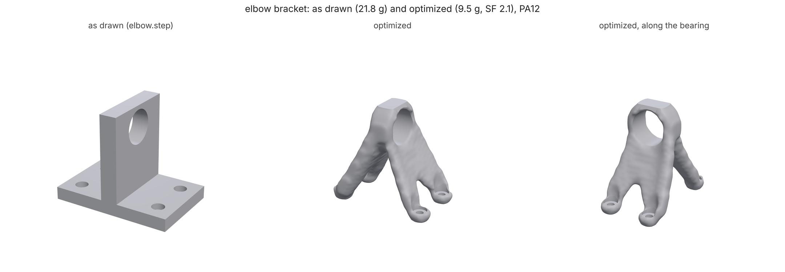
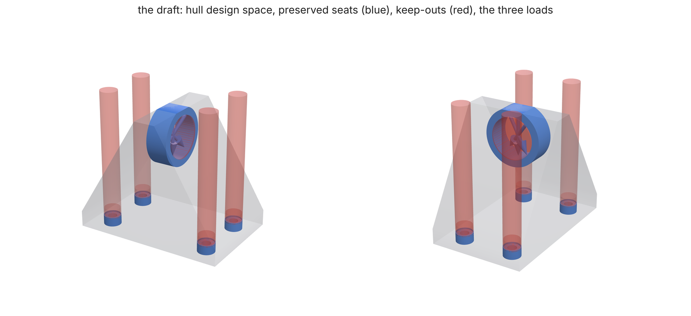
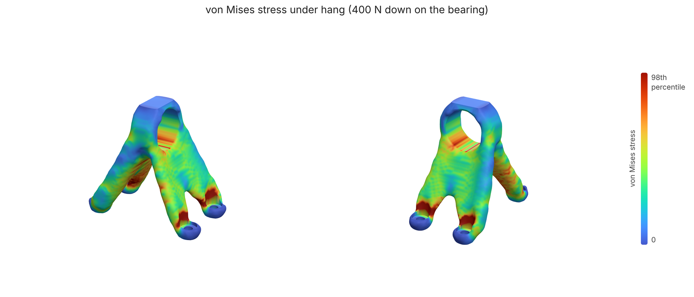

# STEP in, optimized part out

**What you'll make:** a lighter shoulder bracket for a small robot arm,
starting from the CAD part you already have. [`elbow.step`](elbow.step) is
the bracket as drawn: a 56 x 36 x 6 mm base held to the frame by four
counterbored M3 screws, and an 8 mm upright carrying the shoulder shaft's
688 bearing (a 16 mm seat, 36 mm up). It is printed in PA12 on an SLS
printer. `loadpath import` reads the STEP, finds the screws, the bearing
seat and the face the bracket bolts down on, and drafts a study round them;
you put in the real loads, run it, and get the optimized bracket back as
STEP for your CAD. About 32 minutes on 4 cores, 3 with `--quick`.



STEP needs OpenCascade: `pip install "loadpath[step]"`. (An STL works
without it, with fitted rather than exact surfaces.)

## 1. What's in the part

```bash
loadpath import elbow.step --features-only > features.json
```

One line per interface, with the ids the study will use:

| id | kind | what |
|---|---|---|
| `face-0-mount` | bolted face | the underside, with 4 bolt holes (r 1.7 mm, each counterbored to r 3 mm, 3 mm deep) |
| `bore-0` | bore | the bearing seat, r 8 mm x 8 mm, through, axis along x |

From a STEP file the surfaces are exact: OpenCascade says which faces are
planes and cylinders, so the bolt radius comes out as 1.7 mm, not 1.69. A
counterbored hole is one bolt (a 1.7 and a 3.0 mm segment), not two bores.
[docs/IMPORT.md](../../IMPORT.md) has the rules.

## 2. Draft the study

```bash
loadpath import elbow.step --out draft/ --space hull --material pa12 --process sls > import.json
```

`draft/elbow.study.json` and the STLs it uses:

- **design space**, `--space hull`: the part's convex hull, a wedge from the
  base's ends up to the top of the upright. The part as drawn (the default)
  would only let the optimizer take material away; the hull lets it put a
  gusset where the drawing had none;
- **preserved**: a washer-sized seat round each screw, under its head and
  where it clamps (`face-0-mount-keep`), and a 2.8 mm ring round the
  bearing seat (`bore-0-keep`);
- **kept out**: the holes, each screw's head-and-driver path up out of its
  counterbore (`bore-1-driver` ... `bore-4-driver`), the screws' and the
  shaft's lines through the grown space (`face-0-mount-path`, `bore-0-path`:
  the hull is wider than the upright, and without these the optimizer
  would cap the bearing seat's ends), and a slab under the base so nothing
  grows over the face it bolts on (`face-0-mount-clear`);
- **support**: the four screw holes (`face-0-mount-hole`);
- **load**: a placeholder. `import.json` says so in its `todo`: the
  suggestion pushes 100 N on the bearing seat, square to the lever from the
  screws. Only you know what the shaft does.



## 3. Put in the real loads

[`study.json`](study.json) is the draft with two things changed, the
description and the load cases (and its mesh paths point into `draft/`).
The arm hangs off the shoulder shaft, and swings both ways:

```text
"loadCases": [
  {"name": "hang",        "loads": [{"region": "bore-0", "force": [0, 0, -400],      "distribution": "bearing"}]},
  {"name": "swing-left",  "loads": [{"region": "bore-0", "force": [80, 200, -250],   "distribution": "bearing"}]},
  {"name": "swing-right", "loads": [{"region": "bore-0", "force": [-80, -200, -250], "distribution": "bearing"}]}]
```

`bearing` spreads each force over the half of the seat it pushes on, as a
bearing's outer ring does. Check that nothing else moved:

```bash
python compare.py draft/elbow.study.json study.json
```

prints the two changed keys and writes `compare.json`; it exits 1 if the
draft's geometry, support or material differ from `study.json` (a newer
loadpath drafting it differently), so the study you run is the one you
checked. Swing both ways matters: with one swing case, the optimizer
carried everything through the two screws on the side the load leans to
and left the other two seats floating, a part in three pieces.

## 4. Run it, and take it back to CAD

```bash
loadpath run study.json --out out/ --step
```

`out/` gets the usual STL, 3MF, report and viewer per outcome, and with
`--step`, `out/elbow-NN.step` for the best one: the screw holes,
counterbores and bearing seat as exact cylinders and planes (so your CAD
can dimension and mate against them), the optimized body between them
faceted.



## What you should see

Full grid, as the commands above run:

| | |
|---|---|
| features found | 4 bolts (counterbored), 1 bore, 1 bolted face |
| draft | hull design space, 2 preserved interfaces, support on the 4 screws |
| grid | 47 236 cells at 1.04 mm |
| best outcome | volume fraction 0.138, the lightest of three that pass (a fourth, 0.116 at 8.4 g, reads SF 1.87) |
| mass (PA12) | **9.5 g**, from the drawn part's 21.8 g |
| safety factor (worst case) | **2.06** (swing-right; swing-left 2.09, hang 3.84), goal 2 |
| one body / keep-out intrusion | yes / ~0 mm³ |
| STEP (`out/elbow-14.step`) | one valid solid: 11 exact cylinders and 6 planes (16% of the area), the rest 16 772 facets; 42 MB |

Under half the drawn part's mass, at the safety factor asked for, and still
bolting on with the same four screws and carrying the same bearing. The
swing cases set it: the 400 N straight down is the biggest load, but the
sideways 200 N levered 36 mm up the upright is the hardest one.

## Quick mode

`--quick` runs the study on 6000 cells and 30 iterations, in about 3
minutes (a minute of it the STEP export). Its search is
shorter too (three runs), so it stops at a heavier outcome: 12.6 g at SF
5.3 (volume fraction 0.225), with the next lighter one it tries (0.15)
already failing. Use it to check the setup, not the mass. CI runs this
tutorial that way
([test_tutorials.py](../../../tests/test_tutorials.py)) and holds it to
[expect.json](expect.json).

[`make_part.py`](make_part.py) made `elbow.step` (OpenCascade, once). The
images come from [render.py](render.py) after a full run (three.js in
headless Chromium via [docs/render3d.py](../../render3d.py)).
