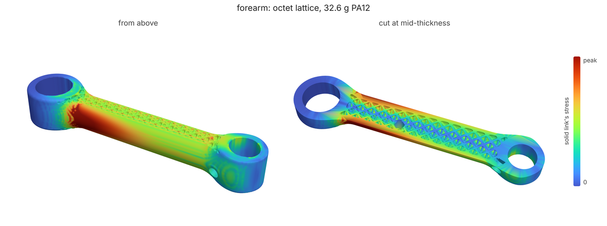
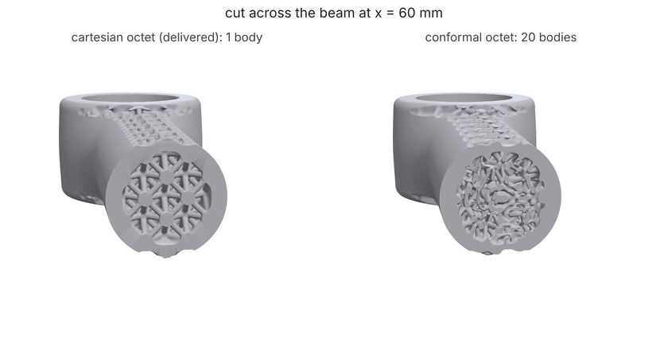

# Strut-lattice forearm: an octet core sized by stress (PA12, SLS)

**What you'll make:** a forearm link in the style of
[GRIP](https://github.com/connorwhite-online/grip)'s, a 22 mm elbow bearing
and a 16 mm wrist bearing 120 mm apart, printed in PA12 on an SLS machine,
filled with an octet strut lattice instead of solid. The solid link's own
stress decides how thick the struts and the rim round the link's edge are,
`loadpath tune` scales both until the lattice part just holds the GRIP goal
of SF 2 (the lattice analyzed homogenized), and `loadpath field` meshes it
and checks it: one body, no thin walls, powder drains. The part is 31%
lighter than the solid link. About 12 minutes on 4 cores, 4 with `--quick`.

The brief was a lattice that follows the part's shape (a conformal
lattice). loadpath has one, and it is shown at the end against the one
delivered, but on this link it does not make a printable part: in a 20 mm
closed section its cells crowd and break up. The delivered core is a plain
(cartesian) octet.



## The loads and the graph

[`forearm.study.json`](forearm.study.json) is the loads: the elbow bearing
held, 1.5 kg at the wrist with a dynamic factor of 2 (30 N down the link's
width), the wrist servo's 1.5 N m reaction twisting the wrist boss, and a
15 N side knock; PA12, goal SF 2.

[`forearm.json`](forearm.json) is the part, a field graph (`loadpath schema
field`; [sls-lattice-drains](../sls-lattice-drains/) walks through one in
more detail):

```text
"envelope": {"op": "intersect", "inputs": ["blob", "slab"], "blend": 2}
"solid":    {"op": "subtract", "inputs": ["envelope", "bores"]}
"stress":   {"op": "result", "study": "forearm.study.json", "part": "solid", "scale": "peak"}
```

Two bosses and a round beam smooth-unioned into a tapered link, trimmed to
22 mm thick; `solid` is the link without a lattice, the mass to beat and the
part `stress` analyzes, as a fraction of its own peak.

```text
"strut":   {"op": "remap", "input": "stress", "from": [0.05, 0.6], "to": [1.0, 2.4], "curve": "sqrt"}
"core":    {"op": "lattice", "type": "octet", "cell": 7, "thickness": "strut", "blend": 0.5}
"rimWall": {"op": "remap", "input": "stress", "from": [0.1, 0.8], "to": [1.0, 2.0], "curve": "smoothstep"}
"rim":     {"op": "intersect", "inputs": [{"op": "shell", "input": "envelope", "thickness": "rimWall"}, <|z| < 8.5>]}
"collars": {"op": "shell", "input": "bores", "side": "outside", "thickness": 5.5}
```

An octet lattice of 7 mm cells whose strut diameter follows the stress:
1 mm where the solid link is calm, up to 2.4 mm where it carries 60% of its
peak, with 0.5 mm fillets at the nodes. Octet is stretch-dominated, the
stiffest strut cell per gram (`docs/fields.md`, "Strut and conformal
lattices"). A skin round the link's edge only, also graded by stress (the
flat faces stay open), and the bosses solid round the bearings.

```text
"tune": {"study": "forearm.study.json", "safetyFactor": 2.0,
         "params": [{"path": "nodes/rimWall/to/1", "min": 1.2, "max": 4.0},
                    {"path": "nodes/strut/to/1", "min": 1.0, "max": 3.0}]}
```

The two numbers `tune` may turn: the rim's and the struts' thickest. Their
thinnest stay at 1 mm, a little over SLS's 0.8 mm minimum.

## 1. The solid link

```bash
loadpath field forearm.json --node solid --out solid/
```

`solid/report.json`: **47.0 g**, and under `analyses.stress` its safety
factor, **9.2**, and 0.79 mm at the wrist. A lot of margin to spend.

## 2. Size the lattice

```bash
loadpath tune forearm.json --out tune/
```

Each candidate is analyzed with the lattice homogenized (a strut is far
finer than an analysis grid: each cell gets the octet's modulus and stress
concentration at the local strut diameter, from lattice.py's unit-cell
fits). `tune/tune.json`'s `best`: rim up to **3.4 mm**, struts at **1 mm**
throughout, 31.0 g, SF 2.04 on the search's grid and **2.32 checked on a
grid twice as fine**, 1.12 mm at the wrist. `tune/tuned.json` is the graph
with those numbers in.

The search moved the material out of the struts and into the rim: the
start (rim to 2 mm, struts to 2.4) read 38.6 g and SF 2.53. In a link
loaded in bending, the material at the edge does the work; the lattice
between the rims carries shear and holds them apart, and 1 mm struts are
enough for that.

## 3. Mesh it and check it

```bash
loadpath field tune/tuned.json --base-dir . --out out/
```

`--base-dir .` because the graph's study path is relative to this folder.
`out/forearm.stl` is the part and `out/report.json`:

- `mass` **32.6 g**, `bodies` 1, `watertight` true;
- `printability.ok` true: the thinnest walls are the 1 mm struts
  (`wallP1Mm` 0.79 on the check's grid, within its tolerance of the
  0.8 mm minimum);
- `drains`: SLS powder needs a 4 mm opening to get out, and the gaps
  between the octet's struts at the open faces are smaller than that, so
  the whole core reads as one 12.8 cm³ sealed void. loadpath drills two
  6 mm drain holes at the calmest sites it finds (27% and 50% of the solid
  link's peak stress) and fills 19 pockets of about 1 mm³ (`sealedAfter` 0,
  `ok` true);
- `lattices.core`: a third of the octet's strut length is horizontal
  (`unsupportedFraction` 0.33), which would bridge on FDM; on SLS the
  powder holds it.

## What you should see

Full grid, as the commands above run:

| | mass | safety factor | wrist deflection | bodies | printability |
|---|---|---|---|---|---|
| solid link (`solid/`) | 47.0 g | 9.2 | 0.79 mm | 1 | |
| tuned lattice, homogenized (`tune/tune.json` `best`) | 31.0 g | **2.32** (fine grid) | 1.12 mm | | |
| **tuned lattice, meshed (`out/`)** | **32.6 g** (31% lighter) | | | **1** | **ok**, 2 drains |

The meshed part weighs 5% more than the homogenized analysis counted (node
fillets and the joins to the rim and collars). It is 31% lighter than the
solid link but deflects 40% more, and a solid link shaped by topology
optimization to SF 2 would be lighter still: as
[docs/fields.md](../../fields.md) says, a lattice costs mass per unit of
stiffness. Strut lattices earn their place where sheets and solids don't:
open cells, energy absorption, parts that are mostly air.

## The conformal lattice

[`forearm-conformal.json`](forearm-conformal.json) is the tuned part with
the core laid along the link's surface (`"frame": {"type": "conformal",
"surface": "inset", "axis": "x"}`, the envelope taken 1 mm in so the outer
nodes sit under the skin). Not run by the tests (6 minutes):

```sh
loadpath field forearm-conformal.json --out conformal/
```

Same mass, 32.6 g, but **20 bodies** (loose fragments of strut) and
`printability.ok` false: a quarter of the surface reads under the 0.8 mm
minimum (`thinAreaFraction` 0.26) and the mesh has overlapping shells. On
this link the conformal frame lays its first layer of nodes along the skin
as it should, but deeper in it cannot fit whole cells: round a closed
section its in-plane cells are a stripe pattern (docs/fields.md,
"Conformal lattice"), and in a section only three cells across the
pattern's defects fill the middle with short, crowded, broken struts
(`lattices.core.irregularSamples` 34 of 300). It also gives up the
cartesian octet's printing advantage on FDM: 70% of its strut length
bridges against 33%. Conformal frames work on parts many cells thick (the
round-a-tube example in fields.md); for a slender link like this one, use
a cartesian cell and let a skin or rim follow the shape.



## Quick mode

The same commands with `--quick` (or `LOADPATH_QUICK=1`) analyze the solid
link on 30k cells without hotspot submodels, tune with 6 analyses instead
of 12 and mesh at 0.4 mm: about 4 minutes in all. The tune stops earlier,
before it has moved all the material into the rim (rim to 2.6 mm, struts to
1.6 mm, 33.6 g, SF 2.11 checked; 35.3 g meshed); the part meshes as one
body and prints. With thicker struts on a coarser grid the drain search
can read the core as open or sealed, so it drills between none and three
holes; either way no powder is left sealed. CI runs this tutorial that way
([test_tutorials.py](../../../tests/test_tutorials.py)) and holds it to
[expect.json](expect.json).

The images come from [render.py](render.py) after a full run (three.js in
headless Chromium via [docs/render3d.py](../../render3d.py)).
